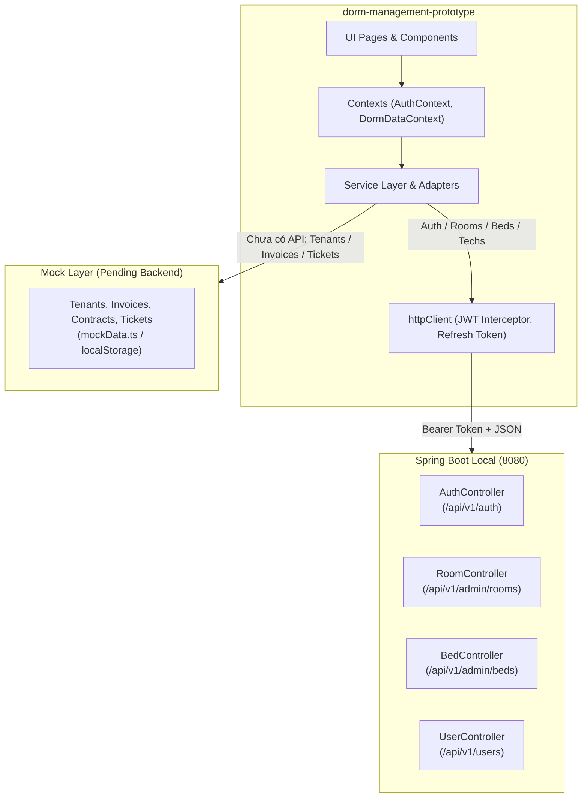

# KẾ HOẠCH TÍCH HỢP REST API BACKEND VÀO FRONTEND PROTOTYPE
**Dự án:** KTX Hub Frontend Prototype (`dorm-management-prototype`)  
**Backend:** Spring Boot 3.x (`dormitory-management`) — `http://localhost:8080/api/v1`  
**Tài liệu tham chiếu:** OpenAPI 3.1.0 (`http://localhost:8080/docs`), `AGENTS.md`, `ARCHITECTURE.md`

---

## 1. Tổng quan & Chiến lược Tích hợp (Integration Strategy)

### 1.1. Hiện trạng khảo sát Backend (Thực tế tại thời điểm khảo sát)
Qua đối soát trực tiếp từ endpoint `http://localhost:8080/v3/api-docs` và mã nguồn controller tại `/home/chinh/Projects/dormitory-management/src/main/java/com/uit/dormmanagement/controllers`:
- **Đã hoàn thiện & sẵn sàng kết nối (4 Controllers, 16 Endpoints):**
  1. `AuthController` (8 endpoints): Đăng nhập, đăng xuất đơn/toàn bộ, refresh token, đổi mật khẩu, quên mật khẩu (OTP).
  2. `RoomController` (6 endpoints): Ma trận phòng & giường trực quan, danh sách phân trang có filter, tạo phòng kèm sinh giường tự động, chi tiết phòng, cập nhật phòng, xóa mềm phòng trống.
  3. `BedController` (1 endpoint): Cập nhật trạng thái bảo trì/sẵn sàng của giường theo khóa logic OCCUPIED.
  4. `UserController` (6 endpoints): Lấy hồ sơ tài khoản hiện tại (`/users/me`), CRUD & khóa/mở khóa kỹ thuật viên.
- **Chưa có REST Controller ở Backend (Đang ở tầng Repository/Entity):**
  - Khách thuê (`Tenant`), Hợp đồng (`Contract`), Hóa đơn (`Invoice`), Sự cố kỹ thuật (`MaintenanceTicket`), Phương tiện xe (`Vehicle`).

### 1.2. Chiến lược Tích hợp Lai (Hybrid Dual-Mode Strategy)
Để đảm bảo trải nghiệm người dùng không bị gián đoạn và tuân thủ nguyên tắc độc lập của Prototype:
- **Nhóm tính năng có Backend:** Chuyển thẳng sang gọi REST API thật qua `apiDormService` & `authService`.
- **Nhóm tính năng chưa có Backend:** Tự động fallback dữ liệu từ Mock Data hoặc lưu cục bộ (`localStorage`), không gây crash ứng dụng.
- **Bảo toàn 100% giao diện (Zero Visual Regression):** Giữ nguyên toàn bộ layout, CSS tokens, màu sắc và component UI.



---

## 2. Ma trận Ánh xạ Endpoint ⟷ Màn hình Giao diện (Mapping Matrix)

### 2.1. Phân hệ Xác thực & Tài khoản (Authentication & Profile)

| STT | Phương thức & Endpoint | Chức năng Backend | Màn hình / Component Prototype | Dữ liệu truyền / nhận |
|:---:|:---|:---|:---|:---|
| 1 | `POST /api/v1/auth/login` | Đăng nhập tài khoản | `src/pages/auth/LoginPage.tsx` | **Req:** `{ identifier, password }`<br>**Res:** `{ accessToken, refreshToken, user: { id, email, role, status } }` |
| 2 | `POST /api/v1/auth/logout` | Đăng xuất phiên hiện tại | `AdminHeader`, `TenantPortalPage`, `TechnicianPage` | **Header:** `Authorization: Bearer <token>` |
| 3 | `POST /api/v1/auth/refresh-token` | Làm mới Access Token khi hết hạn | `src/services/httpClient.ts` (Interceptor) | **Req:** `{ refreshToken }`<br>**Res:** `{ accessToken, refreshToken, expiresIn }` |
| 4 | `GET /api/v1/users/me` | Lấy thông tin user hiện tại & profile | `AuthContext.tsx`, `AdminHeader` | **Res:** `{ id, username, email, phone, role, staffProfile, tenantProfile }` |
| 5 | `POST /api/v1/auth/change-password` | Đổi mật khẩu | `SettingsTab.tsx` (Kỹ thuật viên) | **Req:** `{ oldPassword, newPassword, confirmPassword }` |
| 6 | `POST /api/v1/auth/forgot-password` | Gửi OTP reset mật khẩu qua email | `LoginPage.tsx` (Forgot Password Modal) | **Req:** `{ email }` |
| 7 | `POST /api/v1/auth/verify-forgot-password-otp` | Xác thực OTP đặt lại mật khẩu | `LoginPage.tsx` (Step 2 OTP) | **Req:** `{ email, otp }`<br>**Res:** `{ resetToken }` |
| 8 | `POST /api/v1/auth/reset-password` | Đặt mật khẩu mới với resetToken | `LoginPage.tsx` (Step 3 New Password) | **Req:** `{ email, resetToken, newPassword, confirmPassword }` |

### 2.2. Phân hệ Sơ đồ Ma trận & Quản lý Phòng (Rooms & Beds)

| STT | Phương thức & Endpoint | Chức năng Backend | Màn hình / Component Prototype | Ghi chú tích hợp |
|:---:|:---|:---|:---|:---|
| 9 | `GET /api/v1/admin/rooms/matrix` | Lấy sơ đồ ma trận phòng, giường & người ở | `src/pages/admin/rooms/RoomMatrixView.tsx` | Nhận danh sách phòng đầy đủ thông tin giường con (`beds: BedSlotResponse[]`) và người ở (`occupant`). Cung cấp dữ liệu trực tiếp cho chế độ xem Ma trận tầng. |
| 10 | `GET /api/v1/admin/rooms` | Lấy danh sách phòng phân trang & lọc | `src/pages/admin/rooms/RoomTableView.tsx` | Nhận `PageResponse<RoomSummaryResponse>` với các query params: `floor`, `genderPolicy`, `search`, `page`, `size`. Dùng cho chế độ xem Bảng. |
| 11 | `POST /api/v1/admin/rooms` | Tạo phòng mới + tự động sinh giường | `src/pages/admin/rooms/AddEditRoomModal.tsx` | **Req:** `{ roomNumber, floor, roomType, genderPolicy, basePrice, amenities }`. Backend tự động sinh 4/6/8 giường theo quy tắc BR-01. |
| 12 | `GET /api/v1/admin/rooms/{id}` | Lấy chi tiết phòng, tiện ích & giường | `src/pages/admin/rooms/RoomDetailDrawer.tsx` | Trả về `RoomDetailResponse` chi tiết khi click vào một phòng. |
| 13 | `PUT /api/v1/admin/rooms/{id}` | Cập nhật chính sách giới tính, giá, tiện ích | `src/pages/admin/rooms/AddEditRoomModal.tsx` (Chế độ Edit) | **Req:** `{ genderPolicy, basePrice, amenities }`. Lưu ý: Không đổi số giường để bảo toàn tính toàn vẹn. |
| 14 | `DELETE /api/v1/admin/rooms/{id}` | Xóa mềm phòng (chỉ khi phòng trống) | `src/pages/admin/rooms/DeleteRoomModal.tsx` | Backend kiểm tra BR-04: chặn xóa nếu có hợp đồng còn hiệu lực. |
| 15 | `PATCH /api/v1/admin/beds/{id}/status` | Chuyển trạng thái giường (AVAILABLE ⟷ MAINTENANCE) | `RoomDetailDrawer.tsx`, `RoomCard.tsx` | **Req:** `{ status: "AVAILABLE" \| "MAINTENANCE" }`. Backend khóa không cho bảo trì nếu giường có `OCCUPIED`. |

### 2.3. Phân hệ Quản lý Kỹ thuật viên (Technician Accounts)

| STT | Phương thức & Endpoint | Chức năng Backend | Màn hình / Component Prototype | Ghi chú tích hợp |
|:---:|:---|:---|:---|:---|
| 16 | `GET /api/v1/users/technicians` | Danh sách tài khoản kỹ thuật viên | `src/pages/admin/technicians/TechnicianAccountsPage.tsx` | Thay thế `useState` nội bộ bằng dữ liệu từ API (`PageResponse<TechnicianResponse>`). |
| 17 | `POST /api/v1/users/technicians` | Tạo tài khoản kỹ thuật viên mới | `TechnicianAccountsPage.tsx` (Form tạo) | **Req:** `{ fullName, email, phone, password }`. |
| 18 | `GET /api/v1/users/technicians/{id}` | Xem chi tiết thông tin kỹ thuật viên | `TechnicianAccountsPage.tsx` (Drawer chi tiết) | Hiển thị hồ sơ, trạng thái hoạt động và lịch sử công tác. |
| 19 | `PUT /api/v1/users/technicians/{id}` | Cập nhật thông tin kỹ thuật viên | `TechnicianAccountsPage.tsx` (Edit Drawer) | **Req:** `{ fullName, email, phone }`. |
| 20 | `PATCH /api/v1/users/technicians/{id}/status` | Khóa / Mở khóa tài khoản | `TechnicianAccountsPage.tsx` (Nút Khóa/Mở) | **Req:** `{ active: boolean }`. Khi khóa, backend hủy toàn bộ phiên làm việc của user đó. |

---

## 3. Lớp Chuyển đổi Kiểu dữ liệu (Data Adapter & DTO Mappers)

Backend và Frontend Prototype có một số khác biệt về quy ước đặt tên và enum hiển thị. Cần xây dựng các hàm adapter hai chiều (`src/services/api/adapters/`):

### 3.1. Bảng quy đổi Enum & Chuẩn hoá giá trị

| Khái niệm | Backend OpenAPI | Frontend Prototype | Hàm chuyển đổi |
|:---|:---|:---|:---|
| **Loại phòng** | `FOUR_BEDS`<br>`SIX_BEDS`<br>`EIGHT_BEDS` | `"4 giường"`<br>`"6 giường"`<br>`"8 giường"` | `toFrontendRoomType(type: string): RoomType`<br>`toBackendRoomType(type: RoomType): string` |
| **Chính sách giới tính** | `MALE`<br>`FEMALE` | `"Nam"`<br>`"Nữ"` | `toFrontendGender(policy: string): RoomGender`<br>`toBackendGenderPolicy(gender: RoomGender): string` |
| **Trạng thái giường** | `AVAILABLE`<br>`OCCUPIED`<br>`MAINTENANCE` | `AVAILABLE`<br>`OCCUPIED`<br>`MAINTENANCE` | Trùng khớp 1-1 |
| **Vai trò người dùng** | `MANAGER`<br>`TECHNICIAN`<br>`TENANT` | `"manager"`<br>`"technician"`<br>`"student"` | `toFrontendRole(role: string): Role`<br>`toBackendRole(role: Role): string` |
| **Mã phòng** | `roomNumber` (vd: `P.101`) | `code` (vd: `P.101`) | Gán `code = res.roomNumber` |

### 3.2. Cấu trúc Response của Spring Boot
Backend sử dụng cấu trúc đóng gói chuẩn:
```typescript
export interface SingleResponse<T> {
  httpStatus: string;
  message: string;
  data: T;
}

export interface PageResponse<T> {
  items: T[];
  page: number;
  size: number;
  totalElements: number;
  totalPages: number;
  last: boolean;
}

export interface DetailedErrorResponse {
  httpStatus: string;
  errorCode: string;
  message: string;
  timestamp: string;
  errors?: Record<string, string>;
}
```

---

## 4. Kế hoạch Triển khai Chi tiết theo từng Giai đoạn (Roadmap)

### 📌 Giai đoạn 1: Nâng cấp Hạ tầng HTTP Client & Quản lý Xác thực (Auth Core)
- **Mục tiêu:** Đăng nhập thật vào backend, lưu JWT, tự động đính kèm token và xử lý refresh token.
- **Các bước thực hiện:**
  1. Cập nhật `src/services/httpClient.ts`:
     - Tự động gắn header `Authorization: Bearer <accessToken>` từ token lưu trong `localStorage`.
     - Thêm xử lý mã lỗi `401 Unauthorized`: gọi endpoint `/api/v1/auth/refresh-token`. Nếu refresh thành công, retry lại request ban đầu; nếu thất bại, logout và chuyển về trang Login.
     - Trích xuất thông điệp lỗi từ `DetailedErrorResponse` để hiển thị Toast thân thiện.
  2. Tạo `src/services/authService.ts`:
     - Hiện thực `login()`, `logout()`, `getMe()`, `changePassword()`, `forgotPassword()`, `resetPassword()`.
  3. Cập nhật `src/contexts/AuthContext.tsx`:
     - Lưu trữ trạng thái `user: UserProfileResponse | null`, `token`, phân quyền tự động.
     - Giữ nguyên các tài khoản demo (quick buttons) nhưng cho phép đăng nhập thật với tài khoản quản trị viên/kỹ thuật viên/sinh viên từ database.
  4. Cập nhật `src/pages/auth/LoginPage.tsx`:
     - Kết nối form đăng nhập vào `authService.login()`.
     - Kết nối modal Quên mật khẩu với quy trình 3 bước (Gửi email -> Nhập OTP -> Đổi mật khẩu).

### 📌 Giai đoạn 2: Tích hợp Quản lý Phòng & Giường (Rooms & Beds)
- **Mục tiêu:** Toàn bộ thao tác trên trang Phòng (`/admin/rooms`) giao tiếp trực tiếp với Backend REST API.
- **Các bước thực hiện:**
  1. Cập nhật `src/types/api/endpoints.ts`:
     - Định nghĩa đầy đủ các interface DTO theo OpenAPI: `RoomDetailResponse`, `RoomSummaryResponse`, `BedSlotResponse`, `CreateRoomRequest`, `UpdateRoomRequest`, `UpdateBedStatusRequest`.
  2. Xây dựng adapter `src/services/api/adapters/roomAdapter.ts`:
     - Ánh xạ `RoomDetailResponse` sang `RoomRecord` để các component giao diện hiện tại không phải sửa đổi cấu trúc dữ liệu.
  3. Hoàn thiện `src/services/api/apiDormService.ts`:
     - `getRooms()`: Gọi `GET /api/v1/admin/rooms/matrix` để lấy đầy đủ cấu trúc tầng, phòng, giường và người thuê hiện tại.
     - `createRoom(request)`: Gọi `POST /api/v1/admin/rooms`.
     - `updateRoom(id, request)`: Gọi `PUT /api/v1/admin/rooms/{id}`.
     - `deleteRoom(id)`: Gọi `DELETE /api/v1/admin/rooms/{id}`.
     - `updateBedStatus(bedId, status)`: Gọi `PATCH /api/v1/admin/beds/{id}/status`.
  4. Cập nhật `src/contexts/DormDataContext.tsx`:
     - Bổ sung hàm thao tác trực tiếp theo ID thay vì chỉ `onRoomsChange(allRooms)` toàn cục, nâng cao hiệu năng và độ mượt mà của ứng dụng.

### 📌 Giai đoạn 3: Tích hợp Quản lý Tài khoản Kỹ thuật viên (Technicians)
- **Mục tiêu:** Trang Kỹ thuật viên quản lý dữ liệu nhân sự thật từ database PostgreSQL.
- **Các bước thực hiện:**
  1. Tạo `src/services/technicianService.ts` (hoặc mở rộng vào `apiDormService.ts`):
     - `getTechnicians(params)`: Gọi `GET /api/v1/users/technicians`.
     - `createTechnician(payload)`: Gọi `POST /api/v1/users/technicians`.
     - `updateTechnician(id, payload)`: Gọi `PUT /api/v1/users/technicians/{id}`.
     - `toggleTechnicianStatus(id, active)`: Gọi `PATCH /api/v1/users/technicians/{id}/status`.
  2. Chuyển đổi `src/pages/admin/technicians/TechnicianAccountsPage.tsx`:
     - Thay thế mảng mẫu `staff` nội bộ bằng dữ liệu tải từ API.
     - Xử lý trạng thái loading, phân trang, tìm kiếm và hiển thị toast thông báo kết quả.

### 📌 Giai đoạn 4: Kiểm thử Tự động, Đối soát & Nghiệm thu (Verification & QA)
- **Mục tiêu:** 100% test suites pass, TypeScript build không lỗi, hoạt động mượt mà ở cả 2 chế độ `VITE_USE_MOCK=true` và `VITE_USE_MOCK=false`.
- **Các bước thực hiện:**
  1. Cập nhật test suites trong `src/test/`:
     - `services.test.ts`: Kiểm tra các mapper và hàm gọi API của `apiDormService`.
     - `contexts.test.ts`: Kiểm tra việc xử lý dữ liệu bất biến và fallback.
  2. Chạy kiểm tra bắt buộc:
     ```bash
     npm test          # Kiểm tra toàn bộ test suites (Pass 100%)
     npm run build     # Đảm bảo compile TypeScript & bundle Vite thành công
     ```
  3. Smoke test trực tiếp trên trình duyệt qua Chrome DevTools:
     - Đăng nhập tài khoản Quản lý (`manager@ktxhub.vn` hoặc tài khoản có sẵn trong DB).
     - Xem ma trận phòng -> Tạo phòng mới `P.305` -> Kiểm tra giường tự sinh.
     - Chuyển trạng thái một giường sang bảo trì -> Kiểm tra DB cập nhật.
     - Thêm một tài khoản kỹ thuật viên mới -> Khóa và mở khóa tài khoản.

---

## 5. Danh sách các File cần Tạo mới & Chỉnh sửa

| Thư mục / File | Hành động | Mô tả công việc |
|:---|:---:|:---|
| `src/types/api/endpoints.ts` | **Chỉnh sửa** | Thêm đầy đủ DTO Request/Response của Auth, Room, Bed, Technician theo OpenAPI spec. |
| `src/services/httpClient.ts` | **Chỉnh sửa** | Thêm Bearer Token Interceptor, tự động Refresh Token và chuẩn hóa ApiError. |
| `src/services/api/adapters/roomAdapter.ts` | **Tạo mới** | Adapter chuyển đổi hai chiều giữa Backend DTO và Frontend types. |
| `src/services/api/adapters/authAdapter.ts` | **Tạo mới** | Adapter ánh xạ User Profile và Role giữa Spring Security và React Auth. |
| `src/services/api/apiDormService.ts` | **Chỉnh sửa** | Hiện thực hóa các API gọi Backend thật: `/rooms/matrix`, CRUD room, update bed status. |
| `src/services/authService.ts` | **Tạo mới** | Tầng dịch vụ chuyên biệt xử lý API Auth và User Profile. |
| `src/services/technicianService.ts` | **Tạo mới** | Tầng dịch vụ quản lý tài khoản kỹ thuật viên. |
| `src/contexts/AuthContext.tsx` | **Chỉnh sửa** | Hỗ trợ lưu trữ JWT Token và User Profile thật từ `/users/me`. |
| `src/pages/auth/LoginPage.tsx` | **Chỉnh sửa** | Cắm API đăng nhập thật và quy trình OTP Quên mật khẩu. |
| `src/pages/admin/technicians/TechnicianAccountsPage.tsx` | **Chỉnh sửa** | Kết nối API lấy danh sách, tạo mới, sửa và khóa kỹ thuật viên. |
| `src/test/services.test.ts` | **Chỉnh sửa** | Bổ sung test kiểm thử mapper và adapter API mới. |
