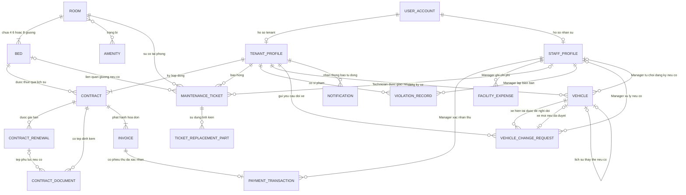

# MÔ HÌNH THỰC THỂ – QUAN HỆ MỨC KHÁI NIỆM (CONCEPTUAL ERD)

## DỰ ÁN: KTX HUB — PRIVATE DORMITORY MANAGEMENT SYSTEM (PDMS)

| Thông tin | Nội dung |
|---|---|
| Tài liệu | Conceptual Entity–Relationship Diagram & Business Invariants |
| Phiên bản | **3.5 — FINAL (đồng bộ SRS v3.4.1)** |
| Ngày cập nhật | 13/11/2026 |
| Trạng thái | **FINAL về thiết kế khái niệm**; chưa khẳng định cấu trúc DB/Backend đã triển khai |
| Tài liệu nguồn | `docs/SRS.md` — v3.4.1 FINAL (BR-03, BR-10; FR-08, FR-14, FR-20, FR-27) |
| Bản tham chiếu trước đó | `KTX_Hub_Conceptual_ERD_v3.4_Final.md` — giữ các quyết định nghiệp vụ đã chốt |

> **Thẩm quyền tài liệu:** `docs/SRS.md` v3.4.1 FINAL là nguồn nghiệp vụ ưu tiên. Số lượng thực thể/quan hệ trong tài liệu này **không phải** bằng chứng PostgreSQL/Backend đã được nâng cấp. Bản này thay thế mô hình khái niệm dựa trên SRS v3.2. Điều chỉnh v3.4.1 về **5 tab Tenant** và **chuông thông báo độc lập** là yêu cầu trình bày và truy cập, **không tạo thực thể database mới**.

> **Phạm vi:** Tài liệu mô tả **thực thể nghiệp vụ, mối quan hệ, bội số và quy tắc bất biến**. Chưa quyết định tên cột SQL, kiểu dữ liệu, chỉ mục, chính sách `ON DELETE`, API hoặc transaction ở mức triển khai. Các quyết định chi tiết đó thuộc bước **Logical ERD và Backend**. FR-11 (chuyển phòng) thuộc Phase 2.

## 1. BỐI CẢNH VÀ RANH GIỚI MÔ HÌNH

1. **Một cơ sở duy nhất.** KTX Hub quản lý một tòa nhà có nhiều tầng. `floor` là đặc tính của `ROOM`; không tạo `BUILDING` hay `FLOOR` thành thực thể riêng trong Phase 1.
2. **Cho thuê theo vị trí ngủ.** `ROOM` chứa đúng 4, 6 hoặc 8 `BED`; Bed bao hàm cả cách bố trí vật lý như sleepbox/pod. Tất cả Bed của một Room dùng chung giá tiêu chuẩn phòng. Không có đặt/giữ chỗ (`RESERVED`).
3. **Phân quyền cố định.** Tài khoản thuộc một trong ba vai trò `MANAGER`, `TENANT`, `TECHNICIAN`. Tenant đăng nhập bằng CCCD; Manager/Technician đăng nhập bằng email. **Email liên kết mỗi User là duy nhất toàn hệ thống** (không phân biệt hoa/thường) và dùng nhận OTP khôi phục; email Tenant không dùng đăng nhập. UUID là định danh nội bộ, không dùng CCCD/email làm khóa chính.
4. **Onboarding không tách rời hồ sơ.** Khách mới chỉ phát sinh `TENANT_PROFILE`, tài khoản, hợp đồng chiếm chỗ và hóa đơn tháng đầu khi Manager onboarding ngày **01**; không tạo hồ sơ khách trước hay cho bắt đầu thuê giữa tháng. Khách đã thuê rồi quay lại dùng hồ sơ/tài khoản cũ, sau khi tất toán công nợ.
5. **Hợp đồng và phụ lục.** Một `CONTRACT` gốc gắn một Tenant và Bed, có nhiều lần gia hạn bằng `CONTRACT_RENEWAL`. Mỗi kỳ giá thuê được giữ theo hợp đồng/phụ lục tương ứng, không tự đổi theo giá phòng mới.
6. **Thu tiền thủ công.** `INVOICE` thể hiện khoản phải thu theo tháng. `PAYMENT_TRANSACTION` là **bản ghi KTX đã thu đủ tiền, được Manager xác nhận**, cho cả **tiền mặt** lẫn **chuyển khoản VietQR**; **không phải** giao dịch ngân hàng và không đòi hỏi tích hợp ngân hàng.
7. **Bảo toàn lịch sử.** Checkout không xóa Tenant/User, Contract, Invoice, Payment, lịch sử vi phạm hay sự cố. Room có lịch sử thì lưu trữ (Archive), không xóa vật lý.
8. **Thông báo hệ thống.** Chỉ có thông báo tự động phát sinh từ nghiệp vụ hiện có (bao gồm từ chối đăng ký xe và duyệt/từ chối đổi xe); không có tính năng Manager soạn/gửi thông báo chung.
9. **Vòng đời phương tiện và yêu cầu đổi xe.** Phân biệt `VEHICLE` và `VEHICLE_CHANGE_REQUEST`; xe cũ giữ quyền sử dụng thẻ khi chờ duyệt, khi chấp thuận tạo hồ sơ xe mới mang **cùng** mã thẻ vật lý.
10. **Tài chính giới hạn.** Manager chỉ nhập **tổng lương một khoản/tháng**; lợi nhuận ròng **ước tính** là số liệu vận hành từ doanh thu/chi phí đã ghi nhận, không phải kế toán thuế hay payroll.
11. **Biểu đồ Prototype.** Dữ liệu minh họa Dashboard tách biệt dữ liệu nghiệp vụ, không có thực thể analytics chỉ nhằm phục vụ demo.

---

## 2. DANH MỤC 18 THỰC THỂ NGHIỆP VỤ

| STT | Thực thể | Mục đích nghiệp vụ | Ghi chú |
|:---:|---|---|---|
| **I** | **Không gian lưu trú** | | |
| 1 | `ROOM` | Phòng, mã phòng, tầng, sức chứa, chính sách giới tính, giá tiêu chuẩn và trạng thái khai thác/lưu trữ | Tầng và sức chứa không được sửa sau tạo |
| 2 | `BED` | Vị trí ngủ thuộc một phòng, mã vị trí và tình trạng `AVAILABLE` / `OCCUPIED` / `MAINTENANCE` | Không có trạng thái giữ chỗ |
| 3 | `AMENITY` | Danh mục tiện nghi được trang bị cho phòng | Quan hệ với Room có số lượng theo từng loại |
| **II** | **Người dùng và nhân sự** | | |
| 4 | `USER_ACCOUNT` | Tài khoản xác thực, email liên kết duy nhất, mật khẩu băm, vai trò và trạng thái hoạt động | Tenant đăng nhập CCCD; nhân sự đăng nhập email; JWT/Redis xử lý xác thực tạm thời |
| 5 | `TENANT_PROFILE` | Hồ sơ khách thuê, CCCD, liên hệ, cư trú và định danh lịch sử | Tạo cùng onboarding; email duy nhất qua User; giữ sau checkout |
| 6 | `STAFF_PROFILE` | Hồ sơ Manager và Technician | Quyền theo role tài khoản |
| **III** | **Hợp đồng, hóa đơn và tài chính** | | |
| 7 | `CONTRACT` | Hợp đồng giấy gốc cho một Tenant thuê một Bed; giá/thời hạn tại thời điểm ký | Một hợp đồng có thể có nhiều phụ lục |
| 8 | `CONTRACT_RENEWAL` | **MỚI** — Một lần gia hạn: thời hạn mới, giá thuê cố định, ngày ký/ngày áp dụng | Không tạo Contract mới cho mỗi lần gia hạn |
| 9 | `CONTRACT_DOCUMENT` | Tệp scan hợp đồng gốc, phụ lục, biên bản bàn giao | Có thể upload sau; không quản lý phiên bản file |
| 10 | `INVOICE` | Hóa đơn tiền thuê trọn tháng; kỳ, số tiền và trạng thái `Nợ` / `Chờ xác nhận` / `Đã thu` | Hóa đơn tháng đầu có ngay khi onboarding |
| 11 | `PAYMENT_TRANSACTION` | Phiếu ghi nhận **đã thu đủ** tiền thuê bằng tiền mặt hoặc chuyển khoản VietQR | Mỗi Invoice tối đa một phiếu thu hoàn tất Phase 1 |
| 12 | `FACILITY_EXPENSE` | Chi phí điện, nước, Internet, **Lương nhân viên** và vận hành khác đã ghi nhận | Tối đa một khoản **tổng lương/tháng** do Manager nhập, có thể sửa bản ghi; dùng tính **Lợi nhuận ròng (ước tính)**, không gồm tiền cọc |
| **IV** | **Vận hành và thông báo** | | |
| 13 | `MAINTENANCE_TICKET` | Phiếu sự cố tại Room, có thể liên quan một Bed; mức ưu tiên, người báo, người xử lý | Ban đầu chưa có Technician |
| 14 | `TICKET_REPLACEMENT_PART` | Dòng vật tư/linh kiện sử dụng khi sửa chữa: tên, số lượng, đơn giá | Không dùng linh kiện thì chi phí 0 |
| 15 | `VIOLATION_RECORD` | Biên bản vi phạm của Tenant, do Manager lập | Tiền phạt chỉ lưu trên biên bản, không thu qua hệ thống |
| 16 | `VEHICLE` | Xe được Tenant đăng ký, mã thẻ vật lý và lịch sử vòng đời | `PENDING_CARD`, `ISSUED`, `REJECTED`, `REVOKED`, `REPLACED`, `CANCELLED`; chỉ `ISSUED` nắm quyền dùng mã thẻ vật lý |
| 17 | `NOTIFICATION` | Thông báo tự động cho Tenant từ sự kiện nghiệp vụ | Bao gồm thông báo từ chối đăng ký và duyệt/từ chối đổi xe; không có soạn gửi thủ công |
| 18 | `VEHICLE_CHANGE_REQUEST` | **MỚI theo SRS v3.4** — Đề nghị đổi xe do Tenant gửi, dữ liệu xe mới, kết quả và người xử lý | `PENDING`, `APPROVED`, `REJECTED`, `CANCELLED`; không phải một xe thứ hai có hiệu lực |

**Số lượng:** 17 thực thể của bản Conceptual v3.4 được giữ, thêm **1 thực thể `VEHICLE_CHANGE_REQUEST`** → **18 thực thể nghiệp vụ**. Không tạo `PARKING_CARD`, `PAYROLL`, `DASHBOARD_CHART_DATA` hoặc bảng Notification riêng cho tab Vi phạm. `ROOM_CODE_REGISTRY` là bảng hỗ trợ mức Logical, không phải thực thể nghiệp vụ.

---

## 3. SƠ ĐỒ CONCEPTUAL ERD (MERMAID)

> **Cách đọc:** `||` = đúng một, `o|` = không hoặc một, `o{` = không hoặc nhiều, `|{` = một hoặc nhiều. Sơ đồ diễn đạt bội số của **toàn bộ lịch sử dữ liệu**; các giới hạn như “tối đa một hợp đồng đang chiếm chỗ” hoặc “tối đa một xe `PENDING_CARD` hoặc `ISSUED`” được bổ sung ở Business Invariants.

**Lưu ý về hai nhánh hồ sơ:** Một `USER_ACCOUNT` có đúng **một** hồ sơ tương ứng với vai trò: `TENANT` có `TENANT_PROFILE`, còn `MANAGER`/`TECHNICIAN` có `STAFF_PROFILE`; không được đồng thời thuộc cả hai nhánh. Biểu diễn `USER_ACCOUNT` đến từng nhánh là `0..1` vì tính loại trừ; tính bắt buộc của **một trong hai nhánh** được nêu trong Business Invariants.

---

## 4. CARDINALITY MATRIX — 28 MỐI QUAN HỆ

Bảng diễn đạt bội số từ cả hai phía bằng câu nghiệp vụ, nhằm tránh nhầm dấu chân quạ trên Mermaid.

| STT | Quan hệ | Đối với thực thể bên trái | Đối với thực thể bên phải | Quy tắc/giới hạn bổ sung |
|:---:|---|---|---|---|
| 01 | `ROOM` — `BED` | Một Room có **đúng 4/6/8 Bed** | Một Bed thuộc **đúng một Room** | Tạo Room và đầy đủ Bed nhất quán |
| 02 | `ROOM` — `AMENITY` | Một Room có **0..N** loại tiện nghi | Một Amenity xuất hiện ở **0..N** Room | Số lượng xác định trên từng quan hệ Room–Amenity |
| 03 | `USER_ACCOUNT` — `TENANT_PROFILE` | Một User có **0..1** Tenant Profile | Một Tenant Profile có **1** User | Chỉ khi role `TENANT` |
| 04 | `USER_ACCOUNT` — `STAFF_PROFILE` | Một User có **0..1** Staff Profile | Một Staff Profile có **1** User | Chỉ khi role `MANAGER`/`TECHNICIAN`; độc quyền với quan hệ 03 |
| 05 | `TENANT_PROFILE` — `CONTRACT` | Một Tenant có **1..N** Contract trong lịch sử | Một Contract thuộc **1** Tenant | Tối đa một hợp đồng chiếm chỗ hiện hành/Tenant |
| 06 | `BED` — `CONTRACT` | Một Bed có **0..N** Contract trong lịch sử | Một Contract gắn với **1** Bed | Tối đa một hợp đồng chiếm chỗ hiện hành/Bed |
| 07 | `CONTRACT` — `CONTRACT_RENEWAL` | Một Contract có **0..N** lần gia hạn | Một Renewal thuộc **1** Contract | Không phát sinh Contract mới khi gia hạn |
| 08 | `CONTRACT` — `CONTRACT_DOCUMENT` | Một Contract có **0..N** tệp | Một Document thuộc **1** Contract | Upload sau onboarding được phép |
| 09 | `CONTRACT_RENEWAL` — `CONTRACT_DOCUMENT` | Một Renewal có **0..N** tệp liên quan | Một Document có **0..1** Renewal liên quan | Tệp gắn Renewal vẫn phải thuộc đúng Contract gốc |
| 10 | `CONTRACT` — `INVOICE` | Một Contract đã onboarding thành công có **1..N** Invoice | Một Invoice thuộc **1** Contract | Một hóa đơn tiền thuê/Contract/kỳ; kỳ đầu tạo ngay |
| 11 | `INVOICE` — `PAYMENT_TRANSACTION` | Một Invoice có **0..1** bản ghi thu tiền hoàn tất | Một Payment Transaction thuộc **1** Invoice | Chỉ sinh khi Manager xác nhận nhận đủ tiền |
| 12 | `STAFF_PROFILE` — `PAYMENT_TRANSACTION` | Một Staff có **0..N** lần xác nhận thu | Một Payment Transaction được xác nhận bởi **1** Manager | Áp dụng cho **cả CASH và VietQR**, không chỉ tiền mặt |
| 13 | `STAFF_PROFILE` — `FACILITY_EXPENSE` | Một Staff có **0..N** khoản chi ghi nhận | Một Facility Expense do **1** Manager ghi nhận | Dữ liệu chi phí cơ sở, không phải thuế/kế toán đầy đủ |
| 14 | `TENANT_PROFILE` — `MAINTENANCE_TICKET` | Một Tenant có **0..N** phiếu đã gửi | Một Ticket do **1** Tenant báo | Chỉ Tenant đang cư trú tạo mới |
| 15 | `ROOM` — `MAINTENANCE_TICKET` | Một Room có **0..N** phiếu sự cố | Một Ticket xảy ra tại **1** Room | Ticket luôn xác định phòng |
| 16 | `BED` — `MAINTENANCE_TICKET` | Một Bed có **0..N** Ticket liên quan | Một Ticket gắn **0..1** Bed | Có thể là sự cố chung của phòng |
| 17 | `STAFF_PROFILE` — `MAINTENANCE_TICKET` | Một Technician có **0..N** Ticket được giao | Một Ticket có **0..1** Technician hiện tại | Ban đầu `Chưa phân công`; có thể đổi người khi chưa hoàn thành |
| 18 | `MAINTENANCE_TICKET` — `TICKET_REPLACEMENT_PART` | Một Ticket dùng **0..N** dòng vật tư | Một dòng vật tư thuộc **1** Ticket | Không có vật tư thì chi phí 0 |
| 19 | `TENANT_PROFILE` — `VIOLATION_RECORD` | Một Tenant có **0..N** biên bản | Một biên bản thuộc **1** Tenant | Giữ sau checkout |
| 20 | `STAFF_PROFILE` — `VIOLATION_RECORD` | Một Manager lập **0..N** biên bản | Một biên bản do **1** Manager lập | Không có nghiệp vụ thu tiền phạt |
| 21 | `TENANT_PROFILE` — `VEHICLE` | Một Tenant có **0..N** xe trong lịch sử | Một Vehicle thuộc **1** Tenant | Tối đa một xe `PENDING_CARD` hoặc `ISSUED` tại một thời điểm |
| 22 | `TENANT_PROFILE` — `NOTIFICATION` | Một Tenant nhận **0..N** thông báo | Một Notification thuộc **1** Tenant | Hệ thống tự sinh; không tạo thủ công bởi Manager |
| 23 | `TENANT_PROFILE` — `VEHICLE_CHANGE_REQUEST` | Một Tenant có **0..N** yêu cầu đổi xe trong lịch sử | Một Request thuộc **1** Tenant | Tối đa **1 PENDING**/Tenant; chỉ khi còn cư trú |
| 24 | `VEHICLE` — `VEHICLE_CHANGE_REQUEST` (xe hiện tại) | Một Vehicle có **0..N** yêu cầu được gửi trong lịch sử | Một Request tham chiếu **1** xe hiện tại tại lúc gửi | Xe phải `ISSUED` và thuộc Tenant yêu cầu; khi đã duyệt xe chuyển `REPLACED` |
| 25 | `VEHICLE` — `VEHICLE_CHANGE_REQUEST` (xe mới) | Một Vehicle có **0..1** Request tạo ra nó | Một Request có **0..1** xe mới | Chỉ Request `APPROVED` mới có xe mới; không tạo xe mới khi đang `PENDING` |
| 26 | `STAFF_PROFILE` — `VEHICLE_CHANGE_REQUEST` | Manager xử lý **0..N** Request | Một Request có **0..1** Manager xử lý | `PENDING` chưa có người duyệt; `APPROVED/REJECTED` phải có người xử lý; `CANCELLED` có thể do checkout |
| 27 | `STAFF_PROFILE` — `VEHICLE` (từ chối đăng ký) | Manager từ chối **0..N** hồ sơ xe | Một Vehicle có **0..1** Manager từ chối | Chỉ khi `PENDING_CARD → REJECTED`; lưu thời điểm và lý do |
| 28 | `VEHICLE` — `VEHICLE` (thay thế) | Xe cũ có **0..1** xe mới thay thế trực tiếp | Xe mới có **0..1** xe tiền nhiệm | Mối nối lịch sử; một chuỗi thay thế có thể gồm nhiều xe theo thời gian |

---

## 5. BUSINESS INVARIANTS — QUY TẮC NGHIỆP VỤ BẤT BIẾN

### BI-01 — Room, Bed và mã định danh

1. Mỗi Room có đúng **4/6/8** Bed. Tầng (`floor`) và sức chứa bất biến sau khi tạo; không thay đổi sức chứa bằng việc xóa/khôi phục phòng.
2. Trạng thái Bed chỉ gồm `AVAILABLE`, `OCCUPIED`, `MAINTENANCE`; `OCCUPIED` chỉ phát sinh/kết thúc qua quy trình thuê và checkout. Giường bảo trì không được cấp cho khách mới.
3. Room Code là mã nghiệp vụ, khác ID nội bộ; Bed Code và Slot Key có tính duy nhất trong phạm vi cần quản lý. Khi đổi Room Code, Slot Key của các Bed tương ứng phải đổi nhất quán, không thay đổi ID và snapshot hợp đồng.
4. Phòng đang khai thác hoặc đã Archive **giữ độc quyền mã hiện tại**. Mã từng xuất hiện trong **hợp đồng, cư trú, phiếu sự cố hoặc hồ sơ nghiệp vụ cần bảo toàn** không được tái sử dụng, kể cả khi Room đã đổi tên.
5. **Ngoại lệ cho phép tái sử dụng:** Nếu Room chỉ tạo nhầm và **chưa từng có bất kỳ nghiệp vụ cần bảo toàn** rồi được xóa vật lý hợp lệ, mã phòng được giải phóng. Tương tự, mã cũ được giải phóng nếu đổi mã khi Room chưa từng có nghiệp vụ. Cấu hình Room/Bed/Amenity chưa dùng không làm phát sinh lịch sử nghiệp vụ cần bảo vệ.
6. Có thể **xóa vật lý** Room tạo nhầm và Bed phụ thuộc khi chưa phát sinh nghiệp vụ; Room từng có lịch sử phải **Archive** khi hết chiếm chỗ và có thể **Restore** với nguyên trạng ID/Bed. Archive/Restore không tự chuyển `MAINTENANCE` thành `AVAILABLE`.
7. Tỷ lệ lấp đầy = **đếm Bed có trạng thái `OCCUPIED`** / tổng giường vật lý của **các Room đang vận hành**, có tính giường bảo trì trong mẫu số. `occupiedBeds` là số tổng hợp suy ra từ Bed, **không cần lưu riêng ở Room**.

### BI-02 — Cách ly giới tính

1. Room có giới tính cho phép `Nam` hoặc `Nữ`; Tenant chỉ được gán Bed trong Room phù hợp.
2. Chỉ đổi giới tính phòng khi **không có người đang cư trú và không có hợp đồng chiếm chỗ còn hiệu lực**.

### BI-03 — Tenant, User và ngày onboarding

1. Một User chỉ có **một nhánh hồ sơ đúng vai trò**: Tenant hoặc Staff; không có tài khoản không thuộc nhánh nào sau khi tạo thành công.
2. CCCD 12 chữ số duy nhất là **định danh nghiệp vụ/Tenant login**; khóa chính Tenant/User bất biến. **Email gắn User phải duy nhất toàn hệ thống** (chuẩn hóa hoa/thường), dùng nhận OTP khôi phục; **chỉ Manager/Technician đăng nhập bằng email**. Manager không có chức năng đổi email đăng nhập của chính mình; việc Manager cập nhật email Tenant/Technician không bị cấm.
3. Khách **mới** được tạo Tenant, User, Contract, Bed occupancy và Invoice tháng đầu **đồng thời trong onboarding ngày 01**; không tạo Tenant trước hợp đồng, không có giữ chỗ, không thuê lẻ tháng. Khách cũ quay lại sử dụng lại hồ sơ/tài khoản cũ, sau khi tất toán nợ cũ.
4. Một Tenant có **tối đa một Contract chiếm chỗ hiện hành**; một Bed có **tối đa một Contract chiếm chỗ hiện hành**. Backend thực thi kiểm tra đồng thời để không gán trùng.
5. Sau checkout, Tenant vẫn đăng nhập được để xem lịch sử và gửi minh chứng thanh toán khoản `Nợ`, nhưng không được đăng ký xe hay báo hỏng mới.

### BI-04 — Contract, Renewal và Document

1. Contract gắn đúng một Tenant và một Bed, lưu thông tin và giá thuê tại thời điểm ký. Hợp đồng ký giấy ngoài thực tế; ảnh/scan có thể upload sau.
2. Contract có **0..N Renewal**, mỗi Renewal ghi nhận giai đoạn gia hạn và **một mức giá cố định cho cả kỳ gia hạn**. Giá tiêu chuẩn mới của Room áp dụng khi tạo hợp đồng/ký phụ lục sau thay đổi; không áp dụng ngược lên hợp đồng/phụ lục đã ký hoặc hóa đơn đã phát hành.
3. Renewal chỉ thực hiện trước khi hợp đồng hết hạn và không cho thực hiện khi Tenant còn hóa đơn `Nợ` hoặc `Chờ xác nhận`. Kỳ gia hạn bắt đầu từ ngày **01 tháng tiếp theo** sau thời hạn cũ.
4. Contract Document bao gồm file hợp đồng gốc, file phụ lục và biên bản bàn giao; tệp có thể được thêm sau, xóa tệp upload nhầm và tải lại. Không có yêu cầu versioning tài liệu; **xóa tệp** không đồng nghĩa xóa Contract/Renewal hay lịch sử.

### BI-05 — Invoice và Payment Transaction

1. **Hóa đơn đầu tiên** được tạo ngay trong onboarding thành công ngày 01; các tháng sau phát hành cho kỳ tiếp theo lúc **00:00 ngày 25** theo giờ Việt Nam, khi kỳ đó nằm trong thời hạn hợp đồng/phụ lục và chưa checkout. Một Contract có **tối đa một Invoice tiền thuê/kỳ**.
2. Các trạng thái Invoice: `Nợ → Chờ xác nhận → Đã thu` (VietQR có xác nhận); `Nợ → Đã thu` (tiền mặt trực tiếp); từ chối minh chứng: `Chờ xác nhận → Nợ`. Không có trạng thái quá hạn thứ tư.
3. Tenant gửi ảnh minh chứng không chứng minh KTX đã nhận tiền. **Chỉ Manager xác nhận đã nhận đủ tiền mới tạo `PAYMENT_TRANSACTION`** và chuyển `Đã thu`. Mỗi Invoice có 0..1 Payment Transaction hoàn tất ở Phase 1.
4. `PAYMENT_TRANSACTION` dùng cho **tiền mặt lẫn VietQR**, ghi số tiền, phương thức, ngày giờ và Manager xác nhận. Đây là **bản ghi thu tiền nội bộ của KTX**, không phải sổ giao dịch của ngân hàng; không có webhook hoặc tự đối soát.
5. Hạn thanh toán là ngày 05 của kỳ hóa đơn. Doanh thu **thực thu** được nhóm **theo kỳ hóa đơn** và chỉ tính Invoice `Đã thu`, kể cả tiền thực nhận muộn vào tháng sau; công nợ quá hạn chỉ tính Invoice `Nợ` quá hạn, không tính `Chờ xác nhận`.
6. Tiền cọc theo dõi riêng, không phải doanh thu thuê. Không làm thanh toán một phần, trả dư, hoàn tiền hay quản lý thu tiền phạt trong Phase 1.

### BI-06 — Checkout và bảo toàn lịch sử

1. Khách không gia hạn phải bàn giao/rời đi **chậm nhất ngày cuối hợp đồng**; Manager thực hiện kiểm tra, thu thẻ xe/chìa khóa, xử lý cọc và xác nhận checkout theo thực tế.
2. Khi checkout, Manager chọn Bed trở về `AVAILABLE` hoặc `MAINTENANCE`; Contract chuyển đã thanh lý, giải phóng chiếm chỗ và giữ lịch sử nhất quán. Không tự giải phóng Bed chỉ vì hết hạn khi chưa xác nhận bàn giao.
3. Checkout **được phép** dù có Invoice `Nợ`/`Chờ xác nhận`; trạng thái hóa đơn giữ nguyên cho đối soát. Nhưng Tenant muốn gia hạn hoặc thuê tiếp phải tất toán tất cả khoản tiền thuê còn nợ/chờ đối soát. 
4. Checkout không xóa hồ sơ định danh, hợp đồng, phụ lục, hóa đơn, khoản thu, phiếu sự cố, vi phạm hoặc lịch sử phương tiện.

### BI-07 — Vehicle, yêu cầu đổi xe và thẻ gửi xe (BR-10/FR-08)

1. Mỗi Tenant **đang cư trú** có **tối đa một** hồ sơ xe `PENDING_CARD` hoặc `ISSUED` tại một thời điểm. Xe `REJECTED`, `REVOKED`, `REPLACED`, `CANCELLED` chỉ là lịch sử và **không chiếm hạn mức**. Mọi hồ sơ được bảo toàn trong lịch sử sau checkout.
2. Đăng ký mới `PENDING_CARD` chưa có mã thẻ; Manager có thể cấp thẻ (`ISSUED`, phải có mã và bàn giao) hoặc từ chối (`REJECTED`, lý do văn bản bắt buộc, không cần tệp/ảnh từ chối). Từ chối phải ghi Manager, thời điểm và notification; Tenant được đăng ký hồ sơ mới.
3. Tenant còn cư trú, có xe `ISSUED`, được gửi một **`VEHICLE_CHANGE_REQUEST`** chứa ID xe hiện tại và **snapshot thông tin/giấy tờ xe mới**. Trong trạng thái `PENDING`, xe cũ và mã thẻ vẫn `ISSUED` và không tạo xe thứ hai. Một Tenant chỉ có **tối đa một Request `PENDING`**.
4. Khi Manager **duyệt**, phải cập nhật nhất quán: xe cũ `ISSUED → REPLACED`; tạo xe mới ID riêng ở `ISSUED` **dùng chính mã thẻ vật lý xe cũ**; Request `PENDING → APPROVED`, lưu Manager, thời điểm, ID xe mới và liên kết lịch sử; gửi thông báo. **Không chuyển xe cũ sang `REVOKED` và không cấp lại thẻ.**
5. Khi Manager **từ chối**, yêu cầu `PENDING → REJECTED`, bắt buộc lý do; xe cũ **không đổi** và Tenant nhận thông báo. Không xóa, sửa đè Request cũ. `CANCELLED` dùng cho yêu cầu bị hủy khi checkout/thu hồi xe hiện tại; không đồng nghĩa bị Manager từ chối.
6. `REPLACED` là lịch sử đã thay xe, **không** có nghĩa thẻ đã thu hồi. `REVOKED` chỉ dùng sau thu hồi thẻ vật lý từng được cấp. `PENDING_CARD` khi checkout được chuyển `CANCELLED`, **không** giả lập trả thẻ chưa cấp.
7. Mỗi mã thẻ vật lý có **tối đa một xe `ISSUED`** tại cùng thời điểm. Xe `REPLACED` và `REVOKED` được lưu mã đã dùng, có thể trùng mã với xe hiện hành để tra cứu lịch sử. Manager không được cấp mã đang dùng trên xe `ISSUED` khác.
8. Cả đăng ký xe và đề nghị xe mới phải kiểm tra biển số/ảnh hai mặt theo loại xe tại BR-10/FR-08, không chỉ kiểm tra trên UI. Xe không yêu cầu giấy đăng ký được để trống biển số/ảnh.
9. Checkout phải đồng bộ hủy Request `PENDING`, hủy đăng ký `PENDING_CARD`, thu hồi xe `ISSUED` và giữ toàn bộ lịch sử. Không mở workflow mất thẻ, barrier hay phí gửi xe riêng.

### BI-08 — Maintenance Ticket và linh kiện

1. Danh mục loại sự cố: `Điện`, `Nước`, `Internet`, `Nội thất`, `Tiện ích`, `Khác`; mức ưu tiên: `Khẩn cấp`, `Cao`, `Bình thường`.
2. Ticket được tạo ở `Chưa phân công`, **chưa có Technician**; khi Manager giao thì `Mới giao`, sau đó `Đang xử lý`, cuối cùng `Hoàn thành`. Manager được chuyển Technician khi chưa hoàn thành.
3. Ticket luôn gắn một Room, **có thể không gắn Bed** nếu sự cố chung. Technician chỉ thao tác trên các phiếu đang được giao.
4. Chi phí sửa chữa gồm **linh kiện thực dùng** (tên, số lượng, đơn giá), tổng tự tính. Không dùng linh kiện vẫn được hoàn thành và có tổng chi phí bằng 0; không nghiệm thu nhiều cấp hoặc mở lại phiếu.

### BI-09 — Vi phạm nội quy

1. Manager lập biên bản cho Tenant đang cư trú; mỗi biên bản gắn cá nhân, không yêu cầu liên kết Room.
2. Các hình thức: `Nhắc nhở`, `Cảnh cáo`, `Phạt tiền`; tiền phạt chỉ ghi trong biên bản, không trở thành Invoice, công nợ hoặc Payment Transaction.
3. Lịch sử vi phạm được giữ sau checkout, Tenant chỉ xem biên bản của chính mình.

### BI-10 — Chi phí, tổng lương và chỉ số vận hành (BR-03/FR-14/FR-20)

1. Manager ghi nhận các nhóm `Điện`, `Nước`, `Internet`, **`Lương nhân viên`** và `Khác` trong `FACILITY_EXPENSE`; **mỗi tháng tối đa một khoản tổng lương** do Manager tự tổng hợp bên ngoài. Được sửa/xóa bản ghi nhập nhầm, không tính payroll tự động hoặc chia lương theo nhân viên.
2. **Lợi nhuận ròng (ước tính)** kỳ M = hóa đơn thuê `Đã thu` có `billing_period=M` − vật tư Ticket `COMPLETED` theo tháng hoàn thành − mọi `FACILITY_EXPENSE` theo `expense_date` thuộc M (bao gồm lương). Không nhập/tính trùng vật tư; không tính cọc/tiền phạt. Dữ liệu thanh toán muộn vẫn ghi về **kỳ hóa đơn gốc**.
3. Chỉ số được dán nhãn **“Lợi nhuận ròng (ước tính)”** và phải kèm giới hạn: chỉ dựa vào khoản thu/chi đã ghi nhận, có thể thiếu chi phí, thuế, khấu hao, nghĩa vụ khác; **không** là báo cáo kế toán/kiểm toán hay dòng tiền.
4. Dashboard giữ **đúng bốn KPI** vận hành theo BR-03/FR-20 và thêm **bốn biểu đồ** (Vào/Rời, phân bố giường, doanh thu kỳ vọng/đã thu, chi phí). Trong **Prototype/Mock**, biểu đồ được phép dùng dữ liệu minh họa **tách khỏi dữ liệu nghiệp vụ**, phải gắn nhãn, không được sử dụng dữ liệu demo chart cho KPI/Finance/export. Trong API/Backend thật, chart theo dữ liệu nghiệp vụ; lưu `Contract.start_on`, `checked_out_at` thực tế để đếm lượt vào/rời; không suy checkout chỉ từ ngày hết hạn.

### BI-11 — Notification và RBAC

1. Hệ thống tự tạo Notification cho Tenant từ các sự kiện nghiệp vụ phù hợp, như phát hành hóa đơn, nhắc nợ, xác nhận/từ chối thanh toán, ghi nhận vi phạm, **từ chối đăng ký xe, duyệt hoặc từ chối đổi xe**. **Không có** chức năng Manager soạn/gửi thông báo chung.
2. Tenant chỉ đọc Notification của mình qua **chuông trên header**; lịch sử vi phạm được xem ở **tab Vi phạm riêng**, không phải trong danh sách thông báo. Sau checkout, Tenant vẫn xem lịch sử; không nhận thông báo sinh hoạt mới, các thông báo về công nợ cũ vẫn được phép.
3. Vai trò cố định `MANAGER`, `TENANT`, `TECHNICIAN`; Backend kiểm tra quyền theo role và chủ sở hữu dữ liệu. Technician chỉ xem/xử lý Ticket được giao, không quản trị nhân sự. Khi khóa tài khoản Technician, phiên đăng nhập có hiệu lực bị thu hồi.
4. **Đổi mật khẩu khi đang đăng nhập** cần JWT hợp lệ + mật khẩu hiện tại + mật khẩu mới, **không OTP**. **Quên/khôi phục mật khẩu** dùng OTP 6 chữ số/5 phút gửi đến email duy nhất của User qua Redis. Manager không có chức năng đổi email đăng nhập của chính mình; Manager được cập nhật email Tenant/Technician sau xác minh ngoài thực tế, không yêu cầu OTP email mới hay nhật ký riêng.

---

## 6. NHỮNG RÀNG BUỘC ĐỂ CHUYỂN SANG LOGICAL ERD

Đây là **danh sách đồng bộ cần thiết**, chưa phải quyết định lược đồ SQL:

| Nhóm | Điều cần làm rõ ở bước Logical ERD |
|---|---|
| Room/Bed | Cơ chế Archive/Restore; xóa vật lý Room/Bed không có nghiệp vụ; đồng bộ Slot Key; **bảo vệ mã có lịch sử nhưng giải phóng mã phòng tạo nhầm hợp lệ**; **không lưu `rooms.occupied_beds`**, tính từ Bed. Có thể cần bảng registry kỹ thuật, không thêm entity khái niệm. |
| Account/Tenant | Phân nhánh Tenant/Staff độc quyền, CCCD duy nhất, **email của mọi User duy nhất** (Tenant nhận OTP, nhân sự cũng dùng đăng nhập); SĐT không UNIQUE; bảo toàn User sau checkout; không yêu cầu username riêng. JWT/Redis xử lý token và OTP, không thêm bảng auth SQL. |
| Contract/Renewal | Quan hệ 1–N, giá và thời hạn mỗi kỳ, snapshot phòng/giường, điều kiện hiệu lực và chống trùng chiếm chỗ. |
| Contract Document | Mỗi tệp thuộc một hợp đồng, có thể chỉ định một lần Renewal; tệp upload sau được phép. Lưu private trên OCI; chỉ cấp URL ký có hạn sau kiểm tra quyền. |
| Invoice/Payment | Invoice có 0..1 bản ghi thu tiền hoàn tất; cả tiền mặt và VietQR có Manager xác nhận; **minh chứng chờ đối soát phải tồn tại trước khi có Payment Transaction**; không buộc lưu minh chứng ở một Payment chưa tồn tại. |
| Facility Expense | Nhóm `SALARY` cho **một khoản tổng lương/tháng**; giữ các nhóm điện/nước/Internet/khác; không tính trùng vật tư sửa chữa; nhãn **Lợi nhuận ròng (ước tính)** có chú thích, không phải bảng lương. |
| Maintenance | Ticket chưa được giao có assignee trống; Bed của Ticket có thể trống; sáu loại, bốn trạng thái; giá vật tư tính từ số lượng và đơn giá. |
| Vehicle / VehicleChangeRequest | Bổ sung **bảng nghiệp vụ VehicleChangeRequest** riêng, bốn trạng thái và liên kết xe hiện tại/xe mới; xe có sáu trạng thái; tối đa một `PENDING_CARD`/`ISSUED` mỗi Tenant, tối đa một Request `PENDING`/Tenant; **chỉ `ISSUED`** giữ mã thẻ độc quyền. Duyệt đổi xe trong transaction không thu hồi thẻ, bảo toàn xe cũ `REPLACED`; ảnh/biển NULL theo loại; checkout có `CANCELLED`. |
| Notification / Tenant Portal | Thông báo hệ thống gồm sự kiện từ chối đăng ký và duyệt/từ chối đổi xe, chống tạo trùng; chuông riêng, tab Vi phạm riêng là **UI**, không tăng bảng. |
| Dashboard / Analytics | **Không** thêm bảng số liệu minh họa cho Prototype; dữ liệu chart độc lập khỏi KPI và báo cáo. Khi dùng dữ liệu thật cần ngày checkout thực tế và nhóm kỳ Invoice cho doanh thu. |

## 7. NHỮNG THỰC THỂ CHỦ ĐỘNG KHÔNG BỔ SUNG

Không thêm `BUILDING`, `FLOOR`, `SLEEPBOX`, `RESERVATION`, `BOOKING`, `PARKING_CARD`, `PAYROLL`, `DASHBOARD_DEMO_DATA`, `DOCUMENT_VERSION`, `NOTIFICATION_TEMPLATE`, `MAINTENANCE_ASSIGNMENT_HISTORY`, hoặc các bảng kế toán/giao dịch ngân hàng chỉ vì mục đích minh họa. **`VEHICLE_CHANGE_REQUEST` là thực thể bắt buộc theo BR-10/FR-08, không thuộc danh sách loại trừ.** Nếu một ràng buộc cần bảng/constraint kỹ thuật để triển khai thì quyết định tại **Logical ERD**, không biến thành use case mới.

## 8. TÓM TẮT LỊCH SỬ VÀ ĐỒNG BỘ SRS v3.4.1

1. Từ v3.2 đã bổ sung `CONTRACT_RENEWAL`, `NOTIFICATION` → 17 thực thể ở v3.4; **đợt đồng bộ SRS v3.4.1 thêm `VEHICLE_CHANGE_REQUEST` → 18 thực thể.**
2. Giữ `PAYMENT_TRANSACTION` nhưng xác định rõ là **phiếu thu tiền đã được Manager xác nhận**, cho **cả CASH và VietQR**, không phải giao dịch ngân hàng.
3. Sửa `STAFF_PROFILE`–`MAINTENANCE_TICKET`: Ticket có thể **chưa phân công**; sửa `BED`–`MAINTENANCE_TICKET`: Ticket có thể không gắn Bed.
4. Sửa `INVOICE`–`PAYMENT_TRANSACTION` sang **0..1** bản ghi thu hoàn tất/Invoice; đồng bộ quy tắc hợp đồng luôn có hóa đơn đầu tiên và Tenant mới có hợp đồng đầu tiên.
5. Chuẩn hóa mã phòng theo **phương án B**: mã đã gắn lịch sử/đang thuộc Room không tái sử dụng; mã Room tạo nhầm được xóa hợp lệ hoặc mã đổi trước khi có nghiệp vụ được **tái sử dụng**.
6. Đồng bộ xác thực CCCD/email, **email duy nhất**, Change Password **không OTP**, Forgot Password **OTP qua Redis**, không lưu `occupied_beds`, tệp OCI private có URL ký; giữ ngày 01 onboarding, giá phụ lục, bốn trạng thái Ticket, sáu loại sự cố và thông báo tự động.
7. Theo BR-03/FR-14 bổ sung **tổng lương thủ công một khoản/tháng** và **Lợi nhuận ròng (ước tính)** có chú thích, không phải lợi nhuận kế toán.
8. Theo BR-10/FR-08 bổ sung từ chối đăng ký, Request đổi xe riêng, sáu trạng thái xe, bốn trạng thái Request, **cùng mã thẻ vật lý** khi duyệt, giữ xe `REPLACED` và đồng bộ checkout.
9. Theo FR-20, giữ bốn KPI và bốn biểu đồ, không chuyển dataset demo thành thực thể. SRS v3.4.1 tách **tab Vi phạm** khỏi **chuông Thông báo**, không tạo bảng mới.

---

*Hết tài liệu Conceptual ERD — KTX Hub / PDMS, phiên bản 3.4 — FINAL.*
