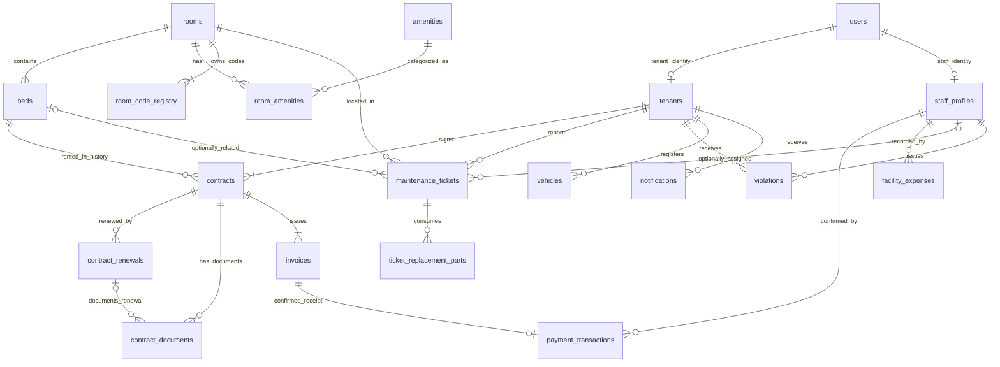
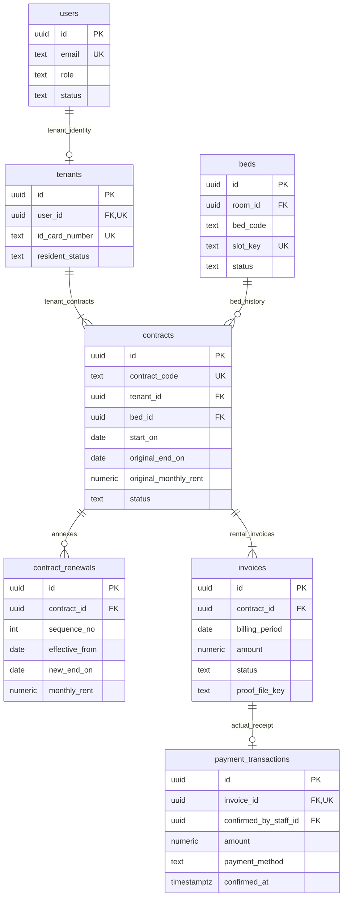

# THIẾT KẾ MÔ HÌNH DỮ LIỆU MỨC LOGIC (LOGICAL ERD)

## KTX HUB — PRIVATE DORMITORY MANAGEMENT SYSTEM (PDMS)

| Thông tin | Nội dung |
|---|---|
| Tài liệu | Logical Entity–Relationship Diagram & Data Dictionary |
| Phiên bản | **v3.5 — FINAL** |
| Ngày lập | 09/11/2026 |
| Nguồn yêu cầu | `KTX_Hub_SRS_v3.2_Final.md` và `KTX_Hub_Conceptual_ERD_v3.4_Final.md` |
| Tham khảo | `Logical-ERD.md` (bản cũ, **không** dùng làm chuẩn để đảo ngược các quyết định SRS) |
| Hệ quản trị dữ liệu đích | PostgreSQL |
| Trạng thái triển khai | **Thiết kế dữ liệu FINAL; chưa reset Flyway/DB hay sửa Backend** |

> **Nguyên tắc ưu tiên:** SRS v3.2 Final → Conceptual ERD v3.4 Final → Logical ERD v3.5 Final. Các chi tiết SQL dưới đây là **đề xuất thiết kế logic/kiểm soát toàn vẹn**, không phải cam kết rằng schema đang chạy đã có các cột đó. Tài liệu chỉ đặc tả phạm vi Phase 1; FR-11 (chuyển phòng) thuộc Phase 2.

---

## 1. PHẠM VI VÀ QUY ƯỚC

### 1.1. Ranh giới mô hình

- **17 thực thể nghiệp vụ** giữ nguyên theo Conceptual ERD v3.4 Final.
- **2 bảng hỗ trợ logic**: `room_amenities` (M:N có số lượng), `room_code_registry` (giữ/giải phóng mã phòng theo lịch sử). Tổng cộng **19 bảng PostgreSQL** (17 nghiệp vụ + 2 hỗ trợ). JWT Access/Refresh, revoke/blacklist và OTP khôi phục được quản lý bằng **Redis**, **không** tạo `auth_sessions` hay `auth_otps` trong PostgreSQL.
- Một cơ sở, nhiều tầng (tầng là thuộc tính Room), một Tenant tối đa một hợp đồng chiếm chỗ hiện hành và một phương tiện chưa thu hồi.
- Không có `BUILDING`, `FLOOR`, `SLEEPBOX`, `RESERVATION`, `PARKING_CARD`, bảng giao dịch ngân hàng, `PAYMENT_PROOF_HISTORY`, quản lý phiên bản tài liệu hay lịch sử phân công kỹ thuật.

### 1.2. Chuẩn đặt tên và dữ liệu

| Quy ước | Thiết kế |
|---|---|
| Primary key | `id uuid` (`gen_random_uuid()` nếu cần sinh tại DB) ngoại trừ bảng nối và registry |
| Foreign key | Đuôi `_id` trỏ đến PK; mặc định **RESTRICT/NO ACTION** đối với dữ liệu nghiệp vụ cần giữ |
| Tiền VND | `numeric(14,0)` — không sử dụng `float`/`double` cho số tiền |
| Ngày hợp đồng/kỳ | `date`; `billing_period` lưu **ngày 01 của tháng** thay vì chuỗi `YYYY-MM` |
| Thời điểm thao tác | `timestamptz`, chuẩn lưu UTC và hiển thị/đối chiếu lịch theo `Asia/Ho_Chi_Minh` |
| Trạng thái | Hằng mã ổn định trong DB (`ACTIVE`, `PAID`...), FE hiển thị tiếng Việt theo bảng ánh xạ |
| Tên cột | `snake_case`; mã nghiệp vụ (`room_number`, `contract_code`, `invoice_code`) không làm PK |
| Mật khẩu | PostgreSQL chỉ giữ `users.password_hash` (Bcrypt/Argon2id); không có cột mật khẩu plaintext |
| JWT/OTP | Access/Refresh JWT, refresh/blacklist/token revocation và OTP khôi phục quản lý trong Redis; không thuộc 19 bảng quan hệ. **Change Password không có OTP**. |
| Tệp chứng từ | `*_file_key` là **OCI private object key**, không lưu presigned URL. Backend kiểm tra JWT/role/ownership trước khi cấp URL ký hiệu lực tối đa 15 phút |
| Xóa dữ liệu | Chỉ xóa vật lý dữ liệu cấu hình/tệp nhập nhầm khi an toàn; lịch sử hợp đồng, hóa đơn, phiếu thu, sự cố, vi phạm được giữ |

**Giới hạn của `CHECK`/`FK`:** Một `CHECK` không thể so sánh dữ liệu của hai bảng hay kiểm tra trạng thái của nhiều hợp đồng cùng lúc. Những bất biến này cần **transaction**, `UNIQUE`/partial index và/hoặc trigger/logic Backend (nêu rõ ở §6–§7), không được mô tả sai là một `CHECK` đơn giản.

---

## 2. SƠ ĐỒ LOGICAL ERD (MERMAID)

### 2.1. Quan hệ giữa các bảng

> Sơ đồ biểu diễn FK và bội số của **19 bảng PostgreSQL**. Hai nguồn dữ liệu tạm Redis (JWT/OTP) không phải các bảng trong sơ đồ.



### 2.2. Sơ đồ thuộc tính rút gọn — lõi hợp đồng và thanh toán



**Ghi chú về 1..N:** Tenant mới và Contract mới phải được tạo cùng Contract/Invoice đầu tiên theo onboarding. Ràng buộc **tồn tại ít nhất một con** không thể đảm bảo chỉ bằng FK từ bảng con; được đảm bảo bằng **giao dịch onboarding**. Không hiểu quan hệ này là cho phép tạo hồ sơ/hợp đồng trống rồi bổ sung sau.

---

## 3. DATA DICTIONARY — 19 BẢNG POSTGRESQL

### 3.1. Không gian lưu trú và danh mục phòng

#### 3.1.1. `rooms` — Phòng

| Cột | PostgreSQL type | Null | Khóa / ràng buộc | Ý nghĩa |
|---|---|:---:|---|---|
| `id` | `uuid` | Không | PK | ID nội bộ bất biến |
| `room_number` | `text` | Không | Unique sau chuẩn hóa mã | Mã phòng nghiệp vụ, ví dụ `P.302` |
| `floor` | `integer` | Không | `CHECK (floor >= 1)` | Tầng; bất biến sau tạo |
| `total_beds` | `smallint` | Không | `IN (4,6,8)` | Sức chứa vật lý; bất biến sau tạo |
| `gender_policy` | `text` | Không | `IN ('MALE','FEMALE')` | Chính sách Nam/Nữ |
| `base_price` | `numeric(14,0)` | Không | `> 0` | Giá tiêu chuẩn một giường/tháng, chung cả phòng |
| `archived_at` | `timestamptz` | Có | — | `NULL` = đang vận hành, khác `NULL` = đã Archive |
| `created_at` | `timestamptz` | Không | Default `now()` | Thời điểm tạo phòng |
| `updated_at` | `timestamptz` | Không | — | Lần cập nhật gần nhất |

**Ràng buộc:** `room_number` không trùng với phòng khác, kể cả Archive; đồng thời phải kiểm tra `room_code_registry` để cấm sử dụng mã đã có lịch sử. Trường `archived_at` **khác** `deleted_at`: phòng Archive vẫn còn dữ liệu và có thể Restore. **Không có cột `rooms.occupied_beds`** trong schema đích; số giường có người **tính trực tiếp** bằng `COUNT(*)` trên Bed `OCCUPIED` của Room, không duy trì counter cộng/trừ.

#### 3.1.2. `beds` — Giường/vị trí nằm

| Cột | Type | Null | Khóa / ràng buộc | Ý nghĩa |
|---|---|:---:|---|---|
| `id` | `uuid` | Không | PK | ID giường bất biến |
| `room_id` | `uuid` | Không | FK → `rooms.id` | Phòng sở hữu |
| `bed_code` | `text` | Không | `UNIQUE (room_id, bed_code)` | `G01`…`G04/G06/G08` |
| `slot_key` | `text` | Không | Unique chuẩn hóa | `RoomCode-BedCode` của vị trí hiện hành |
| `status` | `text` | Không | `AVAILABLE`, `OCCUPIED`, `MAINTENANCE` | Trạng thái giường |
| `created_at` | `timestamptz` | Không | Default `now()` | Ngày tạo |

**Ràng buộc:** Room phải có chính xác `total_beds` Bed sau khi tạo; toàn bộ thao tác tạo Room–Bed atomic. Không cho Backend/UI tùy ý cập nhật `OCCUPIED`: chỉ qua onboarding/checkout. Không tạo cột `beds.price` độc lập: **giá niêm yết của Bed đọc từ `rooms.base_price`**, nên Manager đổi giá phòng sẽ hiển thị đúng trên tất cả Bed mà không có hai giá lệch nhau. Giá hợp đồng/hóa đơn lịch sử là snapshot riêng. Khi Room Code thay đổi, phải cập nhật **mọi `slot_key`** trong cùng transaction. Có thể tạo `UNIQUE (id, room_id)` để hỗ trợ FK phức hợp trên Ticket (§3.4.1).

#### 3.1.3. `amenities` — Danh mục tiện nghi

| Cột | Type | Null | Khóa / ràng buộc | Ý nghĩa |
|---|---|:---:|---|---|
| `id` | `uuid` | Không | PK | ID tiện nghi |
| `code` | `text` | Không | UK | Mã loại tiện nghi |
| `name` | `text` | Không | — | Tên tiện nghi |
| `category` | `text` | Có | — | Phân nhóm hiển thị khi cần |

#### 3.1.4. `room_amenities` — Bảng nối Room–Amenity

| Cột | Type | Null | Khóa / ràng buộc | Ý nghĩa |
|---|---|:---:|---|---|
| `room_id` | `uuid` | Không | PK (1), FK → `rooms.id` | Phòng |
| `amenity_id` | `uuid` | Không | PK (2), FK → `amenities.id` | Tiện nghi |
| `quantity` | `integer` | Không | `> 0` | Số lượng tại phòng |

**Khóa chính:** `(room_id, amenity_id)`. Có thể `ON DELETE CASCADE` từ Room **chỉ khi** xóa Room tạo nhầm đã vượt qua kiểm tra an toàn; không cascade từ bảng lịch sử hợp đồng. Khi xóa danh mục tiện nghi còn được sử dụng, ưu tiên `RESTRICT`.

#### 3.1.5. `room_code_registry` — Bảo vệ mã phòng lịch sử (bảng hỗ trợ)

| Cột | Type | Null | Khóa / ràng buộc | Ý nghĩa |
|---|---|:---:|---|---|
| `code` | `text` | Không | PK/Unique chuẩn hóa | Một mã Room từng được cấp và **chưa giải phóng hợp lệ** |
| `room_id` | `uuid` | Không | FK → `rooms.id` (`RESTRICT`) | Room sở hữu mã (kể cả mã cũ đã bảo vệ) |
| `is_current` | `boolean` | Không | — | `true` nếu mã hiện tại của Room |
| `used_in_business` | `boolean` | Không | Default `false` | Đã gắn với Contract/Ticket/hồ sơ nghiệp vụ cần giữ |
| `created_at` | `timestamptz` | Không | Default `now()` | Thời điểm cấp mã |

**Bất biến registry:** Mỗi Room có **đúng một** mã `is_current=true` (partial unique index cho một mã hiện hành/Room). Mã cũ không còn hiện hành **chỉ được giữ** khi `used_in_business=true`; nếu mã chưa từng dùng trong nghiệp vụ thì **xóa hàng registry** để cho phép tái sử dụng. Không được chuyển `used_in_business` từ `true` về `false`. Mã đang dùng bởi Room còn tồn tại/Archive không được cấp cho Room khác. Khi xóa phòng tạo nhầm chưa có lịch sử, xóa registry chưa bảo vệ trước khi xóa Room; khi Archive giữ nguyên registry. `rooms.room_number` và bản ghi registry hiện hành phải đồng bộ trong cùng transaction.

**Ví dụ:** `P.302` vừa tạo và nhập sai tầng, chưa từng có Contract/Ticket → được Delete an toàn, xóa dòng registry `P.302` → có thể tạo lại `P.302`. Nếu `P.302` từng xuất hiện trong lịch sử rồi đổi thành `P.303` → giữ `P.302` với `used_in_business=true`, `is_current=false`; **cấm** cấp `P.302` cho Room khác.


### 3.2. Tài khoản, định danh và nhân sự

**Ánh xạ:** Thực thể Conceptual `USER_ACCOUNT` → bảng vật lý `users`; `TENANT_PROFILE` → `tenants`; `STAFF_PROFILE` → `staff_profiles`. **Giữ tên bảng hiện có trong Backend**, không đổi tên hàng loạt. Mỗi tài khoản có **một email duy nhất toàn hệ thống** ở `users.email`; hai bảng profile không lưu trùng email. Tenant vẫn đăng nhập bằng CCCD, không phải email. SĐT là thông tin liên hệ và không UNIQUE.

#### 3.2.1. `users` — Tài khoản và email liên kết duy nhất

| Cột | Type | Null | Khóa / ràng buộc | Ý nghĩa |
|---|---|:---:|---|---|
| `id` | `uuid` | Không | PK | Định danh User bất biến |
| `email` | `text` | Không | **UNIQUE chuẩn hóa `lower(btrim(email))`** | Email liên kết với **một** User, kênh OTP; nhân sự dùng đăng nhập |
| `password_hash` | `text` | Không | — | Chỉ lưu mật khẩu băm |
| `role` | `text` | Không | `MANAGER`, `TENANT`, `TECHNICIAN` | Vai trò cố định |
| `status` | `text` | Không | `ACTIVE`, `INACTIVE`, `LOCKED` | Trạng thái tài khoản; khóa Technician ngăn truy cập |
| `created_at` | `timestamptz` | Không | Default `now()` | Tạo tài khoản |
| `updated_at` | `timestamptz` | Không | Default `now()` | Cập nhật |

**Không có cột `username` và `phone` ở `users`** trong schema đích: Tenant đăng nhập bằng `tenants.id_card_number`, nhân sự qua `users.email` cùng điều kiện role `MANAGER`/`TECHNICIAN`. Không cho email của Tenant dùng để đăng nhập dù email là UNIQUE. Cập nhật email của Tenant hoặc Technician sau khi Manager xác minh phải kiểm tra trùng **toàn User**; email Manager cố định theo chức năng Phase 1. `LOCKED`/`INACTIVE` bị từ chối dù JWT còn hạn; Redis kiểm soát thu hồi token/OTP và giới hạn đăng nhập tạm thời. User phải được tạo cùng profile đúng role; không cho tồn tại hai nhánh hồ sơ khi transaction hoàn tất.

#### 3.2.2. `tenants` — Hồ sơ khách thuê

| Cột | Type | Null | Khóa / ràng buộc | Ý nghĩa |
|---|---|:---:|---|---|
| `id` | `uuid` | Không | PK | Tenant ID bất biến |
| `user_id` | `uuid` | Không | UNIQUE, FK → `users.id` | Tài khoản Tenant, 1–1 |
| `tenant_code` | `text` | Không | UNIQUE | Mã hồ sơ |
| `id_card_number` | `varchar(12)` | Không | UNIQUE, regex 12 chữ số | CCCD đăng nhập Tenant |
| `full_name` | `text` | Không | — | Họ tên |
| `gender` | `text` | Không | `MALE`, `FEMALE` | Giới tính |
| `date_of_birth` | `date` | Có | — | Ngày sinh |
| `phone` | `text` | Không | **Không UNIQUE** | Thông tin liên hệ, không đăng nhập |
| `permanent_address` | `text` | Không | — | Địa chỉ thường trú |
| `emergency_contact_name` | `text` | Có | — | Người liên hệ khẩn cấp |
| `emergency_contact_phone` | `text` | Có | — | SĐT liên hệ khẩn cấp |
| `resident_status` | `text` | Không | `ACTIVE`, `CHECKED_OUT` | Cư trú hiện hành hoặc đã checkout |
| `created_at` | `timestamptz` | Không | Default `now()` | Tạo hồ sơ |
| `updated_at` | `timestamptz` | Không | Default `now()` | Cập nhật |

**Quy tắc:** Email Tenant lấy **duy nhất từ `users.email`**, không lưu thêm `tenants.email` để tránh lệch đồng bộ; khi trả DTO có thể JOIN qua `user_id`. CCCD 12 số là unique nghiệp vụ và để tìm khách cũ; không làm PK. Tenant chỉ tự cập nhật phone, permanent address, emergency contacts; Manager được hiệu chỉnh thông tin định danh và email sau xác minh. `ACTIVE`/`CHECKED_OUT` đi theo onboarding/checkout, không tự xóa User sau checkout. Không tạo Tenant riêng trước hợp đồng ngày 01.

#### 3.2.3. `staff_profiles` — Hồ sơ nhân sự Manager/Technician

| Cột | Type | Null | Khóa / ràng buộc | Ý nghĩa |
|---|---|:---:|---|---|
| `id` | `uuid` | Không | PK | Staff ID |
| `user_id` | `uuid` | Không | UNIQUE, FK → `users.id` | User tương ứng, role nhân sự |
| `full_name` | `text` | Không | — | Họ tên |
| `phone` | `text` | Không | **Không UNIQUE** | Số điện thoại liên hệ |
| `created_at` | `timestamptz` | Không | Default `now()` | Tạo nhân sự |
| `updated_at` | `timestamptz` | Không | Default `now()` | Cập nhật |

**Quy tắc:** Email đăng nhập nhân sự lấy từ `users.email` và được unique **trên toàn bộ users**. `staff_profiles` không cần trường email/active riêng. Role và trạng thái ở `users`; khóa Technician phải chặn request có Access Token cũ và thu hồi Refresh Token qua Redis. Manager có quyền cập nhật email của Technician, không có UI/API đổi email của chính Manager. Mọi thao tác đổi mật khẩu đã đăng nhập cần JWT hợp lệ + mật khẩu cũ, **không OTP**; Forgot Password dùng OTP email/Redis.

**Ranh giới ngoài PostgreSQL:** Access/Refresh JWT, refresh rotation/revocation/blacklist, OTP khôi phục 6 số (TTL 5 phút), reset token và giới hạn đăng nhập sai nằm trong **Redis**. `auth_sessions`, `auth_otps`, `failed_login_count`, `locked_until` **không phải cột/bảng trong Logical ERD này**.

---
## 3.3. Hợp đồng, phụ lục, hóa đơn và tài chính

#### 3.3.1. `contracts` — Hợp đồng gốc

| Cột | Type | Null | Khóa / ràng buộc | Ý nghĩa |
|---|---|:---:|---|---|
| `id` | `uuid` | Không | PK | ID Contract bất biến |
| `contract_code` | `text` | Không | UK | Mã hợp đồng giấy/nghiệp vụ |
| `tenant_id` | `uuid` | Không | FK → `tenants.id` | Khách thuê |
| `bed_id` | `uuid` | Không | FK → `beds.id` | Giường gắn với hợp đồng, **không đổi trong Phase 1** |
| `room_code_snapshot` | `text` | Không | — | Mã phòng ở thời điểm ký |
| `bed_code_snapshot` | `text` | Không | — | Mã giường ở thời điểm ký |
| `slot_key_snapshot` | `text` | Không | — | Mã vị trí ở thời điểm ký, không đổi khi Room Code thay đổi |
| `signed_on` | `date` | Không | — | Ngày ký giấy/ghi nhận lúc onboarding |
| `start_on` | `date` | Không | Ngày 01 | Ngày bắt đầu cư trú của hợp đồng gốc |
| `original_end_on` | `date` | Không | Ngày cuối tháng, `>= start_on` | Ngày kết thúc ban đầu của hợp đồng |
| `original_monthly_rent` | `numeric(14,0)` | Không | `> 0` | Giá thuê trọn tháng lúc ký hợp đồng gốc |
| `deposit_amount` | `numeric(14,0)` | Không | `>= 0` | Tiền cọc theo giấy tờ, **không phải thu nhập** |
| `status` | `text` | Không | `ACTIVE`, `LIQUIDATED` | Hợp đồng hiện còn chiếm chỗ hay đã checkout |
| `checked_out_at` | `timestamptz` | Có | — | Thời điểm Manager xác nhận checkout |
| `checkout_bed_status` | `text` | Có | `AVAILABLE`, `MAINTENANCE` | Trạng thái Bed Manager đã chọn khi checkout |
| `created_at` | `timestamptz` | Không | Default `now()` | Thời điểm tạo |

**Ràng buộc liên bảng:** Chỉ được tạo Contract qua onboarding ngày 01; người thuê và giường cùng đủ điều kiện; ngày kết thúc vào ngày cuối tháng; ngày **onboarding/tạo Contract mới** trùng ngày bắt đầu cư trú; văn bản giấy có thể được ký trước hoặc trong ngày này (`signed_on <= start_on`). `status='LIQUIDATED'` yêu cầu có `checked_out_at` và `checkout_bed_status`, `ACTIVE` không có chúng. Sau khi checkout, lịch sử vẫn giữ và tài khoản Tenant vẫn đăng nhập được.

**Không lưu giá/`end_on` hiện hành bằng cách ghi đè dữ liệu gốc.** `current_end_on` được xác định bằng `new_end_on` của Renewal có `sequence_no` lớn nhất, nếu không có Renewal thì bằng `original_end_on`. Để UI truy vấn thuận tiện có thể tạo View `v_contract_current_terms` (§7.1). `ACTIVE` là quan hệ chiếm chỗ chưa checkout; **không tự chuyển thành `LIQUIDATED` chỉ vì đồng hồ đã qua ngày hết hạn**, tránh giải phóng giường sai khi Manager chưa xác nhận bàn giao.

**Chống chiếm chỗ đồng thời:** Một Tenant và một Bed có tối đa một Contract `ACTIVE`; dùng **partial unique index** trên `(tenant_id)` và `(bed_id)` với điều kiện `status='ACTIVE'` (§6). Không tạo Contract mới để gia hạn.

#### 3.3.2. `contract_renewals` — Phụ lục/lần gia hạn

| Cột | Type | Null | Khóa / ràng buộc | Ý nghĩa |
|---|---|:---:|---|---|
| `id` | `uuid` | Không | PK | ID phụ lục |
| `contract_id` | `uuid` | Không | FK → `contracts.id` | Hợp đồng gốc |
| `sequence_no` | `integer` | Không | UK `(contract_id, sequence_no)`, `> 0` | Thứ tự gia hạn 1,2,3,... |
| `signed_on` | `date` | Không | — | Ngày ký phụ lục giấy |
| `previous_end_on` | `date` | Không | — | Ngày kết thúc trước lần gia hạn này |
| `effective_from` | `date` | Không | UK `(contract_id, effective_from)` | **Ngày 01** của tháng tiếp theo `previous_end_on` |
| `new_end_on` | `date` | Không | Ngày cuối tháng, `>= effective_from` | Ngày kết thúc mới |
| `monthly_rent` | `numeric(14,0)` | Không | `> 0` | Giá cố định cho **toàn bộ kỳ gia hạn này** |
| `created_at` | `timestamptz` | Không | Default `now()` | Thời điểm ghi vào DB |

**Ràng buộc:** Phụ lục phải được ký **trước ngày kết thúc hiện hành**, chỉ khi Contract `ACTIVE`, Tenant còn cư trú và không có hóa đơn `DEBT` hoặc `PENDING_CONFIRMATION`. `previous_end_on` phải bằng ngày kết thúc hiện hành trước lúc gia hạn; `effective_from = previous_end_on + 1 day` (ngày 01), `new_end_on` là ngày cuối tháng. Mỗi lần ký bổ sung một dòng **bất biến về giá/thời hạn** thay vì sửa dòng cũ. Giá lấy từ `rooms.base_price` tại thời điểm **ký phụ lục**, không tự thay đổi nếu Manager tăng giá phòng sau đó.

**Cách chọn giá hóa đơn tháng M:** Tìm Renewal mới nhất của Contract có `effective_from <= M` và `M <= new_end_on`; nếu có, dùng `renewals.monthly_rent`; nếu không và tháng thuộc hạn gốc, dùng `contracts.original_monthly_rent`. Không được dùng `rooms.base_price` để phát hành hóa đơn cho hợp đồng đã ký. Mỗi phụ lục không tạo thêm Contract mới hoặc làm tăng số người đang ở.

#### 3.3.3. `contract_documents` — Tệp hợp đồng/phụ lục/bàn giao

| Cột | Type | Null | Khóa / ràng buộc | Ý nghĩa |
|---|---|:---:|---|---|
| `id` | `uuid` | Không | PK | ID tệp |
| `contract_id` | `uuid` | Không | FK → `contracts.id` | Hợp đồng sở hữu tệp |
| `renewal_id` | `uuid` | Có | FK → `contract_renewals.id` | Phụ lục nếu loại `RENEWAL_ANNEX` |
| `document_type` | `text` | Không | `ORIGINAL_CONTRACT`, `RENEWAL_ANNEX`, `CHECKOUT_HANDOVER`, `OTHER` | Loại văn bản |
| `original_filename` | `text` | Không | — | Tên gốc |
| `mime_type` | `text` | Không | Whitelist theo SRS | MIME đã kiểm tra |
| `size_bytes` | `bigint` | Không | `0 < size_bytes <= 10485760` | Tối đa 10 MB/tệp |
| `storage_file_key` | `text` | Không | UK | Vị trí lưu trong storage bảo vệ quyền |
| `uploaded_at` | `timestamptz` | Không | Default `now()` | Ngày upload |

**Bảo vệ tệp:** `storage_file_key` là khóa object **private** của OCI; không lưu đường dẫn public/presigned URL. Sau khi xác minh quyền Manager hoặc Tenant sở hữu Contract, Backend cấp URL có chữ ký **tối đa 15 phút** để xem/tải tệp. Credential OCI chỉ đặt ở cấu hình secrets ngoài repository.

**Ràng buộc:** `RENEWAL_ANNEX` phải trỏ đúng Renewal; mọi Document phải thuộc cùng `contract_id` với Renewal được chỉ định. Để cưỡng chế cả hai FK bằng DB, tạo `UNIQUE (id, contract_id)` ở `contract_renewals`, sau đó tạo **composite FK** `(renewal_id, contract_id)` → `contract_renewals(id, contract_id)` (khi `renewal_id IS NULL` quan hệ phụ lục không áp dụng). File có thể upload **sau** onboarding/gia hạn; không dùng `NOT NULL` đối với tệp trong Contract/Renewal. Cho Manager xóa file upload nhầm và upload lại; **không có bảng `document_versions`**. Việc xóa file không kéo theo xóa Contract/Renewal.

#### 3.3.4. `invoices` — Hóa đơn tiền thuê theo kỳ

| Cột | Type | Null | Khóa / ràng buộc | Ý nghĩa |
|---|---|:---:|---|---|
| `id` | `uuid` | Không | PK | ID hóa đơn |
| `invoice_code` | `text` | Không | UK | Mã hóa đơn duy nhất |
| `contract_id` | `uuid` | Không | FK → `contracts.id` | Hợp đồng phát sinh |
| `billing_period` | `date` | Không | UK `(contract_id, billing_period)`; ngày 01 | Kỳ thuê theo tháng |
| `amount` | `numeric(14,0)` | Không | `> 0` | **Snapshot** tiền thuê kỳ đó |
| `due_on` | `date` | Không | — | Ngày 05 thuộc chính kỳ thuê |
| `status` | `text` | Không | `DEBT`, `PENDING_CONFIRMATION`, `PAID` | Ba trạng thái thanh toán |
| `proof_file_key` | `text` | Có | — | Ảnh minh chứng Tenant gửi **trước khi** có phiếu thu |
| `proof_submitted_at` | `timestamptz` | Có | — | Lúc gửi minh chứng hiện tại |
| `issued_at` | `timestamptz` | Không | Default `now()` | Ngày tạo hóa đơn |

**Ánh xạ UI:** `DEBT` = `Nợ`; `PENDING_CONFIRMATION` = `Chờ xác nhận`; `PAID` = `Đã thu`. `Overdue` không phải enum: tính `status='DEBT' AND due_on < current_local_date`. `PENDING_CONFIRMATION` **không** tính vào công nợ quá hạn. `proof_file_key` được lưu trực tiếp tại Invoice để tồn tại ngay khi khách gửi ảnh; **không gắn vào `payment_transactions` vốn chưa được tạo**. Khi Manager từ chối minh chứng: chuyển `PENDING_CONFIRMATION→DEBT`, cho phép bỏ/thay thế ảnh minh chứng hiện tại; không cần lưu lịch sử phiên bản ảnh trong Phase 1.

Chỉ có **một loại hóa đơn tiền thuê** trong phạm vi Phase 1; không có loại hóa đơn điện/nước/phạt. Hóa đơn tháng đầu tạo trong giao dịch onboarding ngày 01, các kỳ tiếp theo do batch ngày 25 phát hành và có thể chạy lại idempotent. Không phát hành cho tháng ngoài hạn gốc/phụ lục hoặc Contract đã `LIQUIDATED`.

#### 3.3.5. `payment_transactions` — Phiếu thu đã xác nhận

| Cột | Type | Null | Khóa / ràng buộc | Ý nghĩa |
|---|---|:---:|---|---|
| `id` | `uuid` | Không | PK | ID phiếu thu |
| `receipt_code` | `text` | Không | UK | Mã chứng nhận thu tiền |
| `invoice_id` | `uuid` | Không | UK, FK → `invoices.id` | **Tối đa 1 phiếu thu hoàn tất/Invoice** |
| `amount` | `numeric(14,0)` | Không | `> 0` | Số tiền thực thu đầy đủ |
| `payment_method` | `text` | Không | `CASH`, `VIETQR_TRANSFER` | Tiền mặt / Chuyển khoản VietQR |
| `confirmed_by_staff_id` | `uuid` | Không | FK → `staff_profiles.id` | Manager xác nhận, **cho cả hai phương thức** |
| `confirmed_at` | `timestamptz` | Không | Default `now()` | Lúc Manager xác nhận đã nhận tiền |
| `bank_reference` | `text` | Có | — | Mã tham chiếu đối soát thủ công nếu có; `NULL` đối với tiền mặt |

**Ý nghĩa rất quan trọng:** Đây **không phải** lệnh hoặc bản ghi sao kê giao dịch của ngân hàng. Phiếu thu chỉ được thêm khi Manager xác nhận KTX đã nhận đủ tiền. `payment_transactions.amount` phải bằng `invoices.amount` (Backend/trigger kiểm tra liên bảng); insert phiếu thu và update Invoice sang `PAID` phải **atomic**. Không tạo phiếu thu khi Tenant mới upload ảnh. Không xử lý trả từng phần, trả dư, hoàn tiền. Không tạo phiếu thu thứ hai cho Invoice `PAID`.

**Ví dụ:** Khách đóng 1.500.000đ **tiền mặt** → Manager xác nhận → Invoice `PAID`, Payment `method=CASH`, `amount=1500000`. Khách **chuyển khoản** và gửi ảnh → Invoice `PENDING_CONFIRMATION`, chưa có Payment; sau Manager đối soát → Payment `method=VIETQR_TRANSFER` được tạo.

#### 3.3.6. `facility_expenses` — Chi phí cơ sở đã ghi nhận

| Cột | Type | Null | Khóa / ràng buộc | Ý nghĩa |
|---|---|:---:|---|---|
| `id` | `uuid` | Không | PK | ID khoản chi |
| `recorded_by_staff_id` | `uuid` | Không | FK → `staff_profiles.id` | Manager ghi nhận |
| `expense_date` | `date` | Không | — | Ngày chi phí được quy về kỳ báo cáo |
| `expense_type` | `text` | Không | `ELECTRICITY`, `WATER`, `INTERNET`, `OTHER` | Loại chi phí cơ sở |
| `title` | `text` | Không | — | Tiêu đề khoản chi |
| `amount` | `numeric(14,0)` | Không | `>= 0` | Số tiền ghi nhận |
| `invoice_code` | `text` | Có | — | Mã chứng từ nhà cung cấp nếu có |
| `invoice_file_key` | `text` | Có | — | File ảnh chứng từ nếu có |
| `notes` | `text` | Có | — | Ghi chú |
| `created_at` | `timestamptz` | Không | Default `now()` | Lúc tạo |
| `updated_at` | `timestamptz` | Không | — | Lúc sửa |

**Ràng buộc:** Manager được **sửa/xóa** khoản chi nhập nhầm. Đề xuất xóa vật lý khoản chi bị nhập nhầm trong phạm vi không yêu cầu lịch sử phiên bản; nếu cần khôi phục trong triển khai có thể chọn `deleted_at` và lọc báo cáo, nhưng **không được giữ hàng bị xóa trong phép SUM**. Chi phí linh kiện sửa chữa **không được nhập trùng** tại đây — chỉ lấy từ phiếu sửa chữa `COMPLETED`. Không gọi báo cáo là “lợi nhuận ròng”.

---

## 3.4. Vận hành: Sự cố, vi phạm, phương tiện và thông báo

#### 3.4.1. `maintenance_tickets` — Phiếu báo hỏng

| Cột | Type | Null | Khóa / ràng buộc | Ý nghĩa |
|---|---|:---:|---|---|
| `id` | `uuid` | Không | PK | ID phiếu |
| `ticket_code` | `text` | Không | UK | Mã ticket |
| `reporter_tenant_id` | `uuid` | Không | FK → `tenants.id` | Tenant đang cư trú khi tạo |
| `room_id` | `uuid` | Không | FK → `rooms.id` | Phòng xảy ra sự cố |
| `bed_id` | `uuid` | Có | FK → `beds.id`; composite FK nếu gắn Bed | Giường liên quan **không bắt buộc** |
| `assignee_staff_id` | `uuid` | Có | FK → `staff_profiles.id` | Technician hiện tại; **NULL khi chưa phân công** |
| `title` | `text` | Không | — | Tiêu đề |
| `description` | `text` | Không | — | Mô tả hiện trường |
| `category` | `text` | Không | Sáu giá trị bên dưới | Nhóm sự cố |
| `priority` | `text` | Không | `URGENT`, `HIGH`, `NORMAL` | Mức ưu tiên hiện tại |
| `status` | `text` | Không | Bốn giá trị bên dưới | Trạng thái xử lý |
| `report_image_file_key` | `text` | Có | — | Ảnh hiện trường; việc bắt buộc ảnh xác minh tại tầng nghiệp vụ |
| `deadline_at` | `timestamptz` | Có | — | Hạn hoàn thành Manager đặt |
| `resolution_notes` | `text` | Có | — | Kết quả xử lý |
| `resolution_image_file_key` | `text` | Có | — | Ảnh nghiệm thu khi hoàn thành |
| `resolved_at` | `timestamptz` | Có | — | Ngày Technician hoàn thành |
| `created_at` | `timestamptz` | Không | Default `now()` | Ngày báo hỏng |

**Danh mục `category`:** `ELECTRIC`, `WATER`, `INTERNET`, `FURNITURE`, `AMENITY`, `OTHER`, tương ứng `Điện`, `Nước`, `Internet`, `Nội thất`, `Tiện ích`, `Khác`.

**Vòng đời:** `UNASSIGNED` (`Chưa phân công`) → `ASSIGNED` (`Mới giao`) → `IN_PROGRESS` (`Đang xử lý`) → `COMPLETED` (`Hoàn thành`). Khi `UNASSIGNED`, `assignee_staff_id=NULL`; khi đã được giao, phải có Technician tương ứng; khi `COMPLETED`, yêu cầu kết quả, ảnh nghiệm thu và `resolved_at`. Không có trạng thái mở lại/duyệt thêm. Manager được thay `assignee_staff_id` khi chưa `COMPLETED`, không tạo bảng lịch sử phân công. Technician chỉ sửa ticket hiện được giao cho mình.

**Toàn vẹn vị trí:** Nếu `bed_id` khác `NULL`, Bed phải thuộc đúng `room_id` của ticket. Có thể dùng FK phức hợp `(bed_id,room_id)` → `beds(id,room_id)` (cần unique cặp `(id,room_id)` ở Beds). Ticket phòng chung chỉ có `room_id` và để `bed_id=NULL`.

#### 3.4.2. `ticket_replacement_parts` — Linh kiện thực dùng cho Ticket

| Cột | Type | Null | Khóa / ràng buộc | Ý nghĩa |
|---|---|:---:|---|---|
| `id` | `uuid` | Không | PK | Dòng vật tư |
| `ticket_id` | `uuid` | Không | FK → `maintenance_tickets.id` | Phiếu sửa chữa |
| `part_name` | `text` | Không | — | Tên linh kiện |
| `quantity` | `integer` | Không | `> 0` | Số lượng |
| `unit_cost` | `numeric(14,0)` | Không | `>= 0` | Đơn giá VND |
| `total_cost` | `numeric(14,0)` | Không | Generated: `quantity * unit_cost` | Thành tiền, DB tự tính |

**Tổng chi phí Ticket** = `COALESCE(SUM(parts.total_cost),0)`; chỉ tính vào báo cáo FR-14 nếu ticket `COMPLETED`, theo tháng `resolved_at` tại `Asia/Ho_Chi_Minh`. Không cần ghi `ticket.total_cost` thứ hai, không nhập tiền công, không dùng vật tư thì không cần dòng Part và tổng = 0. Nếu hệ DB không dùng generated column, tính bằng query từ `quantity × unit_cost`, không cho người dùng nhập `total_cost`.

#### 3.4.3. `violations` — Biên bản vi phạm

| Cột | Type | Null | Khóa / ràng buộc | Ý nghĩa |
|---|---|:---:|---|---|
| `id` | `uuid` | Không | PK | ID vi phạm |
| `violation_code` | `text` | Không | UK | Mã biên bản |
| `tenant_id` | `uuid` | Không | FK → `tenants.id` | Khách vi phạm |
| `issued_by_staff_id` | `uuid` | Không | FK → `staff_profiles.id` | Manager lập |
| `occurred_on` | `date` | Không | — | Ngày xảy ra |
| `violation_type` | `text` | Không | Sáu nhóm dưới đây | Loại vi phạm |
| `level` | `text` | Không | `REMINDER`, `WARNING`, `FINE` | Nhắc nhở / Cảnh cáo / Phạt tiền |
| `fine_amount` | `numeric(14,0)` | Không | `>= 0`, default `0` | Chỉ có giá trị dương khi `FINE` |
| `note` | `text` | Có | — | Diễn biến, nội dung biên bản |
| `created_at` | `timestamptz` | Không | Default `now()` | Ngày lập |

**`violation_type`:** `LATE_RETURN`, `NOISE`, `HYGIENE`, `OUTSIDER`, `SMOKING_FIRE`, `OTHER` → `Về muộn`, `Gây ồn`, `Vệ sinh`, `Khách ngoài`, `Hút thuốc / cháy nổ`, `Khác`. `level != FINE` thì `fine_amount=0`; `FINE` thì `fine_amount>0`. Người được lập biên bản phải đang cư trú tại thời điểm lập; không bắt buộc `room_id`. Tiền phạt **không có FK đến Invoice/Payment**, không đưa vào doanh thu tiền thuê.

#### 3.4.4. `vehicles` — Phương tiện và thẻ gửi xe

| Cột | Type | Null | Khóa / ràng buộc | Ý nghĩa |
|---|---|:---:|---|---|
| `id` | `uuid` | Không | PK | ID xe |
| `tenant_id` | `uuid` | Không | FK → `tenants.id` | Chủ xe |
| `vehicle_type` | `text` | Không | Năm loại bên dưới | Phân loại |
| `license_plate` | `text` | Có | Conditional required | Biển số, có thể `NULL` với xe không đăng ký |
| `brand` | `text` | Không | — | Hãng/dòng xe |
| `color` | `text` | Không | — | Màu xe |
| `registration_front_file_key` | `text` | Có | Conditional required | Ảnh giấy đăng ký mặt trước |
| `registration_back_file_key` | `text` | Có | Conditional required | Ảnh mặt sau |
| `card_code` | `text` | Có | Unique **khi chưa thu hồi** | Mã thẻ vật lý được cấp, tái sử dụng sau thu hồi |
| `status` | `text` | Không | `PENDING_CARD`, `ISSUED`, `REVOKED` | Chờ cấp / Đã cấp / Đã thu hồi |
| `created_at` | `timestamptz` | Không | Default `now()` | Ngày đăng ký |
| `revoked_at` | `timestamptz` | Có | — | Thời điểm thu hồi |

**Năm loại:** `SCOOTER`, `MANUAL_MOTORCYCLE`, `ELECTRIC_MOTORBIKE`, `ELECTRIC_BICYCLE`, `BICYCLE`. Xe tay ga/xe số/xe máy điện có đăng ký: bắt buộc biển số và hai ảnh giấy đăng ký; xe đạp điện không đăng ký và xe đạp thường được để `NULL` các trường này. Trường `brand`, `color` vẫn quản lý theo SRS.

**Ràng buộc trạng thái:** Một Tenant có **tối đa một** xe chưa thu hồi (`status IN ('PENDING_CARD','ISSUED')`), thực thi bằng partial unique index. `card_code` được cấp khi chuyển `PENDING_CARD→ISSUED`, một mã thẻ không được đồng thời tồn tại trên hai xe chưa thu hồi; `REVOKED` vẫn giữ `card_code` lịch sử và **không chiếm quyền sử dụng mã đó**. Khi checkout, cập nhật xe/thẻ tương ứng `REVOKED` trong transaction bàn giao. Không tích hợp barrier, quẹt thẻ hoặc thu thêm phí gửi xe.

**Gợi ý dữ liệu:** Biển số (nếu có) có thể unique giữa các xe **chưa thu hồi** để tránh hai Tenant cùng đăng ký một xe đang hoạt động; đây là **ràng buộc đề xuất cho review kỹ thuật**, không phải điều kiện mới đã chốt trong SRS.

#### 3.4.5. `notifications` — Hộp thư thông báo tự động

| Cột | Type | Null | Khóa / ràng buộc | Ý nghĩa |
|---|---|:---:|---|---|
| `id` | `uuid` | Không | PK | ID thông báo |
| `tenant_id` | `uuid` | Không | FK → `tenants.id` | Người nhận |
| `event_type` | `text` | Không | Enum nghiệp vụ | Loại sự kiện tự sinh |
| `title` | `text` | Không | — | Tiêu đề hiển thị |
| `body` | `text` | Không | — | Nội dung hiển thị |
| `related_entity_type` | `text` | Có | — | Ví dụ `INVOICE`, `VIOLATION` |
| `related_entity_id` | `uuid` | Có | — | ID nghiệp vụ tương ứng, chỉ dùng dẫn hướng |
| `dedupe_key` | `text` | Có | Unique nếu có | Tránh tạo trùng khi task chạy lại |
| `read_at` | `timestamptz` | Có | — | Đã đọc nếu khác `NULL` |
| `created_at` | `timestamptz` | Không | Default `now()` | Ngày sinh |

**Nguồn tạo:** Chỉ các sự kiện nghiệp vụ: ví dụ `INVOICE_ISSUED`, `INVOICE_DUE`, `INVOICE_OVERDUE`, `PAYMENT_CONFIRMED`, `PAYMENT_PROOF_REJECTED`, `VIOLATION_CREATED`. **Không có `created_by_manager`, `broadcast_message`, mẫu thông báo hoặc API Manager soạn và gửi thông báo chung.** Tenant chỉ đọc thông báo của mình. Sau checkout, hệ thống có thể tiếp tục tạo thông báo về nợ cũ nhưng không tạo thông báo sinh hoạt mới; dữ liệu thông báo lịch sử vẫn được xem.

`related_entity_type` và `related_entity_id` là liên kết hiển thị tùy chọn (polymorphic pointer), **không giả vờ đây là FK đơn chuẩn đến nhiều bảng**. Để tránh phức tạp, Backend xác minh nguồn sự kiện khi tạo và kiểm tra quyền chủ sở hữu khi mở liên kết.

---
## 4. DANH MỤC KHÓA NGOẠI VÀ CHÍNH SÁCH XÓA

Các bảng nghiệp vụ có quan hệ lịch sử phải tránh cascade deletion làm mất bằng chứng. Bảng dưới đây là định hướng **mặc định**; những ngoại lệ an toàn được nêu riêng.

| Bảng con / FK | Bảng cha | Chính sách | Ghi chú |
|---|---|---|---|
| `beds.room_id` | `rooms` | `RESTRICT` | Khi Delete Room tạo nhầm, xóa các Bed chưa sử dụng trước |
| `room_amenities.room_id` | `rooms` | `CASCADE` có kiểm soát | Chỉ thực sự cascade khi Room được phép xóa vật lý |
| `room_amenities.amenity_id` | `amenities` | `RESTRICT` | Không xóa danh mục còn được phòng sử dụng |
| `room_code_registry.room_id` | `rooms` | `RESTRICT` | Xóa registry chưa có nghiệp vụ trước khi xóa Room |
| `tenants.user_id` | `users` | `RESTRICT` | Không xóa User chỉ vì checkout |
| `staff_profiles.user_id` | `users` | `RESTRICT` | Khóa tài khoản thay vì xóa nhân sự có lịch sử |
| `contracts.tenant_id` | `tenants` | `RESTRICT` | Bảo toàn lịch sử cư trú |
| `contracts.bed_id` | `beds` | `RESTRICT` | Bed từng có Contract không được xóa |
| `contract_renewals.contract_id` | `contracts` | `RESTRICT` | Bảo toàn phụ lục |
| `contract_documents.contract_id` | `contracts` | `RESTRICT` | Xóa riêng tệp upload nhầm, không cascade Contract |
| `contract_documents.renewal_id` | `contract_renewals` | `RESTRICT` | Tham chiếu phụ lục tùy chọn |
| `invoices.contract_id` | `contracts` | `RESTRICT` | Hóa đơn không bị xóa theo checkout |
| `payment_transactions.invoice_id` | `invoices` | `RESTRICT` | Phiếu thu đã xác nhận không bị xóa |
| `payment_transactions.confirmed_by_staff_id` | `staff_profiles` | `RESTRICT` | Nhân sự cũ vẫn là người đã xác nhận |
| `facility_expenses.recorded_by_staff_id` | `staff_profiles` | `RESTRICT` | Bảo toàn người lập (trừ dòng chi nhập nhầm được xóa) |
| `maintenance_tickets.reporter_tenant_id` | `tenants` | `RESTRICT` | Giữ phiếu báo hỏng |
| `maintenance_tickets.room_id` | `rooms` | `RESTRICT` | Room có sự cố không được xóa |
| `maintenance_tickets.bed_id` | `beds` | `RESTRICT` nếu không NULL | Nếu gắn Bed thì giữ Bed lịch sử |
| `maintenance_tickets.assignee_staff_id` | `staff_profiles` | `RESTRICT` nếu không NULL | Không xóa nhân sự có phiếu được giao |
| `ticket_replacement_parts.ticket_id` | `maintenance_tickets` | `RESTRICT` | Không xóa phiếu/linh kiện lịch sử đã hoàn thành |
| `violations.tenant_id` | `tenants` | `RESTRICT` | Lịch sử vi phạm |
| `violations.issued_by_staff_id` | `staff_profiles` | `RESTRICT` | Giữ người lập |
| `vehicles.tenant_id` | `tenants` | `RESTRICT` | Xe thu hồi vẫn giữ lịch sử |
| `notifications.tenant_id` | `tenants` | `RESTRICT` | Giữ hộp thư cá nhân, không tự xóa khi checkout |

**Kết luận:** Không sử dụng `ON DELETE CASCADE` hàng loạt với `contracts`, `invoices`, `payment_transactions`, `maintenance_tickets`, `violations` hoặc `vehicles`. Xóa Room nhập sai tầng là thao tác **có kiểm tra điều kiện**, chỉ thực hiện khi các khóa ngoại nghiệp vụ không có dữ liệu. Archive/Restore không xóa dữ liệu nên không đụng chính sách FK.

---

## 5. CARDINALITY, UNIQUENESS VÀ ENUM

### 5.1. Quan hệ nghiệp vụ chính (đúng với Conceptual ERD v3.4 Final)

| Quan hệ | Bội số theo lịch sử | Lưu ở cột FK / bảng nối | Ràng buộc phụ |
|---|---|---|---|
| Room–Bed | 1 ↔ đúng 4/6/8 | `beds.room_id` | Transaction tạo đồng bộ |
| Room–Amenity | M:N | `room_amenities` | Số lượng dương |
| User–Tenant | 1 ↔ 0..1 | `tenants.user_id UNIQUE` | Theo role TENANT |
| User–Staff | 1 ↔ 0..1 | `staff_profiles.user_id UNIQUE` | Theo role MANAGER/TECHNICIAN |
| Tenant–Contract | 1 ↔ 1..N (khi đã tạo hồ sơ) | `contracts.tenant_id` | ≤1 Contract ACTIVE/Tenant |
| Bed–Contract | 1 ↔ 0..N | `contracts.bed_id` | ≤1 Contract ACTIVE/Bed |
| Contract–Renewal | 1 ↔ 0..N | `contract_renewals.contract_id` | Kỳ gia hạn tiếp nối |
| Contract–Document | 1 ↔ 0..N | `contract_documents.contract_id` | Upload sau được phép |
| Renewal–Document | 0..1 ↔ 0..N | `contract_documents.renewal_id` | Cùng Contract gốc |
| Contract–Invoice | 1 ↔ 1..N (đã onboarding) | `invoices.contract_id` | Một Invoice/Contract/kỳ |
| Invoice–Payment | 1 ↔ 0..1 | `payment_transactions.invoice_id UNIQUE` | Chỉ tạo sau xác nhận đã thu |
| Staff–Payment | 1 ↔ 0..N | `payment_transactions.confirmed_by_staff_id` | Staff phải là Manager |
| Staff–Expense | 1 ↔ 0..N | `facility_expenses.recorded_by_staff_id` | Manager ghi nhận |
| Tenant–Ticket | 1 ↔ 0..N | `maintenance_tickets.reporter_tenant_id` | Chỉ Tenant đang ở tạo mới |
| Room–Ticket | 1 ↔ 0..N | `maintenance_tickets.room_id` | Bắt buộc Room |
| Bed–Ticket | 0..1 ↔ 0..N | `maintenance_tickets.bed_id` | Có thể NULL, phải cùng Room |
| Technician–Ticket | 0..1 ↔ 0..N | `maintenance_tickets.assignee_staff_id` | NULL trước phân công |
| Ticket–Part | 1 ↔ 0..N | `ticket_replacement_parts.ticket_id` | Không dùng Part = 0 đồng |
| Tenant–Violation | 1 ↔ 0..N | `violations.tenant_id` | Vi phạm gắn cá nhân |
| Staff–Violation | 1 ↔ 0..N | `violations.issued_by_staff_id` | Chỉ Manager lập |
| Tenant–Vehicle | 1 ↔ 0..N | `vehicles.tenant_id` | ≤1 xe chưa thu hồi |
| Tenant–Notification | 1 ↔ 0..N | `notifications.tenant_id` | Chỉ do hệ thống sinh |

**22 quan hệ nghiệp vụ** theo Conceptual ERD v3.4 Final; các quan hệ bảng nối/registry (Room–RoomAmenity, Room–Registry) là hỗ trợ kỹ thuật, không phát sinh use case mới. **JWT/OTP Redis không nằm trong ERD.**

### 5.2. Ví dụ câu lệnh PostgreSQL cho các uniqueness quan trọng

Đây là **đoạn minh họa cho thiết kế**, không phải script migration chạy trực tiếp (cần tạo bảng và dọn dữ liệu cũ trước). Các index dùng **chỉ một mẫu tên/cột thống nhất với Data Dictionary**.

```sql
-- Một Bed và một Tenant chỉ có một hợp đồng chiếm chỗ hiện hành.
CREATE UNIQUE INDEX uq_contract_active_bed
    ON contracts (bed_id) WHERE status = 'ACTIVE';
CREATE UNIQUE INDEX uq_contract_active_tenant
    ON contracts (tenant_id) WHERE status = 'ACTIVE';

-- Một Tenant có tối đa một phương tiện chưa thu hồi, kể cả chờ cấp thẻ.
CREATE UNIQUE INDEX uq_vehicle_active_tenant
    ON vehicles (tenant_id)
    WHERE status IN ('PENDING_CARD', 'ISSUED');

-- Thẻ vật lý chỉ gắn một phương tiện chưa thu hồi; sau REVOKED được cấp lại.
CREATE UNIQUE INDEX uq_vehicle_active_card
    ON vehicles (upper(btrim(card_code)))
    WHERE status IN ('PENDING_CARD', 'ISSUED') AND card_code IS NOT NULL;

-- CCCD và email theo User đều duy nhất; email Tenant không dùng đăng nhập.
ALTER TABLE tenants
    ADD CONSTRAINT uq_tenant_cccd UNIQUE (id_card_number);
CREATE UNIQUE INDEX uq_users_email_canonical
    ON users (lower(btrim(email)));

-- Kỳ hóa đơn lưu là ngày 01 và không trùng trên cùng hợp đồng.
ALTER TABLE invoices
    ADD CONSTRAINT ck_billing_period_first_day
    CHECK (EXTRACT(DAY FROM billing_period) = 1);
ALTER TABLE invoices
    ADD CONSTRAINT uq_invoice_contract_period
    UNIQUE (contract_id, billing_period);

-- Mỗi invoice có tối đa một phiếu thu hoàn tất.
ALTER TABLE payment_transactions
    ADD CONSTRAINT uq_receipt_invoice UNIQUE (invoice_id);

-- Mã phòng không trùng giữa các phòng hoặc các mã đã bị khóa lịch sử.
CREATE UNIQUE INDEX uq_room_number_canonical
    ON rooms (upper(btrim(room_number)));
CREATE UNIQUE INDEX uq_room_code_registry_canonical
    ON room_code_registry (upper(btrim(code)));
CREATE UNIQUE INDEX uq_room_one_current_code
    ON room_code_registry (room_id) WHERE is_current = true;
CREATE UNIQUE INDEX uq_bed_current_slot_key
    ON beds (upper(btrim(slot_key)));
```

**Không được hiểu** index Room như việc chỉ cần cấm trùng `rooms.room_number`: trước khi dùng một mã mới, Backend còn phải kiểm tra `room_code_registry` và bảo đảm cập nhật dưới cùng transaction/khóa thích hợp. SQL ví dụ không tự thực hiện quy tắc lịch sử mã phòng.

### 5.3. Ràng buộc thuộc tính và các trạng thái

| Bảng / Trường | Giá trị hợp lệ (DB) | Hiển thị/ý nghĩa |
|---|---|---|
| `rooms.gender_policy`, `tenants.gender` | `MALE`, `FEMALE` | Nam, Nữ |
| `beds.status` | `AVAILABLE`, `OCCUPIED`, `MAINTENANCE` | Sẵn sàng, Đang thuê, Bảo trì |
| `users.role` | `MANAGER`, `TENANT`, `TECHNICIAN` | Ba role cố định |
| `users.status` | `ACTIVE`, `INACTIVE`, `LOCKED` | Hoạt động / Ngưng hoạt động / Bị khóa |
| `tenants.resident_status` | `ACTIVE`, `CHECKED_OUT` | Đang thuê / Đã trả phòng |
| `contracts.status` | `ACTIVE`, `LIQUIDATED` | Hiệu lực / Đã thanh lý |
| `invoices.status` | `DEBT`, `PENDING_CONFIRMATION`, `PAID` | Nợ / Chờ xác nhận / Đã thu |
| `payment_transactions.payment_method` | `CASH`, `VIETQR_TRANSFER` | Tiền mặt / Chuyển khoản VietQR |
| `facility_expenses.expense_type` | `ELECTRICITY`, `WATER`, `INTERNET`, `OTHER` | Điện / Nước / Internet / Khác |
| `maintenance_tickets.category` | `ELECTRIC`, `WATER`, `INTERNET`, `FURNITURE`, `AMENITY`, `OTHER` | Điện / Nước / Internet / Nội thất / Tiện ích / Khác |
| `maintenance_tickets.priority` | `URGENT`, `HIGH`, `NORMAL` | Khẩn cấp / Cao / Bình thường |
| `maintenance_tickets.status` | `UNASSIGNED`, `ASSIGNED`, `IN_PROGRESS`, `COMPLETED` | Chưa phân công / Mới giao / Đang xử lý / Hoàn thành |
| `vehicles.status` | `PENDING_CARD`, `ISSUED`, `REVOKED` | Chờ cấp thẻ / Đã cấp thẻ / Đã thu hồi |
| `violations.level` | `REMINDER`, `WARNING`, `FINE` | Nhắc nhở / Cảnh cáo / Phạt tiền |

**Lựa chọn loại dữ liệu:** Với PostgreSQL có thể dùng `text + CHECK` hoặc DB `ENUM`. Tài liệu này dùng `text + CHECK` để việc bổ sung/đổi mã ở giai đoạn đồng bộ Backend dễ kiểm soát, không tự thay đổi phạm vi danh mục đã chốt.

---

## 6. CÁC BẤT BIẾN PHẢI THỰC THI THEO TRANSACTION

### T01 — Tạo Room và các Bed

- Validate Room Code chưa thuộc `rooms` và chưa bị khóa trong `room_code_registry`; khóa/chặn cạnh tranh khi cấp mã.
- Tạo Room, 4/6/8 Bed, quan hệ tiện nghi, bản ghi registry hiện hành (`used_in_business=false`).
- Commit đồng thời. Không có phòng chỉ được tạo một phần số Bed.

### T02 — Đổi mã Room / Xóa phòng tạo nhầm / Archive–Restore

- **Đổi Room Code:** Yêu cầu không có cư trú hoặc hợp đồng chiếm chỗ hiện hành trong Room; khóa Room và Bed, kiểm tra mã mới; cập nhật Room Code + tất cả Slot Key. Mã cũ từng gắn nghiệp vụ phải giữ registry với `used_in_business=true`, `is_current=false`; mã chưa từng gắn nghiệp vụ được xóa khỏi registry để tái sử dụng.
- **Xóa vật lý Room:** Chỉ khi Room/Bed không từng có Contract, Ticket, lịch sử hay nghiệp vụ cần giữ. Xóa cấu hình tiện nghi, registry chưa bảo vệ, Bed, rồi Room trong cùng transaction. Mã được giải phóng; không xóa Room có registry đã bảo vệ.
- **Archive/Restore:** Chỉ đổi `rooms.archived_at` sau kiểm tra điều kiện; mã Room vẫn được giữ, không tác động Bed status hoặc bản ghi hợp đồng cũ.
- **Bảo vệ mã:** Ngay khi phát sinh nghiệp vụ đầu tiên tham chiếu Room (ví dụ Contract/Ticket), đánh dấu mã **hiện hành lúc đó** `used_in_business=true` cùng transaction. Không đánh dấu mã cấu hình trống chưa phát sinh nghiệp vụ.

### T03 — Onboarding ngày 01 (FR-09 và FR-15)

1. Chỉ thực hiện khi **ngày địa phương tại KTX là ngày 01** và `start_on` bằng ngày đó. Khách mới chưa tồn tại Tenant/User; khách cũ phải dùng lại Tenant/User theo CCCD và không còn Invoice `DEBT`/`PENDING_CONFIRMATION`.
2. Khóa/kiểm tra Bed `AVAILABLE`, Room chưa Archive và chính sách giới tính phù hợp; không có Contract `ACTIVE` của Tenant hoặc Bed khác.
3. Tạo User/Tenant nếu mới, Contract, gán Bed `OCCUPIED`, cập nhật trạng thái cư trú và **phát hành Invoice của tháng đầu** (đúng giá snapshot, kỳ ngày 01, hạn ngày 05).
4. Đánh dấu mã phòng liên quan đã gắn nghiệp vụ trong Registry; chỉ báo thành công sau khi **toàn bộ dữ liệu chính** được commit. Với mật khẩu lần đầu, chỉ bàn giao plaintext **một lần** sau khi tạo thành công; DB chỉ có hash.

### T04 — Gia hạn và khóa giá theo phụ lục (FR-12)

- Kiểm tra Contract `ACTIVE`, còn hạn, chưa checkout, không có Invoice `DEBT`/`PENDING_CONFIRMATION`; lấy ngày kết thúc hiện tại từ phụ lục mới nhất hoặc hợp đồng gốc.
- Lấy giá tiêu chuẩn **chung của Room tại thời điểm ký**; tạo `contract_renewals` với `previous_end_on`, `effective_from` ngày 01 tháng sau, `new_end_on` cuối tháng và `monthly_rent` bất biến.
- Không tạo Contract thứ hai, không tự sửa hóa đơn phát hành trước đó, không tính lại giá kỳ cũ.

### T05 — Phát hành hóa đơn định kỳ (FR-15)

- Scheduler chạy lúc **00:00 ngày 25** `Asia/Ho_Chi_Minh` và chọn tháng tiếp theo; Manager có thể retry nếu batch lỗi.
- Chỉ chọn Contract `ACTIVE` có thời hạn gốc hoặc phụ lục **bao phủ tháng cần thu**, lấy mức giá đã khóa theo kỳ; không phát hành sau checkout/ngoài thời hạn.
- `UNIQUE (contract_id, billing_period)` là lớp bảo vệ cuối cùng, kết hợp insert-if-not-exists/idempotency khi retry.
- Trường hợp **ký phụ lục sau ngày 25 nhưng trước ngày hết hạn**, tháng tới vừa đủ điều kiện mà chưa được batch phát hành: tạo **Invoice bổ sung ngay trong/đúng sau luồng gia hạn**, dùng giá phụ lục và unique `(contract_id, billing_period)` để chống trùng. Nếu đã có hóa đơn thì không tạo lại. Đây là xử lý kỹ thuật tránh thiếu kỳ, không tạo thêm loại hóa đơn.

### T06 — Gửi minh chứng, xác nhận tiền mặt/chuyển khoản (FR-16)

- Tenant (kể cả sau checkout với hóa đơn cũ) chỉ được gửi ảnh vào Invoice `DEBT` của mình → lưu `proof_file_key`, `proof_submitted_at` và đổi `PENDING_CONFIRMATION`; **không** tạo Payment Transaction.
- Manager đối soát chuyển khoản: `PENDING_CONFIRMATION→PAID`, tạo một `payment_transactions` với `VIETQR_TRANSFER`, `amount=invoice.amount`, `confirmed_by_staff_id` và thời gian; hoặc từ chối → `DEBT` và cho gửi lại.
- Tiền mặt: chỉ từ `DEBT→PAID`, tạo một Payment Transaction với `CASH` sau khi thực nhận đủ. Khóa Invoice trong transaction; tránh hai người cùng xác nhận trùng.
- Invoice `PAID` phải có **đúng một** Payment Transaction; Invoice `DEBT`/`PENDING_CONFIRMATION` phải có **không** Payment Transaction. Đây là bất biến **liên bảng**, không thể chỉ dùng CHECK trên Invoice.

### T07 — Checkout (FR-13)

- Manager xác nhận bàn giao, chọn trạng thái giường `AVAILABLE` hoặc `MAINTENANCE` (không tự chọn mặc định), thu hồi phương tiện/thẻ theo quy trình thông thường.
- Cập nhật Contract `LIQUIDATED`, `checked_out_at`, `checkout_bed_status`, Bed status, Tenant `CHECKED_OUT`, các Vehicle liên quan `REVOKED` trong cùng transaction.
- Hóa đơn đang `DEBT`/`PENDING_CONFIRMATION` **giữ nguyên**; User/Tenant, Contract/Renewal, Invoice, phiếu thu, Ticket/Violation lịch sử vẫn tồn tại. Hóa đơn kỳ sau checkout không được phát hành.

### T08 — Maintenance và vật tư (FR-17/18)

- Tenant đang cư trú tạo Ticket `UNASSIGNED` với `assignee_staff_id=NULL`, có Room và tùy chọn Bed cùng phòng.
- Manager gán/chuyển Technician chưa hoàn thành; Technician phải thuộc role `TECHNICIAN`, tài khoản đang hoạt động và là người đang được giao khi bấm bắt đầu/kết thúc.
- Khi `COMPLETED`, lưu ảnh/kết quả, `resolved_at`, vật tư thực dùng; chỉ tổng hợp chi phí linh kiện của phiếu hoàn thành. Không cần Part nếu chi phí 0.

### T09 — Quản lý nhân sự, OTP và thông báo

- Tạo Technician với `users.role='TECHNICIAN'`, email unique **toàn User**; khóa Technician vô hiệu hóa token cũ qua Redis và chặn request theo `users.status`, không thêm bảng SQL session. Không cho Manager tự đổi email của chính mình.
- **Change Password:** kiểm tra JWT hợp lệ + mật khẩu cũ + mật khẩu mới, không OTP; vô hiệu hóa token cũ. **Forgot Password:** xác định một User bằng CCCD Tenant hoặc email Staff, gửi OTP 6 số/5 phút tới `users.email`, quản lý trong Redis. Manager được cập nhật email Tenant/Technician duy nhất toàn hệ thống sau xác minh trực tiếp; không làm nhật ký đổi email riêng.
- Notification chỉ được sinh bởi hành động sự kiện nghiệp vụ trong Backend, có `dedupe_key` khi phù hợp; Tenant chỉ xem của mình.

---

## 7. LOGICAL VIEWS VÀ INDEX PHỤC VỤ BÁO CÁO

### 7.1. View hợp đồng hiện hành (đề xuất)

`v_contract_current_terms` được suy ra từ Contract và Renewal mới nhất, tránh ghi đè giá/ngày kết thúc của hợp đồng gốc:

```sql
CREATE OR REPLACE VIEW v_contract_current_terms AS
SELECT c.id AS contract_id,
       c.tenant_id,
       c.bed_id,
       c.status,
       COALESCE(r.new_end_on, c.original_end_on) AS current_end_on,
       COALESCE(r.monthly_rent, c.original_monthly_rent) AS latest_agreed_rent
FROM contracts c
LEFT JOIN LATERAL (
    SELECT cr.new_end_on, cr.monthly_rent
    FROM contract_renewals cr
    WHERE cr.contract_id = c.id
    ORDER BY cr.sequence_no DESC
    LIMIT 1
) r ON true;
```

`latest_agreed_rent` phục vụ **hiển thị điều khoản mới nhất**, **không thay thế logic chọn giá theo `billing_period`** khi phát hành hóa đơn quá khứ hoặc kỳ gia hạn tương lai.

### 7.2. Tổng hợp thu–chi theo kỳ hóa đơn

- **Tiền thuê thực thu kỳ M:** `SUM(invoices.amount)` với `billing_period=M AND status='PAID'` (chỉ hóa đơn đã có Manager xác nhận, liên bảng có Payment Transaction). Khoản trả muộn vẫn tính về kỳ M của hóa đơn gốc.
- **Tiền thuê kỳ vọng M:** `SUM(invoices.amount)` của tất cả hóa đơn thuộc M.
- **Chi phí cơ sở M:** `SUM(facility_expenses.amount)` khi `expense_date` nằm trong M.
- **Chi phí sửa chữa M:** `SUM(ticket_replacement_parts.total_cost)` cho phiếu `COMPLETED`, với tháng bản địa của `maintenance_tickets.resolved_at` là M.
- **Chênh lệch thu – chi ghi nhận M:** Thu thực thu kỳ M trừ hai nhóm chi phí trên. **Không trừ hai lần** vật tư bằng cách nhập lại trong Facility Expense. Không cộng tiền cọc, tiền phạt, hóa đơn `DEBT`/`PENDING_CONFIRMATION` vào doanh thu đã thu.

Vì các nguồn tổng hợp có mức hạt khác nhau, cần **aggregate từng nguồn theo tháng trước** rồi mới JOIN theo tháng. **Không JOIN thẳng từng Invoice với từng Part và Expense**, tránh nhân bản tổng tiền. Mọi biểu đồ/query dùng cùng định nghĩa; không còn View cũ tên `v_financial_profit_summary` gọi chỉ số này là “lợi nhuận ròng”.

### 7.3. Các chỉ mục tra cứu khuyến nghị

| Truy vấn | Index khuyến nghị |
|---|---|
| Tra cứu Tenant bằng CCCD đăng nhập | Unique `tenants.id_card_number` |
| Email User duy nhất (nhân sự đăng nhập, Tenant nhận OTP) | Unique `lower(btrim(users.email))` |
| Ma trận Room–Bed | `(beds.room_id, beds.status)`; `(rooms.floor, rooms.archived_at)` |
| Hồ sơ và lịch sử hợp đồng | `(contracts.tenant_id, contracts.created_at DESC)` |
| Hóa đơn theo kỳ/trạng thái | `(invoices.billing_period, invoices.status)`, `(invoices.contract_id, invoices.billing_period)` unique |
| Hóa đơn nợ quá hạn | `(invoices.status, invoices.due_on)` |
| Sửa chữa theo mức ưu tiên | `(maintenance_tickets.status, maintenance_tickets.priority, maintenance_tickets.created_at)` |
| Ticket Technician được giao | `(maintenance_tickets.assignee_staff_id, maintenance_tickets.status)` |
| Chi phí cơ sở theo tháng | `(facility_expenses.expense_date, facility_expenses.expense_type)` |
| Thông báo chưa đọc | `(notifications.tenant_id, notifications.read_at, notifications.created_at DESC)` |
| Các lần gia hạn | `UNIQUE (contract_id, sequence_no)` và index `(contract_id, effective_from)` |

**Lưu ý về hiệu năng:** Đây là danh sách **đề xuất** để đánh giá bằng `EXPLAIN (ANALYZE, BUFFERS)` và số liệu thực tế sau triển khai, không khẳng định đã benchmark hoặc đã đạt các mục tiêu NFR.

---

## 8. ĐỐI CHIẾU VỚI LOGICAL ERD CŨ VÀ KẾ HOẠCH ĐỒNG BỘ

| Thành phần bản cũ | Thiết kế mới | Lý do từ SRS/Conceptual |
|---|---|---|
| `users.username` dùng cho mọi role | **Loại cột username trong schema đích**; Tenant tra CCCD, Staff tra `users.email` | FR-06, FR-21, FR-23 |
| `users.email`, `users.phone` unique toàn User | **Giữ `users.email` unique toàn User** (kể cả Tenant); bỏ `users.phone`, số liên hệ nằm ở profile và không UNIQUE; không lưu email trùng ở profile | FR-06, FR-24 và quyết định cuối |
| Role chuẩn `MANAGER`, `TENANT`, `TECHNICIAN` đã triển khai | **Giữ ba role hiện hành** | BR-11 |
| `contracts.monthly_rent` bị ghi đè khi gia hạn | `contracts.original_monthly_rent` + `contract_renewals.monthly_rent` theo kỳ | FR-12, giá đã khóa |
| Thiếu bảng gia hạn | Thêm `contract_renewals` | Conceptual ERD v3.4 Final |
| `rooms.deleted_at` dùng để ẩn mọi phòng | `rooms.archived_at`, xóa vật lý có điều kiện; `room_code_registry` | FR-04, phương án B mã phòng |
| `beds.price` riêng lẻ | Giá niêm yết kế thừa trực tiếp từ Room | Giá chung toàn bộ Bed, tránh lệch |
| Invoice kỳ `YYYY-MM` dạng text | `billing_period date` tại ngày 01 | Dễ ràng buộc đúng kỳ và kiểm tra thời hạn |
| `invoices.kind` hỗ trợ phụ phí | Chỉ Invoice tiền thuê trong Phase 1 | Không tạo hóa đơn phạt/điện/nước |
| `payment_transactions.confirmed_by_staff_id` NULL nếu VietQR | **NOT NULL** cho cả CASH và VietQR | Đều do Manager xác nhận thủ công |
| Proof chỉ trên Payment | `invoices.proof_file_key` lưu trước khi có Payment | `Chờ xác nhận` chưa phải thực thu |
| Ticket mặc định `Mới giao` và yêu cầu assignee | `UNASSIGNED`, `assignee=NULL` | FR-17/18 |
| Danh mục Ticket cũ | Sáu nhóm Điện, Nước, Internet, Nội thất, Tiện ích, Khác | FR-17 |
| `vehicles.license_plate NOT NULL`, `card_code UNIQUE` toàn lịch sử | NULL có điều kiện, card unique **trên xe chưa thu hồi** | FR-08 |
| Thiếu Notification | Thêm `notifications` hệ thống tự sinh | FR-27 |
| View `net_profit` | Báo cáo **Chênh lệch thu – chi ghi nhận** theo kỳ | BR-03, FR-14 |

**Kế hoạch Flyway đã duyệt cho đồ án:** Dữ liệu hiện tại chỉ là **seed/demo**; khi được phép bắt đầu refactor Backend, **có thể xóa migrations V1–V7 cũ, tạo lại baseline `V1__init...sql` đầy đủ + migrations seed**, reset **chỉ database development/test được xác nhận có thể xóa**, rồi tạo mới. Không thực hiện xóa hay migration vào repo/DB ở bước viết tài liệu. **Không áp dụng** chiến lược reset cho môi trường có dữ liệu người dùng thật. Giữ Spring Boot + PostgreSQL + Flyway + JWT + Redis và phần code đã đúng nghiệp vụ; không đổi tên bảng hàng loạt.

---

## 9. TRUY VẾT LOGICAL ERD VỀ SRS

| Cụm FR / BR | Bảng chính |
|---|---|
| BR-01/02, FR-01–05 — Phòng/giường, mã phòng | `rooms`, `beds`, `amenities`, `room_amenities`, `room_code_registry` |
| BR-08/09/11, FR-06/07/21–24 — Tài khoản/hồ sơ | `users`, `tenants`, `staff_profiles` (**JWT/OTP Redis, không có bảng SQL auth**) |
| BR-10, FR-08 — Xe và thẻ | `vehicles`, `tenants` |
| BR-04/05/08, FR-09/10/12/13 — Onboarding/hợp đồng/checkout | `contracts`, `contract_renewals`, `contract_documents`, `beds`, `tenants`, `invoices` |
| FR-11 — Chuyển phòng | **Phase 2 — không thêm bảng hoặc workflow trong Phase 1** |
| BR-03/05, FR-14–16/20 — Tiền thuê, hóa đơn, chi phí | `invoices`, `payment_transactions`, `facility_expenses`, `maintenance_tickets`, `ticket_replacement_parts` |
| BR-06, FR-17/18 — Sự cố | `maintenance_tickets`, `ticket_replacement_parts` |
| BR-07, FR-19 — Biên bản vi phạm | `violations` |
| FR-25/26/27 — Portal Tenant | `tenants`, `contracts`, `contract_renewals`, `invoices`, `payment_transactions`, `violations`, `notifications` |

---

## 10. CÁC VẤN ĐỀ THUỘC PHẠM VI REVIEW KỸ THUẬT, KHÔNG TỰ SINH USE CASE

1. **Gia hạn ký sau batch ngày 25:** Nếu phụ lục được ký sau batch 25, kỳ tháng kế tiếp đủ điều kiện nhưng chưa có Invoice, Backend phải phát hành bổ sung hóa đơn ngay sau khi gia hạn thành công (cùng quy tắc giá và kỳ) hoặc qua cơ chế retry nghiệp vụ; `UNIQUE (contract_id,billing_period)` bảo đảm không tạo trùng. Đây là cách hoàn thiện đường phát hành thiếu đã được thảo luận, **không thêm loại hóa đơn hay use case mới**.
2. **Mã phòng đã có lịch sử:** Registry cần cập nhật nguyên tử với Contract/Ticket và các lần đổi mã; có thể bổ sung trigger để đảm bảo không bị bỏ sót khi có nhiều đường ghi dữ liệu. Không cho tái sử dụng mã chỉ vì một Room đã Archive hoặc đổi tên.
3. **Tính bắt buộc của Tenant–Contract và Contract–Invoice:** Dùng transaction onboarding; các quan hệ 1..N này không được đảm bảo bằng FK thuần.
4. **Phân nhánh User–Tenant/Staff:** Unique FK và kiểm tra role/phân nhánh trong cùng transaction hoặc trigger; không tạo User độc lập sau khi nghiệp vụ hoàn tất.
5. **JWT/Redis không thuộc ERD:** Backend đã có Access/Refresh JWT, Redis blacklist/refresh rotation, OTP. Không tạo `auth_sessions`, `auth_otps` SQL; Change Password không OTP, Forgot Password dùng OTP. Cần kiểm thử logout-all, khóa Technician và thu hồi token cũ sau đổi/reset mật khẩu.
6. **Mã vi phạm/phòng/hợp đồng:** Mã ví dụ dùng trong tài liệu là minh họa; không tự áp đặt quy tắc regex không có trong SRS. Mã canonical phải so khớp nhất quán không phân biệt hoa/thường khi kiểm tra trùng.

**Tiêu chí hoàn tất Logical ERD:** Đủ **19 bảng PostgreSQL**, PK/FK, bội số, unique email/CCCD, trạng thái theo nghiệp vụ, giá thuê theo kỳ, phiếu thu, phòng/giường, room registry và quyền truy cập tệp **nhất quán với SRS v3.2 và Conceptual ERD v3.4 Final**. Đây là thiết kế FINAL; không tự đánh dấu Backend đã triển khai hay kiểm thử xong.

---

*Hết tài liệu Logical ERD — KTX Hub / PDMS, phiên bản 3.5 — FINAL.*
