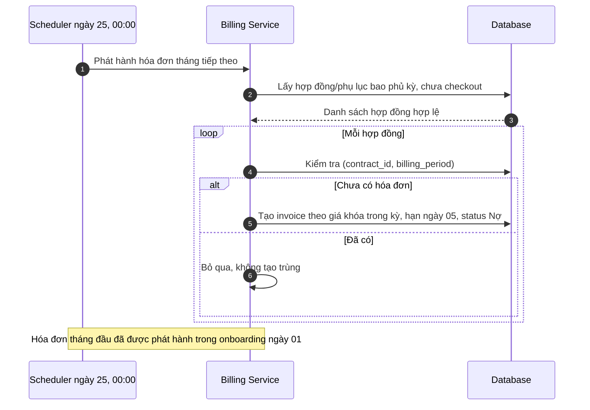
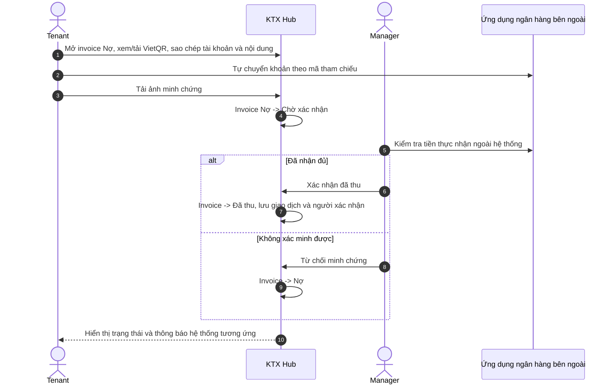
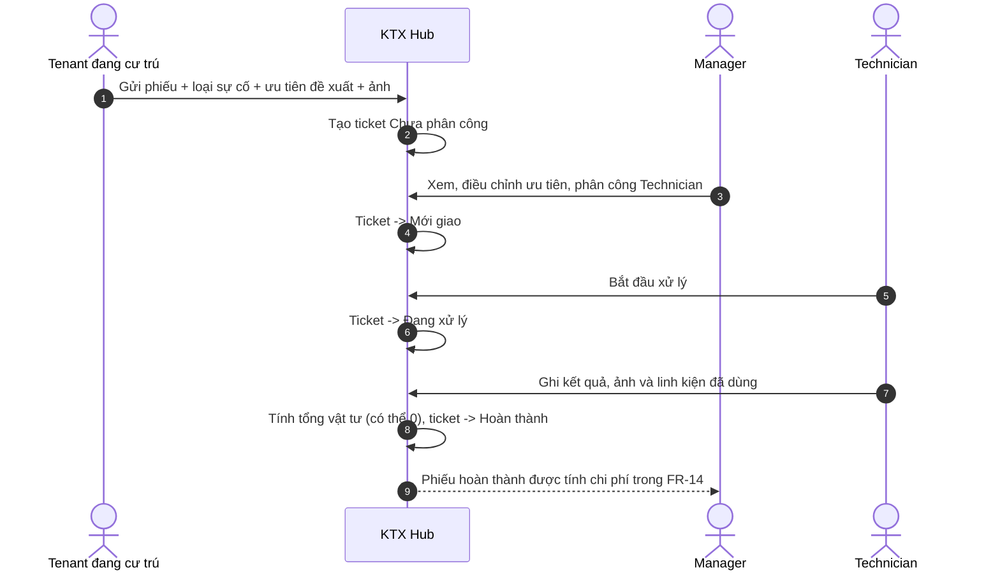

# ĐẶC TẢ YÊU CẦU PHẦN MỀM (SOFTWARE REQUIREMENTS SPECIFICATION — SRS)

## DỰ ÁN: HỆ THỐNG QUẢN LÝ KÝ TÚC XÁ TƯ NHÂN (KTX HUB / PDMS)

| Thông tin | Nội dung |
|---|---|
| Tên hệ thống | KTX Hub — Private Dormitory Management System (PDMS) |
| Loại tài liệu | Software Requirements Specification (SRS) |
| Phiên bản tài liệu | 3.4 — FINAL (bổ sung yêu cầu đổi xe giữ thẻ, cho phép biểu đồ dùng dữ liệu demo độc lập) |
| Ngày cập nhật | 11/11/2026 |
| Trạng thái | **FINAL — đặc tả đã chốt để triển khai**; chưa xác nhận Backend/Frontend hiện hành đáp ứng |
| Cấu trúc tham khảo | IEEE 830 / ISO/IEC/IEEE 29148 (cách tổ chức tài liệu, không tuyên bố chứng nhận tuân thủ) |
| Tệp triển khai dự kiến | `docs/SRS.md` |

> **Thay đổi v3.2 (chỉ các mục liên quan):** (1) **Change Password** yêu cầu phiên đăng nhập hợp lệ và mật khẩu hiện tại, **không dùng OTP**; **Forgot Password** vẫn dùng OTP email 6 số/5 phút qua Redis; (2) email mỗi tài khoản, kể cả Tenant, **duy nhất toàn hệ thống** và dùng nhận OTP, email Tenant **không** dùng đăng nhập; (3) JWT Access/Refresh và quản lý token/OTP bằng Redis, không thêm bảng OTP/Session vào PostgreSQL; (4) tài liệu và ảnh nhạy cảm lưu **private trên OCI Object Storage**, chỉ trả liên kết có chữ ký, hiệu lực tối đa 15 phút, sau kiểm tra quyền. **Giữ nguyên** chính sách mã phòng có điều kiện và phiếu thu của v3.1.

> **Thay đổi v3.3:** (1) Bổ sung 4 biểu đồ cho Dashboard, giữ đúng 4 KPI; (2) Manager có thể nhập **tổng lương nhân viên tự tính ngoài hệ thống** vào chi phí vận hành, và UI được sử dụng nhãn **“Lợi nhuận ròng (ước tính)”** kèm chú thích rõ giới hạn; (3) Manager có thể **từ chối yêu cầu cấp thẻ xe đang chờ** với lý do bắt buộc, **không cần minh chứng đính kèm**, đồng thời tạo thông báo hệ thống cho Tenant; (4) tăng dữ liệu lịch sử có ngày sự kiện để thử biểu đồ năm. Không tự động thay đổi Backend hay chứng nhận prototype đã hoàn thành.

> **Thay đổi v3.4:** (1) Tenant đang có xe `ISSUED` được **tự gửi yêu cầu đổi xe**; Manager phê duyệt/từ chối yêu cầu với lý do nếu từ chối; khi duyệt, tạo hồ sơ xe mới dùng **chính mã thẻ vật lý hiện tại**, chuyển hồ sơ xe cũ sang `REPLACED`, giữ toàn bộ lịch sử, **không yêu cầu thu hồi/bàn giao lại thẻ**; (2) tại **Prototype/Mock mode**, cho phép bốn biểu đồ Dashboard lấy **bộ số liệu minh họa tách biệt Shared Mock Store**, không cần khớp hóa đơn/phòng/giường/hợp đồng thực tế của các màn khác, với điều kiện **hiển thị nhãn “Dữ liệu biểu đồ minh họa”**; KPI chính vẫn lấy dữ liệu nghiệp vụ mock và không được giả là số liệu thật; (3) giữ nguyên quyết định “Lợi nhuận ròng (ước tính)” và từ chối cấp thẻ **chỉ cần lý do, không cần ảnh minh chứng** từ v3.3. Những quy tắc tích hợp Backend thật, ERD và API cần đồng bộ riêng sau giai đoạn Prototype.

> **Quy ước hiệu lực:** Tài liệu này phản ánh các quyết định nghiệp vụ đã thống nhất cho phạm vi Phase 1. Khi có khác biệt giữa SRS này với Conceptual ERD, Logical ERD hoặc mã nguồn hiện hành, phải lập kế hoạch đồng bộ thiết kế và triển khai theo SRS; không xem sự khác biệt là bằng chứng chức năng đã được thực hiện. FR-11 được giữ mã số nhưng hoãn triển khai sang Phase 2.

## MỤC LỤC

1. Giới thiệu
2. Tổng quan hệ thống
3. Quy tắc nghiệp vụ (BR-01–BR-11)
4. Yêu cầu chức năng (FR-01–FR-27)
5. Ma trận truy vết yêu cầu (RTM)
6. Các luồng tuần tự nghiệp vụ đầu cuối
7. Yêu cầu giao diện ngoài
8. Yêu cầu phi chức năng (NFR)
9. Phụ lục và tiêu chí hoàn thiện

---

## 1. GIỚI THIỆU (INTRODUCTION)

### 1.1. Mục đích tài liệu

Tài liệu quy định phạm vi, đối tượng sử dụng, quy tắc nghiệp vụ, yêu cầu chức năng và phi chức năng của **KTX Hub**, làm căn cứ chung cho phân tích nghiệp vụ, thiết kế giao diện, API, cơ sở dữ liệu, triển khai và nghiệm thu. Yêu cầu được trình bày theo hành vi hệ thống cần có, không đồng nhất với trạng thái đã có trong mã nguồn.

### 1.2. Phạm vi sản phẩm

KTX Hub hỗ trợ vận hành **một cơ sở/tòa nhà ký túc xá tư nhân** có nhiều tầng, phòng và vị trí ngủ cho thuê riêng lẻ. Mỗi phòng có 4, 6 hoặc 8 vị trí ngủ. Giường tầng, giường có rèm và sleepbox/pod chỉ là cách bố trí vật lý; hệ thống mô hình hóa thống nhất `Room → Bed`, không tạo thực thể Sleepbox riêng. Tất cả giường trong một phòng dùng cùng giá thuê tiêu chuẩn tại một thời điểm.

Đối tượng thuê có thể là người đi làm, sinh viên, học viên, freelancer hoặc cá nhân lưu trú hợp lệ khác. Không bắt buộc thông tin trường học, khoa, mã số sinh viên hoặc diện ưu tiên.

| Nhóm | Trong phạm vi Phase 1 | Ngoài phạm vi Phase 1 |
|---|---|---|
| Cơ sở và chỗ ở | Một tòa nhà; ma trận phòng/giường; giá phòng; tiện nghi; bảo trì giường; lưu trữ/khôi phục phòng | Đa cơ sở; thực thể Sleepbox riêng; thay đổi sức chứa phòng đã tạo; đặt/giữ chỗ |
| Khách thuê và hợp đồng | Tiếp nhận trực tiếp ngày 01; tài khoản Tenant; hợp đồng giấy và file scan; gia hạn bằng phụ lục; checkout; bảo toàn lịch sử | Tự đăng ký công khai; chuyển phòng (FR-11 ở Phase 2); gia hạn trễ/ở thêm mặc định |
| Tiền thuê và tài chính | Tiền thuê trọn gói; hóa đơn; VietQR và đối soát thủ công; tiền mặt; chi phí cơ sở; **tổng lương nhân viên do Manager tự tính và nhập theo tháng**; **Lợi nhuận ròng (ước tính từ dữ liệu đã ghi nhận)** | Tự động tính bảng lương từng nhân viên; kê khai thuế, khấu hao và kế toán đầy đủ; đồng bộ ngân hàng; tiền thuê lẻ tháng; thu tiền phạt trên hệ thống |
| Vận hành | Xe và mã thẻ vật lý (bao gồm **từ chối cấp thẻ kèm lý do** và **Tenant yêu cầu đổi xe giữ nguyên thẻ**); phiếu sự cố; linh kiện sửa chữa; vi phạm; **4 KPI và 4 biểu đồ Dashboard**; thông báo hệ thống | Barrier/đầu đọc thẻ; IoT; workflow mất thẻ riêng; thông báo thủ công/hàng loạt từ Manager; native app |
| Tài khoản | 3 role cố định; Tenant đăng nhập CCCD; nhân sự đăng nhập email; **đổi mật khẩu bằng mật khẩu cũ, khôi phục bằng OTP email**; email mỗi User duy nhất | Permission editor; đổi email tài khoản Manager; OTP khi đã đăng nhập đổi mật khẩu; xác minh email mới bằng OTP; lịch sử thao tác đổi email/reset mật khẩu riêng |

### 1.3. Thuật ngữ và từ viết tắt

| Thuật ngữ | Định nghĩa |
|---|---|
| PDMS | Private Dormitory Management System — hệ thống quản lý ký túc xá tư nhân |
| Room / Bed | Phòng và vị trí ngủ cho thuê riêng; `Bed` bao hàm cả vị trí dạng sleepbox/pod |
| Room Code / `room_number` | Mã phòng nghiệp vụ (ví dụ `P.302`), khác với UUID khóa chính; mã đang sử dụng hoặc gắn với lịch sử nghiệp vụ phải được bảo vệ |
| Bed Code / Slot Key | `bed_code` như `G02`; `slot_key = RoomCode-BedCode` như `P.302-G02` |
| Tenant | Khách thuê; CCCD 12 chữ số là định danh nghiệp vụ duy nhất, UUID là định danh kỹ thuật |
| Onboarding | Manager tiếp nhận, tạo/tái sử dụng hồ sơ và tài khoản, lập hợp đồng, gán giường, phát hành hóa đơn đầu tiên trong một quy trình nhất quán |
| Checkout | Bàn giao và thanh lý hợp đồng, giải phóng giường, bảo toàn hồ sơ/hóa đơn/công nợ |
| Gia hạn / Phụ lục | Văn bản giấy gia hạn hợp đồng gốc; mỗi lần gia hạn lưu thời hạn và mức giá cố định của kỳ gia hạn |
| Giá tiêu chuẩn phòng | Giá hiện hành chung cho tất cả giường của phòng, dùng khi lập hợp đồng hoặc ký phụ lục mới |
| Giá hợp đồng | Giá snapshot ở hợp đồng/phụ lục, không tự tăng theo giá tiêu chuẩn phòng sau khi ký |
| Kỳ hóa đơn (`billing_period`) | Tháng tiền thuê được thu, ví dụ `2026-12`; khác ngày Manager xác nhận tiền |
| `Nợ` / `Chờ xác nhận` / `Đã thu` | Ba trạng thái thanh toán hóa đơn. Quá hạn là chỉ báo tính từ hạn thanh toán, không phải trạng thái thứ tư |
| Bản ghi thu tiền (`PAYMENT_TRANSACTION`) | Bằng chứng hệ thống xác nhận một hóa đơn đã được Manager thu đủ bằng tiền mặt hoặc chuyển khoản VietQR; không phải lệnh/giao dịch ngân hàng và chỉ có sau xác nhận `Đã thu` |
| VietQR | Mã QR cung cấp tài khoản nhận, số tiền và nội dung chuyển khoản gắn mã hóa đơn; không tự xác nhận tiền đã đến |
| RBAC | Kiểm soát quyền theo 3 vai trò `MANAGER`, `TENANT`, `TECHNICIAN` |
| Yêu cầu đổi xe (`VehicleChangeRequest`) | Yêu cầu do Tenant đang có xe `ISSUED` khởi tạo; chứa thông tin xe mới, tham chiếu xe hiện tại và trạng thái duyệt, **không phải xe thứ hai đang có hiệu lực**; mã thẻ vật lý giữ nguyên nếu Manager chấp nhận |
| Xe `REPLACED` | Hồ sơ xe **đã được thay thế** bởi xe mới sau khi duyệt đổi xe; vẫn giữ lịch sử và mã thẻ trước đây nhưng **không đồng nghĩa đã thu hồi thẻ vật lý** |
| Lợi nhuận ròng (ước tính) | **Nhãn vận hành có điều kiện** cho doanh thu thuê đã xác nhận thu theo kỳ hóa đơn trừ các chi phí đã ghi nhận trong kỳ, bao gồm tổng lương Manager nhập thủ công; **không phải số liệu lợi nhuận ròng đã được kiểm toán hay báo cáo kế toán/thuế đầy đủ** |

### 1.4. Tài liệu tham chiếu

- Bản SRS nền: `SRS(3).md` và bản trích đặc tả `SRS_FR01_FR13_Chot_Nghiep_Vu.md`.
- `Conceptual_ERD.md` (bản nền v3.2), được đối chiếu và cập nhật thành `KTX_Hub_Conceptual_ERD_v3.4_Final.md` trong cùng đợt; thiết kế mức khái niệm không thay thế Logical ERD.
- `KTX_Hub_Logical_ERD_v3.5_Final.md` — mô hình dữ liệu logic cuối cùng, gồm 19 bảng PostgreSQL; bản `Logical-ERD.md` cũ chỉ để đối chiếu.
- Các quyết định nghiệp vụ đã được thống nhất trong quá trình review FR-01 đến FR-27.

### 1.5. Cấu trúc tài liệu

Chương 2 định vị hệ thống và tác nhân; Chương 3 chuẩn hóa BR; Chương 4 định nghĩa 27 FR; Chương 5 ánh xạ BR–FR–dữ liệu; Chương 6 mô tả các luồng đầu cuối; Chương 7–8 quy định giao diện ngoài và NFR; Chương 9 làm rõ phạm vi và các phần cần đồng bộ thiết kế.

---

## 2. TỔNG QUAN HỆ THỐNG (OVERALL DESCRIPTION)

### 2.1. Bài toán vận hành

Hệ thống giải quyết sáu nhu cầu cốt lõi: (1) quản lý chiếm chỗ theo từng Bed; (2) theo dõi chi phí cơ sở, tổng lương nhập thủ công và lợi nhuận ròng ước tính từ dữ liệu ghi nhận; (3) cách ly giới tính phòng; (4) thu tiền thuê trọn gói bằng VietQR/tiền mặt với xác nhận thủ công; (5) điều phối sự cố theo mức khẩn cấp; (6) quản lý phương tiện và thẻ gửi xe vật lý.

### 2.2. Nhóm tác nhân

| Tác nhân | Thiết bị ưu tiên | Phạm vi chính |
|---|---|---|
| Manager / Chủ KTX (`MANAGER`) | Desktop Web, laptop | Toàn bộ quản lý phòng/giường, khách thuê, hợp đồng, hóa đơn, thu tiền, tài chính, nhân viên, xe, sự cố, vi phạm và Dashboard |
| Khách thuê (`TENANT`) | Mobile Web | Thẻ phòng, hồ sơ được phép, hóa đơn, VietQR, minh chứng, xe, báo hỏng, thông báo và lịch sử cá nhân |
| Kỹ thuật viên (`TECHNICIAN`) | Mobile/Tablet Web | Các phiếu sự cố được phân công; cập nhật trạng thái, kết quả, ảnh nghiệm thu và linh kiện sử dụng |

Tenant đã checkout vẫn mang role `TENANT` nhưng quyền theo trạng thái cư trú bị giới hạn: xem hợp đồng/hóa đơn/giao dịch/vi phạm cũ và gửi minh chứng cho khoản `Nợ`; không đăng ký xe hay báo hỏng mới.

### 2.3. Hệ thống ngoài

- Ứng dụng ngân hàng của khách thực hiện chuyển khoản bằng VietQR. Manager tự đối chiếu tiền thực nhận trong ngân hàng **ngoài KTX Hub**; không có webhook và tự động gạch nợ.
- Dịch vụ email **chỉ gửi OTP khôi phục mật khẩu**; không tự động xác minh quyền sở hữu email mới khi Manager cập nhật hồ sơ.
- Dịch vụ lưu trữ tệp phục vụ hợp đồng, ảnh đăng ký xe, minh chứng thanh toán và ảnh sự cố/nghiệm thu.

### 2.4. Môi trường vận hành

Frontend sử dụng React/TypeScript, trình duyệt Chrome, Edge, Firefox và Safari; Backend Java Spring Boot cung cấp REST/JSON; dữ liệu nghiệp vụ lưu PostgreSQL; **JWT Access/Refresh** kết hợp **Redis** để quản lý thu hồi token/OTP tạm thời; tệp nhạy cảm lưu **OCI Object Storage ở chế độ private**. Giao diện responsive cho Desktop, Mobile và Tablet.

### 2.5. Ràng buộc và giả định

1. Phase 1 phục vụ một cơ sở. Mỗi phòng chỉ có 4/6/8 giường và chính sách giới tính `Nam`/`Nữ`.
2. Không có tự đặt/giữ chỗ. **Khách mới chỉ tạo hồ sơ, User và hợp đồng khi thực hiện onboarding ngày 01**; ngày bắt đầu cư trú cũng là ngày 01. Hợp đồng tính theo tháng đầy đủ, kết thúc vào ngày cuối của kỳ thuê; lần gia hạn tiếp nối từ ngày 01 tháng tiếp theo.
3. Ngày ký/thỏa thuận giấy và bàn giao được Manager thực hiện trực tiếp theo quy trình; upload bản scan có thể làm sau. Phần mềm không ký số hợp đồng.
4. Tiền cọc và bàn giao/khấu trừ được xử lý ngoài thực tế; hệ thống lưu giá trị cần tra cứu, không thực hiện nghiệp vụ quyết toán cọc tự động phức tạp.
5. Backend chịu trách nhiệm về toàn vẹn dữ liệu, ngăn gán giường trùng và kiểm tra quyền; giao diện ẩn nút không thay thế điều kiện nghiệp vụ phía máy chủ.
6. Việc cập nhật Conceptual ERD, Logical ERD, API và Backend được thực hiện **sau** bước xác nhận đặc tả; không ép SRS giữ nguyên các hạn chế của schema cũ.

---

## 3. QUY TẮC NGHIỆP VỤ CỐT LÕI (BUSINESS RULES)

### BR-01 — Vị trí ngủ, trạng thái và mã định danh

1. Mỗi phòng có đúng 4, 6 hoặc 8 Bed. Cấu hình tầng và sức chứa không được chỉnh sửa sau khi tạo. Các Bed trong phòng dùng một giá tiêu chuẩn chung.
2. `rooms.id` và `beds.id` là khóa chính nội bộ bất biến. Room Code (`room_number`) là mã nghiệp vụ, Bed Code (`bed_code`) là mã giường; `slot_key = RoomCode-BedCode` duy nhất. Khi Room Code được đổi hợp lệ, phải cập nhật mọi Slot Key tương ứng đồng bộ, không thay đổi UUID và các snapshot hợp đồng cũ.
3. Trạng thái Bed: `AVAILABLE`, `OCCUPIED`, `MAINTENANCE`. Không có `RESERVED`. Manager chỉ trực tiếp chuyển `AVAILABLE ↔ MAINTENANCE` ở giường trống; `OCCUPIED` chỉ thay đổi qua onboarding/checkout.
4. **Mã phòng chỉ được tái sử dụng khi chưa từng gắn với dữ liệu nghiệp vụ cần bảo toàn.** Mã phòng của Room còn tồn tại (kể cả Room đã Archive) luôn được giữ riêng, không cấp đồng thời cho Room khác. Mã đã xuất hiện trong hợp đồng, lịch sử cư trú, phiếu sự cố hoặc hồ sơ nghiệp vụ cần giữ **không được tái sử dụng**, kể cả sau khi Room đổi mã. Riêng Room tạo nhầm đã xóa vật lý an toàn mà chưa phát sinh dữ liệu nghiệp vụ, hoặc mã cũ của Room được đổi tên khi chưa phát sinh dữ liệu nghiệp vụ, có thể được cấp lại. Cấu hình phòng/giường/tiện nghi chưa sử dụng không tính là lịch sử nghiệp vụ cần bảo toàn.
5. Phòng không còn khách và không có hợp đồng chiếm chỗ hiệu lực mới được đổi mã, đổi chính sách giới tính hoặc lưu trữ. Phòng lưu trữ không nhận khách mới; có thể khôi phục, giữ nguyên Bed/Room ID và trạng thái giường.
6. Tỷ lệ lấp đầy = số giường `OCCUPIED` / tổng giường vật lý **của các phòng đang vận hành**; giường `MAINTENANCE` vẫn thuộc mẫu số.

### BR-02 — Chính sách giới tính phòng

1. Một phòng chỉ cho người thuê cùng giới tính `Nam` hoặc `Nữ` cư trú; không xếp người không phù hợp.
2. Chỉ đổi chính sách giới tính khi phòng **không còn người đang cư trú và không có hợp đồng chiếm chỗ còn hiệu lực**.
3. Backend bắt buộc kiểm tra tại thời điểm gán giường/chỉnh chính sách; không tự đổi giới tính Tenant hoặc di chuyển khách để hợp thức hóa.

### BR-03 — Tiền thuê trọn gói, chi phí vận hành và lợi nhuận ròng ước tính

1. Tiền thuê mỗi Bed theo giá đã khóa trong hợp đồng/phụ lục, gồm tiền phòng và dịch vụ cơ bản: điện, nước, Internet, gửi xe theo chính sách cơ sở. Không xuất hóa đơn tiện ích phân bổ riêng từng Tenant.
2. Giá tiêu chuẩn chung của phòng có thể được Manager thay đổi; mức mới được sử dụng cho **hợp đồng mới hoặc phụ lục gia hạn ký sau khi thay đổi**, không cập nhật giá hợp đồng/phụ lục đã ký và không chỉnh hóa đơn đã phát hành.
3. Doanh thu thực thu của một **kỳ hóa đơn** chỉ gồm số tiền của các hóa đơn kỳ đó đã được Manager xác nhận `Đã thu`. Hóa đơn thanh toán muộn vẫn được phản ánh vào kỳ hóa đơn gốc, không chuyển sang kỳ của ngày nhận tiền. Doanh thu kỳ vọng gồm toàn bộ giá trị hóa đơn của kỳ, không phụ thuộc trạng thái thu.
4. Manager tự tính lương nhân viên **ngoài hệ thống** và nhập **một khoản tổng lương của tháng** vào nhóm chi phí `Lương nhân viên`, kèm ngày chi phí, tiêu đề và chứng từ/ghi chú khi có. Hệ thống **không** tính lương theo nhân viên, chấm công, các khoản trích theo lương hoặc khấu trừ thuế. Nếu cần điều chỉnh số lương tháng đã nhập, Manager sửa khoản ghi nhận thay vì nhập trùng.
5. **Lợi nhuận ròng (ước tính theo dữ liệu ghi nhận) của kỳ** = doanh thu tiền thuê đã xác nhận thu thuộc kỳ hóa đơn − chi phí vật tư của phiếu sửa chữa hoàn thành trong kỳ − chi phí cơ sở (điện, nước, Internet) theo ngày chi phí − tổng lương nhân viên nhập thủ công theo tháng − các chi phí vận hành khác theo ngày ghi nhận. Không tính trùng chi phí vật tư đã tổng hợp từ Ticket; không tính tiền cọc vào doanh thu hoặc tiền phạt vi phạm vào doanh thu thuê.
6. **Điều kiện sử dụng nhãn “Lợi nhuận ròng (ước tính)”**: Dashboard/Finance và báo cáo phải kèm giải thích “Chỉ dựa trên doanh thu và chi phí đã nhập/ghi nhận; có thể chưa bao gồm mọi nghĩa vụ và chi phí thực tế”. Doanh thu nhóm theo `billing_period` còn chi phí nhóm theo `expense_date` hoặc ngày Ticket hoàn thành; đây là **chỉ số vận hành quy ước**, không phải lợi nhuận ròng kế toán được kiểm toán, báo cáo thuế hoặc dòng tiền. Khi thiếu khoản chi chưa được nhập, số ước tính có thể cao hơn thực tế.

### BR-04 — Cọc, thời hạn hợp đồng và checkout

1. Cọc tiêu chuẩn bằng một tháng tiền thuê giường; điều khoản cụ thể, thu và hoàn/trừ cọc được thực hiện ngoài thực tế theo hợp đồng giấy. KTX Hub không tự quyết toán cọc phức tạp.
2. Khách thông báo ý định rời đi tối thiểu 15 ngày. Nếu không gia hạn, khách phải rời phòng chậm nhất ngày cuối hợp đồng; Manager chủ động kiểm tra phòng, bàn giao, xử lý cọc và thu hồi chìa khóa/thẻ xe **trong ngày cuối**. Không có quyền ở thêm mặc định hoặc quy trình gia hạn trễ Phase 1.
3. Chỉ Manager xác nhận checkout sau bàn giao. Manager phải chọn giường trở lại `AVAILABLE` hoặc `MAINTENANCE`; hệ thống cập nhật hợp đồng, cư trú, giường và thu hồi xe/thẻ một cách nhất quán.
4. Checkout vẫn được thực hiện khi có hóa đơn `Nợ` hoặc `Chờ xác nhận`; giữ nguyên các trạng thái đó cho việc đối soát sau. Khách đã checkout vẫn đăng nhập và gửi minh chứng cho hóa đơn `Nợ`.
5. Không tự xóa hồ sơ, hợp đồng, hóa đơn, giao dịch, công nợ, lịch sử cư trú, phiếu sự cố hay vi phạm. Không tự giải phóng giường chỉ vì đến ngày hết hạn khi chưa xác nhận bàn giao.
6. **Không cho gia hạn hoặc ký hợp đồng mới nếu Tenant còn hóa đơn `Nợ` hoặc `Chờ xác nhận`**. Thu nợ ngoài thực tế do Manager thực hiện; không có workflow đòi nợ riêng.

### BR-05 — Chu kỳ thuê, phát hành hóa đơn và thanh toán

1. Ngày **tạo hồ sơ Tenant mới = ngày onboarding = ngày bắt đầu cư trú = ngày 01 của tháng**. Không tiếp nhận bắt đầu thuê giữa tháng, không tạo hồ sơ Tenant độc lập trước khi có hợp đồng, không tính tiền thuê lẻ tháng.
2. Khi onboarding thành công ngày 01, hệ thống phát hành ngay hóa đơn **tháng đầu** với giá thuê trọn tháng từ hợp đồng. Việc tạo Tenant/User (nếu mới), hợp đồng, gán giường và hóa đơn đầu tiên phải nhất quán; không xác nhận onboarding hoàn tất một nửa.
3. Các tháng tiếp theo, hệ thống phát hành hóa đơn cho kỳ tháng sau vào **00:00 ngày 25 tháng hiện tại**, theo múi giờ cơ sở (`Asia/Ho_Chi_Minh`). Chỉ phát hành nếu kỳ được thu nằm trong thời hạn thuê có hiệu lực của hợp đồng/phụ lục và chưa checkout. Không tạo hóa đơn cho kỳ sau thời hạn thuê.
4. Một hợp đồng có tối đa **một hóa đơn tiền thuê cho mỗi kỳ**. Có thể chạy lại tác vụ để tạo hóa đơn còn thiếu, nhưng không được trùng. Hạn thanh toán là ngày **05 của kỳ hóa đơn**, kể cả hóa đơn tháng đầu; không phạt trễ hạn.
5. Trạng thái thanh toán: `Nợ` (ban đầu), `Chờ xác nhận` (đã gửi minh chứng, chưa đối soát), `Đã thu` (Manager xác nhận đủ tiền). `Quá hạn` chỉ là dấu hiệu tính trên hóa đơn `Nợ` quá ngày 05, không phải trạng thái thứ tư; `Chờ xác nhận` không nằm trong nợ quá hạn.
6. VietQR hiển thị tài khoản nhận, số tiền và mã tham chiếu; Tenant chuyển khoản, tải ảnh minh chứng để chuyển `Nợ → Chờ xác nhận`; Manager kiểm tra tiền thực nhận rồi xác nhận `Đã thu` hoặc từ chối để quay về `Nợ`.
7. Tiền mặt được Manager xác nhận sau khi thực nhận đủ, chỉ từ hóa đơn `Nợ → Đã thu`; không thu tiền mặt cho hóa đơn `Chờ xác nhận` và không ghi nhận lần thu thứ hai cho hóa đơn `Đã thu`.
8. Khi và chỉ khi Manager xác nhận **đã nhận đủ** tiền (tiền mặt hoặc chuyển khoản VietQR), hệ thống tạo **một bản ghi thu tiền `PAYMENT_TRANSACTION`** cho hóa đơn, lưu số tiền, phương thức, thời gian và người xác nhận. Một hóa đơn có tối đa một bản ghi thu tiền hoàn tất trong Phase 1. Ảnh minh chứng ở trạng thái `Chờ xác nhận` chưa phải bản ghi thu tiền hoàn tất. `PAYMENT_TRANSACTION` chỉ ghi nhận tiền KTX đã thu, **không phải giao dịch ngân hàng**, không có webhook hay tự động gạch nợ. Thanh toán một phần, trả dư, hoàn tiền và chuyển khoản không có minh chứng không được mở rộng thành luồng Phase 1.

### BR-06 — Ưu tiên và vòng đời sự cố

1. Tenant đang cư trú tạo phiếu báo hỏng, chọn loại trong `Điện`, `Nước`, `Internet`, `Nội thất`, `Tiện ích`, `Khác`; đề xuất mức ưu tiên `Khẩn cấp`, `Cao`, `Bình thường`, kèm mô tả/ảnh hiện trường.
2. Phiếu đi theo `Chưa phân công → Mới giao → Đang xử lý → Hoàn thành`. Manager phân công và có thể điều chỉnh mức ưu tiên, hạn hoàn thành; có thể đổi Technician khi phiếu chưa hoàn thành.
3. Technician chỉ xử lý phiếu hiện đang được giao. Trong danh sách, phiếu chưa hoàn thành đứng trước; sau đó theo mức ưu tiên Khẩn cấp → Cao → Bình thường và thời điểm tạo tăng dần.
4. Khi hoàn thành, Technician ghi kết quả, ảnh nghiệm thu và linh kiện đã dùng (tên, số lượng, đơn giá); tổng chi phí được tính tự động. Không dùng linh kiện thì chi phí bằng 0. Không có luồng mở lại hoặc nghiệm thu nhiều cấp.

### BR-07 — Biên bản vi phạm

1. Manager được lập biên bản cho khách **đang cư trú**; mỗi biên bản gắn trực tiếp Tenant, không bắt buộc gắn Room ID.
2. Loại: `Về muộn`, `Gây ồn`, `Vệ sinh`, `Khách ngoài`, `Hút thuốc / cháy nổ`, `Khác`; hình thức: `Nhắc nhở`, `Cảnh cáo`, `Phạt tiền`.
3. Nếu phạt tiền, chỉ lưu số tiền và ghi chú vi phạm; **không** tạo hóa đơn, công nợ, giao dịch thu tiền phạt hoặc cộng vào doanh thu thuê phòng.
4. Tenant chỉ được xem biên bản của chính mình; lịch sử được giữ sau checkout.

### BR-08 — Toàn vẹn dữ liệu và bảo toàn lịch sử

1. Toàn vẹn giao dịch áp dụng cho tạo Room/Bed, đổi Room Code/Slot Key, onboarding và hóa đơn đầu tiên, checkout và các cập nhật khác có quan hệ chặt chẽ.
2. Không có hai hợp đồng chiếm chỗ hiện hành trên cùng Bed; một Tenant không có hai hợp đồng chiếm chỗ hiện hành. Backend phải xử lý an toàn các yêu cầu đồng thời.
3. Bảo toàn hồ sơ định danh, hợp đồng, phụ lục giá/thời hạn, hóa đơn, thu tiền, phiếu sửa chữa và vi phạm. Chỉ xóa vật lý phòng tạo nhầm khi hoàn toàn chưa có nghiệp vụ cần giữ; phòng có lịch sử thì lưu trữ/khôi phục. Không giải phóng mã Room đã gắn với lịch sử, nhưng được dùng lại mã đã giải phóng hợp lệ sau xóa/đổi mã khi chưa từng có dữ liệu nghiệp vụ.
4. Không áp dụng máy móc Soft Delete hoặc cùng một quy tắc xóa khóa ngoại cho mọi bảng; Logical ERD và Backend phải được đồng bộ với điều kiện từng nghiệp vụ đã chốt.

### BR-09 — Hồ sơ khách thuê và xác thực

1. Không có tự đăng ký. Manager tạo Tenant/User mới **duy nhất trong onboarding ngày 01**; khách quay lại dùng Tenant/User cũ theo CCCD sau khi đã tất toán các khoản thuê cũ.
2. Tenant đăng nhập bằng **CCCD 12 chữ số + mật khẩu**; Manager và Technician đăng nhập bằng **email + mật khẩu**. CCCD không phải khóa chính; mỗi tài khoản và hồ sơ vẫn có UUID riêng. **Mỗi tài khoản User có một email duy nhất trong toàn hệ thống** (chuẩn hóa chữ hoa/thường); email Tenant chỉ dùng liên hệ/nhận OTP, **không dùng đăng nhập**. SĐT không phải định danh đăng nhập và không bắt buộc duy nhất.
3. Mật khẩu ban đầu sinh ngẫu nhiên và chỉ hiển thị một lần để bàn giao; Backend chỉ lưu mật khẩu băm. Không bắt buộc đổi ở lần đăng nhập đầu tiên.
4. Manager được đổi email Tenant và Technician sau khi tự xác minh danh tính ngoài thực tế; không có OTP xác minh email mới hay yêu cầu tạo lịch sử đổi email/reset mật khẩu riêng. Tenant/Technician không tự đổi email. **Không xây dựng chức năng đổi email của Manager**; email đăng nhập Manager được cấu hình cố định.
5. **Change Password:** cả ba role khi đã đăng nhập phải cung cấp mật khẩu hiện tại và mật khẩu mới hợp lệ; **không gửi/kiểm tra OTP**. **Forgot Password:** dùng OTP email 6 chữ số, hiệu lực 5 phút, dùng một lần và giới hạn thử; Tenant xác định tài khoản bằng CCCD, nhân sự bằng email. Khi Tenant/Technician mất quyền truy cập email, liên hệ Manager để xác minh và hỗ trợ thay email hoặc cấp lại mật khẩu; không tạo quy trình nhiều cấp.
6. Sau checkout, Tenant giữ tài khoản, tra cứu tài liệu/hóa đơn/lịch sử và gửi minh chứng nợ cũ; không dùng chức năng cư trú hiện hành. Không tạo role `FORMER_TENANT`.

### BR-10 — Phương tiện, yêu cầu đổi xe và thẻ gửi xe

1. Mỗi Tenant **đang cư trú** có tối đa **một hồ sơ xe đang có hiệu lực hoặc chờ cấp thẻ** (`ISSUED` hoặc `PENDING_CARD`). Xe `REJECTED` (Bị từ chối), `REVOKED` (Đã thu hồi thẻ), `REPLACED` (Đã thay thế xe) và `CANCELLED` (Đã hủy đăng ký chưa cấp thẻ) **không chiếm hạn mức**; tất cả đều được giữ lịch sử, trừ chính sách xóa dữ liệu hợp pháp không thuộc nghiệp vụ này.
2. Xe tay ga, xe số, xe máy điện có đăng ký cần biển số và ảnh hai mặt giấy đăng ký; xe đạp điện không có giấy đăng ký và xe đạp thường được để trống biển số/ảnh giấy tờ theo bảng FR-08. Kiểm tra ở cả UI và tầng nghiệp vụ, không chỉ trong form.
3. Với đăng ký mới `PENDING_CARD`, Manager được **cấp thẻ** (`ISSUED`, phải nhập mã thẻ vật lý và xác nhận bàn giao) hoặc **từ chối** (`REJECTED`, lý do văn bản bắt buộc, không yêu cầu ảnh/tệp minh chứng). Khi từ chối lưu người/thời điểm, thông báo tự động trong ứng dụng cho Tenant; Tenant được đăng ký lại bằng **hồ sơ mới**, không sửa lịch sử từ chối.
4. **Đổi xe khi đã được cấp thẻ:** Tenant có xe `ISSUED` chọn `[Yêu cầu đổi xe]` và cung cấp **thông tin, giấy tờ của xe mới**. Hệ thống tạo `VehicleChangeRequest` ở trạng thái `PENDING`, tham chiếu xe hiện tại và dữ liệu xe mới; **xe cũ vẫn `ISSUED`, mã thẻ vẫn có hiệu lực** trong lúc chờ. Yêu cầu đổi xe **không tạo xe `ISSUED` thứ hai**, không chiếm thêm hạn mức. Mỗi Tenant có tối đa một yêu cầu đổi xe `PENDING` tại một thời điểm.
5. **Manager duyệt yêu cầu đổi xe:** sau khi kiểm tra dữ liệu và giấy tờ xe mới, hệ thống thực hiện **một cập nhật nhất quán**: chuyển hồ sơ xe cũ `ISSUED → REPLACED`; tạo hồ sơ xe mới ID khác, trạng thái `ISSUED`, gắn **đúng mã thẻ vật lý đang dùng**; đánh dấu yêu cầu `APPROVED`, liên kết ID xe cũ/mới, lưu người và thời điểm duyệt. **Không thu hồi, không bàn giao lại và không sinh mã thẻ mới**. Lịch sử cả hai xe và thời điểm thay thế được giữ.
6. **Manager từ chối yêu cầu đổi xe:** bắt buộc ghi **lý do văn bản**, không yêu cầu minh chứng; yêu cầu `PENDING → REJECTED`, tạo thông báo cho Tenant kèm lý do. **Xe cũ vẫn `ISSUED`, thẻ vật lý vẫn hoạt động**; Tenant có thể gửi yêu cầu mới sau khi yêu cầu cũ kết thúc. Không sử dụng thao tác `REVOKED` để từ chối.
7. `REPLACED` chỉ có nghĩa **hồ sơ xe cũ được thay thế**, không có nghĩa thẻ vật lý đã trả. `REVOKED` chỉ dùng khi Manager thực sự nhận lại/thu hồi thẻ đã cấp (ví dụ Tenant thôi gửi xe, checkout). Xe chưa từng cấp thẻ khi bị hủy đăng ký/checkout dùng `CANCELLED`, không gắn hành vi thu hồi thẻ. Không tạo quy trình riêng xử lý mất thẻ.
8. **Duy nhất mã thẻ đang có hiệu lực:** tại cùng một thời điểm chỉ tối đa một xe `ISSUED` sở hữu mỗi mã thẻ; các bản ghi `REPLACED`/`REVOKED` có thể giữ mã đó trong lịch sử. Manager có thể cấp lại mã thẻ sau **thu hồi vật lý hợp lệ**, hoặc tiếp tục mã đang dùng trong **giao dịch thay xe** đã được duyệt; không được cấp cùng mã cho hai xe `ISSUED` đồng thời. Trình tự duyệt phải được bảo vệ khỏi thao tác đồng thời/lặp yêu cầu.
9. Khi checkout, hệ thống hủy yêu cầu đổi xe `PENDING` (`CANCELLED`), hủy đăng ký `PENDING_CARD` (`CANCELLED`) và Manager thu hồi vật lý thẻ của xe `ISSUED` (`REVOKED`) đồng bộ với nghiệp vụ checkout. Không để quyền gửi xe còn hiệu lực sau checkout; giữ lịch sử.
10. Gửi xe đã gồm trong tiền thuê trọn gói; không tích hợp đầu đọc thẻ, barrier, lượt quét, thanh toán thẻ xe hay quy trình khiếu nại riêng trong Phase 1.

### BR-11 — Ba vai trò và phạm vi truy cập

1. Ba vai trò cố định: `MANAGER`, `TENANT`, `TECHNICIAN`. Không có trình chỉnh quyền tùy biến.
2. Manager quản lý dữ liệu vận hành và tài khoản Technician; Tenant chỉ thao tác với dữ liệu cá nhân trong phạm vi cư trú; Technician chỉ thấy/xử lý phiếu đang được giao.
3. Backend kiểm tra vai trò, chủ sở hữu dữ liệu và trạng thái cư trú trên mọi thao tác được bảo vệ; ẩn nút ở UI không đủ. Technician bị khóa phải bị thu hồi phiên còn hiệu lực.
4. Theo FR-27, hộp thư Tenant chỉ hiển thị **thông báo tự động do hệ thống sinh từ nghiệp vụ**; không có giao diện Manager soạn/gửi thông báo chung.

| Chức năng | `MANAGER` | `TENANT` | `TECHNICIAN` |
|---|---|---|---|
| Phòng/giường | Quản lý | Xem thẻ phòng khi đang ở | Không |
| Hồ sơ/hợp đồng | Quản lý | Xem của mình; cập nhật thông tin được cấp quyền | Không |
| Hóa đơn/thu tiền | Phát hành/đối soát/xác nhận | Xem và gửi minh chứng của mình | Không |
| Phương tiện | Duyệt cấp/từ chối thẻ, duyệt/từ chối yêu cầu đổi xe, thu hồi | Đăng ký và xem xe; tự gửi yêu cầu đổi xe khi đã được cấp thẻ | Không |
| Sự cố | Phân công/điều chỉnh | Tạo/xem phiếu của mình khi đang ở | Chỉ xử lý phiếu được giao |
| Vi phạm | Lập/xem | Chỉ xem của mình | Không |
| Tài chính và KPI | Toàn quyền | Không | Không |
| Tài khoản Technician | Tạo/sửa/khóa/kích hoạt | Không | Không |
| Xác thực cá nhân | Đăng nhập; đổi bằng mật khẩu cũ; quên dùng OTP | Đăng nhập; đổi bằng mật khẩu cũ; quên dùng OTP | Đăng nhập; đổi bằng mật khẩu cũ; quên dùng OTP |

---
## 4. YÊU CẦU CHỨC NĂNG CHI TIẾT (FUNCTIONAL REQUIREMENTS — FR)

### 4.0. Nguyên tắc áp dụng chung

- Mọi thao tác của `MANAGER`, `TENANT`, `TECHNICIAN` phải kiểm tra quyền phía Backend; dữ liệu lịch sử luôn thuộc đúng chủ thể.
- Đối tượng cơ sở: một tòa nhà, phòng 4/6/8 Bed, trạng thái Bed `AVAILABLE`, `OCCUPIED`, `MAINTENANCE`, không giữ chỗ.
- Kỳ thuê trọn tháng: onboarding chỉ ngày 01; phát hành hóa đơn tháng đầu ngay khi onboarding, tháng sau theo lịch ngày 25.
- Tài khoản Tenant đăng nhập **CCCD + mật khẩu**; Manager và Technician đăng nhập **email + mật khẩu**; email liên kết User duy nhất toàn hệ thống. Đổi mật khẩu khi đã đăng nhập dùng mật khẩu cũ (**không OTP**); quên mật khẩu dùng OTP email qua Redis.
- SRS xác định **hành vi cần triển khai**, không khẳng định Backend/DB hiện có đã đáp ứng.

### 4.1. Phân hệ Cơ sở, Phòng và Giường (Room & Bed Management)

#### FR-01: Hiển thị sơ đồ ma trận phòng và giường (Room–Bed Matrix Grid)

**Tác nhân:** Manager.  
**Mục tiêu:** Quan sát sức chứa, tình trạng chiếm chỗ và tình trạng bảo trì theo từng phòng và giường.

**Đầu vào và điều kiện:**
- Bộ lọc tầng theo các tầng thực tế đang quản lý.
- Bộ lọc chính sách giới tính phòng: `Tất cả`, `Nam`, `Nữ`.
- Dữ liệu phòng và giường đang được khai thác; phòng đã lưu trữ không xuất hiện trong ma trận vận hành thông thường.

**Quy trình xử lý:**
1. Hệ thống hiển thị danh sách phòng theo tầng; mỗi phòng thể hiện mã phòng, giới tính phòng, sức chứa 4/6/8, số giường đang thuê và số giường còn sẵn sàng.
2. Mỗi giường thể hiện mã giường và trạng thái trực quan: `OCCUPIED` (xanh), `AVAILABLE` (viền nét đứt), `MAINTENANCE` (biểu tượng cờ lê/màu cam).
3. Tỷ lệ lấp đầy được tính theo `số giường OCCUPIED / tổng số giường vật lý × 100%`. Giường đang bảo trì vẫn thuộc mẫu số tổng sức chứa; số giường sẵn sàng cho thuê được hiển thị riêng.
4. Khi Manager chọn phòng, mở Drawer thể hiện các giường, khách đang cư trú tương ứng và tiện nghi kèm số lượng.
5. Manager được chuyển giường **`AVAILABLE ↔ MAINTENANCE`** khi giường không bị chiếm chỗ bởi hợp đồng hiện hành. Chuyển sang hoặc ra khỏi `OCCUPIED` chỉ thực hiện thông qua onboarding/checkout hợp lệ, không cho sửa thủ công trong Drawer.
6. Ở giường `AVAILABLE`, giao diện có thao tác `[+ Xếp khách]` dẫn tới FR-09 và điền sẵn phòng/giường được chọn.
7. Dữ liệu ma trận được tải từ Backend khi mở/làm mới trang và sau các thao tác thành công; Phase 1 **không yêu cầu WebSocket** hoặc đồng bộ tức thời giữa các trình duyệt.

**Ràng buộc và trường hợp từ chối:**
- Từ chối chuyển giường `OCCUPIED` sang `AVAILABLE` hoặc `MAINTENANCE` bằng thao tác trạng thái thủ công.
- Từ chối xếp khách vào giường `MAINTENANCE`, `OCCUPIED` hoặc phòng đã lưu trữ.
- Backend phải ngăn hai yêu cầu đồng thời chiếm cùng một giường.

**Đầu ra:** Ma trận phòng–giường đúng dữ liệu Backend, có tỷ lệ lấp đầy và Drawer chi tiết; mọi thay đổi trạng thái hợp lệ được cập nhật nhất quán.

**Quy tắc liên quan:** BR-01, BR-02, BR-08; FR-03, FR-09, FR-13.

#### FR-02: Thêm mới phòng và tự động sinh danh mục giường

**Tác nhân:** Manager.  
**Mục tiêu:** Đăng ký một phòng vật lý mới trong hệ thống cùng đầy đủ các vị trí ngủ.

**Đầu vào:**
- Mã phòng (`room_number`/Room Code), ví dụ `P.302`.
- Tầng (`floor`) thuộc các tầng hợp lệ của cơ sở.
- Sức chứa/loại phòng: **4, 6 hoặc 8** vị trí ngủ.
- Chính sách giới tính: `Nam` hoặc `Nữ`.
- Giá thuê tiêu chuẩn hằng tháng (`base_price`), áp dụng đồng nhất cho các giường.
- Danh mục tiện nghi và số lượng từng loại (nếu có).

**Quy trình xử lý:**
1. Manager nhập thông tin phòng và yêu cầu tạo mới.
2. Backend kiểm tra dữ liệu bắt buộc, mã phòng chưa thuộc Room đang tồn tại/đã lưu trữ và không nằm trong tập mã gắn với lịch sử nghiệp vụ phải bảo vệ; mã được giải phóng hợp lệ từ một Room tạo nhầm chưa có nghiệp vụ có thể dùng lại. Đồng thời kiểm tra sức chứa hợp lệ, giá thuê lớn hơn 0 và số lượng tiện nghi hợp lệ (số nguyên dương đối với tiện nghi được chọn).
3. Hệ thống tạo một Room và đúng số Bed tương ứng, đánh mã giường `G01` đến `G04`/`G06`/`G08`, với `slot_key = RoomCode-BedCode` duy nhất; mọi giường ban đầu là `AVAILABLE`.
4. Phòng, giường và quan hệ tiện nghi được ghi nhận nhất quán trong cùng đơn vị xử lý dữ liệu. Không được để tồn tại phòng chỉ tạo được một phần số giường.

**Ràng buộc:**
- Không có đặt chỗ/giữ chỗ trước (`RESERVED`).
- Sức chứa và tầng được xác lập tại lúc tạo phòng và không hỗ trợ chỉnh sửa trong FR-03.
- Mã phòng còn thuộc Room đang tồn tại (kể cả đã lưu trữ) hoặc từng gắn với lịch sử hợp đồng/cư trú/sự cố không được cấp cho Room mới. Chỉ cho tái sử dụng mã đã được giải phóng hợp lệ từ phòng tạo nhầm chưa có dữ liệu nghiệp vụ hoặc mã cũ sau đổi tên trước khi phát sinh nghiệp vụ; cơ chế kiểm tra mã bảo vệ được đồng bộ tại thiết kế dữ liệu.

**Đầu ra:** Room mới cùng chính xác 4/6/8 Bed, các mã vị trí hợp lệ, giá tiêu chuẩn đồng nhất và trạng thái `AVAILABLE`.

**Quy tắc liên quan:** BR-01, BR-02, BR-08; FR-01, FR-03, FR-04.

#### FR-03: Cập nhật thông tin phòng, mã phòng và tiện nghi

**Tác nhân:** Manager.  
**Mục tiêu:** Hiệu chỉnh những thuộc tính được phép của phòng mà không làm sai vị trí, chiếm chỗ hay lịch sử hợp đồng.

**Đầu vào:** Room ID; mã phòng mới (nếu có); giá tiêu chuẩn mới; chính sách giới tính mới (nếu có); danh mục tiện nghi và số lượng.

**Quy trình xử lý:**
1. Manager chọn phòng đang được quản lý và mở giao diện cập nhật.
2. Hệ thống cho phép cập nhật **giá tiêu chuẩn** và **tiện nghi** theo dữ liệu hợp lệ. Khi đổi giá tiêu chuẩn, giá niêm yết của toàn bộ giường trong phòng được đồng bộ; giá đã ghi trên hợp đồng hoặc phụ lục còn hiệu lực, cũng như hóa đơn đã phát hành, không thay đổi.
3. **Đổi `room_number` (Room Code)** chỉ được chấp nhận nếu đồng thời không có khách đang cư trú trong phòng và không có hợp đồng chiếm chỗ còn hiệu lực đối với bất kỳ giường nào trong phòng.
4. Khi đổi Room Code, Backend kiểm tra mã mới không thuộc Room khác đang tồn tại/đã lưu trữ và không nằm trong các mã cần bảo vệ do đã có lịch sử nghiệp vụ; mã cũ đã được giải phóng hợp lệ có thể dùng lại. Cập nhật `rooms.room_number` và toàn bộ `beds.slot_key` liên quan trong cùng một thao tác nhất quán. **Không thay đổi** `rooms.id`, `beds.id`, `beds.room_id` hay snapshot trên các hợp đồng đã ký. Nếu mã cũ đã có lịch sử, tiếp tục bảo lưu không cho phòng khác sử dụng; nếu chưa có lịch sử, mã cũ được giải phóng.
5. **Đổi chính sách giới tính** cũng chỉ được chấp nhận khi phòng không có khách cư trú **và** không có hợp đồng chiếm chỗ còn hiệu lực. Backend kiểm tra độc lập điều kiện này.
6. Không cung cấp thao tác sửa `floor`, `total_beds` hoặc loại phòng làm thay đổi số lượng giường sau khi tạo.
7. Thao tác chuyển trạng thái bảo trì/sẵn sàng của từng giường trống thực hiện theo FR-01, không dùng chức năng sửa trực tiếp trạng thái `OCCUPIED`.

**Ràng buộc và trường hợp từ chối:**
- Từ chối mã phòng trống, sai quy ước, đang được dùng bởi Room khác hoặc từng gắn với dữ liệu nghiệp vụ cần bảo toàn; không từ chối một mã chỉ vì nó từng thuộc phòng cấu hình nhầm đã được xóa/đổi mã trước khi phát sinh nghiệp vụ.
- Từ chối đổi mã phòng/chính sách giới tính nếu còn khách hay hợp đồng chiếm chỗ hiệu lực.
- Từ chối sửa tầng, sức chứa hoặc tạo số giường không khớp cấu hình ban đầu.
- Nếu cập nhật Room Code/Slot Key thất bại giữa chừng, toàn bộ thay đổi phải được hủy.

**Đầu ra:** Thông tin phòng mới hợp lệ; hợp đồng/hóa đơn lịch sử vẫn phản ánh điều kiện tại thời điểm ký/phát hành.

**Quy tắc liên quan:** BR-01, BR-02, BR-08; FR-02, FR-09, FR-12.

#### FR-04: Xóa phòng tạo nhầm; lưu trữ và khôi phục phòng

**Tác nhân:** Manager.  
**Mục tiêu:** Phân biệt sửa lỗi nhập dữ liệu với ngừng khai thác phòng có thật; bảo toàn các quan hệ lịch sử và chỉ giải phóng mã phòng khi chưa từng gắn với nghiệp vụ.

**A. Xóa phòng tạo nhầm (Delete)**
1. Cho phép yêu cầu xóa phòng đã tạo nhầm **chỉ khi** phòng và toàn bộ giường của phòng chưa từng phát sinh hồ sơ nghiệp vụ cần bảo toàn, bao gồm hợp đồng, cư trú, hóa đơn, phiếu sự cố và quan hệ lịch sử khác.
2. Backend kiểm tra toàn bộ dữ liệu liên kết; không chỉ dựa trên điều kiện hiện tại không có khách.
3. Khi đủ điều kiện, xóa phòng và các giường/dữ liệu cấu hình phụ thuộc chưa sử dụng một cách nhất quán; **mã phòng được giải phóng và có thể sử dụng lại** vì chưa từng phát sinh hồ sơ nghiệp vụ. Khi không đủ điều kiện, từ chối xóa và đề xuất lưu trữ sau khi phòng hết quan hệ thuê hiện hành.
4. Phòng đã có lịch sử thuê, phiếu sự cố hoặc hồ sơ nghiệp vụ cần giữ không được xóa vật lý dù toàn bộ khách đã checkout; mã phòng liên quan vẫn được bảo lưu.

**B. Lưu trữ phòng (Archive)**
1. Manager được lưu trữ phòng nếu **không có khách đang cư trú và không có hợp đồng chiếm chỗ còn hiệu lực**.
2. Phòng lưu trữ được loại khỏi danh sách phòng đang vận hành và khỏi nguồn chọn để xếp khách; giữ nguyên Room ID, Bed ID, lịch sử hợp đồng, hóa đơn và sự cố.
3. Có thể lưu trữ phòng có hợp đồng hoặc công nợ lịch sử, hoặc có các giường đang `MAINTENANCE`, miễn không vi phạm điều kiện tại mục B.1.
4. Mã phòng của phòng lưu trữ tiếp tục được bảo lưu; không được cấp cho phòng khác.

**C. Khôi phục phòng (Restore)**
1. Manager có thể khôi phục một phòng đã lưu trữ để đưa lại vào danh sách đang vận hành.
2. Giữ nguyên mã phòng, ID và danh sách giường; không tạo bản ghi phòng/giường mới và không xóa lịch sử.
3. Việc khôi phục **không tự động** chuyển giường `MAINTENANCE` thành `AVAILABLE`; Manager chỉ được tiếp nhận khách tại giường đủ điều kiện.

**D. Phân biệt với bảo trì**
- Phòng/giường hư hỏng tạm thời phải được xử lý bằng trạng thái bảo trì giường và phiếu kỹ thuật, không xóa phòng hoặc lưu trữ chỉ vì đang sửa chữa.
- Việc cải tạo từ 4 lên 6/8 giường hoặc ngược lại **không thuộc Phase 1**; không dùng Xóa/Lưu trữ/Khôi phục để lách quy tắc sức chứa bất biến.

**Đầu ra:** Phòng tạo nhầm được xóa khi an toàn, mã phòng chưa từng gắn nghiệp vụ được giải phóng hợp lệ; phòng đã hoạt động được lưu trữ, có thể khôi phục mà vẫn giữ định danh/lịch sử và mã phòng.

**Quy tắc liên quan:** BR-01, BR-08; FR-01, FR-02, FR-03, FR-09.

#### FR-05: Tìm kiếm và lọc danh mục phòng

**Tác nhân:** Manager.  
**Đầu vào:** Từ khóa mã phòng; bộ lọc tầng; bộ lọc giới tính `Tất cả`/`Nam`/`Nữ`.

**Quy trình xử lý:**
1. Tìm kiếm theo toàn bộ hoặc một phần mã phòng; việc so khớp không phân biệt chữ hoa/chữ thường.
2. Kết hợp các điều kiện tìm kiếm, tầng và giới tính khi cùng được áp dụng.
3. Theo mặc định, chỉ trả về phòng đang vận hành. Manager có thể truy cập danh sách phòng đã lưu trữ riêng để tra cứu và thực hiện khôi phục theo FR-04.
4. Khi không có kết quả, hiển thị trạng thái danh sách trống và cho phép thay đổi/xóa bộ lọc; không coi đây là lỗi hệ thống.

**Đầu ra:** Danh sách phòng phù hợp với điều kiện, có phân biệt phòng đang vận hành và phòng đã lưu trữ.

**Quy tắc liên quan:** FR-01, FR-04.

---

### 4.2. Phân hệ Hồ sơ Khách thuê và Phương tiện (Tenant & Vehicle Management)

#### FR-06: Quản lý hồ sơ định danh và thông tin liên hệ khách thuê

**Tác nhân:** Manager; Tenant đối với thông tin của chính mình trong phạm vi được cho phép.  
**Mục tiêu:** Duy trì một hồ sơ định danh lâu dài cho mỗi khách thuê, không phụ thuộc vào email/số điện thoại thay đổi.

**Thông tin hồ sơ:**
- Họ tên, giới tính, CCCD gồm 12 chữ số, số điện thoại, email, địa chỉ thường trú.
- Ngày sinh và người liên hệ khẩn cấp/SĐT liên hệ khẩn cấp khi được cung cấp; không yêu cầu trường học, khoa, MSSV hay diện ưu tiên.
- Tenant ID và User ID nội bộ dùng UUID; CCCD được quản lý duy nhất, dùng để đối chiếu khách quay lại và làm thông tin đăng nhập của Tenant. **Email của mỗi User cũng phải duy nhất trên toàn hệ thống** (so sánh không phân biệt hoa/thường), dù Tenant không dùng email để đăng nhập.

**Tạo hồ sơ:**
1. **Không có chức năng tạo hồ sơ Tenant độc lập trước khi ký hợp đồng.** Hồ sơ Tenant mới và tài khoản User mới chỉ được tạo như một phần của luồng tiếp nhận và lập hợp đồng đầu tiên tại FR-09.
2. Khi tiếp nhận, Backend kiểm tra định dạng CCCD 12 chữ số và xung đột định danh; không tạo Tenant/User trùng.
3. Nếu khách quay lại, Manager xác minh CCCD và sử dụng lại Tenant/User hiện có. Không tự gộp hồ sơ chỉ dựa vào email hoặc số điện thoại, vì đây là thông tin liên hệ có thể thay đổi; CCCD là căn cứ tìm hồ sơ khách cũ.

**Tra cứu và quản lý:**
1. Manager được tìm/lọc khách thuê theo phòng và trạng thái cư trú, mở hồ sơ chi tiết để xem lịch sử hợp đồng và công nợ.
2. Tenant chỉ được xem hoặc cập nhật các trường thuộc hồ sơ của chính mình theo bảng quyền dưới đây. Backend kiểm tra phạm vi dữ liệu; không dựa riêng vào UI.
3. Cập nhật hồ sơ liên hệ không tự thay đổi nội dung hợp đồng giấy hoặc snapshot đã ký.

**Quyền chỉnh sửa hồ sơ:**

| Thuộc tính | Tenant | Manager | Quy tắc |
|---|---|---|---|
| Họ tên | Xem | Hiệu chỉnh | Kiểm tra danh tính khi hiệu chỉnh; không sửa hợp đồng lịch sử |
| CCCD | Xem | Hiệu chỉnh có xác minh | Bắt buộc 12 chữ số, duy nhất; cập nhật thông tin đăng nhập Tenant tương ứng, không tạo User mới |
| Giới tính | Xem | Hiệu chỉnh có kiểm soát | Không được vi phạm chính sách giới tính của phòng đang cư trú |
| Ngày sinh | Xem | Hiệu chỉnh | Theo thông tin định danh thực tế |
| Email liên hệ/khôi phục mật khẩu | Xem, liên hệ Manager nếu muốn đổi | Chỉnh sửa sau khi xác minh danh tính ngoài thực tế | **Duy nhất toàn hệ thống**, so khớp không phân biệt hoa/thường; không OTP xác minh email mới; không phải tên đăng nhập Tenant |
| Số điện thoại | Tự sửa | Sửa | Không phải tên đăng nhập |
| Địa chỉ thường trú | Tự sửa | Sửa | Không thay đổi dữ liệu hợp đồng đã ký |
| Người liên hệ khẩn cấp và SĐT liên hệ | Tự sửa | Sửa | Áp dụng trên hồ sơ chính mình |
| Mật khẩu | Tự đổi/khôi phục qua FR-24 | Hỗ trợ reset sau khi xác minh | Không xem lại mật khẩu hiện tại |
| Tenant ID, User ID, mã hồ sơ Tenant nội bộ | Xem theo quyền | Không chỉnh sửa thông thường | ID bất biến |
| Phòng, giường, giá thuê, cọc, thời hạn, trạng thái cư trú | Xem theo quyền | Chỉ thay đổi qua các FR nghiệp vụ tương ứng | Không sửa tùy ý trực tiếp trên hồ sơ |
| Hợp đồng/hóa đơn/giao dịch lịch sử | Xem của mình | Xử lý theo nghiệp vụ | Không xóa lịch sử vì đổi thông tin liên hệ |

**Tài khoản và khôi phục:**
1. Tenant đăng nhập bằng **CCCD + mật khẩu**; Manager và Technician bằng **email + mật khẩu** theo FR-21.
2. Mật khẩu khởi tạo phải ngẫu nhiên, riêng từng tài khoản, chỉ lưu hash tại Backend và chỉ được hiển thị một lần để Manager bàn giao. Khuyến khích đổi sau đăng nhập, không bắt buộc đổi ngay lần đầu.
3. **Đổi mật khẩu** khi đã đăng nhập dùng mật khẩu hiện tại, không gửi OTP; **khôi phục mật khẩu** dùng OTP qua Redis gửi tới email duy nhất liên kết User theo FR-24. Khi Tenant muốn đổi email hoặc mất quyền truy cập email, Tenant liên hệ Manager; Manager xác minh danh tính ngoài thực tế rồi cập nhật email/cấp lại mật khẩu. **Không triển khai quy trình duyệt nhiều cấp, OTP xác minh email mới hay tính năng lịch sử thay đổi email/reset mật khẩu riêng**.

**Đầu ra:** Hồ sơ duy nhất theo CCCD, có thông tin liên hệ cập nhật và lịch sử cư trú được bảo toàn; không có đăng ký tài khoản công khai.

**Quy tắc liên quan:** BR-08, BR-09, BR-11; FR-07, FR-09, FR-21, FR-24, FR-25.

#### FR-07: Bảo toàn hồ sơ và giới hạn quyền sau checkout (Historical Tenant Record)

**Tác nhân:** Manager thực hiện checkout; Tenant truy cập dữ liệu sau checkout.  
**Điều kiện kích hoạt:** Checkout hợp lệ theo FR-13.

**Quy trình xử lý:**
1. Hệ thống cập nhật `resident_status = 'Đã trả phòng'` và trạng thái hợp đồng tương ứng; không xóa Tenant, User, CCCD hoặc lịch sử cư trú.
2. Tài khoản Tenant tiếp tục đăng nhập được bằng CCCD + mật khẩu để xem hợp đồng cũ, hóa đơn, lịch sử thanh toán, các khoản `Nợ`/`Chờ xác nhận` còn tồn tại và tài liệu thuộc hợp đồng của mình.
3. Tenant sau checkout vẫn được gửi ảnh minh chứng chuyển khoản cho hóa đơn của chính mình đang ở trạng thái `Nợ`; hóa đơn sang `Chờ xác nhận`, Manager tiếp tục đối soát theo quy trình thanh toán đã chốt.
4. Không cho Tenant sau checkout thực hiện chức năng chỉ dành cho người **đang cư trú**, như đăng ký xe gửi hầm mới hoặc tạo phiếu báo hỏng mới.
5. Manager vẫn tra cứu được hồ sơ khách cũ; khi khách quay lại, FR-09 tái sử dụng hồ sơ/tài khoản cũ sau khi đáp ứng điều kiện tiếp nhận.
6. Không tạo thêm role `FORMER_TENANT`; quyền truy cập phụ thuộc role `TENANT` kết hợp trạng thái cư trú/hợp đồng.

**Đầu ra:** Hồ sơ và công nợ lịch sử được giữ, tài khoản truy cập được với quyền phù hợp sau checkout.

**Quy tắc liên quan:** BR-04, BR-05, BR-08, BR-11; FR-06, FR-09, FR-13, FR-16 (ngoài phạm vi phần trích này).

#### FR-08: Đăng ký, cấp thẻ, từ chối, yêu cầu đổi xe và quản lý phương tiện hầm xe

**Tác nhân:** Tenant đang cư trú; Manager.  
**Mục tiêu:** Quản lý một xe có hiệu lực/chờ cấp thẻ trên mỗi Tenant; hỗ trợ Tenant chủ động đề nghị đổi xe trong khi giữ nguyên thẻ vật lý, không mất lịch sử và không nhầm lẫn việc thay xe với thu hồi thẻ.

**Đầu vào:** Tenant ID, loại xe, biển số (khi áp dụng), hãng, màu, ảnh hai mặt giấy đăng ký xe (khi áp dụng), mã thẻ vật lý khi cấp mới; lý do văn bản khi từ chối đăng ký hoặc yêu cầu đổi xe.

**Quy tắc nhập liệu theo loại xe:**

| Loại xe | Biển số | Ảnh hai mặt giấy đăng ký xe |
|---|---|---|
| Xe tay ga | Bắt buộc | Bắt buộc |
| Xe số | Bắt buộc | Bắt buộc |
| Xe máy điện có đăng ký | Bắt buộc | Bắt buộc |
| Xe đạp điện không có giấy đăng ký | Không bắt buộc (`NULL`) | Không bắt buộc (`NULL`) |
| Xe đạp thông thường | Không bắt buộc (`NULL`) | Không bắt buộc (`NULL`) |

**Trạng thái hồ sơ xe:**

| Trạng thái | Ý nghĩa |
|---|---|
| `PENDING_CARD` | Đã đăng ký, đang chờ Manager cấp/từ chối thẻ lần đầu |
| `ISSUED` | Xe hiện tại có thẻ vật lý hợp lệ |
| `REJECTED` | Đăng ký ban đầu bị Manager từ chối; chưa được cấp thẻ |
| `REVOKED` | Đã thu hồi thẻ vật lý và kết thúc quyền gửi xe |
| `REPLACED` | Xe cũ đã được thay bởi xe mới **với cùng thẻ vật lý**; là lịch sử, không phải thu hồi thẻ |
| `CANCELLED` | Đăng ký chưa được cấp thẻ bị hủy/kết thúc, ví dụ do checkout |

**Trạng thái yêu cầu đổi xe (`VehicleChangeRequest`):** `PENDING` (Chờ duyệt), `APPROVED` (Đã duyệt), `REJECTED` (Từ chối), `CANCELLED` (Hủy do checkout). Trạng thái của **yêu cầu** và trạng thái của **hồ sơ xe** là hai khái niệm riêng.

**A. Đăng ký xe và cấp/từ chối thẻ lần đầu**
1. Tenant đang cư trú chọn `[Đăng ký xe mới]` nếu chưa có hồ sơ `PENDING_CARD` hoặc `ISSUED`. Nhập thông tin hợp lệ theo loại xe. Hệ thống kiểm tra ở cả UI và Mock Service/Backend.
2. Hồ sơ mới ở trạng thái `PENDING_CARD`, chưa có mã thẻ. Manager có thể xem chi tiết, lọc theo trạng thái và tìm theo biển số, tên Tenant, mã thẻ.
3. Manager xác nhận `[Cấp thẻ]` và nhập mã thẻ vật lý đã bàn giao; nếu hợp lệ, hồ sơ chuyển `ISSUED`. Mã thẻ không được thuộc một xe `ISSUED` khác.
4. Manager có thể chọn `[Từ chối đăng ký]` đối với hồ sơ `PENDING_CARD`, **nhập lý do bắt buộc**, không cần tệp/ảnh minh chứng; hệ thống lưu người/thời điểm, chuyển hồ sơ `REJECTED`, tạo notification cho Tenant. `REJECTED` không chiếm hạn mức; đăng ký lại là hồ sơ mới.

**B. Tenant tự yêu cầu đổi xe khi vẫn giữ thẻ vật lý**
1. Tenant có **một xe `ISSUED` và đang cư trú** chọn `[Yêu cầu đổi xe]` trong chi tiết phương tiện. Hệ thống mở form với loại, biển số, hãng, màu và ảnh giấy tờ của **xe mới**, theo cùng quy tắc validation của đăng ký mới.
2. Khi gửi thành công, tạo bản ghi `VehicleChangeRequest` có ID riêng, `tenantId`, `currentVehicleId`, thông tin/ảnh xe mới, thời điểm tạo, trạng thái `PENDING`. **Không thay đổi dữ liệu xe cũ**, không tạo xe đang hiệu lực mới và không yêu cầu Tenant trả thẻ. Chỉ một yêu cầu `PENDING`/Tenant; không cho gửi trùng.
3. Manager xem danh sách **Yêu cầu đổi xe**, mở chi tiết so sánh **xe hiện tại và xe đề nghị**, kiểm tra giấy tờ, rồi chọn `[Chấp nhận đổi xe]` hoặc `[Từ chối]`.
4. Nếu **chấp nhận**, kiểm tra lại xe cũ vẫn `ISSUED` của chính Tenant và yêu cầu còn `PENDING`. Trong cùng một thao tác nhất quán: cập nhật xe cũ thành `REPLACED` (lưu thời điểm thay thế/ID xe kế tiếp); tạo **xe mới có ID mới, trạng thái `ISSUED` và `cardCode` bằng mã thẻ cũ**; cập nhật yêu cầu thành `APPROVED`, lưu người/thời điểm và liên kết hai xe. Tenant giữ thẻ vật lý cũ; **không thao tác thu hồi/cấp lại**. Gửi thông báo đổi xe được duyệt.
5. Nếu **từ chối**, Manager **nhập lý do bắt buộc**, không đính kèm minh chứng; yêu cầu chuyển `REJECTED` và thông báo tới Tenant. Xe và mã thẻ hiện tại **giữ nguyên**. Tenant có thể gửi yêu cầu đổi xe mới sau khi yêu cầu cũ kết thúc, không ghi đè lịch sử.
6. Tenant được xem trạng thái/lý do/yêu cầu đổi xe của chính mình và lịch sử cả xe `REPLACED` lẫn xe `ISSUED`, bao gồm mã thẻ mà xe đã sử dụng. Không có luồng khiếu nại riêng.

**C. Thu hồi, checkout và ngoại lệ**
1. Khi Tenant thôi đăng ký gửi xe hoặc checkout, Manager nhận thẻ vật lý và thực hiện `ISSUED → REVOKED`; mã thẻ được giải phóng để cấp lại.
2. Nếu checkout xảy ra khi có yêu cầu đổi xe `PENDING`, hệ thống hủy yêu cầu (`CANCELLED`) và thu hồi thẻ của xe đang `ISSUED` trong quy trình checkout. Đăng ký `PENDING_CARD` khi checkout chuyển `CANCELLED` mà **không giả lập thu hồi thẻ**.
3. Nếu yêu cầu được gửi hoặc duyệt nhiều lần, dữ liệu đồng thời thay đổi, thẻ không còn hợp lệ, xe hiện tại đã đổi hoặc Tenant đã checkout, hệ thống từ chối xử lý và **không ghi dở**. Không có hai xe `ISSUED` cùng mã thẻ hoặc cùng một Tenant tại cùng thời điểm.

**Ràng buộc:**
- Phí gửi xe nằm trong tiền thuê trọn gói, không lập phí riêng; không hỗ trợ đầu đọc thẻ/barrier/lịch sử lượt quét.
- Tenant chỉ xem/đăng ký/đổi xe của mình; Manager mới được quyết định cấp/từ chối/duyệt đổi/thu hồi. Kiểm tra quyền tại service/Backend.
- Yêu cầu đổi xe là bản ghi chờ duyệt **riêng**, không phải hồ sơ xe thứ hai đã cấp thẻ; không sửa đè thông tin xe cũ.
- Mã thẻ chỉ duy nhất giữa các xe `ISSUED` hiện hành; được phép xuất hiện trên xe `REPLACED`/`REVOKED` để tra cứu lịch sử.
- Thông báo trong app từ FR-27, không yêu cầu upload bằng chứng khi Manager từ chối; không email/SMS/Zalo hay workflow mất thẻ riêng.

**Đầu ra:** Hồ sơ xe và lịch sử được giữ; Tenant chủ động yêu cầu đổi xe, Manager quyết định; nếu duyệt thì tiếp tục dùng đúng thẻ vật lý; nếu từ chối thì xe cũ không bị ảnh hưởng và Tenant biết lý do.

**Quy tắc liên quan:** BR-03, BR-08, BR-10, BR-11; FR-07, FR-13, FR-27.

---

### 4.3. Phân hệ Tiếp nhận, Xếp phòng và Hợp đồng (Onboarding & Contracts)

#### FR-09: Tiếp nhận khách, cấp tài khoản, gán giường và lập hợp đồng

**Tác nhân:** Manager.  
**Mục tiêu:** Hoàn tất một lần tiếp nhận khách đang bắt đầu cư trú, đồng thời bảo đảm hồ sơ, tài khoản, hợp đồng và chiếm chỗ nhất quán.

**Điều kiện trước:**
- Khách đã xem phòng, thống nhất thuê và ký hợp đồng giấy ngoài thực tế; việc tải bản scan có thể thực hiện sau theo FR-10.
- Giường đích thuộc phòng đang khai thác, ở trạng thái `AVAILABLE`, phù hợp chính sách giới tính.
- Tenant không có hợp đồng chiếm chỗ hiện hành khác và không còn khoản tiền thuê chưa được Manager xác nhận đã thu khi ký hợp đồng mới.
- Ngày tạo hồ sơ Tenant mới, ngày onboarding và ngày bắt đầu cư trú đều là **ngày 01 hằng tháng**. Kỳ thuê tính theo tháng đầy đủ; không tiếp nhận ngày giữa tháng, không đặt chỗ hay tạo hợp đồng chiếm chỗ tương lai.

**Đầu vào:** CCCD 12 chữ số; họ tên, giới tính, ngày sinh (nếu có), số điện thoại, email, địa chỉ thường trú; giường đích, ngày bắt đầu là ngày 01 và ngày kết thúc là ngày cuối của kỳ thuê; giá thuê tháng theo giá phòng tại thời điểm ký; tiền cọc và thông tin hợp đồng.

**Quy trình xử lý:**
1. Vào **ngày 01 của tháng**, Manager chọn `[+ Xếp khách]` trên giường `AVAILABLE` tại Room Matrix/Drawer. Hệ thống mở form tiếp nhận, điền sẵn phòng, giường và mã vị trí. Khách đã hoàn tất thủ tục ký hợp đồng giấy và bắt đầu cư trú trong ngày.
2. Hệ thống tìm hồ sơ theo CCCD. Nếu không có, tạo quy trình cho **khách mới**; nếu đã có hồ sơ đã checkout, dùng lại Tenant/User cũ. Không tự gộp hoặc tạo trùng hồ sơ dựa trên email/SĐT; chỉ tra cứu định danh cũ bằng CCCD và xử lý các xung đột CCCD thực tế nếu có.
3. Kiểm tra giường đang `AVAILABLE`; chính sách giới tính phòng phù hợp; hợp đồng hiện hành của giường và của Tenant không bị chồng lấn. FE lọc/khóa lựa chọn không phù hợp và Backend kiểm tra lại tại thời điểm ghi dữ liệu.
4. Trước khi tiếp nhận khách quay lại, kiểm tra không còn hóa đơn tiền thuê chưa tất toán (`Nợ` hoặc `Chờ xác nhận`). Trường hợp còn nợ, **từ chối lập hợp đồng mới cho đến khi Manager xác nhận đã thu đủ**; việc liên hệ/thu nợ được Manager xử lý trực tiếp ngoài hệ thống, không tạo quy trình đòi nợ riêng.
5. Với khách mới, trong cùng luồng tạo Tenant, User có role `TENANT`, mật khẩu ban đầu ngẫu nhiên riêng, hợp đồng và quan hệ chiếm chỗ. Với khách quay lại, tái sử dụng Tenant/User hiện có và chỉ tạo hợp đồng mới.
6. Mỗi Tenant được có tối đa **một hợp đồng chiếm chỗ hiện hành**; mỗi Bed được có tối đa **một hợp đồng chiếm chỗ hiện hành**. Backend phải ngăn yêu cầu cạnh tranh đồng thời.
7. Hợp đồng ghi nhận `tenant_id`, `bed_id`, ngày bắt đầu **ngày 01**, ngày kết thúc **ngày cuối tháng**, giá thuê được cố định tại lúc ký, tiền cọc và snapshot thông tin quan trọng như Room Code, Bed Code/Slot Key tại thời điểm ký. Hợp đồng giấy và nội dung đã chốt không bị thay đổi bởi việc sửa thông tin phòng về sau.
8. Khi mọi điều kiện hợp lệ, hệ thống lưu Tenant/User mới (nếu có), Contract, cập nhật Bed thành `OCCUPIED` và **phát hành hóa đơn thuê tháng đầu** giá trọn tháng, hạn thanh toán ngày 05, trạng thái `Nợ`, trong cùng một đơn vị xử lý nhất quán. Không xác nhận onboarding thành công nếu một trong các dữ liệu chính hoặc hóa đơn đầu tiên chưa được ghi nhận đúng. Không tạo trùng hóa đơn cùng hợp đồng/kỳ.
9. Với tài khoản mới, Manager nhận thông tin CCCD đăng nhập và mật khẩu ngẫu nhiên chỉ hiển thị một lần để bàn giao; Backend chỉ lưu password hash. Không bắt buộc Tenant đổi mật khẩu ở lần đăng nhập đầu.
10. Khoản tiền thuê tháng đầu được thanh toán dựa trên **hóa đơn vừa phát hành** theo FR-16; Manager chỉ xác nhận `Đã thu` sau khi thực nhận đủ. Khoản tiền cọc được theo dõi riêng, không tính vào doanh thu tiền thuê. Không có prorating hay thu tiền lẻ tháng.

**Ràng buộc và trường hợp từ chối:**
- Từ chối CCCD không hợp lệ, xung đột định danh chưa xử lý, giường không sẵn sàng, phòng lưu trữ, khác giới tính, hợp đồng chiếm chỗ trùng hoặc còn nợ/chờ đối soát khi ký mới.
- Không tạo tài khoản/hồ sơ khách độc lập trước hợp đồng; không tự tạo lại hồ sơ khách quay lại. Từ chối onboarding nếu không phải ngày 01 của tháng.
- Không có cơ chế giữ chỗ/đặt trước trong Phase 1.

**Đầu ra:** Một hợp đồng hiện hành hợp lệ, Bed `OCCUPIED`, Tenant/User đúng định danh và **hóa đơn tiền thuê tháng đầu**; thông tin tài khoản mới được bàn giao khi cần.

**Quy tắc liên quan:** BR-01, BR-02, BR-04, BR-05, BR-08, BR-09, BR-11; FR-01, FR-06, FR-07, FR-10, FR-12, FR-13.

#### FR-10: Lưu trữ đa tệp hợp đồng giấy và tài liệu liên quan

**Tác nhân:** Manager (quản lý tệp); Tenant (xem tệp của mình).  
**Mục tiêu:** Lưu ảnh/scan của các văn bản đã ký ngoài thực tế để tra cứu, không biến tải tài liệu thành điều kiện chặn onboarding.

**Đầu vào:** Hợp đồng được chọn; một hoặc nhiều file ảnh/scan thuộc các định dạng `.jpg`, `.jpeg`, `.png`, `.webp`, `.pdf`, `.doc`, `.docx` (giới hạn dung lượng tối đa 10 MB theo SRS hiện hành); phân loại tài liệu.

**Quy trình xử lý:**
1. Hợp đồng gốc, phụ lục gia hạn và biên bản bàn giao được hai bên ký/hoàn tất trực tiếp ngoài thực tế.
2. Sau khi hợp đồng đã được tạo, Manager mở `ContractsPage` → Drawer chi tiết → `Tài liệu & Minh chứng hợp đồng` → `[Tải thêm tệp]`, có thể chọn nhiều tệp trong một lượt.
3. Hệ thống lưu từng tệp thuộc hợp đồng vào danh sách tài liệu, phân loại `ORIGINAL_CONTRACT`, `RENEWAL_ANNEX`, `CHECKOUT_HANDOVER` (và loại phụ khác nếu thiết kế hỗ trợ).
4. **Không yêu cầu upload tài liệu trước khi onboarding hoặc gia hạn thành công**, với điều kiện văn bản giấy đã được ký theo quy trình thực tế.
5. Nếu upload nhầm, Manager được xóa đúng tệp nhầm và tải lại tệp đúng; có thể bổ sung tệp thiếu trang. Phase 1 **không** triển khai chức năng quản lý nhiều phiên bản của cùng một tệp.
6. Tenant được xem danh sách và nội dung tệp của **hợp đồng thuộc chính mình**, kể cả sau checkout, dưới dạng xem ảnh hoặc PDF phù hợp trình duyệt. Tenant không được thêm/xóa tệp của hợp đồng.
7. Xóa một tệp đính kèm không được xóa bản ghi hợp đồng, các phụ lục cấu trúc, hóa đơn hoặc lịch sử cư trú.

**Ràng buộc:** Kiểm tra định dạng, dung lượng, JWT/role và quyền sở hữu tệp tại Backend; không để Tenant truy cập tài liệu của người khác. Tệp lưu **private trong OCI Object Storage**, DB chỉ giữ object key, mỗi lần mở/tải cấp **URL có chữ ký tối đa 15 phút** sau kiểm tra quyền; không public file hợp đồng.

**Đầu ra:** Tài liệu hợp đồng có thể tra cứu theo từng hợp đồng; Manager có thể sửa lỗi upload theo cách đơn giản.

**Quy tắc liên quan:** BR-08, BR-11; FR-09, FR-12, FR-13.

#### FR-11: Yêu cầu chuyển phòng (Room Transfer) — Ngoài phạm vi Phase 1

**Tác nhân dự kiến:** Tenant, Manager.

**Trạng thái yêu cầu:** **Tạm hoãn sang Phase 2**, không triển khai luồng chuyển phòng trong Phase 1.

**Phạm vi dự kiến khi triển khai:** Tenant đề nghị đổi phòng; Manager kiểm tra giường đích sẵn sàng, chính sách giới tính phù hợp và tính nhất quán của hợp đồng/quan hệ chiếm chỗ; thực hiện chuyển giường an toàn. Chưa đặc tả thêm giao diện, lịch xử lý hoặc trạng thái trung gian cho Phase 1.

**Quy tắc liên quan:** BR-01, BR-02, BR-08.

#### FR-12: Gia hạn hợp đồng cư trú bằng phụ lục

**Tác nhân:** Tenant và Manager (trao đổi/ký văn bản ngoài thực tế); Manager (thực hiện gia hạn trên hệ thống).  
**Mục tiêu:** Cho khách tiếp tục thuê cùng giường sau thời hạn hợp đồng hiện tại thông qua phụ lục, với giá và thời hạn của kỳ gia hạn được xác định rõ.

**Điều kiện trước:**
- Hợp đồng hiện hành **chưa thanh lý**, khách đang cư trú và yêu cầu gia hạn được hoàn tất **trước ngày hết hạn hợp đồng**.
- Tenant không còn hóa đơn/khoản tiền thuê `Nợ` hoặc `Chờ xác nhận` cần đối soát. Manager phải xác nhận đã thu đầy đủ trước khi gia hạn.
- Hai bên đã thống nhất việc tiếp tục thuê và ký phụ lục giấy ngoài thực tế; không cần upload ảnh ngay lúc cập nhật gia hạn.

**Quy trình xử lý:**
1. Hệ thống hiển thị ngày hết hạn và số ngày còn lại trên hợp đồng/thẻ phòng. Khách có thể trao đổi và ký gia hạn **sớm**; không bắt buộc đợi đến giai đoạn `Sắp hết hạn`.
2. Manager được thay đổi **giá tiêu chuẩn chung của phòng** (`rooms.base_price`) theo FR-03 trước khi ký gia hạn. Giá mới áp dụng đồng nhất cho các giường trong phòng khi lập hợp đồng mới hoặc phụ lục gia hạn mới; việc tăng giá tiêu chuẩn không tự sửa giá đã khóa trong các hợp đồng/phụ lục còn hiệu lực.
3. Manager mở Drawer của hợp đồng trên `ContractsPage`, chọn `[Gia hạn]`, nhập/chọn `new_end_date` qua Date Picker; hệ thống lấy giá tiêu chuẩn **hiện tại của phòng tại thời điểm ký gia hạn** để ghi thành giá cố định cho **kỳ gia hạn tiếp theo**.
4. Hệ thống kiểm tra ngày kết thúc mới phải sau ngày kết thúc hiện hành và rơi vào **ngày cuối tháng**; kỳ gia hạn tiếp nối bắt đầu từ **ngày 01 tháng sau** ngày kết thúc cũ; kiểm tra hợp đồng chưa thanh lý, không có khoản nợ/chờ đối soát, và người/giường vẫn là quan hệ thuê hiện hành hợp lệ.
5. Khi Manager xác nhận, hệ thống ghi nhận **một lần gia hạn/phụ lục** gắn với hợp đồng gốc, gồm ngày ký, thời hạn mới, ngày bắt đầu kỳ gia hạn (ngày 01 tháng tiếp theo), giá cố định của kỳ đó và tham chiếu tài liệu (khi có). Hệ thống cập nhật thông tin thời hạn hiện hành để hiển thị; không tạo một hợp đồng chiếm chỗ thứ hai.
6. Tiền cọc đang theo dõi được giữ theo thỏa thuận hiện có; không tự tạo quy trình quyết toán/hoàn cọc khi gia hạn.
7. Manager có thể upload ảnh/scan phụ lục sau đó vào `contract_documents` với loại `RENEWAL_ANNEX` theo FR-10.
8. Giá đã chốt trong phụ lục **không đổi suốt thời hạn gia hạn**, kể cả khi Manager tăng giá tiêu chuẩn của phòng sau ngày ký phụ lục. Hóa đơn của kỳ gia hạn được phát hành dựa trên giá phụ lục tương ứng; hóa đơn đã phát hành trước đó giữ nguyên số tiền, không bị cập nhật ngược.
9. Hệ thống cập nhật ngày hết hạn và số ngày còn lại trên Thẻ phòng của Tenant; hợp đồng tiếp tục được theo dõi là có hiệu lực theo thời hạn mới.

**Quy tắc kết thúc hợp đồng:**
- Nếu không gia hạn, khách phải trả phòng vào ngày kết thúc hợp đồng; Manager chủ động thực hiện kiểm tra, quyết toán cọc ngoài thực tế, thu hồi thẻ/chìa khóa và checkout theo FR-13 **trong ngày cuối**.
- Phase 1 **không** thiết kế quyền ở thêm mặc định, gia hạn trễ, hoặc quy trình xử lý kéo dài sau khi hợp đồng đã hết hạn.
- Hệ thống không tự giải phóng giường chỉ vì ngày trên hợp đồng đã qua mà chưa có thao tác xác nhận bàn giao/checkout; Manager chịu trách nhiệm thực hiện đúng thời điểm.

**Đầu ra:** Hợp đồng gốc có thể có nhiều bản ghi phụ lục/lần gia hạn; mỗi kỳ gia hạn có giá cố định và thời hạn xác định; hóa đơn cũ không bị sửa.

**Quy tắc liên quan:** BR-01, BR-03, BR-04, BR-05, BR-08; FR-03, FR-09, FR-10, FR-13.

#### FR-13: Thanh lý hợp đồng và trả phòng (Checkout)

**Tác nhân:** Manager; Tenant tham gia bàn giao ngoài thực tế.  
**Mục tiêu:** Kết thúc quan hệ cư trú theo hợp đồng, giải phóng giường và bảo toàn lịch sử/hóa đơn.

**Điều kiện trước:**
- Khách thông báo ý định trả phòng trước tối thiểu 15 ngày theo quy trình vận hành (zalo).
- Hai bên hoàn tất bàn giao vật lý. Khi hợp đồng hết hạn mà không gia hạn, Manager thực hiện checkout trong ngày cuối của hợp đồng; không có quyền tự động ở thêm.

**Quy trình xử lý:**
1. Manager và Tenant kiểm tra phòng, vật dụng, tình trạng hư hỏng; xử lý tiền cọc/khấu trừ nếu có ngoài thực tế theo hợp đồng giấy. Manager thu hồi chìa khóa và thẻ xe vật lý theo quy trình thông thường.
2. Manager mở `ContractsPage` → Drawer hợp đồng → `[Thanh lý (Checkout)]`; xác nhận đã bàn giao và **chọn bắt buộc** trạng thái giường sau checkout: `AVAILABLE` (có thể tiếp tục cho thuê) hoặc `MAINTENANCE` (cần bảo trì).
3. Hệ thống cập nhật nhất quán: hợp đồng `Đã thanh lý`; Tenant `Đã trả phòng`; giường không còn bị hợp đồng đó chiếm chỗ và nhận trạng thái đã chọn; xe `ISSUED` được thu hồi thẻ và chuyển `REVOKED`; đăng ký xe chưa cấp thẻ `PENDING_CARD` và yêu cầu đổi xe `PENDING` được hủy thành `CANCELLED` (không giả là đã thu hồi thẻ vật lý).
4. Checkout **không bị chặn** nếu còn hóa đơn `Nợ` hoặc `Chờ xác nhận` sau bàn giao. Các hóa đơn đó giữ nguyên trạng thái: không tự đánh dấu `Đã thu`, không tự chuyển `Chờ xác nhận` về `Nợ`; Manager tiếp tục đối soát theo quy trình thanh toán.
5. Hệ thống không phát hành hóa đơn cho kỳ thuê **nằm ngoài thời hạn của hợp đồng hoặc sau khi hợp đồng đã checkout**. Tại lần phát hành ngày 25, phải kiểm tra thời hạn hợp đồng đối với kỳ cần thu, tránh tạo hóa đơn tháng sau cho khách kết thúc hợp đồng tháng này.
6. Tenant giữ nguyên tài khoản để xem hợp đồng, hóa đơn, lịch sử thanh toán và gửi minh chứng cho hóa đơn `Nợ` theo FR-07. Không xóa hồ sơ định danh, hợp đồng, giao dịch, công nợ, lịch sử cư trú hoặc vi phạm.
7. Không xây dựng quy trình riêng cho trường hợp thiếu/mất thẻ xe hoặc các ngoại lệ bàn giao đặc biệt trong Phase 1; quy trình bàn giao thông thường là yêu cầu vận hành.

**Ràng buộc:**
- Không tự chuyển mọi giường về `AVAILABLE`; Manager phải chọn trạng thái sau bàn giao.
- Trạng thái hợp đồng, hồ sơ cư trú, quan hệ chiếm chỗ và giường không được cập nhật nửa chừng.
- Khoản công nợ cũ được giữ để đối soát; khi khách quay lại hoặc yêu cầu gia hạn, Backend chỉ cho tiếp nhận/gia hạn nếu không còn khoản chưa được Manager xác nhận đã thu.

**Đầu ra:** Hợp đồng được thanh lý; giường được giải phóng đúng trạng thái; tài khoản và lịch sử được giữ; không phát sinh hóa đơn cho kỳ không còn thuê.

**Quy tắc liên quan:** BR-01, BR-04, BR-05, BR-08, BR-10, BR-11; FR-01, FR-07, FR-08, FR-09, FR-12.

---
### 4.4. Chi phí cơ sở và lợi nhuận ròng ước tính

#### FR-14 — Ghi nhận chi phí cơ sở, tổng lương thủ công và báo cáo lợi nhuận ròng ước tính

**Tác nhân:** Manager.  
**Mục tiêu:** Theo dõi các khoản chi vận hành được ghi nhận, bao gồm tổng lương do Manager tự tính bên ngoài, và tổng hợp **Lợi nhuận ròng (ước tính từ dữ liệu ghi nhận)** theo kỳ báo cáo.

**Đầu vào:** Loại chi phí `Điện`, `Nước`, `Internet`, `Lương nhân viên`, `Khác`; tiêu đề, số tiền, ngày chi phí (`expense_date`), mã chứng từ (nếu có), ảnh chứng từ (nếu có) và ghi chú.

**Quy trình xử lý:**
1. Manager tạo khoản chi phí tiện ích cơ sở hoặc chi phí vận hành khác. Đối với `Lương nhân viên`, Manager tự tổng hợp **tổng lương tháng bên ngoài hệ thống** và nhập một khoản tổng cho tháng tương ứng; không nhập bảng lương từng Technician, không tính lương tự động. Khi nhập sai, sửa bản ghi thay vì tạo khoản trùng.
2. Manager xem bảng kê theo thời gian/loại chi phí; được **sửa hoặc xóa khoản chi nhập nhầm**. Báo cáo tính lại theo dữ liệu hiện có, không yêu cầu workflow phê duyệt hoặc lịch sử phiên bản sửa đổi riêng.
3. Hệ thống lấy **doanh thu thực thu** của kỳ từ các hóa đơn có `billing_period` thuộc kỳ và `status = Đã thu`, dù Manager xác nhận tiền vào tháng khác. Hóa đơn `Nợ`/`Chờ xác nhận` không được tính là đã thu; **doanh thu kỳ vọng** là tổng hóa đơn được phát hành cho kỳ, bất kể trạng thái.
4. Chi phí sửa chữa được tổng hợp từ phiếu `Hoàn thành` theo **ngày hoàn thành**, chỉ gồm vật tư/linh kiện thực dùng. Chi phí điện/nước/Internet/lương tổng/chi phí khác được tổng hợp theo `expense_date` trong kỳ; không nhập trùng chi phí vật tư từ Ticket vào Facility Expense.
5. Hệ thống tính và hiển thị:

   ```text
   Lợi nhuận ròng (ước tính theo dữ liệu ghi nhận) của kỳ
       = Doanh thu tiền thuê đã xác nhận thu thuộc kỳ hóa đơn
       - Chi phí vật tư sửa chữa hoàn thành trong kỳ
       - Điện, nước, Internet toàn cơ sở ghi nhận trong kỳ
       - Tổng lương nhân viên do Manager nhập cho kỳ
       - Chi phí vận hành khác đã ghi nhận trong kỳ
   ```

6. Tiền cọc không cộng vào doanh thu tiền thuê; tiền phạt vi phạm thu ngoài hệ thống không cộng vào doanh thu thuê. Manager có thể xuất báo cáo **Excel (`.xlsx`) và PDF** theo kỳ chọn; file xuất phải sử dụng cùng công thức với UI và hiển thị chú thích ở mục 7.
7. **Điều kiện bắt buộc khi hiển thị nhãn “Lợi nhuận ròng (ước tính)”**: đặt ngay cạnh số liệu hoặc trong báo cáo lời giải thích: *“Ước tính dựa trên các khoản thu và chi đã được ghi nhận; có thể chưa bao gồm đầy đủ chi phí, thuế, khấu hao và nghĩa vụ khác.”* Không tuyên bố đây là lợi nhuận ròng kế toán đã kiểm toán. Vì doanh thu theo kỳ hóa đơn trong khi chi phí theo ngày ghi nhận/ngày hoàn thành, đây là chỉ số vận hành theo quy ước, **không phải báo cáo dòng tiền**. Khi hóa đơn kỳ cũ được xác nhận muộn, doanh thu và số ước tính **của kỳ cũ** cập nhật theo.

**Ràng buộc:** Không triển khai quản lý bảng lương, tính lương theo nhân viên, khấu trừ thuế/bảo hiểm, tính khấu hao hoặc kế toán đầy đủ. Các nhóm chi phí chỉ được tính một lần; Manager chịu trách nhiệm về độ đầy đủ và chính xác dữ liệu nhập.

**Đầu ra:** Bảng chi phí, chỉ số **Lợi nhuận ròng (ước tính)** có chú thích và báo cáo Excel/PDF nhất quán.

**Liên quan:** BR-03, BR-05, BR-08; FR-15, FR-16, FR-18, FR-20.

---

### 4.5. Hóa đơn tiền thuê và xác nhận thanh toán

#### FR-15 — Phát hành hóa đơn theo kỳ và lọc trạng thái

**Tác nhân:** Hệ thống (phát hành định kỳ); Manager (tra cứu, chạy lại khi lỗi).  
**Mục tiêu:** Tạo hóa đơn tiền thuê trọn tháng, đúng kỳ và đúng giá hợp đồng/phụ lục, không phát hành trùng.

**Quy trình xử lý:**
1. **Kỳ đầu:** Trong onboarding hợp lệ ngày 01, hệ thống phát hành ngay hóa đơn **tháng bắt đầu cư trú**, có số tiền bằng giá thuê trọn tháng ghi trên hợp đồng, hạn thanh toán ngày 05 tháng đó, trạng thái `Nợ`. Việc phát hành thuộc cùng giao dịch nghiệp vụ tiếp nhận theo FR-09.
2. **Các kỳ tiếp theo:** Vào **00:00 ngày 25 hằng tháng**, theo `Asia/Ho_Chi_Minh`, hệ thống tạo hóa đơn cho tháng sau, chỉ khi tháng đó nằm trong thời hạn của hợp đồng/phụ lục và hợp đồng chưa checkout.
3. Giá trên hóa đơn được xác định từ **giá đã chốt của kỳ hợp đồng/phụ lục** bao phủ tháng đó; thay đổi giá tiêu chuẩn phòng về sau không sửa hóa đơn hiện có.
4. Mỗi cặp `(contract_id, billing_period)` chỉ có **một hóa đơn tiền thuê**. Tác vụ phát hành lại khi lỗi chỉ tạo những hóa đơn còn thiếu, không tạo bản sao; không yêu cầu Manager duyệt từng lần chạy lịch.
5. Hạn thanh toán chung là ngày 05 của chính tháng tính tiền; không tính phí phạt trễ hạn. Hóa đơn `Nợ` sau hạn được gắn chỉ báo quá hạn; `Chờ xác nhận` không xếp vào nợ quá hạn.
6. Manager xem danh sách, lọc `Tất cả`/`Nợ`/`Chờ xác nhận`/`Đã thu`; tìm kiếm theo mã hóa đơn, tên khách, mã phòng, CCCD hoặc email.

**Ràng buộc:** Không phát hành cho kỳ sau thời điểm kết thúc thuê hoặc sau checkout. Không có onboarding giữa tháng và không yêu cầu logic phát hành bù cho trường hợp đến sau ngày 25. Hóa đơn đầu tiên không chờ batch ngày 25.

**Đầu ra:** Các hóa đơn kỳ đầu và các kỳ tiếp theo đúng thời hạn, giá, trạng thái và điều kiện không trùng.

**Liên quan:** BR-03, BR-04, BR-05, BR-08; FR-09, FR-12, FR-13, FR-16, FR-20.

#### FR-16 — Thanh toán VietQR và xác nhận tiền mặt thủ công

**Tác nhân:** Tenant; Manager.  
**Mục tiêu:** Hỗ trợ khách chuyển khoản/đưa tiền mặt, nhưng chỉ Manager xác nhận thu tiền khi thực tế nhận đủ.

**A. Chuyển khoản VietQR**
1. Với từng hóa đơn `Nợ`, hệ thống hiển thị mã VietQR riêng, gồm tài khoản ngân hàng nhận, **đúng số tiền hóa đơn** và nội dung chuyển khoản có mã tham chiếu hóa đơn.
2. Cung cấp thao tác **tải ảnh VietQR**, **sao chép số tài khoản** và **sao chép nội dung chuyển khoản**, phục vụ khách sử dụng ngân hàng trên cùng điện thoại.
3. Tenant tự chuyển khoản trong ứng dụng ngân hàng rồi tải ảnh bill/biên lai lên hóa đơn `Nợ`; hệ thống lưu minh chứng và chuyển `Nợ → Chờ xác nhận`.
4. Manager kiểm tra tiền thực nhận trong ngân hàng bên ngoài hệ thống. Nếu đã nhận đủ, Manager xác nhận `Chờ xác nhận → Đã thu` và hệ thống **tạo `PAYMENT_TRANSACTION`** ghi số tiền, phương thức chuyển khoản, thời điểm và người xác nhận; đây là bản ghi thu tiền của KTX, không phải lệnh chuyển tiền của ngân hàng.
5. Nếu ảnh hoặc giao dịch không hợp lệ/chưa đối soát được, Manager từ chối và chuyển hóa đơn `Chờ xác nhận → Nợ`, cho Tenant gửi minh chứng lại.

**B. Tiền mặt**
1. Tenant đưa tiền mặt trực tiếp cho Manager.
2. Manager chỉ xác nhận khi hóa đơn đang `Nợ` và đã **kiểm đếm nhận đủ** số tiền. Giao diện xác nhận hiển thị mã hóa đơn, khách và số tiền; sau xác nhận, hệ thống chuyển `Nợ → Đã thu` và tạo một bản ghi thu tiền **`PAYMENT_TRANSACTION`** với phương thức `CASH`, thời điểm và người xác nhận.
3. Backend từ chối xác nhận tiền mặt cho hóa đơn `Chờ xác nhận` hoặc tạo giao dịch thu lần nữa cho hóa đơn `Đã thu`.

**C. Quyền sau checkout**
- Tenant đã checkout vẫn có thể xem hóa đơn cũ và **gửi minh chứng chuyển khoản cho hóa đơn `Nợ`**; hóa đơn `Chờ xác nhận` giữ nguyên cho đến khi Manager xử lý, kể cả khi khách đã rời KTX.

**Ràng buộc:** Chỉ có tối đa một `PAYMENT_TRANSACTION` đã hoàn tất cho mỗi hóa đơn, được tạo khi Manager xác nhận nhận đủ tiền; không tạo bản ghi thu hoàn tất chỉ vì Tenant đã gửi ảnh minh chứng. Không có webhook, kết nối biến động số dư hay tự gạch nợ. Chỉ ba trạng thái `Nợ`, `Chờ xác nhận`, `Đã thu`; không xử lý thanh toán một phần, trả dư hoặc hoàn tiền thành workflow Phase 1.

**Đầu ra:** Trạng thái hóa đơn và bản ghi thu tiền mặt/chuyển khoản được cập nhật đúng quyền, đúng số tiền đã xác nhận.

**Liên quan:** BR-04, BR-05, BR-08, BR-11; FR-07, FR-13, FR-15, FR-26.

---

### 4.6. Điều phối sự cố và kỹ thuật

#### FR-17 — Báo hỏng và đề xuất mức ưu tiên

**Tác nhân:** Tenant **đang cư trú**.  
**Đầu vào:** Loại sự cố `Điện`, `Nước`, `Internet`, `Nội thất`, `Tiện ích`, `Khác`; tiêu đề, mô tả, mức ưu tiên đề xuất `Khẩn cấp`/`Cao`/`Bình thường`, ảnh hiện trường, phòng/giường liên quan được xác định từ quyền cư trú.

**Quy trình xử lý:**
1. Tenant tạo phiếu báo hỏng trên Mobile Web, cung cấp loại sự cố, mô tả và ảnh hiện trường.
2. Hệ thống xác nhận người báo đang cư trú, liên kết phiếu với Tenant và phòng đang thuê, tạo mã phiếu và trạng thái ban đầu **`Chưa phân công`**.
3. Phiếu `Khẩn cấp` được nhận diện nổi bật để Manager ưu tiên xử lý; mức ưu tiên Tenant chọn chỉ là **đề xuất**, Manager có thể điều chỉnh.
4. Tenant chỉ được xem các phiếu thuộc mình. Tenant đã checkout không thể tạo phiếu báo hỏng mới.

**Đầu ra:** Phiếu sự cố hợp lệ chờ Manager phân công.

**Liên quan:** BR-06, BR-11; FR-07, FR-18.

#### FR-18 — Phân công và xử lý phiếu sự cố

**Tác nhân:** Manager; Technician.  
**Mục tiêu:** Điều phối phiếu theo mức độ ưu tiên và ghi nhận vật tư sửa chữa thực tế.

**Quy trình xử lý:**
1. Manager xem phiếu `Chưa phân công`, điều chỉnh mức ưu tiên nếu cần, chọn Technician và hạn xử lý; phiếu chuyển sang **`Mới giao`**.
2. Manager được **phân công lại** cho Technician khác khi phiếu chưa `Hoàn thành`; người được giao cũ không còn quyền xử lý phiếu. Không tạo trạng thái mới cho việc đổi người.
3. Technician chỉ xem các phiếu đang được giao cho chính mình; danh sách đưa phiếu chưa hoàn thành trước, sau đó sắp xếp `Khẩn cấp → Cao → Bình thường`, cùng ưu tiên thì phiếu tạo sớm đứng trước. Việc khẩn cấp có cảnh báo đỏ nổi bật trên giao diện kỹ thuật viên.
4. Technician bấm `[Bắt đầu xử lý]`, chuyển phiếu `Mới giao → Đang xử lý` và ghi chú quá trình xử lý khi cần.
5. Khi hoàn tất, Technician ghi kết quả xử lý, ảnh nghiệm thu; khai báo danh sách linh kiện/vật tư **thực sự sử dụng** theo `tên`, `số lượng`, `đơn giá`.
6. Hệ thống tự tính **thành tiền = số lượng × đơn giá** từng dòng và tổng chi phí vật tư cả phiếu. Không dùng linh kiện thì tổng chi phí = **0 đồng**, vẫn được hoàn thành. Chi phí sửa chữa chỉ tổng hợp từ phiếu đã `Hoàn thành` vào FR-14.
7. Technician xác nhận hoàn thành, phiếu chuyển sang **`Hoàn thành`**. Không có quy trình mở lại phiếu hay nghiệm thu nhiều cấp.

**Ràng buộc:** Không cộng chi phí nhân công/dịch vụ kỹ thuật vào chi phí linh kiện của phiếu. Manager không tự biến phiếu hoàn thành thành phiếu mở lại; quyền thao tác phải kiểm tra ở Backend.

**Đầu ra:** Phiếu được xử lý đúng người, đúng trạng thái, có kết quả và chi phí vật tư được tính tự động.

**Liên quan:** BR-03, BR-06, BR-08, BR-11; FR-14, FR-17.

---

### 4.7. Kỷ luật và vi phạm

#### FR-19 — Ghi nhận biên bản vi phạm nội quy

**Tác nhân:** Manager; Tenant (xem lịch sử của mình).  
**Đầu vào:** Tenant đang cư trú, ngày xảy ra, loại vi phạm, mức xử lý, ghi chú diễn biến; số tiền phạt khi hình thức là `Phạt tiền`.

**Quy trình xử lý:**
1. Manager chọn Tenant đang cư trú và lập biên bản, phân loại một trong `Về muộn`, `Gây ồn`, `Vệ sinh`, `Khách ngoài`, `Hút thuốc / cháy nổ`, `Khác`.
2. Manager chọn `Nhắc nhở`, `Cảnh cáo` hoặc `Phạt tiền`; nếu phạt tiền, hệ thống ghi số tiền vào biên bản nhưng **không** tạo hóa đơn/công nợ/thu tiền phạt.
3. Biên bản gắn Tenant, không bắt buộc gắn Room ID. Hệ thống tạo thông báo cá nhân tự động cho Tenant theo FR-27.
4. Tenant chỉ xem biên bản của mình; hồ sơ vi phạm được bảo toàn khi checkout.

**Đầu ra:** Biên bản và lịch sử vi phạm có thể tra cứu theo Tenant, không ảnh hưởng số tiền thuê phòng phải thu.

**Liên quan:** BR-07, BR-08, BR-11; FR-07, FR-27.

---

### 4.8. Thống kê và Dashboard

#### FR-20 — Dashboard với bốn KPI vận hành và bốn biểu đồ phân tích

**Tác nhân:** Manager.  
**Mục tiêu:** Theo dõi sức chứa, thu tiền theo kỳ hóa đơn, công nợ quá hạn và sự cố chưa hoàn thành; phân tích biến động người thuê, trạng thái giường, doanh thu và chi phí trong năm được chọn.

**Đầu ra KPI bắt buộc:** Giữ **đúng bốn thẻ KPI** sau (các biểu đồ bên dưới **không phải KPI bổ sung**):

| KPI | Công thức/phạm vi |
|---|---|
| 1. Tỷ lệ lấp đầy | `Số Bed OCCUPIED / tổng số Bed vật lý thuộc các Room đang vận hành × 100%`; Bed MAINTENANCE vẫn tính trong mẫu số; Room lưu trữ không nằm trong hoạt động hiện hành |
| 2. Doanh thu kỳ vọng / đã thu | Kỳ vọng = tổng số tiền hóa đơn thuê **của kỳ được chọn**; đã thu = tổng số tiền các hóa đơn **cùng kỳ** có trạng thái `Đã thu` dù trả tiền tháng khác |
| 3. Công nợ quá hạn | Tổng hóa đơn `Nợ` quá hạn thanh toán tính tại thời điểm xem; **không** tính `Chờ xác nhận` |
| 4. Sự cố đang mở | Các phiếu `Chưa phân công`, `Mới giao`, `Đang xử lý`; không tính `Hoàn thành` |

**Bốn biểu đồ bắt buộc dưới các thẻ KPI:**

| Biểu đồ | Chiều thời gian / cách tính | Nguồn dữ liệu |
|---|---|---|
| 1. Line chart — Người vào ở và người rời đi | **Hai đường**, mỗi tháng từ 01–12 của **năm được chọn**. Vào ở = số lượt onboarding thực sự bắt đầu cư trú trong tháng (kể cả khách quay lại); rời đi = số lượt Manager **xác nhận checkout** trong tháng. Gia hạn không được tính là onboarding hay checkout | Lịch sử Contract với ngày bắt đầu cư trú và **ngày checkout thực tế** / sự kiện vòng đời tương đương. Không suy ngày rời đi chỉ từ `end_date` hoặc trạng thái `CHECKED_OUT` hiện tại |
| 2. Pie chart — Trạng thái giường | **Snapshot ở thời điểm xem**, phân bố số Bed `MAINTENANCE` / `AVAILABLE` / `OCCUPIED` thuộc **các Room đang vận hành**; không dùng năm được chọn để suy trạng thái giường lịch sử | Room/Bed hiện tại; loại Room đã archive; tổng ba nhóm phải bằng số Bed vật lý đang vận hành |
| 3. Bar chart — Doanh thu theo kỳ hóa đơn | **Hai series cho mỗi tháng 01–12** của năm được chọn: `Kỳ vọng` = tổng số tiền hóa đơn có `billing_period` của tháng; `Đã thu` = các hóa đơn cùng kỳ có trạng thái `Đã thu`. Tiền thu muộn vẫn thuộc cột kỳ hóa đơn gốc | Invoices, hợp đồng/giá snapshot và payment status; không nhóm theo ngày Manager xác nhận tiền |
| 4. Bar chart — Chi phí phát sinh | **Một cột tổng chi phí cho mỗi tháng 01–12** của năm được chọn; tổng = chi phí Facility Expenses (gồm tổng lương Manager nhập) theo `expense_date` + chi phí vật tư từ Ticket hoàn thành theo ngày hoàn thành. Không tính trùng vật tư | Facility Expenses và Ticket/Parts; tooltip có thể trình bày cơ cấu nhưng không bắt buộc nhiều series |

**Quy trình xử lý:**
1. Manager xem các KPI và chọn **kỳ hóa đơn** cho KPI 2; các KPI về trạng thái hiện hành luôn phản ánh trạng thái tại lúc xem, theo phạm vi định nghĩa riêng.
2. Manager chọn **năm thống kê** cho ba biểu đồ lịch sử 12 tháng. Với dữ liệu nghiệp vụ thật, biểu đồ trạng thái giường là snapshot ở thời điểm xem và UI ghi “Trạng thái hiện tại”. Với Prototype dùng bộ số liệu riêng, ghi **“Phân bố giường minh họa”** thay vì khẳng định đây là trạng thái giường vận hành hiện tại; biểu đồ tròn không phụ thuộc năm được chọn.
3. Mỗi biểu đồ có tiêu đề, chú giải và tooltip; tháng không có số liệu trong tập dữ liệu đang dùng hiển thị 0 hoặc trạng thái trống. Với dữ liệu nghiệp vụ thật, biểu đồ thực hiện đúng nguồn và công thức trong bảng trên. **Dữ liệu minh họa riêng là ngoại lệ chỉ dành cho Prototype/Mock mode**.
4. **Prototype/Mock mode (quyết định đơn giản hóa để demo sớm):** cho phép sử dụng **một bộ dữ liệu biểu đồ mẫu riêng** (ví dụ `dashboardDemoData.ts`) gồm 12 tháng và tỷ trọng trạng thái giường, **không cần trùng khớp Shared Mock Store, KPI, hóa đơn, hợp đồng, số giường hay các thao tác nghiệp vụ hiện tại**. Không phải bổ sung lịch sử checkout hay seed lại dữ liệu nghiệp vụ chỉ để vẽ biểu đồ. Khi đổi năm thống kê, chọn số liệu mẫu tương ứng (nếu có); không có năm mẫu thì ghi rõ không có dữ liệu. Phải hiển thị **nhãn rõ ràng “Dữ liệu biểu đồ minh họa (Prototype)”** ngay tại khu vực biểu đồ và không nói các con số đó là dữ liệu vận hành thật.
5. **Bốn KPI hiện có** vẫn tính từ dữ liệu nghiệp vụ Mock Store, **không dùng bộ số liệu chart mẫu để tính KPI, lợi nhuận ròng, hóa đơn, báo cáo tài chính, export hay đổi trạng thái phòng**. Tập dữ liệu minh họa chỉ phục vụ trình diễn giao diện biểu đồ. Ở **API mode**, biểu đồ phải lấy số liệu nghiệp vụ được tổng hợp thật hoặc hiện trạng thái chưa tích hợp; **không tự động dùng dữ liệu demo làm fallback**.

**Ràng buộc:** Đối với nguồn thật, doanh thu theo **kỳ hóa đơn**, không theo ngày thực nhận; chỉ báo quá hạn không phải trạng thái Invoice mới. **Lợi nhuận ròng (ước tính)** thuộc FR-14, không thêm KPI thứ năm. Khi sau này tích hợp dữ liệu thật cho line chart, phải có ngày onboarding/checkout thực tế; **Prototype không bị chặn** vì thiếu lịch sử đầy đủ.

**Liên quan:** BR-01, BR-03, BR-04, BR-05, BR-06; FR-01, FR-07, FR-09, FR-13, FR-14, FR-15, FR-18.

---

### 4.9. Quản trị, xác thực và phân quyền

#### FR-21 — Đăng nhập an toàn và cấp quyền phiên làm việc

**Tác nhân:** Manager, Tenant, Technician.

**Quy trình xử lý:**
1. Hệ thống cung cấp **một trang đăng nhập chung** với trường `Email hoặc CCCD` và trường `Mật khẩu`.
2. Nếu người dùng nhập CCCD có định dạng 12 chữ số, hệ thống tìm **Tenant** theo CCCD; nếu nhập email, tìm tài khoản **Manager/Technician**. Email của Tenant không phải tên đăng nhập. Hệ thống không đăng nhập bằng số điện thoại.
3. Backend so khớp mật khẩu băm bằng Argon2id hoặc Bcrypt, kiểm tra tài khoản hoạt động và xử lý giới hạn đăng nhập: khóa đăng nhập tạm thời **15 phút sau hơn 5 lần nhập sai liên tiếp** theo SRS nền.
4. Xác thực thành công thì phát hành **JWT Access Token và Refresh Token**; Backend dùng **Redis** để kiểm soát refresh/thu hồi token, không dùng bảng `auth_sessions` trong PostgreSQL. Điều hướng theo role; Manager/Technician dùng email đã đăng ký, Tenant dùng CCCD. Không bắt buộc Tenant đổi mật khẩu lần đầu.
5. Mọi API được bảo vệ phải kiểm tra role, phạm vi dữ liệu và quyền cư trú. Technician bị khóa không còn được đăng nhập/tiếp tục dùng phiên cũ.

**Ràng buộc:** Không tiết lộ việc tồn tại CCCD/email qua thông báo lỗi đăng nhập. CCCD dùng để tìm tài khoản, không thay thế UUID định danh nội bộ.

**Đầu ra:** Phiên đăng nhập và quyền truy cập phù hợp người dùng.

**Liên quan:** BR-08, BR-09, BR-11; FR-06, FR-07, FR-22, FR-23, FR-24.

#### FR-22 — Đăng xuất an toàn

**Tác nhân:** Mọi người dùng đã đăng nhập.

**Quy trình xử lý:**
1. Người dùng chọn `Đăng xuất`.
2. Hệ thống xóa thông tin xác thực trên client, thu hồi Refresh Token và vô hiệu hóa Access Token liên quan bằng cơ chế Redis, không dựa vào PostgreSQL Session. Khi khóa tài khoản hoặc đổi/reset mật khẩu, Backend cũng phải ngăn sử dụng token cũ theo phạm vi thu hồi tương ứng.
3. Phiên đã đăng xuất không được tiếp tục truy cập API được bảo vệ; ứng dụng chuyển về trang đăng nhập.

**Đầu ra:** Người dùng kết thúc phiên an toàn.

**Liên quan:** BR-11; FR-21.

#### FR-23 — Quản lý tài khoản Technician và RBAC tinh giản

**Tác nhân:** Manager.

**Quy trình xử lý:**
1. Tài khoản Manager được thiết lập ban đầu cho cơ sở. **Email đăng nhập Manager cố định**; không xây dựng chức năng đổi email của Manager hoặc quản lý nhiều Manager trong Phase 1.
2. Manager tạo tài khoản Technician với họ tên, **email duy nhất trên toàn bộ tài khoản User**, điện thoại, trạng thái hoạt động và mật khẩu khởi tạo ngẫu nhiên. Không cần sinh hoặc yêu cầu Technician nhớ username riêng.
3. Manager có thể xem danh sách Technician có tìm kiếm/lọc trạng thái, xem chi tiết, cập nhật tên, số điện thoại và email Technician sau khi xác minh danh tính ngoài thực tế.
4. Manager được khóa hoặc kích hoạt lại Technician. Khi khóa, Backend **thu hồi toàn bộ phiên hoạt động** và ngăn đăng nhập mới; không xóa lịch sử xử lý phiếu.
5. Khi phiếu đang giao cho Technician bị khóa, Manager có thể phân công lại các phiếu chưa hoàn thành theo FR-18; không tự gộp, xóa hoặc phân công lại hàng loạt một cách ngầm định.
6. Technician không được quản lý tài khoản nhân sự, không có ma trận phân quyền tùy chỉnh. Các thao tác nghiệp vụ theo ba role cố định tại BR-11.

**Đầu ra:** Tài khoản nhân sự được cấp phát/quản lý trực tiếp, không phát sinh quyền ngoài phạm vi được giao.

**Liên quan:** BR-09, BR-11; FR-18, FR-21, FR-24.

#### FR-24 — Đổi mật khẩu bằng mật khẩu cũ; khôi phục bằng OTP email

**Tác nhân:** Manager, Tenant, Technician.

**A. Đổi mật khẩu (đang đăng nhập)**
1. Người dùng đã xác thực bằng JWT hợp lệ mở chức năng đổi mật khẩu và nhập **mật khẩu hiện tại**, **mật khẩu mới** và **xác nhận mật khẩu mới**.
2. Backend kiểm tra mật khẩu hiện tại và chính sách mật khẩu mới, cập nhật `password_hash` sau khi xác thực thành công; thu hồi/không chấp nhận các token cũ theo cơ chế JWT + Redis đã chốt.
3. **Không gửi OTP email và không yêu cầu OTP trong luồng Change Password.** Áp dụng thống nhất cho cả ba role.

**B. Quên mật khẩu (chưa đăng nhập)**
1. Người dùng cung cấp **CCCD** (Tenant) hoặc **email đăng nhập** (Manager/Technician) để yêu cầu khôi phục; Backend xác định **một User cụ thể**, gửi mã OTP 6 số đến email duy nhất liên kết User. Phản hồi không tiết lộ tài khoản có tồn tại hay không.
2. OTP có hiệu lực **5 phút**, giới hạn số lần thử, chỉ dùng một lần; dữ liệu OTP/reset token tạm thời do **Redis** quản lý. Khi xác minh thành công, người dùng đặt mật khẩu mới và Backend vô hiệu hóa token cũ.

**C. Không truy cập được email**
1. Tenant hoặc Technician liên hệ Manager; sau khi Manager xác minh danh tính ngoài thực tế, Manager được cập nhật email liên hệ/đăng nhập phù hợp (phải duy nhất) hoặc cấp lại mật khẩu ngẫu nhiên.
2. **Không** triển khai OTP xác minh email mới, workflow duyệt nhiều cấp hay lịch sử thao tác đổi email/reset mật khẩu riêng. **Không hỗ trợ chức năng đổi email Manager.**

**Đầu ra:** Đổi mật khẩu đã đăng nhập không dùng OTP; quên mật khẩu được khôi phục bằng OTP email; cả ba role đều áp dụng.

**Liên quan:** BR-09, BR-11; FR-06, FR-21, FR-22, FR-23.

---

### 4.10. Cổng thông tin Tenant trên Mobile Web

#### FR-25 — Thẻ phòng điện tử và thông tin cư trú

**Tác nhân:** Tenant.

**Quy trình xử lý:**
1. Khi Tenant **đang cư trú**, trang chủ hiển thị mã phòng, mã giường, tầng, ngày hết hạn hợp đồng, thời hạn còn lại và tình trạng công nợ cá nhân.
2. Danh sách bạn cùng phòng chỉ hiển thị **họ tên và mã giường** của người đang cùng phòng; không hiển thị CCCD, số điện thoại, email, địa chỉ, hợp đồng hoặc nợ của họ.
3. Khi Tenant **đã checkout**, không còn Thẻ phòng hiện hành và không xem danh sách khách đang ở phòng cũ; trang chủ hiển thị thông tin không có hợp đồng cư trú hiện hành và đường dẫn tra cứu hợp đồng/hóa đơn/lịch sử cũ.
4. Tenant chỉ xem dữ liệu trong phạm vi của mình; Backend kiểm tra quyền độc lập với UI.

**Đầu ra:** Thẻ phòng chỉ dành cho khách đang ở, không tiết lộ dữ liệu cá nhân người khác; khách cũ vẫn có lối vào lịch sử.

**Liên quan:** BR-04, BR-08, BR-11; FR-07, FR-09, FR-12, FR-26.

#### FR-26 — Tab Hóa đơn của Tenant

**Tác nhân:** Tenant, kể cả sau checkout đối với dữ liệu lịch sử của mình.

**Quy trình xử lý:**
1. Trên thanh điều hướng Mobile Web, Tenant truy cập tab **`Hóa đơn`**; danh sách chỉ gồm hóa đơn gắn với các hợp đồng của chính mình.
2. Hệ thống tổ chức theo ba nhóm: `Nợ` (cần thanh toán, có VietQR và tải minh chứng); `Chờ xác nhận` (đã gửi minh chứng, đợi Manager); `Đã thu` (lịch sử có ngày/phương thức thanh toán).
3. Với hóa đơn `Nợ`, hiển thị kỳ thuê, số tiền trọn gói, hạn thanh toán, mã VietQR và thao tác tải ảnh QR, sao chép số tài khoản/nội dung chuyển khoản, tải ảnh minh chứng.
4. Với hóa đơn `Chờ xác nhận`, Tenant theo dõi trạng thái; không thể tự chuyển thành `Đã thu`. Với `Đã thu`, Tenant chỉ tra cứu lịch sử.
5. Sau checkout, giữ quyền xem các hóa đơn cũ và gửi minh chứng cho khoản `Nợ`; không cần hợp đồng cư trú hiện hành để thực hiện các thao tác lịch sử này.

**Đầu ra:** Tab hóa đơn và minh chứng chỉ hiển thị dữ liệu Tenant sở hữu, nhất quán với FR-16.

**Liên quan:** BR-04, BR-05, BR-08, BR-11; FR-07, FR-15, FR-16.

#### FR-27 — Hộp thư thông báo hệ thống và lịch sử vi phạm cá nhân

**Tác nhân:** Tenant.

**Quy trình xử lý:**
1. Hệ thống có **hộp thư thông báo bên trong ứng dụng**, truy cập qua khu vực thông báo hiện có, **không thêm tab điều hướng thứ năm**.
2. Thông báo chỉ được **hệ thống tự tạo từ các nghiệp vụ đã có**, như: phát hành hóa đơn, nhắc đến hạn/quá hạn, Manager xác nhận/từ chối minh chứng, lập biên bản vi phạm, **Manager từ chối đăng ký cấp thẻ xe hoặc từ chối yêu cầu đổi xe (kèm lý do), và thông báo khi yêu cầu đổi xe được duyệt**. Không cung cấp chức năng Manager soạn/gửi thông báo chung.
3. Tenant chỉ xem thông báo và các biên bản vi phạm gắn với chính mình; không truy cập thông báo hoặc hồ sơ của người khác.
4. Sau checkout, Tenant vẫn xem thông báo/lịch sử cá nhân, tiếp tục nhận thông báo liên quan khoản tiền thuê chưa tất toán; không nhận thông báo sinh hoạt chung mới.
5. Hệ thống không tích hợp SMS, Zalo, push notification hay email gửi thông báo nghiệp vụ; email OTP **chỉ phục vụ quên/khôi phục mật khẩu**.

**Đầu ra:** Hộp thư cá nhân chỉ chứa thông báo từ các sự kiện nghiệp vụ và lịch sử vi phạm của chính Tenant.

**Liên quan:** BR-05, BR-07, BR-08, BR-10, BR-11; FR-08, FR-15, FR-16, FR-19, FR-25.

---
## 5. MA TRẬN TRUY VẾT YÊU CẦU (REQUIREMENTS TRACEABILITY MATRIX — RTM)

Bảng dưới đây liên kết yêu cầu nghiệp vụ với FR và những **nhóm dữ liệu cần có**. Tên bảng chỉ là định hướng đồng bộ thiết kế, **không khẳng định schema hiện hành đã có đầy đủ trường hoặc ràng buộc**.

| FR | Yêu cầu | BR liên quan | Nhóm dữ liệu chính |
|---|---|---|---|
| FR-01 | Ma trận phòng và giường; trạng thái bảo trì | BR-01, BR-02, BR-08 | `rooms`, `beds`, `contracts` |
| FR-02 | Tạo Room và đầy đủ Bed | BR-01, BR-08 | `rooms`, `beds`, `room_amenities`, kiểm tra mã phòng đang dùng và mã có lịch sử cần bảo lưu |
| FR-03 | Sửa giá phòng, mã phòng, chính sách giới tính và tiện nghi | BR-01, BR-02, BR-03, BR-08 | `rooms`, `beds`, `room_amenities`, snapshot hợp đồng |
| FR-04 | Xóa phòng nhập nhầm, lưu trữ và khôi phục | BR-01, BR-08 | `rooms`, `beds`, quan hệ lịch sử, mã phòng bảo lưu/giải phóng có điều kiện |
| FR-05 | Tìm kiếm và lọc phòng | BR-01 | `rooms` |
| FR-06 | Hồ sơ Tenant và chỉnh sửa thông tin | BR-08, BR-09, BR-11 | `tenants`, `users`, `contracts`, `invoices` |
| FR-07 | Quyền tài khoản sau checkout và lịch sử | BR-04, BR-05, BR-08, BR-11 | `tenants`, `users`, `contracts`, `invoices` |
| FR-08 | Đăng ký/cấp/từ chối thẻ; Tenant yêu cầu đổi xe giữ nguyên thẻ và lịch sử | BR-10, BR-11 | `vehicles` (gồm `REPLACED`, `CANCELLED`), `vehicle_change_requests` (đề xuất), `tenants`, `notifications` |
| FR-09 | Tiếp nhận ngày 01, hợp đồng, giường, hóa đơn đầu | BR-01, BR-02, BR-04, BR-05, BR-08, BR-09 | `tenants`, `users`, `rooms`, `beds`, `contracts`, `invoices` |
| FR-10 | Lưu tài liệu hợp đồng giấy | BR-08, BR-11 | `contracts`, `contract_documents`, tệp lưu trữ |
| FR-11 | Chuyển phòng — Phase 2 | BR-01, BR-02, BR-08 | `contracts`, `beds` (dự kiến) |
| FR-12 | Gia hạn bằng phụ lục và khóa giá | BR-01, BR-03, BR-04, BR-05, BR-08 | `contracts`, lịch sử phụ lục/gia hạn, `contract_documents` |
| FR-13 | Checkout, giải phóng giường, giữ công nợ | BR-04, BR-05, BR-08, BR-10 | `contracts`, `beds`, `tenants`, `vehicles`, `invoices` |
| FR-14 | Chi phí cơ sở, tổng lương nhập thủ công và lợi nhuận ròng ước tính có chú thích | BR-03, BR-05 | `facility_expenses` (nhóm lương), `invoices`, `payment_transactions`, `maintenance_tickets`, vật tư |
| FR-15 | Phát hành hóa đơn tháng đầu và định kỳ | BR-03, BR-05, BR-08 | `invoices`, `contracts`, lịch sử phụ lục |
| FR-16 | Thanh toán VietQR, tiền mặt, đối soát | BR-04, BR-05, BR-11 | `invoices`, `payment_transactions`, tệp minh chứng |
| FR-17 | Báo hỏng và phân loại sự cố | BR-06, BR-11 | `maintenance_tickets`, `tenants`, `rooms`, `beds` |
| FR-18 | Phân công thợ, hoàn thành, vật tư | BR-03, BR-06, BR-08, BR-11 | `maintenance_tickets`, `ticket_replacement_parts`, `staff_profiles` |
| FR-19 | Vi phạm cá nhân, không thu tiền phạt trong web | BR-07, BR-08 | `violations`, `tenants` |
| FR-20 | Đúng bốn KPI và bốn biểu đồ; dữ liệu biểu đồ độc lập chỉ được phép trong Prototype có nhãn minh họa | BR-01, BR-03, BR-04, BR-05, BR-06 | KPI: nghiệp vụ Mock Store/Backend; charts Prototype: `dashboardDemoData`; charts API thật: `rooms`, `beds`, lịch sử cư trú, `invoices`, `maintenance_tickets`, `facility_expenses` |
| FR-21 | Đăng nhập CCCD/email và RBAC | BR-09, BR-11 | `users`, `tenants`, `staff_profiles`, JWT + Redis |
| FR-22 | Đăng xuất | BR-11 | JWT/Redis (thu hồi token; không có Session SQL) |
| FR-23 | Quản lý tài khoản Technician | BR-09, BR-11 | `users`, `staff_profiles`, Redis thu hồi token |
| FR-24 | Đổi bằng mật khẩu cũ (không OTP); quên dùng OTP email | BR-09, BR-11 | `users`, email duy nhất, JWT/Redis OTP tạm thời (không có bảng OTP SQL) |
| FR-25 | Thẻ phòng, người cùng phòng, quyền sau checkout | BR-04, BR-08, BR-11 | `tenants`, `rooms`, `beds`, `contracts`, `invoices` |
| FR-26 | Tab hóa đơn của Tenant | BR-04, BR-05, BR-11 | `invoices`, `payment_transactions`, `contracts` |
| FR-27 | Thông báo tự động: từ chối đăng ký, duyệt/từ chối đổi xe, hóa đơn và lịch sử vi phạm | BR-05, BR-07, BR-08, BR-10, BR-11 | `notifications`, `violations`, `invoices`, `vehicles`, `vehicle_change_requests` (đề xuất) |

---

## 6. CÁC LUỒNG TUẦN TỰ NGHIỆP VỤ ĐẦU CUỐI

Các sơ đồ mô tả luồng yêu cầu, không ấn định endpoint hoặc cấu trúc transaction vật lý. Chúng nhất quán với quy tắc **không giữ chỗ, không nhập khách giữa tháng, đối soát thanh toán thủ công**.

### 6.1. Onboarding khách mới/khách quay lại và phát hành hóa đơn tháng đầu

```mermaid
sequenceDiagram
    autonumber
    actor T as Khách thuê
    actor M as Manager
    participant S as KTX Hub
    participant D as Database
    Note over T,M: Ngày 01 — ký và bàn giao hợp đồng giấy trực tiếp
    M->>S: Chọn Bed AVAILABLE, nhập CCCD và thông tin hợp đồng
    S->>D: Tìm Tenant theo CCCD, kiểm tra công nợ/hợp đồng hiện hành
    D-->>S: Hồ sơ cũ hoặc không có hồ sơ
    S->>D: Kiểm tra Bed còn trống, phòng hoạt động, giới tính phù hợp
    alt Điều kiện hợp lệ
        S->>D: Transaction: tạo/tái dùng Tenant-User, Contract, chiếm Bed OCCUPIED, invoice tháng đầu
        D-->>S: Commit thành công
        S-->>M: Kết quả onboarding, hóa đơn tháng đầu; mật khẩu ngẫu nhiên một lần nếu tài khoản mới
        M-->>T: Bàn giao quyền sử dụng giường và thông tin tài khoản
    else Không hợp lệ hoặc lỗi lưu dữ liệu
        S-->>M: Từ chối; không ghi nhận onboarding nửa chừng
    end
    Note over S,D: Bản scan hợp đồng được bổ sung sau, không chặn onboarding
```

### 6.2. Phát hành hóa đơn định kỳ và khóa theo kỳ thuê



### 6.3. VietQR, gửi minh chứng và xác nhận thanh toán



### 6.4. Thay đổi giá phòng và ký phụ lục gia hạn

```mermaid
sequenceDiagram
    autonumber
    actor M as Manager
    participant S as KTX Hub
    participant D as Database
    M->>S: Cập nhật base_price chung cả phòng (nếu cần)
    S->>D: Lưu giá tiêu chuẩn mới; giữ nguyên hợp đồng/phụ lục đã ký
    Note over M,S: Gia hạn hoàn tất trước ngày hết hạn, Tenant đã hết nợ/chờ xác nhận
    M->>S: Mở Contract, chọn Gia hạn, chọn ngày cuối kỳ mới
    S->>D: Kiểm tra hiệu lực, công nợ và thời hạn
    S->>D: Lưu bản ghi phụ lục: kỳ mới từ ngày 01, giá phòng tại thời điểm ký, ngày ký
    S->>D: Cập nhật hạn hợp đồng đang hiển thị
    S-->>M: Gia hạn thành công; scan phụ lục có thể upload sau
    Note over S,D: Hóa đơn cũ bất biến; hóa đơn kỳ gia hạn dùng giá của phụ lục
```

### 6.5. Checkout và bảo toàn công nợ

```mermaid
sequenceDiagram
    autonumber
    actor T as Tenant
    actor M as Manager
    participant S as KTX Hub
    participant D as Database
    T->>M: Thông báo trả phòng và bàn giao thực tế
    Note over T,M: Manager kiểm tra hiện trạng, cọc, chìa khóa/thẻ xe ngày cuối hợp đồng
    M->>S: Chọn Checkout và trạng thái Bed AVAILABLE hoặc MAINTENANCE
    S->>D: Transaction: thanh lý Contract, Tenant Đã trả phòng, giải phóng Bed, thu hồi xe/thẻ
    D-->>S: Hoàn tất nhất quán
    S-->>M: Checkout thành công
    Note over S,D: Invoice Nợ/Chờ xác nhận giữ nguyên; không phát hành hóa đơn kỳ sau
    T->>S: Đăng nhập CCCD và xem nợ/hợp đồng cũ
    opt Có invoice Nợ
        T->>S: Gửi minh chứng chuyển khoản
        S->>S: Invoice -> Chờ xác nhận, chờ Manager đối soát
    end
```

### 6.6. Báo hỏng, phân công và ghi nhận chi phí vật tư



### 6.7. Đổi mật khẩu và quên mật khẩu (OTP chỉ cho khôi phục)

```mermaid
sequenceDiagram
    autonumber
    actor U as Manager / Tenant / Technician
    participant S as Auth Service
    participant R as Redis (token / OTP)
    participant E as Email Service
    alt Change Password — đã đăng nhập
        U->>S: JWT + mật khẩu cũ + mật khẩu mới
        S->>S: Kiểm tra JWT, mật khẩu cũ và mật khẩu mới
        S->>S: Cập nhật password hash
        S->>R: Vô hiệu hóa token cũ theo chính sách thu hồi
        S-->>U: Đổi mật khẩu thành công; đăng nhập lại
    else Forgot Password — chưa đăng nhập
        U->>S: CCCD (Tenant) hoặc email (Staff)
        S->>S: Xác định User/email duy nhất, phản hồi chống dò tài khoản
        S->>R: Lưu dữ liệu xác minh OTP, TTL 5 phút
        S->>E: Gửi OTP 6 số đến email hiện lưu
        E-->>U: OTP qua email
        U->>S: Nhập OTP và mật khẩu mới
        S->>R: Xác minh, giới hạn thử, hủy OTP dùng một lần
        S->>S: Cập nhật password hash
        S->>R: Vô hiệu hóa token cũ
        S-->>U: Khôi phục thành công
    end
    Note over U,S: Mất email: Tenant/Technician gặp Manager xác minh trực tiếp
```

### 6.8. Tenant yêu cầu đổi xe giữ nguyên thẻ vật lý

```mermaid
sequenceDiagram
    autonumber
    actor T as Tenant
    participant S as KTX Hub
    actor M as Manager
    T->>S: Yêu cầu đổi xe, khai xe mới + giấy tờ
    S->>S: Tạo VehicleChangeRequest PENDING, giữ xe cũ ISSUED
    M->>S: Xem xe hiện tại và xe đề nghị
    alt Chấp nhận
        M->>S: Duyệt đổi xe
        S->>S: Atomic: xe cũ REPLACED, xe mới ISSUED cùng cardCode
        S->>S: Yêu cầu APPROVED; lưu liên kết và thời điểm
        S-->>T: Thông báo duyệt; vẫn giữ thẻ vật lý cũ
    else Từ chối
        M->>S: Nhập lý do, từ chối
        S->>S: Yêu cầu REJECTED; xe cũ vẫn ISSUED
        S-->>T: Thông báo lý do từ chối
    end
```

---

## 7. YÊU CẦU GIAO DIỆN NGOÀI (EXTERNAL INTERFACE REQUIREMENTS)

### 7.1. Giao diện người dùng

| Nhóm | Yêu cầu |
|---|---|
| Manager | Desktop Web, thuận tiện quản lý bảng danh sách và Drawer; sidebar, bộ lọc nhiều tiêu chí, biểu đồ và biểu mẫu quản lý |
| Tenant | Mobile-first Web, thanh điều hướng đáy gồm **4 tab**: `Phòng`, `Hóa đơn`, `Phương tiện`, `Báo hỏng`; thông báo và vi phạm ở khu vực thông báo riêng, không thêm tab thứ năm |
| Technician | Mobile/Tablet responsive, danh sách phiếu ưu tiên rõ ràng, nút cập nhật xử lý và tải ảnh dễ sử dụng trên màn hình cảm ứng |
| Đăng nhập chung | Một form `Email hoặc CCCD` + `Mật khẩu`; sau đăng nhập điều hướng theo role và trạng thái cư trú |
| Tenant sau checkout | Không hiện Thẻ phòng hay bạn cùng phòng hiện tại; vẫn mở được hợp đồng cũ, hóa đơn, lịch sử và gửi minh chứng nợ cũ |

Quy ước hình ảnh/màu sắc dựa trên SRS nền: màu thương hiệu `#1D4ED8`, nền xám nhạt, ưu tiên `Khẩn cấp` đỏ, `Cao` cam, `Bình thường` xanh; font `Plus Jakarta Sans` (tiêu đề), `Inter` (nội dung), `JetBrains Mono` (mã/giá). Các yêu cầu tương tác vẫn phải có nhãn văn bản, không phụ thuộc duy nhất vào màu sắc.

### 7.2. Phần cứng

Máy tính có trình duyệt dành cho Manager; smartphone/tablet có camera dành cho Tenant và Technician để chụp tệp, sự cố, nghiệm thu, bill. Không yêu cầu thiết bị barrier, đầu đọc thẻ, cảm biến IoT hoặc ứng dụng native chuyên biệt.

### 7.3. Giao diện phần mềm và dịch vụ

1. **VietQR:** Tạo mã theo từng hóa đơn, gồm tài khoản nhận, số tiền và nội dung có tham chiếu. Có tải ảnh và sao chép thông tin; không đồng nghĩa đã thanh toán.
2. **OCI Object Storage:** Lưu ảnh/PDF tài liệu hợp đồng, ảnh đăng ký xe, ảnh sự cố/nghiệm thu và minh chứng chuyển khoản trong **bucket/object private**. Backend xác minh JWT, role và quyền sở hữu trước khi cấp **URL có chữ ký hiệu lực tối đa 15 phút**. DB lưu object key bền vững, không lưu presigned URL tạm; không public toàn bộ đường dẫn upload.
3. **Xuất báo cáo:** Hỗ trợ `.xlsx` và `.pdf` cho FR-14, không bắt buộc công nghệ thư viện cụ thể.
4. **Email Service:** Chỉ gửi OTP **quên/khôi phục mật khẩu**; không gửi OTP cho Change Password và không gửi email thông báo vận hành theo FR-27.
5. **Database:** PostgreSQL; Logical ERD phải đồng bộ với giá hợp đồng/phụ lục, room code lịch sử, trạng thái dữ liệu; **không có** `occupied_beds` tổng hợp lưu tại Room, **không có bảng PostgreSQL OTP/Session**. JWT/Redis là dữ liệu vận hành xác thực ngoài ERD quan hệ.

### 7.4. Giao tiếp

Frontend React trao đổi REST/JSON với Backend Java Spring Boot qua HTTPS. Không yêu cầu WebSocket cho ma trận phòng trong Phase 1. Phiên xác thực và dữ liệu nhạy cảm phải được truyền an toàn.

---

## 8. YÊU CẦU PHI CHỨC NĂNG (NON-FUNCTIONAL REQUIREMENTS — NFR)

Các chỉ tiêu số dưới đây **được kế thừa từ SRS nền và là mục tiêu đặc tả**, không phải kết quả đo hoặc tuyên bố đã nghiệm thu. Riêng việc xuất Excel/PDF **không có ngưỡng thời gian bắt buộc** theo quyết định đã chốt.

### 8.1. Hiệu năng

- Mục tiêu phản hồi cho 95% thao tác tra cứu danh mục phòng, khách thuê và sự cố: **dưới 1,2 giây** trong điều kiện tải bình thường theo SRS nền.
- Mục tiêu sinh VietQR: **không quá 2 giây** theo SRS nền.
- Mục tiêu chịu tải: **500 yêu cầu đồng thời** trong các giai đoạn cao điểm thu tiền theo SRS nền; cần kiểm chứng riêng ở giai đoạn triển khai/đánh giá hiệu năng.
- Xuất báo cáo `.xlsx`/`.pdf` phải hoàn thành và tạo đúng nội dung; **không** đặt cam kết cố định 2 giây cho thao tác xuất tệp.

### 8.2. Độ tin cậy và sao lưu

- Mục tiêu độ sẵn sàng **99,5%** trong năm theo SRS nền; việc đạt mục tiêu phụ thuộc môi trường triển khai thực tế.
- Mục tiêu sao lưu CSDL ít nhất mỗi **24 giờ** và hỗ trợ lưu WAL phục hồi Point-in-Time trong **7 ngày** gần nhất theo SRS nền.
- Chạy lại phát hành hóa đơn phải **idempotent**; giao dịch onboarding, checkout và thay đổi Room Code/Slot Key không được để dữ liệu ở trạng thái hoàn tất nửa chừng.

### 8.3. Bảo mật và riêng tư

- Mật khẩu chỉ lưu dạng băm an toàn bằng **Argon2id hoặc Bcrypt**; mật khẩu khởi tạo ngẫu nhiên, riêng từng tài khoản và chỉ hiển thị một lần.
- Hỗ trợ chặn thử mật khẩu bằng khóa tạm 15 phút sau hơn 5 lần sai liên tiếp, hạn chế dò OTP và không lộ trạng thái tồn tại tài khoản qua thông báo lỗi.
- Dữ liệu CCCD cần được che bớt trong giao diện không cần hiển thị đầy đủ, chỉ cấp quyền xem/sửa dữ liệu cá nhân đúng phạm vi. **Tệp/ảnh nhạy cảm lưu riêng tư trên OCI; Backend kiểm tra quyền trước khi cấp URL có chữ ký không quá 15 phút**, không trả địa chỉ public thường trực. Credential OCI chỉ quản lý qua secret/config bảo mật.
- Backend bắt buộc kiểm tra RBAC, chủ sở hữu tài nguyên và trạng thái cư trú. Sử dụng truy vấn tham số, xử lý nội dung đầu vào/đầu ra an toàn và phòng vệ XSS, CSRF, SQL Injection theo kiến trúc thực tế.
- Giao tiếp dữ liệu nhạy cảm qua HTTPS/TLS phù hợp cấu hình bảo mật của môi trường; tránh ghi thông tin mật khẩu, OTP và CCCD đầy đủ vào nhật ký không cần thiết.

### 8.4. Toàn vẹn và bảo toàn dữ liệu

- Giữ UUID làm định danh kỹ thuật cho các bảng nghiệp vụ; CCCD chỉ dùng cho định danh nghiệp vụ/đăng nhập Tenant; **mỗi User có một email duy nhất (không phân biệt hoa/thường)** để nhận OTP, chỉ nhân sự dùng email đăng nhập. SĐT không bắt buộc unique.
- Bảo đảm tối đa một hợp đồng chiếm chỗ hiện hành cho mỗi Bed và mỗi Tenant; hóa đơn không trùng `(contract_id, billing_period)`.
- Lưu lịch sử hợp đồng, phụ lục, hóa đơn, giao dịch và vi phạm; không dùng các bản ghi đã checkout để tự ý xóa hoặc sửa ngược hóa đơn cũ.
- Cách xóa vật lý, lưu trữ và ràng buộc khóa ngoại phải phù hợp nghiệp vụ; Logical ERD hiện hành chưa phải căn cứ để hạ thấp yêu cầu đã chốt.

### 8.5. Khả năng bảo trì và mở rộng

- Frontend React/TypeScript và Backend Java Spring Boot được tổ chức theo các module nghiệp vụ; sử dụng PostgreSQL và mô hình quan hệ có ràng buộc dữ liệu phù hợp.
- Phạm vi sản phẩm trong phiên bản này vẫn là **một tòa nhà**; không mở rộng thành đa cơ sở hoặc thay đổi số Bed trong Room ở Phase 1.

---

## 9. PHỤ LỤC VÀ TIÊU CHÍ HOÀN THIỆN

### 9.1. Sáu bài toán vận hành và phạm vi giải quyết

| Bài toán | Cơ chế trong phạm vi |
|---|---|
| Quản lý vị trí ngủ | Room/Bed 4–6–8, Slot Key, kiểm soát chiếm chỗ và giới tính |
| Theo dõi thu – chi | Doanh thu đã xác nhận theo kỳ hóa đơn; chi phí cơ sở/vật tư sửa chữa/tổng lương nhập thủ công; lợi nhuận ròng **ước tính từ dữ liệu ghi nhận** có chú thích; không tính cọc |
| Cách ly giới tính | Backend từ chối xếp khách khác giới; không đổi chính sách phòng khi có chiếm chỗ |
| Thu tiền VietQR và tiền mặt | QR theo hóa đơn, gửi chứng từ, Manager đối soát và xác nhận thủ công |
| Điều phối sự cố | Ba mức ưu tiên, bốn trạng thái, Technician chỉ xử lý phiếu được giao |
| Quản lý xe/thẻ vật lý | Tối đa một xe đang chờ/đã cấp; từ chối đăng ký có lý do; Tenant có thể gửi yêu cầu đổi xe, Manager duyệt để chuyển mã thẻ hiện tại sang xe mới mà giữ lịch sử; không barrier |

### 9.2. Những điểm bắt buộc đồng bộ sang ERD/Backend/Frontend

Bảng này là **ghi chú chuyển tiếp triển khai**, không thêm FR mới hay khẳng định thay đổi đã được thực hiện.

| Nhóm | Yêu cầu đồng bộ |
|---|---|
| Room/Bed | Cấm tái sử dụng mã phòng đang thuộc Room hoặc đã gắn lịch sử nghiệp vụ; cho phép tái sử dụng mã của phòng xóa vật lý/đổi mã khi chưa có lịch sử; cập nhật đồng bộ `slot_key`; trạng thái lưu trữ riêng của Room; tầng/sức chứa bất biến |
| Contract | Giữ Room/Bed UUID; snapshot thông tin ký; một Contract có nhiều lần gia hạn/phụ lục giá cố định; kỳ gia hạn tiếp nối đầu tháng; không sửa hóa đơn cũ |
| Tenant/User | Tenant xác thực CCCD, staff xác thực email; **email duy nhất trên toàn hệ thống**, SĐT không UNIQUE; email Manager cố định; Tenant tạo hồ sơ ngày 01 khi onboarding; giữ tài khoản sau checkout; không có role `student` trong mô hình RBAC đích |
| Invoice/Payment | Phát hành hóa đơn tháng đầu ngay trong onboarding, các kỳ sau ngày 25; due ngày 05; theo kỳ hợp đồng/phụ lục; 3 trạng thái; idempotent; `PAYMENT_TRANSACTION` ghi nhận cả tiền mặt và VietQR sau khi Manager xác nhận đã thu đủ, 0..1 bản ghi thu hoàn tất/hóa đơn |
| Finance | Doanh thu `Đã thu` nhóm theo **billing_period**; chi phí theo ngày ghi nhận và hoàn thành sửa chữa; thêm nhóm `Lương nhân viên` do Manager nhập **tổng theo tháng**; cho hiển thị **“Lợi nhuận ròng (ước tính)”** kèm cảnh báo rõ giới hạn, đồng bộ công thức UI/PDF/XLSX |
| Vehicle | Có `PENDING_CARD`, `ISSUED`, `REJECTED`, `REVOKED`, `REPLACED`, `CANCELLED`; `VehicleChangeRequest` riêng (`PENDING`, `APPROVED`, `REJECTED`, `CANCELLED`) và quan hệ xe cũ/mới; duyệt đổi xe atomic chuyển cùng `cardCode`; lý do từ chối bắt buộc không minh chứng; notification; giới hạn một xe `ISSUED`/Tenant và một `ISSUED`/cardCode; chưa tự coi schema Backend đáp ứng |
| Maintenance | Loại `Điện`, `Nước`, `Internet`, `Nội thất`, `Tiện ích`, `Khác`; thêm `Chưa phân công`, phân công lại; vật tư tên/số lượng/đơn giá, tính tổng tự động, có thể bằng 0 |
| Auth | Một login form CCCD/email; Change Password dùng JWT + mật khẩu hiện tại (**không OTP**); Forgot Password dùng OTP email 5 phút qua Redis; JWT Access/Refresh và thu hồi token trên Redis; **không có bảng auth_sessions/auth_otps PostgreSQL**; Manager không có chức năng đổi email; nhân sự không cần username riêng |
| Portal/Notifications | Quyền Tenant sau checkout; thông báo từ chối đăng ký xe, duyệt/từ chối yêu cầu đổi xe; Tenant có nút yêu cầu đổi xe nếu `ISSUED`; danh sách người cùng phòng chỉ họ tên/mã Bed; FR-27 chỉ thông báo tự động, không có màn soạn của Manager |
| Dashboard/Analytics | Giữ đúng 4 KPI từ nghiệp vụ; thêm 4 biểu đồ (doanh thu 2 series kỳ vọng/đã thu). **Prototype** được dùng bộ số liệu chart minh họa riêng, không cần khớp Mock Store, phải có nhãn rõ và không tác động KPI/Finance. Chỉ khi tích hợp API thật mới yêu cầu ngày checkout thực tế và nguồn nghiệp vụ để vẽ chart |
| Lưu tệp / Database | OCI private + URL có chữ ký tối đa 15 phút; lưu object key; bỏ `rooms.occupied_beds`, tính số đang ở từ `beds`; cho phép dựng lại Flyway baseline trên DB **chỉ có seed** trong đợt refactor Backend (không xóa dữ liệu khi chưa xác nhận môi trường) |

### 9.3. Các giới hạn được chủ động chấp nhận trong Phase 1

- Không có booking/giữ chỗ, onboarding ngoài ngày 01, tính tiền thuê lẻ tháng hay thay đổi sức chứa phòng đã tạo.
- Không có chuyển phòng FR-11 (hoãn Phase 2), gia hạn trễ hoặc cơ chế ở thêm tự động.
- Không thiết kế điều chỉnh/hủy hóa đơn phức tạp cho ngoại lệ trả phòng sớm sau khi kỳ tương lai đã phát hành; không làm quy trình đòi nợ, thanh toán một phần, trả dư/hoàn tiền.
- Không làm workflow mất thẻ xe, quản lý phiên bản file scan, phê duyệt nhiều cấp, lịch sử riêng thay đổi email/reset mật khẩu.
- Không có Manager soạn thông báo chung, thông báo SMS/Zalo/push, webhook ngân hàng, tự động nhận tiền hay thiết bị barrier.
- Không làm payroll tự động, accounting đầy đủ, kê khai thuế hay kiểm toán; nhãn “Lợi nhuận ròng (ước tính)” luôn kèm giải thích chỉ tính các khoản thu và chi đã ghi nhận.
- Không có luồng khiếu nại từ chối xe, không yêu cầu tải minh chứng từ chối, không xử lý mất thẻ riêng. **Có luồng Tenant chủ động yêu cầu đổi xe giữ nguyên thẻ, Manager chấp nhận/từ chối và bảo toàn lịch sử**; không tự đổi xe chưa qua duyệt.

### 9.4. Trạng thái tài liệu và lưu ý nghiệm thu

Đây là **bản đặc tả nghiệp vụ sau review**, chưa phải bằng chứng rằng các FR hoặc NFR đã được lập trình và kiểm chứng. Khi triển khai, đội ngũ cần cập nhật Conceptual/Logical ERD, ràng buộc database, Backend, Frontend và dữ liệu hiện có để khớp đặc tả. Không ghi trạng thái `ĐẠT` cho tiêu chí triển khai khi chưa có kết quả xác minh thực tế.

---

*Hết tài liệu SRS — KTX Hub / PDMS, phiên bản 3.4 — FINAL (cập nhật nghiệp vụ; chưa xác nhận triển khai).*
