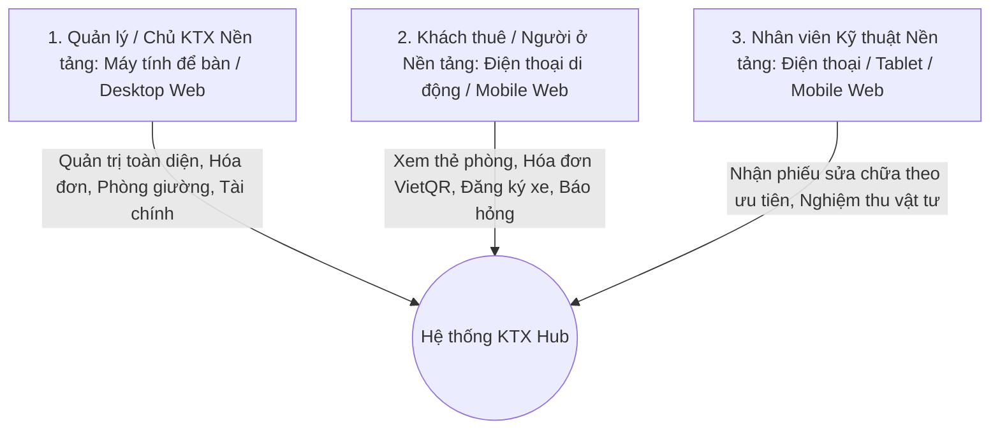
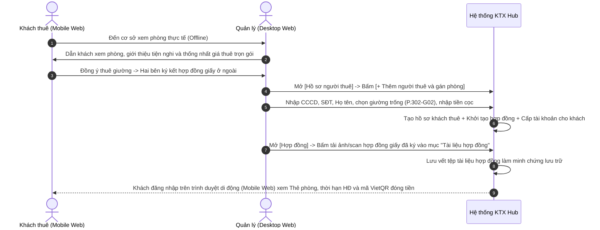
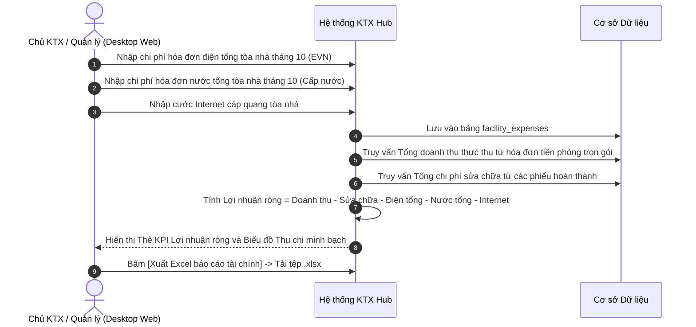
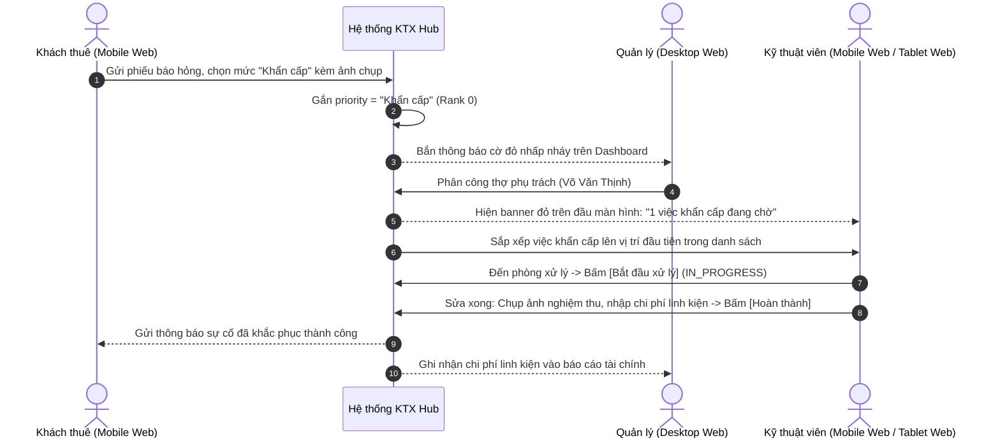
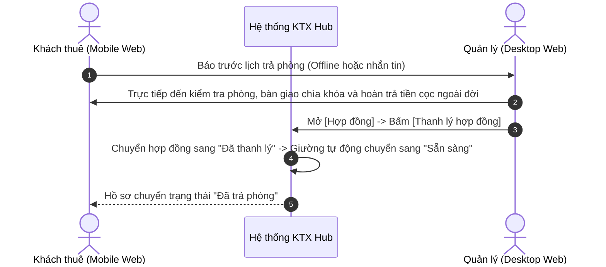

# ĐẶC TẢ YÊU CẦU PHẦN MỀM (SOFTWARE REQUIREMENTS SPECIFICATION - SRS)

## DỰ ÁN: HỆ THỐNG QUẢN LÝ KÝ TÚC XÁ TƯ NHÂN (KTX HUB / PDMS)

---


| Thông tin tài liệu           | Chi tiết                                                                  |
| :---------------------------- | :------------------------------------------------------------------------- |
| **Dự án**                    | Private Dormitory Management System (PDMS / KTX Hub)                      |
| **Tiêu chuẩn cấu trúc**      | IEEE Std 830-1998 / ISO/IEC/IEEE 29148:2018                               |
| **Phiên bản (Version)**      | 2.2 (Cập nhật Đợt 01: Product Scope, System Overview &amp; Payment Model) |
| **Trạng thái (Status)**      | Đã phê duyệt (Approved for Implementation &amp; Database Migration)       |
| **Tác giả / Nhóm biên soạn** | Ban Kỹ thuật &amp; Quản trị Hệ thống KTX Hub                              |
| **Phạm vi lưu trữ**          | Thư mục `docs/SRS.md`                                                     |


---

## MỤC LỤC TÀI LIỆU

1. [GIỚI THIỆU (INTRODUCTION)](#1-giới-thiệu-introduction)
   - 1.1. Mục đích tài liệu (Document Purpose)
   - 1.2. Phạm vi sản phẩm (Product Scope)
   - 1.3. Định nghĩa, thuật ngữ và từ viết tắt (Definitions &amp; Acronyms)
   - 1.4. Tài liệu tham chiếu (References)
   - 1.5. Cấu trúc tài liệu (Document Overview)
2. [TỔNG QUAN HỆ THỐNG (OVERALL DESCRIPTION)](#2-tổng-quan-hệ-thống-overall-description)
   - 2.1. Bối cảnh hệ thống &amp; Các bài toán vận hành cốt lõi (Product Perspective)
   - 2.2. Các nhóm tác nhân &amp; Phân định nền tảng thiết bị (User Classes &amp; Platform Allocation)
   - 2.3. Môi trường vận hành (Operating Environment)
   - 2.4. Ràng buộc thiết kế và triển khai (Design &amp; Implementation Constraints)
   - 2.5. Giả định và sự phụ thuộc (Assumptions &amp; Dependencies)
3. [CÁC QUY TẮC NGHIỆP VỤ CỐT LÕI (CORE BUSINESS RULES - BR)](#3-các-quy-tắc-nghiệp-vụ-cốt-lõi-core-business-rules---br)
   - BR-01: Quản lý theo vị trí giường riêng biệt (Bed-level Tracking &amp; Unique Slot Key)
   - BR-02: Quy tắc cách ly giới tính nghiêm ngặt 100% (Strict Gender Isolation Policy)
   - BR-03: Mô hình giá thuê trọn gói &amp; Quản lý chi phí điện nước cơ sở (All-inclusive Rental &amp; Net Profit)
   - BR-04: Đặt cọc &amp; Trả phòng giải phóng giường (Offline Deposit &amp; Checkout)
   - BR-05: Chu kỳ phát hành hóa đơn &amp; Hạn thanh toán (Monthly Billing Cycle &amp; Due Date)
   - BR-06: Quy trình xử lý sự cố &amp; Thứ tự ưu tiên điều phối kỹ thuật (Ticket Prioritization &amp; Workflow)
   - BR-07: Hồ sơ vi phạm nội quy &amp; Xử phạt (Violations &amp; Disciplinary Actions)
   - BR-08: Toàn vẹn dữ liệu &amp; Nghiêm cấm xóa vật lý (Soft Delete Policy)
   - BR-09: Cấp phát tài khoản trực tiếp &amp; Chuẩn hóa hồ sơ khách thuê đa đối tượng
   - BR-10: Quản lý phương tiện di chuyển &amp; Quy trình cấp thẻ gửi xe hầm
   - BR-11: Mô hình phân quyền quản trị tinh giản (Simplified RBAC)
4. [YÊU CẦU CHỨC NĂNG CHI TIẾT (FUNCTIONAL REQUIREMENTS - FR)](#4-yêu-cầu-chức-năng-chi-tiết-functional-requirements---fr)
   - 4.1. Phân hệ Cơ sở, Phòng &amp; Giường (FR-01 đến FR-05)
   - 4.2. Phân hệ Hồ sơ Khách thuê &amp; Phương tiện di chuyển (FR-06 đến FR-08)
   - 4.3. Phân hệ Tiếp nhận, Xếp phòng &amp; Hợp đồng (FR-09 đến FR-13)
   - 4.4. Phân hệ Chi phí Tiện ích Cơ sở &amp; Lợi nhuận Ròng (FR-14)
   - 4.5. Phân hệ Quản lý Hóa đơn, Bộ lọc Trạng thái &amp; Thu tiền (FR-15, FR-16)
   - 4.6. Phân hệ Điều phối Sự cố &amp; Thứ tự ưu tiên kỹ thuật (FR-17, FR-18)
   - 4.7. Phân hệ Biên bản Vi phạm Nội quy (FR-19)
   - 4.8. Phân hệ Báo cáo Thống kê &amp; Phân tích KPI (FR-20)
   - 4.9. Phân hệ Quản trị Hệ thống, Xác thực &amp; Phân quyền (FR-21 đến FR-24)
   - 4.10. Phân hệ Cổng thông tin Khách thuê trên Web Di động (FR-25 đến FR-27)
5. [MA TRẬN TRUY VẾT YÊU CẦU (REQUIREMENTS TRACEABILITY MATRIX - RTM)](#5-ma-trận-truy-vết-yêu-cầu-requirements-traceability-matrix---rtm)
6. [CÁC LUỒNG TUẦN TỰ HỆ THỐNG ĐẦU CUỐI (END-TO-END SEQUENCE DIAGRAMS)](#6-các-luồng-tuần-tự-hệ-thống-đầu-cuối-end-to-end-sequence-diagrams)
7. [YÊU CẦU GIAO DIỆN NGOÀI (EXTERNAL INTERFACE REQUIREMENTS)](#7-yêu-cầu-giao-diện-ngoài-external-interface-requirements)
8. [YÊU CẦU PHI CHỨC NĂNG (NON-FUNCTIONAL REQUIREMENTS - NFR)](#8-yêu-cầu-phi-chức-năng-non-functional-requirements---nfr)
9. [PHỤ LỤC &amp; TIÊU CHÍ NGHIỆM THU (APPENDICES &amp; ACCEPTANCE CRITERIA)](#9-phụ-lục--tiêu-chí-nghiệm-thu-appendices--acceptance-criteria)

---

## 1. GIỚI THIỆU (INTRODUCTION)

### 1.1. Mục đích tài liệu (Document Purpose)

Tài liệu Đặc tả Yêu cầu Phần mềm (Software Requirements Specification - SRS) này định nghĩa toàn diện, chuẩn hóa theo tiêu chuẩn quốc tế cho dự án **Hệ thống Quản lý Ký túc xá Tư nhân (PDMS - Private Dormitory Management System)**, tên thương mại là **KTX Hub**.

Tài liệu là căn cứ kỹ thuật chính thức giữa Chủ cơ sở lưu trú / Đơn vị vận hành, Kỹ sư phân tích nghiệp vụ (BA), Đội ngũ phát triển phần mềm (Frontend React, Backend Java Spring Boot, Database PostgreSQL) và Đội ngũ Kiểm thử chất lượng (QA/QC) trong toàn bộ chu kỳ phát triển, đối soát mô hình dữ liệu (ERD), thiết kế API và nghiệm thu chuyển giao.

### 1.2. Phạm vi sản phẩm (Product Scope)

#### 1.2.1. Bối cảnh và Định vị sản phẩm

KTX Hub là giải pháp quản trị vận hành tập trung chuyên sâu cho các cơ sở lưu trú ký túc xá tư nhân theo mô hình phòng ở tập thể (homestay dorm, phòng ở chia sẻ không gian):

- **Quy mô phiên bản hiện tại:** Quản lý 01 cơ sở / tòa nhà, gồm nhiều tầng và phòng.
- **Mô hình phòng &amp; vị trí ngủ:** Mỗi phòng có 4, 6 hoặc 8 vị trí ngủ. Vị trí ngủ có thể là giường tầng, giường có rèm che hoặc dạng sleepbox/pod. Trong hệ thống, tất cả đều được quản lý bằng thực thể `Bed`. `Sleepbox` hoặc `Box` là cách gọi vật lý của vị trí ngủ, KHÔNG phải thực thể riêng hay loại phòng độc lập. Các vị trí ngủ trong cùng một phòng áp dụng chung đơn giá thuê tiêu chuẩn của phòng.
- **Đối tượng khách thuê:** Mở rộng phục vụ đa đối tượng lưu trú hợp lệ bao gồm người đi làm, chuyên gia trẻ, freelancer, sinh viên các trường đại học/cao đẳng và học viên thực tập. Không bắt buộc các trường thông tin học vị hay diện ưu tiên.
- **Tôn chỉ sản phẩm:** Tối ưu tỷ lệ lấp đầy giường trống, minh bạch thu chi, kiểm soát an ninh cách ly giới tính 100%, hỗ trợ chuyển khoản ngân hàng qua mã VietQR theo từng hóa đơn kết hợp xác nhận thủ công bởi Quản lý, thu tiền mặt trực tiếp và cung cấp công cụ theo dõi Lợi nhuận ròng thực tế cho chủ cơ sở.

#### 1.2.2. Phân định Phạm vi (Scope Boundaries)


| Hạng mục                      | Trong phạm vi hệ thống (In-Scope)                                                                                                                                                                                                                                                                                                                                                                                                                                                      | Ngoài phạm vi hệ thống (Out-of-Scope)                                                                                                                                                                                                                                                                                  |
| :----------------------------- | :-------------------------------------------------------------------------------------------------------------------------------------------------------------------------------------------------------------------------------------------------------------------------------------------------------------------------------------------------------------------------------------------------------------------------------------------------------------------------------------- | :---------------------------------------------------------------------------------------------------------------------------------------------------------------------------------------------------------------------------------------------------------------------------------------------------------------------- |
| **Quản lý Lưu trú**           | - Quản lý đến từng vị trí ngủ cụ thể (`Bed-level Tracking`). Mỗi phòng có 4, 6 hoặc 8 vị trí ngủ (giường tầng, giường rèm hoặc sleepbox/pod) được quản lý bằng thực thể `Bed`.; Quy tắc cách ly giới tính sinh học 100%.; Ma trận phòng &amp; giường trực quan theo tầng (01 cơ sở/tòa nhà).                                                                                                                                                                                           | - Quản lý chuỗi đa cơ sở / đa pháp nhân độc lập.; Thuê căn hộ gia đình nguyên căn.; Quản lý sleepbox thành thực thể riêng hay loại phòng độc lập.                                                                                                                                                                      |
| **Khách thuê &amp; Hợp đồng** | - Đơn vị vận hành trực tiếp tạo hồ sơ khách thuê và gán vị trí ngủ sau khi xem phòng offline.; Loại bỏ các trường học vị (trường, khoa, MSSV, diện ưu tiên).; Ký hợp đồng giấy bên ngoài, chụp ảnh/scan tải lên lưu trữ minh chứng.                                                                                                                                                                                                                                                    | - Tích hợp hệ thống quản lý đào tạo/tuyển sinh trường đại học.; Cổng đăng ký giữ chỗ công khai trên web.                                                                                                                                                                                                               |
| **Tài chính &amp; Lợi nhuận** | - Thu tiền phòng trọn gói (all-inclusive) hàng tháng cho từng vị trí ngủ.; Ghi nhận hóa đơn chi phí điện, nước, internet tổng của cơ sở để tính Lợi nhuận ròng thực tế.; Sinh mã VietQR riêng cho từng hóa đơn (chứa STK nhận của chủ KTX, số tiền và mã hóa đơn) để khách quét chuyển khoản.; Khách tải ảnh minh chứng/biên lai và Quản lý đối soát tài khoản thực nhận để xác nhận thủ công.; Xác nhận thu tiền mặt trực tiếp thủ công.; Không tính phí phạt khi khách nộp trễ tiền. | - Webhook ngân hàng hoặc cơ chế tự động đọc biến động số dư / tự động gạch nợ.; Tích hợp cổng thanh toán trung gian để đối soát tự động.; Thuật toán phân bổ / chia tiền điện nước theo ngày lưu trú cho khách.; Tích hợp cổng thanh toán quốc tế Visa/Mastercard.; Tự động trích nợ tài khoản ngân hàng (Auto-debit). |
| **Vận hành &amp; Kỹ thuật**   | - Khách thuê gửi phiếu báo hỏng kèm ảnh chụp hiện trường.; Phân cấp ưu tiên xử lý: Khẩn cấp (Rank 0) &gt; Cao (Rank 1) &gt; Bình thường (Rank 2).; Kỹ thuật viên thao tác trên thiết bị di động / máy tính bảng (giao diện web responsive), cập nhật tiến độ và nghiệm thu vật tư.; Quản lý biên bản vi phạm nội quy và phương tiện gửi xe tại hầm.                                                                                                                                    | - Lắp đặt phần cứng công tơ điện tử IoT gửi dữ liệu tự động qua Wi-Fi.; Phần cứng cổng xoay kiểm soát FaceID / vân tay.; Native mobile app riêng.                                                                                                                                                                      |


### 1.3. Định nghĩa, thuật ngữ và từ viết tắt (Definitions &amp; Acronyms)


| Thuật ngữ / Từ viết tắt     | Định nghĩa nghiệp vụ / Kỹ thuật                                                                                                                                                                                                                                                                                                                                                  |
| :--------------------------- | :-------------------------------------------------------------------------------------------------------------------------------------------------------------------------------------------------------------------------------------------------------------------------------------------------------------------------------------------------------------------------------- |
| **PDMS**                    | Private Dormitory Management System - Hệ thống Quản lý Ký túc xá Tư nhân.                                                                                                                                                                                                                                                                                                        |
| **Bed-level Tracking**      | Phương thức quản lý phân rã đến từng vị trí ngủ độc lập (giường tầng, giường có rèm che hoặc dạng sleepbox/pod) bằng thực thể `Bed`. Mỗi vị trí ngủ có mã `G01, G02, ...`, khóa định danh duy nhất `RoomCode-BedCode`, hợp đồng và chỉ gán cho tối đa một khách thuê tại một thời điểm. Toàn bộ vị trí ngủ trong cùng một phòng áp dụng chung đơn giá thuê tiêu chuẩn của phòng. |
| **Sleepbox / Box**          | Cách gọi vật lý của vị trí ngủ dạng hộp/kén không gian kín trong mô hình phòng ở tập thể; trong hệ thống được quản lý thống nhất bằng thực thể `Bed`, không tạo bảng CSDL riêng, không tạo enum loại phòng riêng hay quy trình cho thuê riêng.                                                                                                                                   |
| **Khách thuê (Tenant)**     | Người cư trú tại KTX, bao gồm người đi làm, sinh viên, freelancer, người lưu trú tự do hợp lệ. Định danh cốt lõi bằng CCCD 12 số, họ tên, giới tính, số điện thoại, email. Không bắt buộc các trường thông tin học vị hay diện ưu tiên.                                                                                                                                          |
| **Gender Isolation Policy** | Chính sách bắt buộc: Một phòng chỉ cho phép khách cùng một giới tính sinh học cư trú (Nam hoặc Nữ). Tuyệt đối cấm phòng hỗn hợp.                                                                                                                                                                                                                                                 |
| **All-inclusive Rent**      | Mô hình giá thuê trọn gói cố định hàng tháng cho từng vị trí ngủ: Tiền phòng đã bao gồm chi phí sinh hoạt điện nước, internet và dịch vụ cơ bản; khách thuê không phải thanh toán thêm hóa đơn phân bổ tiện ích riêng. Chủ cơ sở ghi nhận hóa đơn tiện ích tổng để tính Lợi nhuận ròng.                                                                                          |
| **VietQR**                  | Chuẩn mã QR thanh toán nhanh liên ngân hàng Việt Nam. Trong hệ thống, mã VietQR được sinh động theo từng hóa đơn chứa thông tin tài khoản nhận tiền của chủ KTX, số tiền thanh toán chính xác và nội dung chuyển khoản có mã tham chiếu hóa đơn, phục vụ khách quét chuyển khoản qua ứng dụng Mobile Banking (không phải giải pháp xác nhận tiền hay gạch nợ tự động).           |
| **RBAC**                    | Role-Based Access Control - Kiểm soát truy cập dựa trên vai trò: Quản lý (Manager), Kỹ thuật viên (Technician), Khách thuê (Tenant).                                                                                                                                                                                                                                             |
| **Soft Delete**             | Đánh dấu xóa bằng cờ thời gian (`deleted_at`) thay vì xóa vật lý khỏi cơ sở dữ liệu (`No Hard Delete`).                                                                                                                                                                                                                                                                          |
| **Unique Slot Key**         | Khóa định danh duy nhất của vị trí ngủ: `RoomCode-BedCode` (Ví dụ: `P.302-G02`).                                                                                                                                                                                                                                                                                                 |


### 1.4. Tài liệu tham chiếu (References)

1. **Mô hình Dữ liệu Mức Khái niệm:** Conceptual ERD (Đặc tả các thực thể nghiệp vụ cốt lõi).
2. **Mô hình Dữ liệu Mức Logic:** Logical ERD (Đặc tả các bảng dữ liệu quan hệ PostgreSQL 3NF).
*(Ghi chú: Đường dẫn tệp nội bộ của Conceptual ERD và Logical ERD chưa được thiết lập trong repository hiện tại; giữ tên chuẩn tài liệu để bổ sung đường dẫn chính xác theo cập nhật từ chủ dự án).*

### 1.5. Cấu trúc tài liệu (Document Overview)

Tài liệu gồm 9 chương lớn bao quát toàn bộ yêu cầu phần mềm: từ bối cảnh kinh doanh, quy tắc nghiệp vụ cốt lõi, yêu cầu chức năng 10 phân hệ nghiệp vụ (FR-01 đến FR-27), ma trận truy vết RTM, sơ đồ tương tác tuần tự, giao diện ngoài, yêu cầu phi chức năng đến tiêu chí nghiệm thu.

---

## 2. TỔNG QUAN HỆ THỐNG (OVERALL DESCRIPTION)

### 2.1. Bối cảnh hệ thống &amp; Các bài toán vận hành cốt lõi (Product Perspective)

Khác biệt với ký túc xá đại học công lập và chung cư nguyên căn, mô hình **Ký túc xá tư nhân** giải quyết 6 bài toán vận hành thực tế:

```text
+----------------------------------------------------------------------------------------------------+
|                             6 BÀI TOÁN VẬN HÀNH CỐT LÕI CỦA KTX TƯ NHÂN                            |
+----------------------------------------------------------------------------------------------------+
|  [Bài toán 1]  Quản lý trực quan theo từng vị trí ngủ (giường/sleepbox) tiêu chuẩn trong phòng.    |
|  [Bài toán 2]  Theo dõi chi phí điện nước, internet tổng cơ sở để tính đúng Lợi nhuận ròng.        |
|  [Bài toán 3]  Kiểm soát an ninh tuyệt đối và cách ly giới tính nghiêm ngặt 100%.                 |
|  [Bài toán 4]  Thu tiền phòng trọn gói qua chuyển khoản VietQR và xác nhận tiền mặt thủ công.      |
|  [Bài toán 5]  Thứ tự ưu tiên xử lý sự cố kỹ thuật (Khẩn cấp > Cao > Bình thường).                 |
|  [Bài toán 6]  Quản lý phương tiện di chuyển, thẻ từ gửi xe và bảo đảm trật tự hầm xe KTX.        |
+----------------------------------------------------------------------------------------------------+
```

### 2.2. Các nhóm tác nhân &amp; Phân định nền tảng thiết bị (User Classes &amp; Platform Allocation)

Hệ thống phân định ranh giới rõ ràng về thiết bị sử dụng cho từng nhóm đối tượng để tối ưu hóa trải nghiệm thực tế:



#### 2.2.1. Ban Quản lý / Chủ KTX (Manager / Owner)

- **Thiết bị sử dụng:** Máy tính để bàn / Laptop (Desktop Web, độ phân giải từ 1280px trở lên).
- **Giao diện chuyên biệt:** Bảng điều khiển SaaS toàn diện với Sidebar điều hướng, bảng dữ liệu lớn, bộ lọc đa tầng, biểu đồ phân tích KPI và ngăn kéo trượt (Slide-over Drawer).
- **Trách nhiệm chính:** Quản trị phòng ốc; tạo hồ sơ khách thuê và gán vị trí ngủ; ghi nhận hóa đơn tiện ích cơ sở; phát hành hóa đơn; đối soát tài khoản thực nhận và xác nhận thủ công thanh toán VietQR / tiền mặt; phân công kỹ thuật viên; quản lý phương tiện và theo dõi Lợi nhuận ròng.

#### 2.2.2. Khách thuê / Người ở (Tenant / Resident)

- **Thiết bị sử dụng:** Điện thoại thông minh cá nhân (giao diện Web Responsive tối ưu cho di động từ 360px đến 430px).
- **Giao diện chuyên biệt:** Thanh điều hướng 4 tab cố định ở cạnh đáy màn hình (Bottom Navigation Bar): *Phòng của tôi, Hóa đơn, Phương tiện, Sự cố, Vi phạm*.
- **Trách nhiệm chính:** Sử dụng thẻ phòng điện tử; tra cứu hóa đơn, quét mã VietQR thanh toán và tải ảnh minh chứng chuyển khoản; đăng ký phương tiện gửi xe kèm ảnh chụp cà vẹt xe; gửi phiếu báo hỏng vật tư kèm mức độ ưu tiên và ảnh chụp hiện trường; theo dõi lịch sử vi phạm nội quy.

#### 2.2.3. Nhân viên Kỹ thuật (Technician)

- **Thiết bị sử dụng:** Điện thoại thông minh / Máy tính bảng tại hiện trường (giao diện Web Responsive tối ưu cho thiết bị di động và tablet; không yêu cầu native mobile app riêng).
- **Giao diện chuyên biệt:** Thiết kế tối ưu cho màn hình cảm ứng di động (`max-w-md`) và máy tính bảng, thẻ tác vụ lớn, nút thao tác chụp ảnh và bấm nghiệm thu to rõ, dễ bấm khi đang thao tác sửa chữa.
- **Trách nhiệm chính:** Tiếp nhận công việc theo thứ tự ưu tiên (ưu tiên xử lý việc khẩn cấp nhấp nháy trên đầu trang); cập nhật tiến độ đang xử lý; ghi nhận vật tư/linh kiện thay thế và chi phí phát sinh; chụp ảnh nghiệm thu hoàn thành.

#### 2.2.4. Hệ thống bên ngoài: Dịch vụ Ngân hàng &amp; VietQR (External Systems)

- Khách thuê sử dụng ứng dụng ngân hàng di động (Mobile Banking) quét mã VietQR theo hóa đơn để thực hiện lệnh chuyển khoản liên ngân hàng.
- Quản lý kiểm tra biến động số dư thực tế trong tài khoản ngân hàng của mình ngoài hệ thống để đối soát tiền thực nhận.
- Hệ thống KTX Hub **không tích hợp webhook ngân hàng, không có cơ chế tự động đọc biến động số dư và không tự động gạch nợ**. Hóa đơn chỉ được ghi nhận chuyển sang `Đã thu` sau khi Quản lý xác nhận thủ công.

### 2.3. Môi trường vận hành (Operating Environment)

- **Phía Máy khách (Client):** Trình duyệt Web hiện đại (Google Chrome, Apple Safari, Microsoft Edge, Mozilla Firefox) trên Desktop, Mobile và Tablet qua giao diện web responsive.
- **Phía Máy chủ (Server &amp; Database):** Java Spring Boot; PostgreSQL 15+ hỗ trợ B-tree/GIN index và JSONB; Lưu trữ ảnh trên Cloud Object Storage (S3 API). Giao tiếp dữ liệu qua RESTful API chuẩn giữa Frontend React và Backend Java Spring Boot.

### 2.4. Ràng buộc thiết kế và triển khai (Design &amp; Implementation Constraints)

1. **Kiến trúc cơ sở dữ liệu:** Tuân thủ chuẩn hóa 3NF/BCNF theo tài liệu `docs/Logical-ERD.md`. Khóa chính sử dụng `uuid DEFAULT gen_random_uuid()` bảo mật cao kết hợp mã nghiệp vụ tự nhiên thân thiện người dùng (`text UNIQUE`).
2. **Quy tắc không xóa vật lý (No Hard Delete):** Tuyệt đối cấm xóa vật lý trên các bảng pháp lý/tài chính (`contracts`, `invoices`, `payment_transactions`, `facility_expenses`, `violations`). Chỉ dùng cập nhật cờ `deleted_at` hoặc trạng thái hủy.
3. **Quy chuẩn Design Tokens:** Màu thương hiệu Xanh dương (`--brand-600: #1D4ED8`), nền trang xám nhạt (`--slate-50`), font chữ chuyên biệt `Plus Jakarta Sans` (Tiêu đề), `Inter` (Nội dung), `JetBrains Mono` (Mã số, tiền tệ, tài khoản).
4. **Bảo mật mật khẩu:** Băm mật khẩu bằng thuật toán an toàn `Bcrypt` (cost factor &gt;= 12).

### 2.5. Giả định và sự phụ thuộc (Assumptions &amp; Dependencies)

1. Cơ sở lưu trú nhận hóa đơn tiền điện, nước, internet tổng do cơ quan nhà nước / công ty cung cấp dịch vụ phát hành định kỳ hàng tháng.
2. Tài khoản ngân hàng của cơ sở hỗ trợ nhận tiền và tra cứu theo chuẩn VietQR. Quản lý có quyền truy cập ứng dụng/dịch vụ ngân hàng của cơ sở để kiểm tra biến động số dư thực tế phục vụ đối soát thủ công.
3. Quy trình thanh toán dựa trên cơ chế đối soát thủ công của Quản lý; hệ thống không phụ thuộc vào webhook ngân hàng hay API tự động gạch nợ từ bên thứ ba.

## 3. CÁC QUY TẮC NGHIỆP VỤ CỐT LÕI (CORE BUSINESS RULES - BR)

```text
+----------------------------------------------------------------------------------------------------+
|                                BẢNG TỔNG HỢP CÁC QUY TẮC NGHIỆP VỤ (BR)                            |
+--------+-----------------------------------------------------+-------------------------------------+
| Mã BR  | Tên quy tắc nghiệp vụ                               | Phạm vi áp dụng                     |
+--------+-----------------------------------------------------+-------------------------------------+
| BR-01  | Quản lý theo vị trí giường riêng biệt               | Cơ sở, Phòng, Giường, Hợp đồng      |
| BR-02  | Quy tắc cách ly giới tính nghiêm ngặt 100%          | Xếp phòng, Đổi phòng, Cư trú        |
| BR-03  | Giá thuê trọn gói & Quản lý điện nước tổng cơ sở    | Hạch toán Lợi nhuận ròng, Doanh thu |
| BR-04  | Đặt cọc & Trả phòng giải phóng giường (Offline)     | Hợp đồng, Cọc giữ chỗ, Checkout     |
| BR-05  | Chu kỳ phát hành hóa đơn & Hạn nộp (Không phạt trễ)  | Hóa đơn, VietQR, Hạn thanh toán     |
| BR-06  | Xử lý sự cố & Thứ tự ưu tiên điều phối kỹ thuật     | Khẩn cấp > Cao > Bình thường        |
| BR-07  | Hồ sơ vi phạm nội quy & Xử phạt (Nhắc nhở, Cảnh cáo)| Vi phạm nội quy, Tiền phạt          |
| BR-08  | Toàn vẹn dữ liệu & Nghiêm cấm xóa vật lý (Soft)     | CSDL, Hóa đơn, Hợp đồng             |
| BR-09  | Cấp tài khoản trực tiếp & Khách thuê đa đối tượng   | Tạo hồ sơ người thuê, Không ép MSSV |
| BR-10  | Quản lý phương tiện di chuyển & Thẻ gửi xe hầm      | Xe máy, Xe điện, Thẻ từ, Cà vẹt xe  |
| BR-11  | Phân quyền quản trị tinh giản (Simplified RBAC)     | Quản lý (Manager), Thợ (Technician) |
+--------+-----------------------------------------------------+-------------------------------------+
```

### BR-01: Quản lý theo vị trí giường riêng biệt (Bed-level Tracking &amp; Unique Slot Key)

1. **Cơ sở và mô hình phòng:** Cơ sở lưu trú gồm nhiều tầng và phòng. Mỗi phòng có 4, 6 hoặc 8 vị trí ngủ. Vị trí ngủ có thể là giường tầng, giường có rèm che hoặc dạng sleepbox/pod. Trong hệ thống, tất cả đều được quản lý bằng thực thể `Bed`. `Sleepbox` hoặc `Box` là cách gọi vật lý của vị trí ngủ, KHÔNG phải thực thể riêng hay loại phòng độc lập. Giữ mô hình `Room -> Bed`, không bổ sung bảng `sleepboxes`, enum loại phòng mới hay quy trình cho thuê riêng.
2. Mỗi phòng chứa danh sách các vị trí ngủ cố định được đánh số từ `G01, G02, ..., G0n` (với n là sức chứa 4, 6 hoặc 8 của phòng).
3. Đơn vị cho thuê và định danh là từng vị trí ngủ tiêu chuẩn. Toàn bộ các vị trí ngủ trong cùng một phòng áp dụng chung đơn giá thuê tiêu chuẩn của phòng (`rooms.base_price`) khi khởi tạo hợp đồng thuê.
4. Khóa định danh vị trí ngủ trong hệ thống là duy nhất:

```text
slotKey = RoomCode + "-" + BedCode
```

*(Ví dụ: `P.302-G02` định danh cho Vị trí ngủ số 02 tại Phòng 302).*
5. Mỗi vị trí ngủ chỉ được gán cho tối đa một khách thuê tại một thời điểm (`OCCUPIED`).
6. Một vị trí ngủ tại một thời điểm chỉ thuộc 1 trong 3 trạng thái:

- `AVAILABLE` (Sẵn sàng đón khách mới).
- `OCCUPIED` (Đang có khách ở với hợp đồng có hiệu lực).
- `MAINTENANCE` (Đang hỏng hóc hoặc bảo trì vật tư).

7. **Quy tắc bảo trì vị trí ngủ (Bed Maintenance Invariant):** Trạng thái bảo trì được quản lý độc lập theo từng vị trí ngủ cụ thể (không áp dụng bảo trì cào bằng cả phòng). Một vị trí ngủ chỉ được phép chuyển sang trạng thái `Bảo trì` (`MAINTENANCE`) khi đang không có khách cư trú (`status !== OCCUPIED`). Tuyệt đối ngăn chặn việc đưa vị trí ngủ đang có người ở vào trạng thái bảo trì nhằm bảo vệ quyền lợi cư trú của khách.
8. Tuyệt đối không cho phép tạo 2 hợp đồng có hiệu lực trùng cùng một vị trí ngủ tại cùng một thời điểm.

### BR-02: Quy tắc cách ly giới tính nghiêm ngặt 100% (Strict Gender Isolation Policy)

1. Mỗi phòng khi tạo lập bắt buộc phải được gắn chính sách giới tính cố định: `Nam` hoặc `Nữ`. Hệ thống tuyệt đối không hỗ trợ phòng hỗn hợp.
2. Khách thuê có giới tính sinh học xác định trên CCCD: `Nam` hoặc `Nữ`.
3. **Nguyên tắc bất biến:** Một khách thuê chỉ được phép xếp vào hoặc chuyển sang phòng có chính sách giới tính trùng khớp 100% với giới tính của khách:

```text
canAssignToRoom = (tenant.gender == room.gender_policy)
```

4. Trên giao diện, hệ thống tự động lọc và khóa chết các phòng khác giới tính; ngăn chặn triệt để thao tác người dùng cố tình xếp nhầm.

### BR-03: Mô hình giá thuê trọn gói &amp; Quản lý chi phí điện nước cơ sở (All-inclusive Rental &amp; Facility Utilities)

1. **Thu tiền phòng trọn gói (All-inclusive):** Tiền thuê tháng trọn gói cố định cho từng vị trí ngủ (đã bao gồm tiền phòng, điện sinh hoạt, nước sinh hoạt, wifi cáp quang, gửi xe hầm và vệ sinh khu vực chung). Khách thuê không phải thanh toán thêm tiền điện, nước, Internet hoặc dịch vụ cơ bản qua hóa đơn phân bổ riêng. Tuyệt đối không sử dụng thuật toán chia hay phân bổ tiền điện nước theo ngày lưu trú của khách.
2. **Ghi nhận hóa đơn tiện ích cơ sở để tính Lợi nhuận ròng:**
   - Để chủ cơ sở nắm bắt chính xác lợi nhuận thực tế thu về, hệ thống cung cấp giao diện cho phép Quản lý ghi nhận hóa đơn chi phí tiện ích tổng phát sinh trong tháng của cả cơ sở:
     - Hóa đơn tiền điện tổng cơ sở (trả cho Điện lực EVN).
     - Hóa đơn tiền nước tổng cơ sở (trả cho Công ty cấp nước).
     - Cước phí mạng Internet cáp quang tòa nhà.
     - Chi phí phát sinh khác (tiền rác, dịch vụ vệ sinh chung).

```text
Lợi nhuận ròng = Doanh thu tiền phòng thực thu 
                - Chi phí sửa chữa hoàn thành 
                - Hóa đơn điện tổng cơ sở 
                - Hóa đơn nước tổng cơ sở 
                - Cước Internet & Chi phí dịch vụ khác
```

### BR-04: Đặt cọc &amp; Trả phòng giải phóng giường (Security Deposit &amp; Checkout)

1. **Mức tiền cọc:** Mức tiền cọc tiêu chuẩn bằng đúng **01 tháng tiền thuê giường** tương ứng, được thỏa thuận và thu trực tiếp bên ngoài lúc ký hợp đồng giấy.
2. **Quy trình hoàn cọc &amp; Trả phòng thực tế (Offline):**
   - Khách thuê báo trước ngày rời đi tối thiểu **15 ngày**.
   - Khi trả phòng, Chủ cơ sở và khách thuê trực tiếp kiểm tra đồ đạc tại phòng, tự thỏa thuận khấu trừ hư hỏng hoặc tiền phòng còn thiếu (nếu có) và thanh toán hoàn tiền cọc trực tiếp ngoài đời (tiền mặt hoặc chuyển khoản cá nhân).
   - Hệ thống phần mềm **tuyệt đối KHÔNG cần quản lý công thức tính toán hoàn cọc chi tiết**.
   - Sau khi bàn giao phòng xong ngoài thực tế, Quản lý chỉ cần chuyển trạng thái hợp đồng sang `Đã thanh lý` (và hồ sơ người thuê sang `Đã trả phòng`) để giải phóng giường về trạng thái `Sẵn sàng` đón khách mới.

### BR-05: Chu kỳ phát hành hóa đơn cố định &amp; Hạn nộp ngày 05 hàng tháng (Monthly Billing Cycle)

Hệ thống áp dụng mốc thời gian cố định, minh bạch và xác định tuyệt đối (không để khoảng thời gian mơ hồ):

1. **Thời điểm phát hành hóa đơn cố định:** **Đúng 00:00 ngày 25 hàng tháng**, hệ thống tự động phát hành đồng loạt (hoặc Quản lý bấm duyệt phát hành) hóa đơn tiền phòng trọn gói cho tháng tiếp theo với trạng thái ban đầu là `Nợ`. Mốc ngày 25 giúp khách thuê có trọn vẹn 10 - 11 ngày chuẩn bị tiền sau khi nhận lương cuối tháng.
2. **Hạn thanh toán cố định (Due Date):** Hạn chót đóng tiền phòng cố định là **ngày 05 của tháng tiếp theo** (`due_date` là ngày 05 của tháng, ví dụ: hóa đơn kỳ tháng 11 phát hành ngày 25/10, hạn nộp là `05/11/2026`).
3. **Quy tắc theo dõi công nợ &amp; Quy trình thanh toán chính thức (D8):**
   - Hệ thống áp dụng 2 hình thức thanh toán chính thức:
     - **Hình thức 1 — Chuyển khoản ngân hàng bằng VietQR:**
   1. Hệ thống cung cấp mã VietQR riêng cho từng hóa đơn, chứa thông tin tài khoản ngân hàng nhận tiền của chủ KTX, số tiền thanh toán chính xác và nội dung chuyển khoản có mã tham chiếu hóa đơn.
   2. Khách sử dụng ứng dụng ngân hàng (Mobile Banking) để quét mã QR và chuyển khoản.
   3. Sau khi chuyển khoản, khách tải ảnh minh chứng thanh toán (bill/biên lai) lên hệ thống.
   4. Hóa đơn chuyển sang trạng thái `Chờ xác nhận`. *(Lưu ý bắt buộc: Tải bill lên KHÔNG đồng nghĩa giao dịch đã thanh toán thành công)*.
   5. Quản lý tự kiểm tra giao dịch thực tế trong tài khoản ngân hàng ngoài hệ thống.
   6. Khi xác nhận đã nhận đủ tiền, Quản lý chuyển hóa đơn thành `Đã thu` trên hệ thống.
   7. Nếu minh chứng không hợp lệ hoặc không xác minh được giao dịch, Quản lý có quyền từ chối; hóa đơn trở về trạng thái `Nợ` để khách gửi lại minh chứng đúng.
      - **Hình thức 2 — Tiền mặt:**
   8. Khách đưa tiền mặt trực tiếp cho Quản lý.
   9. Quản lý kiểm đếm và xác nhận đã thực nhận đủ tiền.
   10. Quản lý chuyển hóa đơn sang `Đã thu` trên hệ thống.
   11. Hệ thống lưu phương thức thanh toán, thời gian, số tiền và người xác nhận (`confirmed_by_staff_id`).
       - **Nguyên tắc kỹ thuật bắt buộc:** Hóa đơn chỉ được ghi nhận `Đã thu` sau thao tác xác nhận của Quản lý. Không có webhook ngân hàng, không có cơ chế tự động đọc biến động số dư hoặc tự gạch nợ, và không tích hợp cổng thanh toán trung gian để đối soát tự động.
       - Từ ngày 06 trở đi: Hóa đơn nào chưa thanh toán sẽ tự động hiển thị quá hạn trên bộ lọc `Nợ` để Quản lý theo dõi và đôn đốc thu tiền.
       - Tuyệt đối KHÔNG tính phí phạt nộp trễ tiền.
4. **Trường hợp khách vào ở lệch ngày:** Tiền phòng lẻ của tháng đầu tiên (từ ngày vào ở đến ngày cuối tháng) được thanh toán trực tiếp lúc ký hợp đồng giấy ở ngoài. Từ tháng tiếp theo, khách đóng tiền phòng đều đặn vào đợt ngày 01 đến ngày 05 như mọi người khác.

### BR-06: Quy trình xử lý sự cố &amp; Thứ tự ưu tiên điều phối kỹ thuật (Ticket Prioritization &amp; Workflow)

1. **Phân cấp 3 mức độ ưu tiên:**
   - **Mức 1 - Khẩn cấp (Urgent - Rank 0):** Nguy cơ chập cháy điện, vỡ ống nước ngập sàn, kẹt khóa cửa phòng. Cờ đỏ nhấp nháy (pulse badge) kèm banner đỏ cảnh báo trên màn hình thợ.
   - **Mức 2 - Cao (High - Rank 1):** Hỏng máy lạnh, mất nguồn tủ lạnh chung. Cờ màu cam.
   - **Mức 3 - Bình thường (Normal - Rank 2):** Quạt trần kêu to, đèn hành lang chập chờn, kẹt hộc tủ. Cờ màu xanh.
2. **Thuật toán sắp xếp công việc của Kỹ thuật viên:**

```text
Thứ tự sắp xếp = (Đã hoàn thành ? 1 : 0) * 10 + priorityRank[priority]
```

- Công việc chưa xong luôn hiển thị lên trước.
- Trong các việc chưa xong: Ưu tiên tuyệt đối xử lý theo thứ tự: **Khẩn cấp -&gt; Cao -&gt; Bình thường**.

3. **Vòng đời phiếu sự cố:** `Mới giao` -&gt; `Đang xử lý` -&gt; `Hoàn thành` (chụp ảnh nghiệm thu và ghi nhận chi phí phụ tùng).

### BR-07: Hồ sơ vi phạm nội quy &amp; Xử phạt (Violations &amp; Disciplinary Actions)

1. Hồ sơ vi phạm nội quy được gắn trực tiếp với cá nhân khách thuê vi phạm (không bắt buộc và không quản lý `room_id`).
2. **Chuẩn hóa danh mục vi phạm:** Gồm 5 loại vi phạm chuẩn: `'Về muộn'`, `'Gây ồn'`, `'Vệ sinh'`, `'Khách ngoài'`, `'Hút thuốc / cháy nổ'` (và `'Khác'`).
3. **Hình thức xử lý:** Gồm 3 mức:
   - `'Nhắc nhở'`
   - `'Cảnh cáo'`
   - `'Phạt tiền'` (Nếu áp dụng phạt tiền, tiền phạt được thu trực tiếp ngoài thực tế giữa Quản lý và khách thuê; Quản lý chỉ nhập số tiền vào ô phạt tiền để lưu vết hồ sơ, tuyệt đối KHÔNG kết chuyển hay gộp vào hóa đơn tiền phòng trên web).
4. Cột `note` là văn bản tự do lưu trữ chi tiết thời gian, diễn biến vi phạm làm bằng chứng.

### BR-08: Toàn vẹn dữ liệu &amp; Nghiêm cấm xóa vật lý (Soft Delete Policy)

1. Các bảng dữ liệu kế toán và pháp lý (`contracts`, `invoices`, `payment_transactions`, `facility_expenses`, `violations`) tuyệt đối không dùng câu lệnh SQL `DELETE`.
2. Mọi quan hệ khóa ngoại thiết lập `ON DELETE RESTRICT`. Thao tác xóa khách thuê hoặc xóa phòng được thực hiện bằng cách cập nhật cờ `deleted_at = NOW()`.

### BR-09: Cấp phát tài khoản trực tiếp &amp; Chuẩn hóa hồ sơ khách thuê đa đối tượng

1. **Đơn vị vận hành tạo tài khoản trực tiếp:**
   - Khách thuê không tự đăng ký tài khoản từ bên ngoài.
   - Khi ký hợp đồng hoặc khách đồng ý thuê, Quản lý nhấn [Thêm người thuê và gán phòng] trong trang quản lý để tạo hồ sơ và cấp tài khoản.
2. **Loại bỏ các trường học vị/trường đại học:**
   - Để phục vụ mọi đối tượng khách thuê (người đi làm, freelancer, học viên, sinh viên), hệ thống loại bỏ các trường đặc thù sinh viên đại học khỏi form nhập bắt buộc:
     - Không bắt buộc / Loại bỏ: `university` (Trường ĐH).
     - Không bắt buộc / Loại bỏ: `faculty` (Khoa/Ngành).
     - Không bắt buộc / Loại bỏ: `student_code` (Mã số sinh viên).
     - Không bắt buộc / Loại bỏ: `priority_type` (Diện ưu tiên chính sách).
   - Các trường định danh bắt buộc chuẩn hóa cho mọi khách thuê: *Họ và tên, Giới tính, Số điện thoại, Số CCCD (12 chữ số), Địa chỉ email, Địa chỉ thường trú*.
3. **Cấp phát tài khoản đăng nhập Cổng thông tin:**
   - Ngay sau khi Quản lý nhấn [Tạo và gán phòng] thành công, hệ thống tự động khởi tạo tài khoản người dùng (`users`) với:
     - Tên đăng nhập: Địa chỉ email của khách thuê.
     - Mật khẩu ban đầu mặc định: `Password123@`.
     - Vai trò: `TENANT`.
   - Hệ thống hiển thị Popup Modal thông báo thông tin tài khoản kèm nút [Sao chép gửi khách] để Quản lý gửi qua Zalo/SMS cho khách đăng nhập trên điện thoại di động.

### BR-10: Quản lý phương tiện di chuyển &amp; Quy trình cấp thẻ gửi xe (Vehicle &amp; Parking Management)

1. **Hạn mức nghiêm ngặt: Mỗi khách thuê chỉ được đăng ký tối đa 01 phương tiện:**
   - Phí gửi xe được bao trọn gói 100% trong tiền phòng; để bảo đảm an ninh trật tự và sức chứa có hạn của hầm xe, mỗi khách thuê chỉ được cấp tối đa 01 chỗ để xe.
   - Trên ứng dụng web di động, khi khách đã có 01 phương tiện hợp lệ, nút [Đăng ký xe mới] tự động vô hiệu hóa (`[Đã đủ hạn mức (1 xe/người)]`). Nếu có nhu cầu đổi xe hoặc cập nhật biển số mới, khách liên hệ trực tiếp Quản lý để thu hồi thẻ xe cũ trước.
2. **Quy trình 4 bước quản lý phương tiện hầm KTX:**
   - **Bước 1 - Khách khai báo phương tiện trên ứng dụng web di động (Mobile Web):**
     - Nhập: Biển số xe (VD: `59-X3 789.12`), Phân loại xe (`Xe tay ga`, `Xe số`, `Xe máy điện`, `Xe đạp`), Hãng xe (`brand`), Màu sơn (`color`).
     - Tải lên 2 ảnh chụp: Mặt trước &amp; Mặt sau Giấy đăng ký xe (Cà vẹt xe) để chứng minh xe chính chủ.
     - Trạng thái ban đầu: `Chưa cấp thẻ` (`Chờ duyệt`).
   - **Bước 2 - Quản lý duyệt &amp; Cấp thẻ từ gửi xe:**
     - Ban quản lý mở danh sách phương tiện trên máy tính, sử dụng bộ lọc trạng thái (`Tất cả`, `Chờ cấp thẻ`, `Đã cấp thẻ`, `Đã thu hồi`).
     - Bấm nút `[+ Cấp thẻ]`, Popup hiển thị đồng thời thông tin xe và **2 ảnh cà vẹt xe đối soát trực tiếp**.
     - Quản lý lấy thẻ từ vật lý của hầm KTX, nhập Mã thẻ từ (`card_code`, VD: `THE-0187`) gán cho xe.
     - Chuyển trạng thái sang `Đã cấp thẻ` và bàn giao thẻ từ vật lý cho khách thuê.
   - **Bước 3 - Quét thẻ ra vào (Bao trọn gói 100%, không thu phí):**
     - Khách thuê dùng thẻ từ đã cấp để quét ra/vào cổng barrier hầm xe.
     - Phí gửi xe đã bao trọn gói 100% trong tiền phòng; hệ thống **tuyệt đối không thu thêm bất kỳ khoản tiền nào của khách**, không tính phí và không cộng vào hóa đơn.
   - **Bước 4 - Thu hồi thẻ từ khi thanh lý phòng (Checkout):**
     - Khi khách thuê làm thủ tục trả phòng hoặc thôi gửi xe, Quản lý thu hồi lại thẻ từ vật lý và cập nhật trạng thái xe thành `Đã thu hồi` (Soft Delete) để giải phóng chỗ để xe mà vẫn lưu vết lịch sử bảo an.

### BR-11: Mô hình phân quyền quản trị tinh giản (Simplified RBAC)

1. Loại bỏ ma trận tick chọn quyền chi tiết gây rối rắm trong vận hành.
2. Hệ thống phân quyền rõ ràng theo 2 vai trò nhân sự cơ bản:
   - `MANAGER` (Ban Quản trị / Chủ KTX): Sử dụng trên máy tính (Desktop Web), toàn quyền quản lý vận hành, tài chính, phòng ốc, hợp đồng, xe cộ và nhân sự.
   - `TECHNICIAN` (Kỹ thuật viên): Sử dụng trên điện thoại di động hoặc máy tính bảng (giao diện Web Responsive: Mobile Web / Tablet Web), chỉ tiếp nhận và xử lý phiếu báo hỏng kỹ thuật.

---

## 4. YÊU CẦU CHỨC NĂNG CHI TIẾT (FUNCTIONAL REQUIREMENTS - FR)

Hệ thống được cấu trúc thành các nhóm yêu cầu chức năng nghiệp vụ độc lập, mạch lạc, bám sát toàn bộ quy trình vận hành thực tế:

### 4.1. Phân hệ Cơ sở, Phòng &amp; Giường (Room &amp; Bed Management)

#### FR-01: Hiển thị sơ đồ ma trận trực quan Phòng &amp; Giường (Room-Bed Matrix Grid)

- **Tác nhân:** Quản lý
- **Đầu vào:** Bộ lọc tầng (linh hoạt theo các tầng thực tế của tòa nhà, ví dụ Tầng 1, 2, 3...), chính sách giới tính (Tất cả, Nam, Nữ).
- **Quy trình xử lý:**
  1. Hiển thị danh sách phòng theo tầng; mỗi phòng có 4, 6 hoặc 8 vị trí ngủ; hiển thị thước đo sức chứa (`occupied_beds / total_beds`).
  2. Hiển thị ma trận các slot giường nhỏ bên trong thẻ phòng: Màu xanh (Đang ở), Viền nét đứt (Trống sẵn sàng), Cờ lê cam (Bảo trì).
  3. Khi nhấp vào một phòng, mở ngăn kéo chi tiết (Drawer) hiển thị danh sách từng vị trí giường, thông tin khách đang ở và danh mục tiện nghi trang bị. Cho phép Quản lý chuyển đổi trạng thái Bảo trì / Sẵn sàng độc lập cho từng vị trí giường trống (vô hiệu hóa nếu giường đang có khách ở).
- **Đầu ra:** Sơ đồ phòng giường trực quan, cập nhật tỷ lệ lấp đầy theo thời gian thực.

#### FR-02: Thêm mới phòng và tự động sinh danh mục giường

- **Tác nhân:** Quản lý
- **Đầu vào:** Số phòng (ví dụ `P.302`), Tầng (linh hoạt theo quy mô tòa nhà), Loại phòng (4 vị trí, 6 vị trí, 8 vị trí ngủ), Chính sách giới tính (`Nam` hoặc `Nữ`), Đơn giá thuê tiêu chuẩn/tháng (áp dụng đồng nhất cho toàn bộ vị trí ngủ trong phòng), Danh mục tiện nghi kèm số lượng.
- **Quy trình xử lý:** Kiểm tra tính duy nhất của số phòng; tạo bản ghi `rooms` và tự động sinh các bản ghi con trong `beds` từ `G01` đến `G0n` với trạng thái `Sẵn sàng` (`AVAILABLE`), đơn giá kế thừa đồng nhất từ đơn giá tiêu chuẩn của phòng.

#### FR-03: Cập nhật thông tin phòng &amp; Tiện nghi

- **Tác nhân:** Quản lý
- **Đầu vào:** ID phòng, đơn giá phòng mới, danh sách tiện nghi cập nhật kèm số lượng.
- **Quy trình xử lý:** Cập nhật đơn giá phòng và tiện nghi. Đơn giá phòng mới áp dụng đồng nhất cho các hợp đồng phát sinh tiếp theo của các giường trong phòng. Ràng buộc bất biến: Tuyệt đối không cho phép thay đổi chính sách giới tính (`gender_policy`) khi phòng đang có ít nhất 01 khách cư trú. Sức chứa phòng không được phép giảm dưới số lượng người đang cư trú thực tế. Thao tác bảo trì được quản lý theo từng vị trí giường trống cụ thể trong Drawer chi tiết.

#### FR-04: Xóa phòng khỏi danh mục

- **Tác nhân:** Quản lý
- **Quy trình xử lý (BR-09):** Nút xóa phòng bị vô hiệu hóa nếu phòng đang có khách ở hoặc còn hợp đồng còn hiệu lực (`ACTIVE`, `EXPIRING_SOON`). Thực hiện Soft Delete (`deleted_at = NOW()`).
- **Đầu ra:** Phòng được đánh dấu xóa an toàn.

#### FR-05: Tìm kiếm và lọc danh mục phòng đa tiêu chí

- **Tác nhân:** Quản lý
- **Đầu vào:** Từ khóa tìm kiếm số phòng, bộ lọc tầng, giới tính quy định.
- **Quy trình xử lý:** Truy vấn và hiển thị danh sách phòng phù hợp.

---

### 4.2. Phân hệ Hồ sơ Khách thuê &amp; Phương tiện di chuyển (Tenant &amp; Vehicle Management)

#### FR-06: Quản lý hồ sơ định danh khách thuê (Đa đối tượng)

- **Tác nhân:** Quản lý
- **Đầu vào:** Họ tên, Giới tính, Số CCCD (12 số), Số điện thoại, Email, Địa chỉ thường trú. (Không yêu cầu trường học, khoa, MSSV, diện ưu tiên - tuân thủ BR-09).
  - **Quy trình xử lý:** Kiểm tra định dạng CCCD 12 số và kiểm tra không trùng lặp số CCCD, Email; lưu trữ hồ sơ định danh; cung cấp bộ lọc tức thời theo Phòng và theo Trạng thái cư trú; hiển thị chi tiết hồ sơ kèm lịch sử hợp đồng và tình trạng công nợ hiện thời (Đã thu / Nợ / Chờ xác nhận). Thao tác đóng hồ sơ/trả phòng được thực hiện tập trung duy nhất tại trang Quản lý Hợp đồng (thông qua quy trình thanh lý hợp đồng FR-13).
- **Cấp phát tài khoản tự động:** Sau khi tạo hồ sơ thành công, hệ thống tự động sinh tài khoản người dùng (`users`) với mật khẩu mặc định `Password123@`, hiển thị Popup thông báo kèm nút [Sao chép gửi khách] qua Zalo/SMS.
- **Đầu ra:** Hồ sơ khách thuê chuẩn hóa phục vụ quản lý lâu dài; tài khoản đăng nhập được bàn giao tức thì.

#### FR-07: Đóng hồ sơ khách thuê sau khi rời đi (Soft Delete)

- **Tác nhân:** Quản lý
- **Quy trình xử lý:** Được kích hoạt tập trung và tự động khi Quản lý thực hiện thao tác [Thanh lý (Checkout)] tại trang Hợp đồng (FR-13) -&gt; Cập nhật trạng thái `resident_status = 'Đã trả phòng'`; tự động giải phóng vị trí giường tương ứng về trạng thái 'Sẵn sàng' đón khách mới; đồng thời tự động thu hồi thẻ xe; lưu trữ lịch sử để đối soát công nợ cũ, không xóa vật lý khỏi CSDL (tuân thủ BR-08).
- **Đầu ra:** Hồ sơ chuyển sang trạng thái đã trả phòng, giường được mở khóa an toàn và thẻ xe được thu hồi.

#### FR-08: Đăng ký và quản lý phương tiện di chuyển hầm xe (Miễn phí trọn gói)

- **Tác nhân:** Khách thuê, Quản lý
- **Đầu vào:** Tên người thuê, Biển số xe, Phân loại xe (`Xe tay ga`, `Xe số`, `Xe máy điện`, `Xe đạp`), Hãng xe (`brand`), Màu sơn (`color`), Mã thẻ từ giữ xe, Ảnh chụp 2 mặt Giấy đăng ký xe (Cà vẹt xe).
- **Ràng buộc nghiệp vụ:** Mỗi khách thuê chỉ được đăng ký **tối đa 01 phương tiện**. Nút đăng ký trên ứng dụng web di động bị vô hiệu hóa khi khách đã có xe; nếu muốn đổi xe thì liên hệ Quản lý để thu hồi thẻ cũ trước.
- **Quy trình xử lý (BR-10):**
  1. Khách thuê tự bấm [Đăng ký xe mới] trên ứng dụng web di động, điền biển số xe, loại xe, hãng xe, màu sơn và tải 2 ảnh cà vẹt xe (trạng thái: `Chưa cấp thẻ` / `Chờ duyệt`).
  2. Quản lý mở danh sách phương tiện trên máy tính, sử dụng thanh Tab lọc trạng thái: `Tất cả`, `Chờ cấp thẻ`, `Đã cấp thẻ`, `Đã thu hồi`.
  3. Quản lý bấm nút nhanh `[+ Cấp thẻ]`, Popup hiển thị đồng thời thông tin xe và **2 ảnh cà vẹt xe đối soát trực tiếp**. Quản lý gán Mã thẻ từ gửi xe vật lý (`card_code`, VD: `THE-0187`) và kích hoạt trạng thái "Đã cấp thẻ".
  4. Hỗ trợ tra cứu nhanh xe bằng biển số, tên người thuê và mã thẻ từ; quản lý an ninh và thu hồi thẻ khi khách checkout (chuyển trạng thái `Đã thu hồi`); phí giữ xe được bao trọn gói 100% trong tiền phòng không thu thêm.
- **Đầu ra:** Thẻ xe được cấp phát hợp lệ; kiểm soát an ninh trật tự hầm xe.

---

### 4.3. Phân hệ Tiếp nhận, Xếp phòng &amp; Hợp đồng (Onboarding &amp; Contracts)

#### FR-09: Thêm người thuê, gán vị trí giường &amp; Khởi tạo hợp đồng (Direct Onboarding)

- **Tác nhân:** Quản lý
- **Đầu vào:** Họ tên, Giới tính, Số điện thoại, Số CCCD (12 số), Email, Địa chỉ thường trú, Vị trí giường trống (`slotKey`), Ngày bắt đầu, Ngày kết thúc, Tiền thuê/tháng, Tiền cọc.
- **Quy trình xử lý tổng hợp:**
  1. **Liên kết liền mạch từ Sơ đồ phòng:** Khi Quản lý bấm `[+ Xếp khách]` tại bất kỳ giường trống nào trên Sơ đồ ma trận (`RoomsPage`) hoặc Drawer chi tiết giường, hệ thống tự động điều hướng sang form Thêm người thuê và điền sẵn vị trí phòng/giường đó.
  2. Kiểm tra tính hợp lệ của CCCD (12 số) và kiểm tra không trùng lặp CCCD, Email.
  3. **Ràng buộc cách ly giới tính 100% (BR-02):** Danh sách giường trống gợi ý bắt buộc phải thỏa mãn phòng có `gender_policy` trùng khớp với giới tính của khách. Tuyệt đối không hiển thị hoặc vô hiệu hóa các phòng khác giới tính.
  4. **Kiểm tra tính sẵn sàng của giường:** Vị trí giường được chọn phải đang ở trạng thái 'Sẵn sàng' (`AVAILABLE`).
  5. **Thực thi Transaction CSDL:**
     - Tạo bản ghi hồ sơ khách thuê trong bảng `tenants` (và tài khoản đăng nhập `users` mật khẩu mặc định `Password123@`).
     - Tạo bản ghi hợp đồng thuê trong bảng `contracts` với trạng thái `Hiệu lực`, lưu tiền thuê trọn gói và tiền cọc đã thu ngoài.
     - Cập nhật trạng thái vị trí giường trong bảng `beds` thành `Đang thuê` (`OCCUPIED`).
- **Đầu ra:** Hồ sơ người thuê được tạo, giường được gán và khóa lại, hợp đồng kích hoạt ngay lập tức trên hệ thống.

#### FR-10: Ký hợp đồng giấy bên ngoài &amp; Tải đa tệp ảnh/scan làm minh chứng lưu trữ

- **Tác nhân:** Quản lý, Khách thuê
- **Quy trình xử lý:**
  1. Hai bên ký kết hợp đồng bằng văn bản giấy trực tiếp bên ngoài sau khi xem phòng.
  2. Quản lý mở danh sách hợp đồng, chọn Drawer chi tiết hợp đồng tương ứng của khách thuê.
  3. Tại mục "Tài liệu &amp; Minh chứng hợp đồng", Quản lý nhấn [Tải thêm tệp] để tải lên **nhiều tệp tài liệu cùng lúc (multi-file upload)** bao gồm nhiều trang ảnh chụp hợp đồng giấy (`.jpg`, `.jpeg`, `.png`, `.webp`) hoặc file scan văn bản (`.pdf`, `.doc`, `.docx`) tối đa 10 MB.
  4. Hệ thống lưu trữ các tệp vào bảng `contract_documents` kèm phân loại: Hợp đồng gốc (`ORIGINAL_CONTRACT`), Phụ lục gia hạn (`RENEWAL_ANNEX`), hoặc Biên bản bàn giao (`CHECKOUT_HANDOVER`).
  5. Khách thuê có thể tra cứu mã hợp đồng, thời hạn hiệu lực và mở Popup [Xem tài liệu hợp đồng đã ký] để duyệt danh sách các tệp scan PDF hoặc xem phóng to ảnh chụp hợp đồng giấy có chữ ký trực tiếp trên ứng dụng web di động.
- **Đầu ra:** Hợp đồng được lưu trữ minh chứng điện tử an toàn, minh bạch cho cả hai bên.

#### FR-11: Xử lý yêu cầu chuyển phòng (Room Transfer)

- **Tác nhân:** Khách thuê, Quản lý
- **Lưu ý triển khai:** *Tạm hoãn triển khai luồng Đổi phòng trên giao diện người dùng theo lộ trình giai đoạn 2; tập trung hoàn thiện Onboarding, Gia hạn và Checkout.*
- **Quy trình dự kiến:** Khách gửi yêu cầu đổi phòng; Quản lý kiểm tra phòng đích (bắt buộc cùng giới tính và còn giường trống); thực hiện hoán đổi giường trong Transaction CSDL an toàn.

#### FR-12: Gia hạn hợp đồng cư trú (Contract Renewal)

- **Tác nhân:** Khách thuê, Quản lý
- **Điều kiện kích hoạt:** Hợp đồng sắp hết hạn (trạng thái `Sắp hết hạn` trên hệ thống và hiển thị thời hạn còn lại trên Thẻ phòng điện tử của khách thuê).
- **Quy trình xử lý thực tế:**
  1. **Thỏa thuận ngoài đời:** Khách thuê và Chủ cơ sở trực tiếp gặp mặt trao đổi nguyện vọng ở tiếp (trước 15–30 ngày).
  2. **Ký kết văn bản gia hạn ngoài thực tế (Offline):** Hai bên tiến hành ký kết **Phụ lục gia hạn hợp đồng (hoặc Hợp đồng thuê mới bằng văn bản giấy)** xác định ngày hết hạn hiệu lực mới theo nhu cầu thực tế của khách (linh hoạt theo thỏa thuận, không ép cứng 1 năm); toàn bộ số tiền cọc ban đầu được bảo lưu nguyên vẹn.
  3. **Cập nhật trên hệ thống:**
     - Quản lý mở Drawer chi tiết hợp đồng trên `ContractsPage`, bấm nút **`[Gia hạn]`**.
     - Quản lý chọn Ngày kết thúc mới (`new_end_date`) qua Date Picker linh hoạt theo đúng văn bản phụ lục giấy.
     - Quản lý tải ảnh chụp/scan Phụ lục hợp đồng giấy đã ký vào mục tài liệu (lưu vào `contract_documents` với loại `RENEWAL_ANNEX`) để lưu trữ minh chứng pháp lý mới.
     - Trạng thái hợp đồng tự động chuyển từ `Sắp hết hạn` về lại `Hiệu lực`, đồng thời cập nhật ngày hết hạn mới sang hồ sơ người thuê.
  4. **Đồng bộ ứng dụng khách thuê:** Thông tin thời hạn cư trú mới (số ngày còn lại) được cập nhật ngay lập tức trên Thẻ phòng điện tử của khách trên web di động. Trong Card Hợp đồng hiển thị ghi chú hướng dẫn khách liên hệ Ban Quản lý trước 15 ngày khi có nhu cầu gia hạn hoặc trả phòng.
- **Đầu ra:** Hợp đồng được gia hạn thời hiệu pháp lý thành công; lưu vết minh chứng giấy tờ đầy đủ; tiếp tục phát hành hóa đơn tiền phòng định kỳ các kỳ tiếp theo.

#### FR-13: Thanh lý hợp đồng &amp; Mở khóa giường trống (Checkout)

- **Tác nhân:** Quản lý
- **Quy trình xử lý (BR-04):**
  1. Khách báo trước ngày rời đi tối thiểu 15 ngày.
  2. Vào ngày trả phòng, Chủ cơ sở và khách thuê hoàn tất việc kiểm tra đồ đạc tại phòng, tự thỏa thuận khấu trừ hư hỏng (nếu có) và hoàn trả cọc trực tiếp ngoài đời. Quản lý thu hồi lại chìa khóa phòng và thẻ từ gửi xe vật lý.
  3. Quản lý mở danh sách hợp đồng trên `ContractsPage` và bấm nút **`[Thanh lý (Checkout)]`** màu đỏ.
  4. Hệ thống thực thi đồng bộ 4 hành động:
     - Trạng thái hợp đồng chuyển thành `Đã thanh lý`.
     - Hồ sơ khách thuê chuyển sang `Đã trả phòng` (Soft Delete, lưu trữ lịch sử để đối soát công nợ cũ).
     - Vị trí giường tự động giải phóng về trạng thái `Sẵn sàng` (`AVAILABLE`) trên Sơ đồ ma trận để đón khách mới.
     - Phương tiện gửi xe của khách được chuyển sang trạng thái `Đã thu hồi`.
- **Đầu ra:** Hợp đồng được thanh lý dứt điểm; giường được giải phóng ngay lập tức đón khách mới; thẻ xe được thu hồi an toàn.

---

### 4.4. Phân hệ Chi phí Tiện ích Cơ sở &amp; Lợi nhuận Ròng (Facility Operating Expenses)

#### FR-14: Ghi nhận Hóa đơn Tiện ích Cơ sở &amp; Tính Lợi nhuận ròng thực tế

- **Tác nhân:** Quản lý, Chủ KTX
- **Đầu vào:** Loại chi phí (Điện EVN, Nước, Internet, Khác), Tiêu đề, Số tiền hóa đơn, Ngày trên hóa đơn (`expense_date`), Mã hóa đơn, Ảnh chụp hóa đơn đối soát, Ghi chú.
- **Quy trình xử lý (BR-03):**
  1. Quản lý nhập thông tin các hóa đơn chi phí tổng phát sinh của cả cơ sở trong tháng.
  2. Hệ thống lưu vào bảng `facility_expenses`.
  3. CSDL tự động tổng hợp báo cáo tài chính qua SQL View:
  `Lợi nhuận ròng = Doanh thu tiền phòng thực thu - Chi phí sửa chữa hoàn thành - Chi phí điện nước tổng cơ sở`.
  4. Cho phép xuất báo cáo tài chính định dạng Excel (`.xlsx`) và PDF trong thời gian dưới 2 giây.
- **Đầu ra:** Hóa đơn tiện ích được ghi nhận; số liệu Lợi nhuận ròng được cập nhật chính xác vào báo cáo tài chính.

---

### 4.5. Phân hệ Quản lý Hóa đơn, Bộ lọc Trạng thái &amp; Thu tiền (Billing &amp; Payments)

#### FR-15: Phát hành hóa đơn tiền phòng định kỳ &amp; Bộ lọc trạng thái

- **Tác nhân:** Quản lý
- **Quy trình xử lý (BR-05):**
  1. Hóa đơn tiền phòng trọn gói hàng tháng được phát hành đồng loạt cố định vào **ngày 25 hàng tháng** cho kỳ tháng tiếp theo với trạng thái ban đầu là `Nợ`.
  2. Hóa đơn có hạn nộp chót cố định `due_date` là **ngày 05 của tháng tiếp theo** (ví dụ: phát hành ngày 25/10/2026, hạn nộp là `05/11/2026`). Sau ngày 05, nếu chưa nộp thì hóa đơn tự động hiển thị quá hạn trên bộ lọc để Quản lý đôn đốc thu tiền.
  3. Không tính phí phạt tiền nộp trễ.
  4. Bộ lọc trạng thái trên giao diện Quản lý: Cho phép lọc tức thời theo `Tất cả trạng thái`, `Đã thu`, `Chờ xác nhận`, và **`Nợ`** (lọc ra danh sách những khách thuê chưa hoàn tất đóng tiền phòng).
  5. Hộp tìm kiếm thông minh: Tìm nhanh theo mã hóa đơn, tên người thuê, số phòng, số CCCD hoặc email.
- **Đầu ra:** Hóa đơn được phát hành đúng chu kỳ; bộ lọc quản trị hoạt động chuẩn xác theo 3 trạng thái `Nợ`, `Chờ xác nhận`, `Đã thu`.

#### FR-16: Quy trình thanh toán chuyển khoản VietQR &amp; Xác nhận tiền mặt thủ công

- **Tác nhân:** Quản lý, Khách thuê
- **Quy trình xử lý (BR-05, D8):**
  - **Hình thức 1 — Chuyển khoản ngân hàng bằng VietQR:**
    1. Hệ thống hiển thị hóa đơn tiền phòng trọn gói của khách kèm mã VietQR riêng biệt cho hóa đơn (chứa thông tin tài khoản ngân hàng nhận tiền của chủ KTX, số tiền thanh toán chính xác và nội dung chuyển khoản có mã tham chiếu hóa đơn).
    2. Khách thuê sử dụng ứng dụng ngân hàng di động (Mobile Banking) để quét mã VietQR và thực hiện chuyển khoản.
    3. Sau khi chuyển khoản thành công trên app ngân hàng, khách tải ảnh minh chứng thanh toán (bill/biên lai) lên hệ thống.
    4. Hóa đơn chuyển sang trạng thái `Chờ xác nhận`. *(Lưu ý bắt buộc: Tải bill lên KHÔNG đồng nghĩa giao dịch đã thanh toán thành công)*.
    5. Quản lý tự kiểm tra giao dịch thực tế trong tài khoản ngân hàng của mình ngoài hệ thống.
    6. Khi xác nhận đã nhận đủ tiền: Quản lý bấm [Xác nhận Đã nhận tiền] -&gt; Hóa đơn chuyển trạng thái sang `Đã thu`. Hệ thống tạo bản ghi giao dịch `payment_transactions` lưu phương thức chuyển khoản, thời gian, số tiền và cán bộ xác nhận (`confirmed_by_staff_id`).
    7. Nếu minh chứng không hợp lệ, mờ, sai số tiền hoặc chưa thấy tiền vào tài khoản: Quản lý từ chối xác nhận; hóa đơn quay trở về trạng thái `Nợ` để khách thuê gửi lại minh chứng đúng.
  - **Hình thức 2 — Tiền mặt:**
    1. Khách đưa tiền mặt trực tiếp cho Quản lý.
    2. Quản lý kiểm đếm, xác nhận đã thực nhận đủ tiền.
    3. Tại hàng hóa đơn trạng thái `Nợ` (hoặc `Chờ xác nhận`), Quản lý nhấn nút [Xác nhận thanh toán tiền mặt] -&gt; Mở Modal hiển thị mã hóa đơn, tên người thuê, số tiền nhận.
    4. Quản lý bấm xác nhận đã nhận tiền -&gt; Hóa đơn cập nhật `status = 'Đã thu'`, tạo giao dịch `payment_transactions` lưu phương thức tiền mặt, thời gian, số tiền và `confirmed_by_staff_id`.
  - **Nguyên tắc kỹ thuật bắt buộc:** Hóa đơn chỉ được ghi nhận `Đã thu` sau thao tác xác nhận của Quản lý. Hệ thống tuyệt đối không có webhook ngân hàng, không có cơ chế tự động đọc biến động số dư hoặc tự gạch nợ, và không tích hợp cổng thanh toán trung gian để đối soát tự động.
- **Đầu ra:** Hóa đơn được Quản lý xác nhận chuyển trạng thái `Đã thu` hoàn tất; thông tin thanh toán và người xác nhận được lưu vết đầy đủ vào báo cáo tài chính.

---

### 4.6. Phân hệ Điều phối Sự cố &amp; Thứ tự ưu tiên kỹ thuật (Maintenance &amp; Incidents)

#### FR-17: Báo hỏng thiết bị &amp; Phân loại cấp độ ưu tiên

- **Tác nhân:** Khách thuê
- **Đầu vào:** Phân loại sự cố (Điện nước, Điều hòa, Điện, Nội thất, Khóa cửa), Cấp độ ưu tiên (`Khẩn cấp`, `Cao`, `Bình thường`), Mô tả hiện tượng và Ảnh chụp hiện trường.
- **Quy trình xử lý:** Khách gửi phiếu từ điện thoại; nếu chọn mức `Khẩn cấp`, hệ thống gắn cờ đỏ nhấp nháy phát thông báo ưu tiên cao đến Ban quản lý.
- **Đầu ra:** Phiếu báo hỏng được ghi nhận với mã ticket (ví dụ `SC-1049`).

#### FR-18: Điều phối thợ &amp; Sắp xếp thứ tự ưu tiên xử lý của Kỹ thuật viên

- **Tác nhân:** Quản lý, Kỹ thuật viên
- **Quy trình xử lý (BR-07):**
  1. Quản lý xem danh sách sự cố kèm cờ ưu tiên (Đỏ, Cam, Xanh), giao việc cho thợ phụ trách và đặt hạn hoàn thành.
  2. Trên giao diện web di động / tablet của Kỹ thuật viên:
     - Header hiển thị banner cảnh báo đỏ nổi bật: `X việc khẩn cấp đang chờ`.
     - Danh sách công việc tự động sắp xếp ưu tiên việc chưa xong lên trước, và việc khẩn cấp xử lý trước: `Khẩn cấp -> Cao -> Bình thường`.
     - Thợ bấm [Bắt đầu xử lý] (`IN_PROGRESS`); sửa xong chụp ảnh nghiệm thu, ghi nhận chi phí linh kiện thay thế và bấm [Xác nhận Hoàn thành] (`COMPLETED`).
- **Đầu ra:** Sự cố được xử lý kịp thời theo mức độ nguy cấp; chi phí phụ tùng được lưu vết vào báo cáo tài chính.

---

### 4.7. Phân hệ Biên bản Vi phạm Nội quy (Discipline &amp; Violations)

#### FR-19: Lập biên bản vi phạm nội quy &amp; Xử phạt

- **Tác nhân:** Quản lý
- **Đầu vào:** Người thuê vi phạm, Loại vi phạm (Về muộn, Gây ồn, Vệ sinh, Khách ngoài, Hút thuốc / cháy nổ, Khác), Hình thức xử lý (Nhắc nhở, Cảnh cáo, Phạt tiền), Tiền phạt (nếu có) và Ghi chú chi tiết. (Không gắn với phòng `room_id`).
- **Quy trình xử lý:** Quản lý lập biên bản gắn trực tiếp với cá nhân người thuê. Nếu áp dụng hình thức "Phạt tiền", tiền phạt được xử lý và thu trực tiếp ngoài thực tế; Quản lý chỉ nhập số tiền phạt vào hệ thống để lưu vết lịch sử cư trú, tuyệt đối không gộp hay kết chuyển vào hóa đơn tiền phòng trên web; đồng thời gửi thông báo vi phạm vào giao diện web di động của khách thuê để cảnh cáo.
- **Đầu ra:** Hồ sơ vi phạm được ghi nhận chuẩn xác.

---

### 4.8. Phân hệ Báo cáo Thống kê &amp; Phân tích KPI (Analytics &amp; Dashboard)

#### FR-20: Bảng điều khiển phân tích tổng quan &amp; KPI vận hành

- **Tác nhân:** Quản lý
- **Đầu ra:** 4 Thẻ KPI: Tỷ lệ lấp đầy giường, Doanh thu kỳ vọng/thực thu, Cảnh báo nợ quá hạn (màu đỏ), Sự cố đang mở cần xử lý.

---

### 4.9. Phân hệ Quản trị Hệ thống, Xác thực &amp; Phân quyền (System Administration &amp; Auth)

#### FR-21: Đăng nhập hệ thống an toàn &amp; Cấp quyền phiên làm việc

- **Tác nhân:** Mọi tác nhân
- **Quy trình xử lý:** Xác thực mật khẩu băm Argon2id/Bcrypt; khóa tài khoản 15 phút nếu nhập sai quá 5 lần liên tiếp; cấp phát phiên làm việc an toàn và chuyển hướng giao diện theo vai trò.

#### FR-22: Đăng xuất an toàn khỏi hệ thống

- **Tác nhân:** Người dùng
- **Quy trình xử lý:** Hủy phiên làm việc và xóa token an toàn.

#### FR-23: Quản lý tài khoản nhân sự &amp; Phân quyền tinh giản (Simplified RBAC)

- **Tác nhân:** Quản lý
- **Quy trình xử lý (BR-11):**
  1. Quản lý tạo tài khoản nhân sự `TECHNICIAN` (Họ tên, Email, Số điện thoại, Mật khẩu ban đầu, Trạng thái hoạt động).
  2. Quản lý tra cứu danh sách phân trang kỹ thuật viên kèm tìm kiếm và lọc trạng thái hoạt động.
  3. Quản lý xem chi tiết hồ sơ kỹ thuật viên.
  4. Quản lý cập nhật thông tin hồ sơ kỹ thuật viên (Họ tên, Email, Số điện thoại).
  5. Quản lý cập nhật trạng thái kích hoạt/khóa tài khoản kỹ thuật viên (khi khóa tài khoản sẽ lập tức thu hồi toàn bộ phiên đăng nhập đang hoạt động).
  6. Không mở rộng ma trận tick chọn quyền chi tiết (tuân thủ nguyên tắc phân quyền tinh giản BR-11).

#### FR-24: Đổi mật khẩu định kỳ &amp; Khôi phục mật khẩu qua OTP

- **Tác nhân:** Người dùng
- **Quy trình xử lý:** Gửi mã OTP 6 số qua email có hiệu lực 5 phút để xác thực trước khi đổi mật khẩu mới.

---

### 4.10. Phân hệ Cổng thông tin Khách thuê trên Web Di động (Tenant Mobile Web Portal)

#### FR-25: Trang chủ Thẻ phòng điện tử (Digital Room Card)

- **Tác nhân:** Khách thuê
- **Hiển thị:** Số phòng, Số giường, Tầng, Thời hạn hợp đồng còn lại, Tình trạng công nợ hiện thời và Danh sách bạn cùng phòng.

#### FR-26: Menu Tab Hóa đơn chuyên biệt trên thanh điều hướng di động

- **Tác nhân:** Khách thuê
- **Hiển thị:** Truy cập trực tiếp qua menu tab "Hóa đơn" ở thanh điều hướng đáy màn hình di động; tự động gom nhóm 3 phần tương ứng với 3 trạng thái hóa đơn:
  1. *Các khoản cần thanh toán (trạng thái `Nợ`):* Hiển thị chi tiết khoản tiền phòng trọn gói, mã VietQR riêng của hóa đơn để quét chuyển khoản, và nút tải ảnh biên lai minh chứng thanh toán.
  2. *Các khoản chờ xác nhận (trạng thái `Chờ xác nhận`):* Hiển thị hóa đơn khách đã gửi ảnh biên lai, đang chờ Quản lý kiểm tra tài khoản ngân hàng và đối soát thực nhận.
  3. *Lịch sử đã thanh toán (trạng thái `Đã thu`):* Danh sách các hóa đơn đã được Quản lý xác nhận thu tiền thành công kèm thông tin ngày thanh toán và phương thức (VietQR / Tiền mặt).

#### FR-27: Hộp thư thông báo &amp; Lịch sử vi phạm cá nhân

- **Tác nhân:** Khách thuê
- **Hiển thị:** Nhận thông báo chung từ Ban quản lý (lịch bảo trì, nhắc nợ) và danh sách biên bản vi phạm kỷ luật của cá nhân.

---

## 5. MA TRẬN TRUY VẾT YÊU CẦU (REQUIREMENTS TRACEABILITY MATRIX - RTM)


| Mã FR     | Tên Yêu Cầu Chức Năng                                         | Tác nhân chính      | Phân hệ nghiệp vụ        | Bảng CSDL liên quan                                    |
| :--------- | :------------------------------------------------------------- | :------------------- | :------------------------ | :------------------------------------------------------ |
| **FR-01** | Sơ đồ ma trận phòng &amp; giường trực quan theo tầng          | Quản lý             | Quản lý phòng            | `rooms`, `beds`, `tenants`, `contracts`                |
| **FR-02** | Thêm mới phòng &amp; tự động sinh danh mục giường             | Quản lý             | Quản lý phòng            | `rooms`, `beds`, `amenities`, `room_amenities`         |
| **FR-03** | Cập nhật thông tin phòng, tiện nghi &amp; trạng thái          | Quản lý             | Quản lý phòng            | `rooms`, `room_amenities`                              |
| **FR-04** | Xóa phòng khỏi danh mục (Ràng buộc không có khách)            | Quản lý             | Quản lý phòng            | `rooms`, `beds`                                        |
| **FR-05** | Tìm kiếm &amp; lọc danh mục phòng đa tiêu chí                 | Quản lý             | Quản lý phòng            | `rooms`                                                |
| **FR-06** | Quản lý hồ sơ định danh khách thuê đa đối tượng               | Quản lý             | Khách thuê               | `tenants`, `users`                                     |
| **FR-07** | Đóng hồ sơ khách thuê sau checkout (Soft delete)              | Quản lý             | Khách thuê               | `tenants`                                              |
| **FR-08** | Đăng ký &amp; quản lý phương tiện, thẻ từ, ảnh cà vẹt         | Khách thuê, QL      | Phương tiện              | `vehicles`, `tenants`                                  |
| **FR-09** | Thêm người thuê, gán giường &amp; khởi tạo hợp đồng           | Quản lý             | Tiếp nhận &amp; Hợp đồng | `tenants`, `rooms`, `beds`, `contracts`                |
| **FR-10** | Ký hợp đồng giấy ở ngoài &amp; Tải đa tệp ảnh/scan minh chứng | Quản lý, Khách thuê | Hợp đồng                 | `contracts`, `contract_documents`                      |
| **FR-11** | Xử lý yêu cầu chuyển phòng cư trú                             | Khách thuê, QL      | Hợp đồng                 | `contracts`, `beds`                                    |
| **FR-12** | Gia hạn hợp đồng cư trú định kỳ                               | Khách thuê, QL      | Hợp đồng                 | `contracts`                                            |
| **FR-13** | Thanh lý hợp đồng &amp; Mở khóa giường trống                  | Quản lý             | Hợp đồng                 | `contracts`, `beds`                                    |
| **FR-14** | Ghi nhận hóa đơn tiện ích cơ sở &amp; Tính Lợi nhuận ròng     | Quản lý, Chủ KTX    | Tài chính                | `facility_expenses`, `invoices`, `maintenance_tickets` |
| **FR-15** | Phát hành hóa đơn tiền phòng hàng loạt &amp; Bộ lọc nợ        | Quản lý             | Hóa đơn                  | `invoices`, `contracts`                                |
| **FR-16** | Thanh toán VietQR &amp; Xác nhận tiền mặt thủ công            | Khách thuê, QL      | Hóa đơn &amp; Thu tiền   | `payment_transactions`, `invoices`                     |
| **FR-17** | Báo hỏng thiết bị &amp; Phân loại cấp độ ưu tiên              | Khách thuê          | Kỹ thuật &amp; Sự cố     | `maintenance_tickets`, `rooms`, `beds`                 |
| **FR-18** | Điều phối &amp; Sắp xếp công việc theo thứ tự ưu tiên         | Quản lý, Thợ        | Kỹ thuật &amp; Sự cố     | `maintenance_tickets`, `ticket_replacement_parts`      |
| **FR-19** | Lập biên bản vi phạm nội quy &amp; Xử phạt                    | Quản lý             | Kỷ luật                  | `violations`, `tenants`                                |
| **FR-20** | Bảng điều khiển phân tích tổng quan &amp; KPI vận hành        | Quản lý             | Thống kê &amp; KPI       | `beds`, `invoices`, `maintenance_tickets`              |
| **FR-21** | Đăng nhập hệ thống an toàn &amp; Cấp quyền phiên              | Mọi tác nhân        | Quản trị hệ thống        | `users`                                                |
| **FR-22** | Đăng xuất an toàn khỏi hệ thống                               | Mọi tác nhân        | Quản trị hệ thống        | `users`                                                |
| **FR-23** | Quản lý tài khoản nhân sự &amp; Phân quyền tinh giản          | Quản lý             | Quản trị hệ thống        | `users`, `staff_profiles`                              |
| **FR-24** | Đổi mật khẩu định kỳ &amp; Khôi phục qua OTP                  | Mọi tác nhân        | Quản trị hệ thống        | `users`                                                |
| **FR-25** | Thẻ phòng điện tử &amp; Danh sách bạn cùng phòng              | Khách thuê          | Cổng khách thuê          | `tenants`, `rooms`, `beds`                             |
| **FR-26** | Menu Tab Hóa đơn chuyên biệt trên thanh điều hướng            | Khách thuê          | Cổng khách thuê          | `invoices`, `payment_transactions`                     |
| **FR-27** | Hộp thư thông báo &amp; Lịch sử vi phạm cá nhân               | Khách thuê          | Cổng khách thuê          | `notifications`, `violations`                          |


---

## 6. CÁC LUỒNG TUẦN TỰ HỆ THỐNG ĐẦU CUỐI (END-TO-END SEQUENCE DIAGRAMS)

### Luồng 1: Xem phòng trực tiếp, Ký hợp đồng giấy &amp; Tải ảnh minh chứng



### Luồng 2: Hạch toán Chi phí Điện Nước Cơ sở &amp; Báo cáo Lợi Nhuận Ròng



### Luồng 3: Điều phối Sự cố theo Thứ tự Ưu tiên (Khẩn cấp -&gt; Cao -&gt; Bình thường)



### Luồng 4: Quy trình Trả phòng, Kiểm kê Tài sản &amp; Quyết toán Hoàn cọc (Checkout)



---

## 7. YÊU CẦU GIAO DIỆN NGOÀI (EXTERNAL INTERFACE REQUIREMENTS)

### 7.1. Giao diện Người dùng (User Interfaces)

1. **Phân hệ Quản lý (Desktop Web):**
   - Tối ưu cho màn hình máy tính để bàn (từ 1280px trở lên).
   - Sidebar cố định bên trái, vùng làm việc chính nền xám nhạt (`--slate-50`), thẻ dữ liệu nền trắng bo góc hiện đại.
2. **Phân hệ Khách thuê (Mobile-First Web Responsive):**
   - Tối ưu cho màn hình di động (từ 360px đến 430px).
   - Thanh điều hướng đáy màn hình 4 tab cố định: *Phòng, Hóa đơn, Phương tiện, Báo hỏng*. Vùng bấm tối thiểu 44x44px.
3. **Phân hệ Kỹ thuật viên (Mobile Web / Tablet Web Responsive):**
   - Giao diện web responsive tối ưu cho màn hình cảm ứng di động (`max-w-md`) và máy tính bảng, thẻ công việc bo góc lớn, màu sắc phân loại ưu tiên trực quan (Đỏ, Cam, Xanh). Không yêu cầu native mobile app riêng.
4. **Quy chuẩn Font chữ &amp; Màu sắc:**
   - Tiêu đề: `Plus Jakarta Sans`. Nội dung: `Inter`. Mã số, tiền tệ, số tài khoản: `JetBrains Mono`.
   - Màu thương hiệu chính: Xanh dương đậm (`--brand-600: #1D4ED8`), nền thương hiệu nhạt (`--brand-50: #EFF6FF`).
   - Màu trạng thái: Xanh lá (`#16A34A`), Vàng cam (`#D97706`), Đỏ nguy cấp (`#DC2626`).

### 7.2. Giao diện Phần cứng (Hardware Interfaces)

Hệ thống chạy trên các thiết bị tiêu chuẩn: Máy tính văn phòng có trình duyệt web; Điện thoại thông minh và máy tính bảng có camera để chụp ảnh giấy tờ, ảnh báo hỏng, ảnh nghiệm thu, ảnh minh chứng thanh toán và quét mã VietQR. Không yêu cầu thiết bị phần cứng nhúng IoT chuyên dụng.

### 7.3. Giao diện Phần mềm (Software Interfaces)

1. **Dịch vụ VietQR Napas247:** Sinh ảnh mã QR theo chuẩn Napas247 cho từng hóa đơn chứa thông tin tài khoản nhận tiền của chủ KTX, số tiền thanh toán chính xác và nội dung chuyển khoản có mã tham chiếu hóa đơn, phục vụ khách quét chuyển khoản từ ứng dụng ngân hàng. Đây là công cụ hỗ trợ chuyển khoản, không phải giải pháp xác nhận tiền hay gạch nợ tự động.
2. **Dịch vụ Lưu trữ Tệp (Cloud Object Storage):** Kết nối S3 API để lưu trữ ảnh CCCD, ảnh cà vẹt xe, ảnh báo hỏng, ảnh nghiệm thu vật tư và ảnh minh chứng thanh toán chuyển khoản.
3. **Thư viện Xuất Báo cáo:** Xuất tài liệu định dạng PDF (`jspdf` / `react-pdf`) và bảng tính Microsoft Excel (`.xlsx` qua `exceljs`).
4. **Dịch vụ Thư điện tử (Email Service):** Gửi mã OTP xác thực và thông báo hợp đồng qua SMTP/SendGrid/Resend API.

### 7.4. Giao diện Truyền thông (Communication Interfaces)

Giao thức HTTPS trên nền TLS 1.3 bảo mật toàn diện. Kiến trúc trao đổi dữ liệu RESTful JSON API giữa Frontend React và Backend Java Spring Boot.

---

## 8. YÊU CẦU PHI CHỨC NĂNG (NON-FUNCTIONAL REQUIREMENTS - NFR)

### 8.1. Hiệu năng &amp; Khả năng đáp ứng (Performance Requirements)

- **Thời gian phản hồi:** 95% các yêu cầu tra cứu danh mục phòng, khách thuê, sự cố phải phản hồi dưới 1.2 giây dưới tải bình thường.
- **Thời gian sinh mã VietQR:** Không quá 2.0 giây.
- **Tải đồng thời:** Chịu tải tối thiểu 500 yêu cầu đồng thời vào các ngày cao điểm phát hành hóa đơn và thu tiền phòng (từ ngày 25 đến ngày 05 tháng sau).

### 8.2. Độ sẵn sàng &amp; Độ tin cậy (Availability &amp; Reliability)

- **Độ sẵn sàng (Uptime):** Đạt tối thiểu 99.5% trong suốt cả năm.
- **Sao lưu tự động:** Cơ sở dữ liệu được sao lưu định kỳ 24 giờ một lần và lưu trữ nhật ký WAL để khôi phục dữ liệu Point-In-Time trong 7 ngày gần nhất.

### 8.3. An toàn &amp; Bảo mật thông tin (Security &amp; Privacy)

- Toàn bộ mật khẩu được băm một chiều an toàn bằng thuật toán `Argon2id` hoặc `Bcrypt`.
- Phân quyền RBAC nghiêm ngặt; khách thuê tuyệt đối không thể truy cập API quản trị của Ban quản lý.
- Dữ liệu CCCD được che mờ (masking) khi hiển thị nơi công cộng; đường dẫn tải ảnh giấy tờ tùy thân được bảo vệ bằng Pre-signed URL có hạn dùng tối đa 15 phút.
- Ngăn ngừa 100% các lỗ hổng OWASP Top 10: SQL Injection (dùng Parameterized Queries), XSS (Sanitize HTML), CSRF Token và Rate Limiting.

### 8.4. Tính toàn vẹn dữ liệu (Data Integrity)

CSDL đạt chuẩn 3NF/BCNF; toàn bộ bảng kế toán tài chính áp dụng Soft Delete; khóa ngoại thiết lập `ON DELETE RESTRICT`.

### 8.5. Khả năng bảo trì &amp; Mở rộng (Maintainability &amp; Scalability)

Frontend ứng dụng React (TypeScript) phân tầng module hóa rõ ràng; Backend ứng dụng Java Spring Boot theo kiến trúc phân tầng chuẩn mực (Controller, Service, Repository); CSDL PostgreSQL thiết kế chuẩn hóa 3NF, sẵn sàng mở rộng quy mô phòng và vị trí ngủ linh hoạt.

---

## 9. PHỤ LỤC &amp; TIÊU CHÍ NGHIỆM THU (APPENDICES &amp; ACCEPTANCE CRITERIA)

### 9.1. Bảng minh chứng giải quyết trọn vẹn 6 Bài toán Vận hành


| Bài toán Vận hành                                      | Thách thức Thực tế                                                                                              | Giải pháp Phần mềm của KTX Hub                                                                                                                                                             | Tiêu chí Nghiệm thu Thành công                                                                                                                                                 |
| :------------------------------------------------------ | :--------------------------------------------------------------------------------------------------------------- | :------------------------------------------------------------------------------------------------------------------------------------------------------------------------------------------ | :------------------------------------------------------------------------------------------------------------------------------------------------------------------------------ |
| **Bài toán 1: Quản lý vị trí ngủ (Bed-level)**         | Khách thuê phòng tập thể độc lập; quản lý theo phòng nguyên căn bị sai lệch sức chứa và giá tiền.               | Cấu trúc dữ liệu phân rã `Room -> Bed`. Ma trận phòng &amp; vị trí ngủ (4, 6, 8 box/giường) trực quan theo tầng. Quản lý thống nhất bằng thực thể `Bed`.                                   | Hiển thị chính xác từng vị trí ngủ tiêu chuẩn, trạng thái lấp đầy theo thời gian thực. Không cho phép xếp trùng 2 người vào 1 vị trí ngủ.                                      |
| **Bài toán 2: Quản lý chi phí &amp; Lợi nhuận ròng**   | Thu tiền phòng trọn gói nhưng không biết chi phí điện nước cơ sở thực tế là bao nhiêu để tính ra lãi/lỗ ròng.   | Giao diện ghi nhận hóa đơn điện nước tổng cơ sở (`FinancialPage`, `BR-03`). Công thức tính Lợi nhuận ròng tự động.                                                                         | Nhập hóa đơn EVN/cấp nước tổng -&gt; Hệ thống tự động trừ vào doanh thu thực thu để ra Lợi nhuận ròng chuẩn xác.                                                               |
| **Bài toán 3: Kiểm soát cách ly giới tính 100%**       | Nguy cơ mất an ninh trật tự nếu xếp nhầm khách khác giới vào chung phòng.                                       | Động cơ kiểm soát giới tính (`BR-02`) khóa cứng và lọc bỏ tự động mọi phòng khác giới.                                                                                                     | Không thể xếp hoặc chuyển khách vào phòng khác giới tính ở bất kỳ luồng nào.                                                                                                   |
| **Bài toán 4: Thu nợ, VietQR &amp; Xác nhận thủ công** | Thu tiền phân mảnh; khách đóng cả chuyển khoản lẫn tiền mặt gây thất thoát sổ sách nếu không đối soát chặt chẽ. | Sinh mã VietQR theo hóa đơn; khách gửi ảnh minh chứng; Quản lý đối soát tài khoản thực nhận và xác nhận thủ công; Modal xác nhận tiền mặt lưu vết người nhận; Bộ lọc hóa đơn 3 trạng thái. | Quét VietQR đúng số tiền; bấm xác nhận thủ công lưu vết đúng cán bộ thu; Quản lý từ chối được minh chứng sai để hóa đơn về `Nợ`; bộ lọc "Nợ" lọc ra 100% khách chưa đóng tiền. |
| **Bài toán 5: Thứ tự ưu tiên sự cố kỹ thuật**          | Sự cố xảy ra dồn dập, thợ không biết việc nào cần làm trước dẫn đến chậm trễ việc khẩn cấp.                     | Cơ chế phân cấp 3 mức: Khẩn cấp (Rank 0) &gt; Cao (Rank 1) &gt; Bình thường (Rank 2). Sort tự động theo rank.                                                                              | Việc khẩn cấp có cờ đỏ nhấp nháy, banner cảnh báo trên đầu màn hình thợ và luôn được xếp lên đầu danh sách xử lý.                                                              |
| **Bài toán 6: Quản lý phương tiện hầm xe**             | Hầm xe đông đúc, nguy cơ mất trộm hoặc khách ngoài gửi xe trái phép.                                            | Phân hệ Quản lý phương tiện (`VehiclesPage`, `TenantVehiclesPage`) quản lý biển số, thẻ từ, ảnh cà vẹt xe.                                                                                 | Tra cứu xe tức thời bằng biển số; khách tự tải ảnh cà vẹt xe; phí giữ xe được bao trọn gói 100% không thu thêm.                                                                |


### 9.2. Tiêu chí nghiệm thu chuyển giao hệ thống (Sign-off Acceptance Checklist)


| STT | Hạng mục kiểm tra                                     | Tiêu chuẩn Đạt (Pass Criteria)                                                                                                                                                 | Trạng thái |
| :---: | :----------------------------------------------------- | :------------------------------------------------------------------------------------------------------------------------------------------------------------------------------ | :----------: |
| 1   | **Hiển thị Rich Text Markdown**                       | Tệp `docs/SRS.md` hiển thị mượt mà trên mọi trình xem Rich Text (VS Code, GitHub, Typora), không lỗi thẻ hay công thức.                                                        | ĐẠT        |
| 2   | **Hồ sơ Khách thuê Đa đối tượng**                     | Không yêu cầu trường học, khoa, MSSV, diện ưu tiên; quản lý định danh chuẩn CCCD 12 số, họ tên, SĐT, email.                                                                    | ĐẠT        |
| 3   | **Cấp tài khoản &amp; Xếp phòng trực tiếp**           | Quản lý tạo hồ sơ và gán giường trực tiếp cho khách trên trang quản lý mà không cần đăng ký tài khoản trước.                                                                   | ĐẠT        |
| 4   | **Phân định Nền tảng Thiết bị**                       | Manager dùng Desktop Dashboard; Khách thuê và Kỹ thuật viên thao tác mượt mà trên trình duyệt web di động và máy tính bảng (Mobile Web / Tablet Web Responsive).               | ĐẠT        |
| 5   | **Thứ tự Ưu tiên Xử lý Kỹ thuật**                     | Việc khẩn cấp hiển thị cờ đỏ, banner cảnh báo và được sắp xếp lên đầu danh sách công việc của kỹ thuật viên.                                                                   | ĐẠT        |
| 6   | **Bộ lọc Hóa đơn &amp; Xác nhận Thanh toán Thủ công** | Bộ lọc "Nợ", "Chờ xác nhận", "Đã thu" hoạt động chuẩn xác; Quản lý đối soát tài khoản thực nhận để xác nhận thủ công biên lai VietQR hoặc tiền mặt có lưu vết cán bộ xác nhận. | ĐẠT        |
| 7   | **Quản lý Phương tiện Hầm xe**                        | Phía khách đăng ký được xe kèm ảnh cà vẹt; phía quản lý cấp được thẻ từ và tra cứu nhanh bằng biển số.                                                                         | ĐẠT        |
| 8   | **Hạch toán Tiện ích Cơ sở &amp; Lợi nhuận ròng**     | Hỗ trợ nhập hóa đơn điện nước tổng của cơ sở để khấu trừ ra Lợi nhuận ròng thực tế từ doanh thu trọn gói.                                                                      | ĐẠT        |


---

*Tài liệu Đặc tả Yêu cầu Phần mềm (SRS) phiên bản 2.2 đã hoàn thiện đầy đủ, chuẩn hóa Rich Text và có giá trị hiệu lực làm chuẩn kỹ thuật cho toàn bộ dự án KTX Hub (PDMS).*