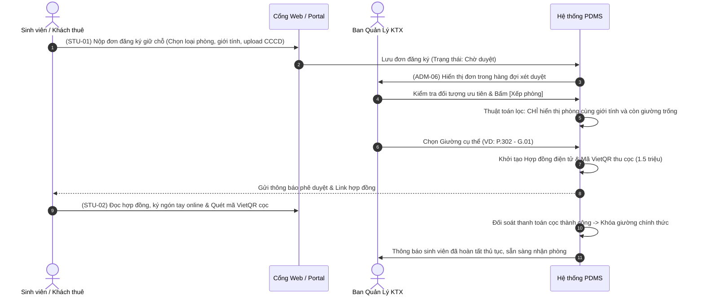
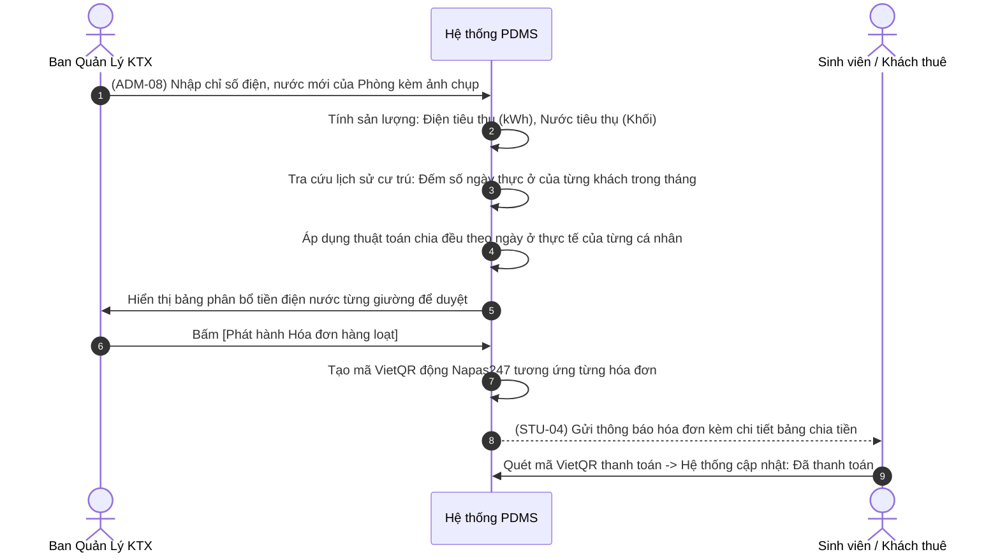
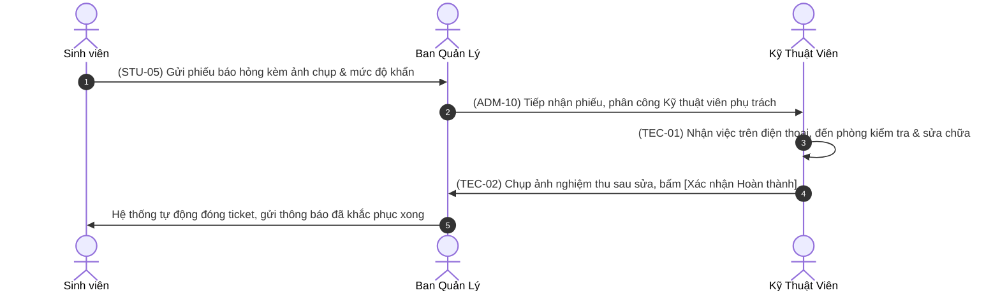
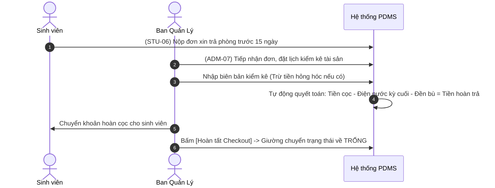

# ĐẶC TẢ CHI TIẾT GIAO DIỆN & LUỒNG NGHIỆP VỤ (UI/UX SPECIFICATION)
## HỆ THỐNG QUẢN LÝ KÝ TÚC XÁ TƯ NHÂN (PDMS - PRIVATE DORMITORY MANAGEMENT SYSTEM)

> **Mục tiêu tài liệu:** Cung cấp đặc tả kiến trúc màn hình, sơ đồ cấu trúc (wireframe layout), các trường dữ liệu, trạng thái giao diện và luồng xử lý (User Flows) chi tiết để **AI Coding Agent / Frontend Developer** có thể đọc và hiện thực hóa giao diện chính xác 100% theo tài liệu SRS ([TÀI LIỆU SRS QUẢN LÝ KTX SINH VIÊN.pdf](file:///d:/Quan_ly_ktx/T%C3%80I%20LI%E1%BB%86U%20SRS%20QU%E1%BA%A2N%20L%C3%9D%20KTX%20SINH%20VI%C3%8AN(1).pdf)) và hệ thống thiết kế [MASTER (1).md](file:///d:/Quan_ly_ktx/MASTER%20(1).md).

---

## PHẦN 1: TỔNG QUAN KIẾN TRÚC MÀN HÌNH (SITEMAP & SCREEN INVENTORY)

Hệ thống phục vụ **3 nhóm tác nhân chính** với 3 không gian làm việc chuyên biệt:

```mermaid
graph TD
    A[Hệ thống Quản lý Ký túc xá - PDMS] --> B[Phân hệ 1: Ban Quản Lý & Chủ KTX<br>Desktop Web Dashboard]
    A --> C[Phân hệ 2: Cổng Sinh Viên / Khách Thuê<br>Mobile Web Responsive]
    A --> D[Phân hệ 3: Kỹ Thuật Viên Vận Hành<br>Mobile/Tablet Web]

    B --> B1[ADM-01: Đăng nhập & Quên mật khẩu]
    B --> B2[ADM-02: Tổng quan Dashboard & KPI]
    B --> B3[ADM-03: Sơ đồ ma trận Phòng & Giường]
    B --> B4[ADM-04: Quản lý Danh mục Phòng & Tiện nghi]
    B --> B5[ADM-05: Quản lý Hồ sơ Sinh viên & Cư trú]
    B --> B6[ADM-06: Tiếp nhận Đơn & Xếp phòng]
    B --> B7[ADM-07: Hợp đồng, Đổi phòng & Checkout]
    B --> B8[ADM-08: Chốt Điện Nước & Phân bổ theo ngày]
    B --> B9[ADM-09: Quản lý Hóa đơn & Đối soát VietQR]
    B --> B10[ADM-10: Điều phối Sự cố & Kỷ luật]
    B --> B11[ADM-11: Báo cáo Thống kê & Xuất dữ liệu]
    B --> B12[ADM-12: Quản trị Tài khoản & Phân quyền RBAC]

    C --> C1[STU-01: Đăng ký Giữ chỗ Trực tuyến]
    C --> C2[STU-02: Ký Hợp đồng Điện tử & Nộp cọc]
    C --> C3[STU-03: Trang chủ Cổng Sinh viên & Thẻ phòng]
    C --> C4[STU-04: Chi tiết Tiền phòng & Hóa đơn VietQR]
    C --> C5[STU-05: Báo hỏng Thiết bị kèm Ảnh]
    C --> C6[STU-06: Đơn Xin Đổi phòng / Gia hạn / Trả phòng]
    C --> C7[STU-07: Hộp thư Thông báo & Biên bản Vi phạm]

    D --> D1[TEC-01: Danh sách Phiếu sửa chữa cần làm]
    D --> D2[TEC-02: Cập nhật Tiến độ & Nghiệm thu Sự cố]
```



---

## PHẦN 2: ĐẶC TẢ CHI TIẾT MÀN HÌNH PHÂN HỆ BAN QUẢN LÝ (DESKTOP WEB)

### ADM-01: Màn hình Đăng nhập & Xác thực Quản trị
- **Mã Use Case liên kết:** UC-35, UC-36, UC-38, UC-39 | FR-27, FR-28, FR-30
- **Bố cục Layout:** Hai cột (Split screen). Cột trái là hình ảnh thương hiệu KTX tông xanh dương hiện đại kèm câu slogan, cột phải là Form đăng nhập nền trắng sạch sẽ.
- **Thành phần & Trường dữ liệu:**
  - *Input 1:* Tên đăng nhập / Email quản lý (`autofocus`, kiểm tra định dạng email).
  - *Input 2:* Mật khẩu (kèm icon ẩn/hiện mật khẩu).
  - *Checkbox:* "Ghi nhớ đăng nhập trên thiết bị này".
  - *Link:* "Quên mật khẩu?" -> Mở modal yêu cầu nhập Email để nhận OTP xác thực 6 số.
  - *Nút chính:* "Đăng nhập vào Hệ thống" (`--brand-600`, loading spinner khi xác thực).
- **Trạng thái & Validation:**
  - Lỗi sai mật khẩu: Alert đỏ `--danger-600` ở đầu form ("Tên đăng nhập hoặc mật khẩu không chính xác").
  - Quên mật khẩu: Luồng 3 bước (Nhập email -> Nhập mã OTP 6 số -> Thiết lập mật khẩu mới có xác nhận).

---

### ADM-02: Bảng Điều Khiển Tổng Quan (Dashboard & KPI Analytics)
- **Mã Use Case liên kết:** UC-29, UC-30, UC-31, UC-32 | FR-23, FR-24
- **Bố cục Layout:** 
  - Hàng trên: 4 Thẻ KPI thống kê chính.
  - Hàng giữa: Biểu đồ Tỷ lệ lấp đầy (Bullet/Donut Chart) + Biểu đồ Doanh thu thu tiền (Bar Chart).
  - Hàng dưới: Hai bảng tóm tắt: Danh sách cảnh báo nợ quá hạn + Yêu cầu sửa chữa khẩn cấp.
- **Thành phần & Dữ liệu chi tiết:**
  - **4 KPI Cards:**
    1. *Tổng số giường & Tỷ lệ lấp đầy:* Ví dụ: `158/180 giường (87.7%)` kèm tag tăng `+3.2%` so với tháng trước.
    2. *Doanh thu dự kiến tháng này:* `145,200,000 đ` (đã thu 65%, chưa thu 35%).
    3. *Hóa đơn nợ quá hạn:* `12 sinh viên` (Tổng nợ: `18,400,000 đ` - badge cảnh báo đỏ).
    4. *Sự cố cần sửa chữa:* `4 phiếu mới` (2 phiếu khẩn cấp - badge vàng).
  - **Bộ lọc thời gian:** Dropdown chọn Tháng/Năm, chọn Chi nhánh/Tòa nhà.
  - **Phím tắt hành động nhanh (Quick Action Bar):** Nút [Xếp phòng nhanh], [Ghi chỉ số điện nước], [Tạo phiếu thu], [Lập biên bản].

---

### ADM-03: Sơ Đồ Ma Trận Trực Quan Phòng & Giường (Room & Bed Grid Matrix)
- **Mã Use Case liên kết:** UC-01, UC-06, UC-10, UC-13 | FR-01, FR-08, FR-11
- **Mục tiêu cốt lõi:** Giải quyết **Bài toán #1 và #3** (Quản lý đến từng vị trí giường & Cách ly giới tính 100%).
- **Bố cục Layout:**
  - Thanh công cụ trên: Thanh tìm kiếm nhanh (số phòng/tên sinh viên) + Bộ lọc Tầng (Tầng 1..5) + Bộ lọc Giới tính (Tất cả, Nam, Nữ) + Bộ lọc Tình trạng (Còn chỗ, Đã đầy, Bảo trì).
  - Vùng chính: Lưới thẻ phòng (Grid layout 3 hoặc 4 cột).
  - Cột trượt bên phải (Slide-over Drawer): Xuất hiện khi nhấp vào một phòng cụ thể.
- **Cấu trúc Thẻ Phòng (Room Card Component):**
  - Header thẻ: Số phòng (VD: `P.302`), Badge phân loại giới tính (`Phòng Nam` - Nền xanh nhạt, hoặc `Phòng Nữ` - Nền hồng/cam nhạt), Đơn giá/tháng.
  - Thước đo sức chứa: Progress bar mini hiển thị `4/6 Giường`.
  - Ma trận các vị trí giường nhỏ bên trong thẻ (Mini Bed Slots):
    - Giường có người ở: Màu xanh dương kèm tên viết tắt của sinh viên.
    - Giường trống: Màu viền nét đứt màu xám kèm dấu `+` để xếp phòng nhanh.
    - Giường bảo trì: Biểu tượng cờ lê màu cam.
- **Cấu trúc Slide-over Drawer (Chi tiết Phòng & Giường):**
  - Tiêu đề: `Chi tiết Phòng 302 - Tòa A (Tầng 3)`.
  - Danh sách từng giường (Giường 01 đến 06):
    - Ảnh đại diện sinh viên, Họ tên, MSSV, Khoa/Ngành, Số điện thoại.
    - Ngày bắt đầu ở, Ngày hết hạn hợp đồng, Tình trạng công nợ (Đã nộp / Nợ).
    - Nút thao tác nhanh trên giường: [Đổi phòng], [Checkout/Trả giường], [Xem hợp đồng].
  - Danh mục tiện nghi phòng: Điều hòa 1.5HP, Tủ lạnh, Bình nóng lạnh, Bàn học riêng.

---

### ADM-04: Quản Lý Danh Mục Phòng & Tiện Nghi
- **Mã Use Case liên kết:** UC-02, UC-03, UC-04, UC-05 | FR-02, FR-03, FR-04, FR-05
- **Bố cục Layout:** Bảng dữ liệu quản trị (Data Table) chuẩn SaaS.
- **Các cột hiển thị:**
  1. Số phòng (P.101, P.102...)
  2. Tầng (Tầng 1, 2, 3...)
  3. Loại phòng (Phòng 4 giường, 6 giường, 8 giường, Sleepbox riêng tư)
  4. Phân loại giới tính (Nam / Nữ)
  5. Đơn giá thuê giường / tháng (VNĐ)
  6. Số giường trống / Tổng số giường
  7. Danh mục tiện nghi (Chips tag: Máy lạnh, Tủ đồ, Nóng lạnh...)
  8. Trạng thái (Trống, Đang ở, Bảo trì, Hỏng hóc)
  9. Thao tác (Sửa, Đổi trạng thái, Xóa)
- **Modal Thêm / Cập nhật phòng:**
  - Nhập số phòng, chọn tầng, chọn loại phòng & giới tính quy định.
  - Số lượng giường (hệ thống tự sinh danh sách Giường 01..n).
  - Đơn giá thuê tiêu chuẩn.
  - Checkbox danh mục tiện nghi có sẵn.
- **Ràng buộc nghiệp vụ quan trọng (FR-04):** Nút [Xóa phòng] bị vô hiệu hóa (disabled) nếu phòng đang có ít nhất 1 sinh viên cư trú hoặc còn hợp đồng hiệu lực.

---

### ADM-05: Quản Lý Hồ Sơ Sinh Viên & Cư Trú
- **Mã Use Case liên kết:** UC-07, UC-08, UC-09 | FR-06, FR-07, FR-08
- **Bố cục Layout:** Bảng dữ liệu sinh viên có thanh lọc nhiều chiều (Search bar, Dropdown Khoa, Lọc theo Phòng, Lọc theo Tình trạng cư trú).
- **Các cột dữ liệu:**
  1. MSSV (Phông `JetBrains Mono`)
  2. Họ và tên (kèm Avatar nhỏ)
  3. Giới tính & Ngày sinh
  4. Số điện thoại & Email
  5. Số CCCD/CMND (kèm link xem ảnh scan 2 mặt)
  6. Trường / Khoa / Khóa học
  7. Phòng & Giường đang ở (VD: `P.304 - Giường 02`)
  8. Trạng thái hồ sơ (`Đang cư trú`, `Chờ xếp phòng`, `Đã rời KTX`)
  9. Thao tác: [Xem chi tiết hồ sơ], [Cập nhật thông tin], [Đóng hồ sơ/Rời đi]
- **Modal Chi tiết Sinh viên:** Gồm 3 Tabs:
  - *Tab 1: Thông tin cá nhân & Giấy tờ:* CCCD, ảnh thẻ, người liên hệ khẩn cấp (Bố/Mẹ, SĐT, Địa chỉ thường trú).
  - *Tab 2: Hợp đồng & Tiền cọc:* Mã hợp đồng, số tiền cọc đang giữ, biên bản bàn giao chìa khóa/thẻ từ.
  - *Tab 3: Lịch sử vi phạm & Sự cố:* Các biên bản trừ điểm, báo cáo đóng tiền muộn.

---

### ADM-06: Tiếp Nhận Đơn Đăng Ký & Xếp Phòng (Allocation Engine)
- **Mã Use Case liên kết:** UC-11, UC-12, UC-13, UC-15 | FR-09, FR-10, FR-11, FR-12
- **Mục tiêu cốt lõi:** Giải quyết **Bài toán #3** (Cách ly giới tính 100%) và tự động sinh hợp đồng cọc (**Bài toán #4**).
- **Bố cục Layout:** 2 phần:
  - Nửa trên: Bảng danh sách đơn đăng ký chờ duyệt (Sắp xếp theo thứ tự ưu tiên: Con thương binh liệt sĩ, Hộ nghèo, Sinh viên năm nhất xa nhà).
  - Nửa dưới: Bảng điều khiển phân bổ giường thông minh (Smart Bed Matcher).
- **Quy tắc Kiểm soát Phân bổ (Validation Rule - FR-11):**
  - Khi quản lý bấm [Xếp phòng] cho sinh viên Nữ -> Hệ thống **chỉ hiển thị các phòng Nữ còn giường trống**.
  - Tuyệt đối khóa không cho chọn phòng có giới tính ngược lại (Ngăn chặn 100% việc xếp nhầm giới tính).
- **Hành động sau khi Xếp phòng thành công (FR-12):**
  - Tự động chuyển trạng thái đơn sang `Đã phê duyệt`.
  - Hệ thống tự động khởi tạo **Dự thảo Hợp đồng điện tử** và **Mã VietQR thu tiền cọc** gửi qua tài khoản/email của sinh viên.

---

### ADM-07: Quản Lý Hợp Đồng, Đổi Phòng & Thanh Lý Checkout
- **Mã Use Case liên kết:** UC-15, UC-16, UC-17, UC-18 | FR-13, FR-14, FR-15, FR-16
- **Bố cục Layout:** Quản lý theo 3 phân loại tab:
  - *Tab 1: Hợp đồng đang hiệu lực:* Danh sách hợp đồng, thời hạn kết thúc, cảnh báo hợp đồng sắp hết hạn (<15 ngày) để gửi thông báo mời gia hạn (UC-16).
  - *Tab 2: Đơn xin chuyển phòng (UC-18):* Xem lý do sinh viên xin đổi (mâu thuẫn thói quen sinh hoạt, chuyển tầng...), gợi ý giường trống phù hợp cùng giới tính để phê duyệt.
  - *Tab 3: Quy trình Trả phòng & Thanh lý cọc (Checkout - UC-17):*
    - **Form kiểm kê tài sản bàn giao:** Bàn giao chìa khóa, kiểm tra giường, đệm, tủ đồ (Hao mòn bình thường vs Hư hỏng bắt đền bù).
    - **Quyết toán chi phí:** Tiền cọc ban đầu - Tiền điện nước kỳ cuối - Tiền bồi thường hỏng hóc = **Số tiền cọc thực hoàn**.
    - Nút [Xác nhận Hoàn cọc & Đóng hồ sơ] -> Trạng thái giường tự động chuyển về `Trống` (FR-16).

---

### ADM-08: Chốt Chỉ Số Điện Nước & Thuật Toán Phân Bổ Theo Ngày
- **Mã Use Case liên kết:** FR-17 | **Giải quyết Bài toán cốt lõi #2 của SRS**
- **Đặc tả thuật toán:** Trong KTX, khách vào/ra lệch pha (người ở đủ 30 ngày, người mới vào ở 12 ngày, người checkout giữa tháng ở 18 ngày). Tiền điện nước chung của phòng phải được tính công bằng theo công thức:
  $$\text{Đơn giá ngày của phòng} = \frac{\text{Tổng tiền điện nước phòng}}{\sum (\text{Số ngày thực tế ở của từng khách})}$$
  $$\text{Tiền khách phải trả} = \text{Đơn giá ngày} \times \text{Số ngày khách thực tế ở trong tháng}$$
- **Giao diện Chốt số định kỳ:**
  - Nhập chỉ số: Chọn Phòng -> Nhập [Chỉ số điện mới], [Chỉ số nước mới] (kèm upload ảnh chụp đồng hồ để làm minh chứng).
  - Hệ thống tự tính: Sản lượng tiêu thụ (kWh, Khối) = Chỉ số mới - Chỉ số cũ.
  - Bảng tính phân bổ tự động (Preview):
    - Cột 1: Tên sinh viên & Vị trí giường
    - Cột 2: Ngày bắt đầu tính - Ngày kết thúc
    - Cột 3: Số ngày thực tế ở (VD: 30 ngày, 14 ngày)
    - Cột 4: Tiền điện phân bổ (VNĐ)
    - Cột 5: Tiền nước phân bổ (VNĐ)
    - Cột 6: Tiền dịch vụ chung (Wifi, rác, vệ sinh)
    - Cột 7: Tổng cộng
  - Nút [Phê duyệt & Phát hành hóa đơn hàng loạt].

---

### ADM-09: Quản Lý Hóa Đơn & Đối Soát Thanh Toán VietQR
- **Mã Use Case liên kết:** UC-42, UC-43 | FR-17, FR-18
- **Bố cục Layout:** Bảng danh sách hóa đơn theo tháng (Hóa đơn tiền phòng định kỳ, Hóa đơn tiền cọc giữ chỗ, Hóa đơn tiền bồi thường hỏng hóc).
- **Các cột dữ liệu:**
  1. Mã hóa đơn (VD: `INV-202610-P302-01`)
  2. Sinh viên & Phòng/Giường
  3. Tiền phòng (VNĐ)
  4. Tiền điện + nước + dịch vụ (VNĐ)
  5. Tổng tiền cần thu
  6. Hạn nộp tiền
  7. Trạng thái thanh toán (`Đã thanh toán` - Xanh lá, `Chờ thanh toán` - Vàng, `Quá hạn` - Đỏ)
  8. Thao tác: [Xem chi tiết], [Xem mã VietQR], [Gửi thông báo nhắc nợ] (UC-33/FR-33), [Hủy hóa đơn]
- **Drawer Chi Tiết Hóa Đơn:** Hiển thị chi tiết bảng tính phân bổ điện nước, mã QR thanh toán động VietQR Napas247 chứa sẵn nội dung chuyển khoản theo cú pháp chuẩn (VD: `KTX P302 G01 THANG10`).

---

### ADM-10: Điều Phối Sự Cố & Quản Lý Kỷ Luật Nội Quy
- **Mã Use Case liên kết:** UC-20, UC-21, UC-22, UC-23 | FR-19, FR-20, FR-21, FR-22
- **Màn hình gồm 2 phân khu chính:**
  - **Phân khu 1: Điều phối Sửa chữa Sự cố (Maintenance Tickets):**
    - Danh sách ticket do sinh viên gửi lên: Mã ticket, Phòng bị hỏng, Mô tả sự cố, Ảnh hiện trạng, Mức độ khẩn cấp (Khẩn / Bình thường / Thấp).
    - Thao tác tiếp nhận: Chọn Nhân viên kỹ thuật phụ trách từ Dropdown -> Bấm [Giao việc].
    - Theo dõi tiến độ: `Mới tiếp nhận` -> `Đang xử lý` -> `Chờ nghiệm thu` -> `Hoàn thành`.
  - **Phân khu 2: Quản lý Vi phạm Nội quy & Kỷ luật (Incident / Discipline):**
    - Bảng danh sách biên bản vi phạm: Ngày vi phạm, Sinh viên, Phòng, Lỗi vi phạm (Hút thuốc, Dẫn người lạ vào phòng, Mất trật tự quá 23h, Nấu ăn sai quy định).
    - Nút [Lập biên bản mới]: Upload ảnh chụp bằng chứng, chọn hình thức xử phạt (Nhắc nhở, Trừ điểm rèn luyện, Phạt tiền bổ sung vào hóa đơn tới).

---

### ADM-11: Báo Cáo & Phân Tích Thống Kê (Reporting & Data Export)
- **Mã Use Case liên kết:** UC-29, UC-30, UC-31, UC-32, UC-33, UC-34 | FR-23, FR-24, FR-25, FR-26
- **Các báo cáo chuyên sâu:**
  1. *Báo cáo Doanh thu & Dòng tiền:* Tổng thu tiền phòng, tiền điện, tiền nước theo tháng/quý/năm.
  2. *Báo cáo Tỷ lệ Lấp đầy Giường (Occupancy Report):* Phân tích số giường trống theo tầng, tỷ lệ khai thác bình quân.
  3. *Báo cáo Phân tích Hao tổn Điện Nước (Utility Anomaly):* Cảnh báo các phòng có sản lượng điện nước tăng đột biến bất thường (nhận diện rò rỉ nước hoặc dùng thiết bị cấm).
  4. *Danh sách Công nợ Quá hạn:* Sinh viên chậm nộp tiền quá 5 ngày, quá 10 ngày.
- **Tính năng Xuất dữ liệu (FR-26):** Nút [Xuất file Excel] và [Xuất báo cáo PDF] cho toàn bộ bảng biểu.

---

### ADM-12: Quản Trị Hệ Thống & Phân Quyền (RBAC Management)
- **Mã Use Case liên kết:** UC-37 | FR-29
- **Phân cấp vai trò rõ ràng:**
  - *Chủ cơ sở (Super Admin):* Toàn quyền xem tài chính, cấu hình đơn giá, phân quyền tài khoản.
  - *Quản lý KTX (Manager):* Quản lý phòng, xếp giường, duyệt hợp đồng, chốt điện nước, lập biên bản.
  - *Nhân viên Kỹ thuật (Technician):* Chỉ xem và cập nhật các phiếu báo hỏng được giao.
  - *Sinh viên (Student):* Chỉ xem cổng tự phục vụ cá nhân.
- **Thao tác quản lý:** Thêm tài khoản nhân viên mới, phân vai trò, Tạm khóa / Kích hoạt lại tài khoản.

---

## PHẦN 3: ĐẶC TẢ CHI TIẾT MÀN HÌNH PHÂN HỆ SINH VIÊN (MOBILE WEB)

Giao diện được thiết kế theo tư duy **Mobile-first**, tối ưu hoàn hảo cho thao tác trên màn hình điện thoại (375px – 430px), giao diện thẻ trực quan và phím bấm lớn dễ chạm.

---

### STU-01: Màn hình Đăng Ký Giữ Chỗ Trực Tuyến (Public Form)
- **Mã Use Case liên kết:** UC-11 | FR-09
- **Bố cục:** Biểu mẫu 3 bước (Wizard flow):
  - *Bước 1: Chọn nguyện vọng lưu trú:* Chọn Tòa nhà, Loại phòng (4/6/8 giường hoặc Sleepbox), Giới tính (Nam/Nữ), Kỳ học dự kiến ở.
  - *Bước 2: Thông tin cá nhân:* Họ tên, Ngày sinh, Số điện thoại, Email, Trường đại học, Mã sinh viên, Số CCCD, Địa chỉ quê quán, Người liên hệ khẩn cấp.
  - *Bước 3: Diện ưu tiên & Giấy tờ:* Chọn diện ưu tiên (nếu có: Con thương binh, hộ nghèo...) kèm chụp/tải ảnh minh chứng + Chụp 2 mặt CCCD.
- **Nút gửi:** [Gửi đơn đăng ký] -> Hiển thị màn hình thành công kèm mã tra cứu đơn (`APP-XXXXXX`).

---

### STU-02: Ký Hợp Đồng Điện Tử & Nộp Cọc Giữ Chỗ (E-Contract & Deposit)
- **Mã Use Case liên kết:** UC-13, UC-15 | FR-12, FR-13
- **Bố cục Layout:**
  - Header: Trạng thái: `Đơn đã được duyệt - Phòng P.302 - Giường 03`.
  - Khung nội dung hợp đồng: Cuộn xem đầy đủ các điều khoản hợp đồng thuê KTX, quy định giờ giấc, tiền đặt cọc giữ chỗ (`1,500,000 đ`).
  - Hộp kiểm xác nhận: Checkbox "Tôi đã đọc và đồng ý 100% với các điều khoản nội quy".
  - Chữ ký điện tử: Khung ký tên ngón tay trên màn hình cảm ứng (Canvas signature).
  - Khung thanh toán nộp cọc: Hiển thị ngay **Mã VietQR động** có logo ngân hàng, số tiền và nội dung chuyển khoản chính xác. Sinh viên chỉ cần nhấn nút [Tải ảnh QR] hoặc [Mở App Ngân hàng] để thanh toán.

---

### STU-03: Trang Chủ Cổng Sinh Viên & Thẻ Phòng Của Tôi
- **Mã Use Case liên kết:** UC-40, UC-44 | FR-31, FR-33
- **Bố cục Layout:**
  - **Thanh tiêu đề:** Lời chào cá nhân ("Xin chào, Nguyễn Văn A"), Avatar và Chuông thông báo (chấm đỏ nếu có thông báo mới).
  - **Thẻ phòng của tôi (My Room Hero Card):** 
    - Nền xanh dương dịu `--brand-50`, viền `--brand-200`.
    - Thông tin: `Phòng 302 - Giường số 02 (Tầng 3 - Tòa A)`.
    - Hạn hợp đồng hiện tại: Còn `45 ngày`.
    - Danh sách bạn cùng phòng: Avatar và tên 5 bạn cùng phòng (giúp sinh viên dễ kết nối, biết ai đang ở giường nào).
  - **Thẻ trạng thái công nợ tháng này:**
    - Nếu đã đóng: Badge xanh lá `Đã hoàn tất thanh toán`.
    - Nếu chưa đóng: Hiển thị số tiền nợ màu đỏ nổi bật kèm nút [Thanh toán ngay bằng QR].
  - **Lối tắt 4 hành động nhanh (Quick Action Icons 2x2):**
    1. [Hóa đơn & Tiền phòng]
    2. [Báo hỏng vật tư]
    3. [Đổi phòng / Gia hạn]
    4. [Nội quy KTX]

---

### STU-04: Chi Tiết Tiền Phòng & Hóa Đơn Điện Nước Theo Ngày
- **Mã Use Case liên kết:** UC-42, UC-43 | FR-17, FR-18
- **Mục tiêu:** Minh bạch tuyệt đối cách tính tiền điện nước theo số ngày thực ở để tránh thắc mắc.
- **Bố cục Layout:**
  - Thẻ thông tin kỳ thanh toán: `Hóa đơn Tháng 10/2026`.
  - Bảng kê chi tiết từng khoản mục:
    - Tiền thuê phòng: `1,200,000 đ`
    - Tiền điện (Chỉ số: 1,420 -> 1,650 = 230 kWh): Được phân bổ theo 30 ngày ở = `185,000 đ`
    - Tiền nước (Chỉ số: 85 -> 97 = 12 khối): Phân bổ theo 30 ngày ở = `60,000 đ`
    - Tiền dịch vụ chung (Wifi tốc độ cao, Rác, Vệ sinh hành lang): `80,000 đ`
    - **Tổng số tiền cần thanh toán:** `1,525,000 đ`
  - Khu vực thanh toán quét mã VietQR:
    - Mã VietQR động tạo tự động từ Napas247.
    - Nút [Sao chép số tài khoản], [Sao chép nội dung], [Lưu mã QR vào thư viện ảnh].

---

### STU-05: Gửi Yêu Cầu Sửa Chữa / Báo Hỏng Vật Tư
- **Mã Use Case liên kết:** UC-19, UC-24 | FR-19
- **Bố cục Layout:**
  - Dropdown chọn vị trí hỏng: `Tại giường của tôi` hoặc `Khu vực chung trong phòng` (Bóng đèn tuýp, Vòi sen, Quạt trần, Điều hòa, Khóa cửa...).
  - Mức độ khẩn cấp: 3 tùy chọn (Bình thường / Cần gấp / Khẩn cấp nguy hiểm rò rỉ điện nước).
  - Ô nhập mô tả chi tiết: "Vòi xịt nước bị rò rỉ làm ướt sàn phòng tắm".
  - Nút tải ảnh / Chụp ảnh: Chụp trực tiếp bằng camera điện thoại hiện trạng hư hỏng (tối đa 3 ảnh).
  - Danh sách phiếu đã gửi & Timeline theo dõi:
    - Phiếu #102: `Đã tiếp nhận` -> `Kỹ thuật viên đang đến` -> `Đã sửa xong`.

---

### STU-06: Đơn Xin Đổi Phòng / Gia Hạn Hợp Đồng / Trả Phòng
- **Mã Use Case liên kết:** UC-14, UC-16, UC-17, UC-18 | FR-14, FR-15, FR-16
- **Gồm 3 chức năng con qua Segmented Control:**
  - *Tab Gia hạn (UC-14):* Chọn số tháng muốn gia hạn cho kỳ học mới (3 tháng, 6 tháng, 1 năm).
  - *Tab Đổi phòng (UC-18):* Chọn lý do đổi phòng, nguyện vọng chuyển sang tầng nào hoặc loại phòng nào khác.
  - *Tab Trả phòng (Checkout - UC-17):* Chọn ngày dự kiến rời đi (báo trước tối thiểu 15 ngày theo quy định), nhập số tài khoản ngân hàng để KTX hoàn trả tiền cọc sau khi kiểm kê.

---

### STU-07: Hộp Thư Thông Báo & Lịch Sử Vi Phạm Kỷ Luật
- **Mã Use Case liên kết:** UC-22, UC-44 | FR-22, FR-33
- **Danh sách thông báo phân theo nhóm màu:**
  - *Thông báo tài chính (Xanh dương):* Nhắc phát hành hóa đơn mới, xác nhận đã nhận tiền thành công.
  - *Thông báo vận hành (Cam/Xanh lá):* Lịch bảo dưỡng điều hòa, phun thuốc khử côn trùng, lịch cúp điện nước định kỳ.
  - *Thông báo kỷ luật (Đỏ):* Chi tiết biên bản vi phạm nội quy kèm hình ảnh nếu có, số điểm rèn luyện bị trừ và tiền phạt bổ sung.

---

## PHẦN 4: ĐẶC TẢ CHI TIẾT MÀN HÌNH NHÂN VIÊN KỸ THUẬT (MOBILE/TABLET)

### TEC-01: Danh Sách Nhiệm Vụ Sửa Chữa (Work Orders Queue)
- **Mã Use Case liên kết:** UC-20, UC-21 | FR-20, FR-21
- **Bố cục Layout:** Thẻ danh sách công việc sắp xếp theo độ ưu tiên:
  - Thẻ đỏ trên cùng: Các sự cố khẩn cấp (Chập điện, vỡ ống nước).
  - Thẻ vàng: Hỏng điều hòa, bóng đèn.
  - Mỗi thẻ hiển thị: Mã phòng (VD: `Phòng 401`), Vị trí cụ thể, Tên sự cố, Người báo hỏng, Thời gian chờ xử lý.
  - Nút bấm nhanh trên thẻ: [Nhận việc ngay] -> Chuyển trạng thái sang `Đang tiến hành sửa chữa`.

---

### TEC-02: Chi Tiết Xử Lý & Nghiệm Thu Hoàn Thành
- **Mã Use Case liên kết:** UC-21, UC-26 | FR-21
- **Bố cục Layout:**
  - Xem ảnh hiện trạng hỏng hóc do sinh viên chụp.
  - Nhập biên bản sửa chữa: Nội dung đã xử lý (Thay tụ điều hòa, thay vòi sen...).
  - Chi phí vật tư thay thế phát sinh (nếu có).
  - Chụp ảnh kết quả nghiệm thu sau khi sửa xong.
  - Nút [Xác nhận Đã hoàn thành sửa chữa] -> Tự động gửi thông báo đến Ban Quản lý và Sinh viên để đóng phiếu.

---

## PHẦN 5: CÁC LUỒNG NGHIỆP VỤ CỐT LÕI (END-TO-END WORKFLOWS)

### Luồng 1: Vòng Đời Tiếp Nhận Sinh Viên & Xếp Phòng Cách Ly Giới Tính (Bed-Level & Gender-Strict)



---

### Luồng 2: Chốt Điện Nước & Phân Bổ Tiền Theo Ngày Thực Ở



---

### Luồng 3: Quy Trình Báo Hỏng Vật Tư & Nghiệm Thu Sửa Chữa



---

### Luồng 4: Quy Trình Trả Phòng & Quyết Toán Tiền Cọc (Checkout)



---

## PHẦN 6: MA TRẬN ÁNH XẠ CHỨC NĂNG (USE CASE TRACEABILITY MATRIX)

Đối soát 100% đầy đủ 44 Use Cases trong tài liệu SRS tương ứng với các màn hình đã thiết kế:

| Mã UC | Tên Use Case trong SRS | Phân hệ & Mã màn hình | Tác nhân chính | Ghi chú nghiệp vụ |
|-------|------------------------|------------------------|----------------|-------------------|
| **UC-01** | Xem danh sách phòng | ADM-03, ADM-04 | Quản lý KTX | Xem tầng, loại phòng, sức chứa, trạng thái |
| **UC-02** | Thêm phòng mới | ADM-04 | Quản lý KTX | Nhập số phòng, giá thuê, tiện nghi, giường |
| **UC-03** | Cập nhật thông tin phòng | ADM-04 | Quản lý KTX | Sửa giá, tiện nghi, quy định giới tính |
| **UC-04** | Xóa phòng | ADM-04 | Quản lý KTX | Chỉ xóa khi phòng trống và không có hợp đồng |
| **UC-05** | Cập nhật tình trạng phòng | ADM-03, ADM-04 | Quản lý KTX | Trống, Đang ở, Bảo trì, Hỏng hóc |
| **UC-06** | Tìm kiếm & lọc phòng | ADM-03, ADM-04 | Quản lý KTX | Lọc theo số phòng, tầng, tình trạng, giới tính |
| **UC-07** | Cập nhật thông tin SV | ADM-05 | Quản lý KTX | Sửa SĐT, CCCD, khoa, liên hệ khẩn cấp |
| **UC-08** | Xóa / Đóng hồ sơ SV | ADM-05, ADM-07 | Quản lý KTX | Đóng hồ sơ sau khi hoàn tất checkout |
| **UC-09** | Tìm kiếm sinh viên | ADM-05 | Quản lý KTX | Tìm theo MSSV, họ tên, phòng đang ở |
| **UC-10** | Xem danh sách SV theo phòng | ADM-03, ADM-05 | Quản lý KTX | Xem toàn bộ sinh viên đang ở chung phòng |
| **UC-11** | Đăng ký ở KTX trực tuyến | STU-01 | Sinh viên | Điền đơn chọn loại phòng, thời gian, diện ưu tiên |
| **UC-12** | Duyệt đơn đăng ký | ADM-06 | Quản lý KTX | Kiểm tra đối tượng ưu tiên, phê duyệt/từ chối |
| **UC-13** | Xếp phòng | ADM-03, ADM-06 | Quản lý KTX | Phân bổ vào giường cụ thể, cách ly giới tính 100% |
| **UC-15** | Ký hợp đồng điện tử & nộp cọc | STU-02 | Sinh viên | Ký online, quét VietQR nộp cọc giữ chỗ |
| **UC-16** | Gia hạn hợp đồng | ADM-07, STU-06 | Sinh viên & QL | Gửi đơn và xét duyệt gia hạn cư trú kỳ tới |
| **UC-17** | Thanh lý hợp đồng (Checkout) | ADM-07, STU-06 | Sinh viên & QL | Kiểm kê tài sản, hoàn cọc, mở khóa giường |
| **UC-18** | Chuyển phòng | ADM-07, STU-06 | Sinh viên & QL | Xử lý yêu cầu đổi phòng khi còn chỗ trống |
| **UC-19** | Gửi yêu cầu sửa chữa | STU-05 | Sinh viên | Tạo phiếu kèm ảnh, mô tả sự cố, độ khẩn cấp |
| **UC-20** | Tiếp nhận & Điều phối sửa chữa | ADM-10 | Quản lý KTX | Giao việc cho nhân viên kỹ thuật phù hợp |
| **UC-21** | Cập nhật tiến độ bảo trì | TEC-02 | Nhân viên KT | Cập nhật tiến độ, ảnh nghiệm thu hoàn thành |
| **UC-22** | Lập biên bản vi phạm | ADM-10 | Quản lý KTX | Ghi nhận lỗi vi phạm nội quy kèm ảnh bằng chứng |
| **UC-23** | Xử lý vi phạm | ADM-10 | Quản lý KTX | Áp dụng trừ điểm rèn luyện hoặc phạt tiền |
| **UC-24** | Gửi yêu cầu sửa chữa | STU-05 | Sinh viên | Định danh bổ sung theo SRS nhóm 5 |
| **UC-25** | Tiếp nhận & Điều phối sửa | ADM-10 | Quản lý KTX | Định danh bổ sung theo SRS nhóm 5 |
| **UC-26** | Cập nhật tiến độ bảo trì | TEC-02 | Nhân viên KT | Định danh bổ sung theo SRS nhóm 5 |
| **UC-27** | Lập biên bản vi phạm | ADM-10 | Quản lý KTX | Định danh bổ sung theo SRS nhóm 5 |
| **UC-28** | Xử lý vi phạm | ADM-10 | Quản lý KTX | Định danh bổ sung theo SRS nhóm 5 |
| **UC-29** | Báo cáo phòng trống | ADM-02, ADM-11 | Quản lý KTX | Thống kê số lượng phòng trống theo tầng/dãy |
| **UC-30** | Báo cáo doanh thu | ADM-02, ADM-11 | Quản lý KTX | Tổng thu tiền phòng, điện, nước theo kỳ |
| **UC-31** | Báo cáo sinh viên nợ phí | ADM-02, ADM-11 | Quản lý KTX | Liệt kê danh sách nợ quá hạn và số tiền |
| **UC-32** | Báo cáo tỷ lệ lấp đầy | ADM-02, ADM-11 | Quản lý KTX | Hiệu suất khai thác phòng và giường KTX |
| **UC-33** | Báo cáo tiêu thụ điện nước | ADM-11 | Quản lý KTX | Phát hiện điểm tiêu thụ điện nước bất thường |
| **UC-34** | Xuất báo cáo PDF/Excel | ADM-11 | Quản lý KTX | Xuất số liệu thống kê ra file tài liệu |
| **UC-35** | Đăng nhập hệ thống | ADM-01 | Mọi tác nhân | Đăng nhập bằng tài khoản/MSSV & mật khẩu |
| **UC-36** | Đăng xuất | ADM-01 | Mọi tác nhân | Kết thúc phiên làm việc an toàn |
| **UC-37** | Quản lý tài khoản & Phân quyền | ADM-12 | Quản trị viên | Cấp quyền RBAC, kích hoạt / khóa tài khoản |
| **UC-38** | Đổi mật khẩu | ADM-01, STU-03 | Mọi tác nhân | Tự đổi mật khẩu định kỳ trong profile |
| **UC-39** | Quên & Khôi phục mật khẩu | ADM-01 | Mọi tác nhân | Gửi mã OTP xác thực qua email để đặt lại |
| **UC-40** | Xem thông tin cá nhân | STU-03 | Sinh viên | Xem hồ sơ cá nhân và danh sách bạn cùng phòng |
| **UC-41** | Xem hợp đồng | STU-02, STU-03 | Sinh viên | Xem lại nội dung hợp đồng thuê KTX |
| **UC-42** | Xem hóa đơn | STU-04 | Sinh viên | Xem chi tiết điện, nước, phòng, hạn nộp |
| **UC-43** | Thanh toán Online | STU-04 | Sinh viên | Quét mã VietQR động Napas247 nộp tiền |
| **UC-44** | Xem thông báo | STU-07 | Sinh viên | Nhận tin nhắn nhắc nợ, lịch bảo dưỡng, kỷ luật |

---

## PHẦN 7: CHỈ DẪN KỸ THUẬT CHO AI AGENT KHI CODE GIAO DIỆN (DIRECTIVES FOR AI AGENT)

Khi AI Agent hoặc Developer bắt tay vào tạo mã nguồn (HTML/CSS/React/Vue/Tailwind), cần tuân thủ nghiêm ngặt các chỉ thị sau:

1. **Tuân thủ Design Tokens trong [MASTER (1).md](file:///d:/Quan_ly_ktx/MASTER%20(1).md):**
   - Màu chủ đạo: `--brand-600: #1D4ED8`, `--brand-50: #EFF6FF`.
   - Màu nền: `--slate-50: #F8FAFC`, bề mặt thẻ `--surface-white: #FFFFFF`.
   - Font chữ: Tiêu đề dùng `Plus Jakarta Sans`, nội dung dùng `Inter`, mã số phòng/MSSV dùng `JetBrains Mono`.
   - Đổ bóng: Sử dụng `--shadow-sm`, `--shadow-md` chuẩn phẳng hiện đại (tuyệt đối không dùng claymorphism cũ).
2. **Quy tắc Kiểm soát Phân bổ Giới tính trong Code (Gender Integrity):**
   - Trong component xếp phòng `RoomBedPicker`, luôn có hàm kiểm tra:
     ```javascript
     const canAssignToRoom = (studentGender, roomGenderPolicy) => {
       return studentGender === roomGenderPolicy;
     };
     ```
   - Nếu không trùng khớp, phòng phải bị `disabled` hoàn toàn kèm tooltip giải thích lý do.
3. **Quy tắc Tính tiền Điện Nước theo ngày (Prorated Utility Calculation):**
   - Cung cấp hàm tiện ích tính toán đúng theo thuật toán mô tả tại màn hình `ADM-08`.
4. **Quy tắc Component VietQR:**
   - Sử dụng định dạng URL chuẩn VietQR Napas:
     `https://img.vietqr.io/image/<BANK_ID>-<ACCOUNT_NO>-compact2.png?amount=<AMOUNT>&addInfo=<CONTENT>&accountName=<NAME>`
   - Đảm bảo hiển thị ảnh QR sắc nét trên nền trắng, có nút tải ảnh về máy.
5. **Tiêu chuẩn Tiếp cận (A11y):**
   - Không được dùng emoji làm icon điều hướng; sử dụng thư viện **Phosphor Icons** hoặc **Lucide Icons**.
   - Mọi nút bấm trên mobile phải có vùng bấm tối thiểu `44x44px`.
   - Mọi form gửi thất bại phải hiển thị `role="alert"` ở đầu trang.
